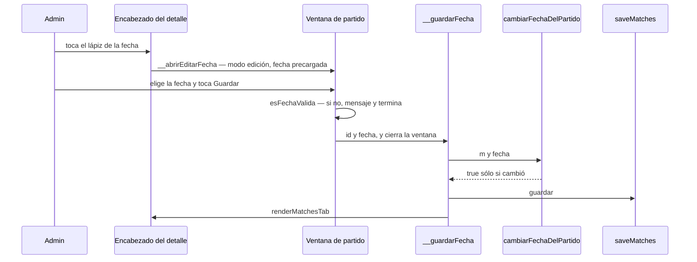
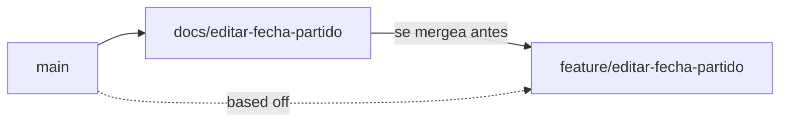

# Editar la fecha de un partido — Implementation Plan

> **Status:** Draft · **Date:** 2026-11-06 · **Owner:** Lucas Manoukian
>
> **Reviewers:** *pending*
>
> **Spec:** [EDITAR_FECHA_PARTIDO_SPEC.md](./EDITAR_FECHA_PARTIDO_SPEC.md)
>
> **Concept note:** [EDITAR_FECHA_PARTIDO_CONCEPT.md](./EDITAR_FECHA_PARTIDO_CONCEPT.md)

> **Grounding evidence (`MD-25`).** Este Plan se apoya en el ledger §6.5 del Concept Note y
> en las citas en línea de la Spec. Donde una tarea `T-N.*`, una decisión `TD-*` o una
> elección de módulo se apoya en una ubicación de código que ninguno de los dos cubre, la
> cita va en línea acá. Todas las líneas de `index.html` y de `tests/` citadas se leyeron el
> 2026-11-06 sobre `docs/editar-fecha-partido` en `cbed6ae`; `index.html` no cambió desde
> `004529c`, el commit de las anclas de la Spec (`git diff --stat 004529c cbed6ae --
> index.html tests/` vacío).

## 1. Summary

Se agregan a `index.html` dos funciones puras —`esFechaValida`, que decide si un texto es
una fecha real del calendario, y `cambiarFechaDelPartido`, que cambia `fecha` y nada más—,
dos manejadores de admin (`window.__abrirEditarFecha` y `window.__guardarFecha`), un botón
de ícono con el lápiz dentro de `.detail-header-fecha`, y un modo edición en la ventana
`#newMatchModal` que ya existe. El alta de partido pasa a validar con la misma
`esFechaValida`. No hay datos nuevos, no hay flag, el motor no se toca. Lo único no obvio
antes de leer el resto: la ventana es una sola para los dos modos (`TC-011`), así que el
riesgo principal no es la edición sino que el modo quede pegado —que "Nuevo partido" se
abra sin Cancha o que "Guardar" cree un partido—; por eso todo lo que cambia entre modos
pasa por una sola función, `abrirVentanaPartido` (`TD-04`). La entrega sigue `AGENTS.md` §
Ramas: esta rama de documentos primero, la de código después.

## 2. Goals & non-goals

- **Technical goal 1** — Toda la regla de "qué fecha se acepta y qué cambia" vive en dos
  funciones puras recortables por nombre, para probar `FR-020`–`FR-032` y `NFR-003` sin
  navegador y sobre todos los partidos del fixture (`AC-02`).
- **Technical goal 2** — Los dos modos de la ventana se arman desde un solo lugar, de modo
  que pasar de uno a otro no pueda dejar restos (`FR-011b`, `FR-013`).
- **Technical goal 3** — Cero cambios en el motor, en la forma de los documentos de
  Firestore y en las reglas (`TC-010`, `TC-013`, `TC-014`, `NFR-003`).

**Non-goals:**

- No se refactoriza `renderMatchDetail` ni el encabezado más allá de sumar el botón.
- No se toca `saveMatches`, `window.storage` ni las reglas de Firestore.
- No se agrega manejo propio de errores de guardado (`FR-044`).
- No se corrige el comentario desactualizado de
  [index.html:7429-7431](../../index.html#L7429-L7431): está en
  `renderEncabezadoPartidoFinalizado`, que este Plan no toca, y la Spec lo pide sólo "si toca
  esa zona" (§17).

## 3. Architecture overview



El diagrama muestra sólo el camino feliz de la edición. El alta ("Nuevo partido") entra a la
misma ventana por `abrirVentanaPartido(null)`, y lo que separa los dos modos —el riesgo
principal de §1— es el argumento de esa función (`TD-04`), no una rama del diagrama.

Capas (`AGENTS.md`, Arquitectura desacoplada): la interfaz (botón, ventana y manejadores)
llama a funciones de dominio puras y a la persistencia sólo a través de `saveMatches`, que
usa `window.storage`. El motor de generación no participa.

### 3.1 Key design decisions

| ID | Decision | Spec ref | Rationale |
|---|---|---|---|
| TD-01 | Sin feature flag: la rama sin mergear es la red de seguridad, como en `intercambiar-colores` (su `TD-01`) | — (convención del proyecto: `AGENTS.md` § Ramas y Simplicidad ante todo; ni la Concept Note ni la Spec hablan de flags) | El proyecto publica por merge a `main` después de probar contra staging (`AGENTS.md` § Ramas); un flag sería infraestructura anticipada (Simplicidad ante todo) |
| TD-02 | `esFechaValida(s)`: `true` sólo si `s` es un string que cumple `/^\d{4}-\d{2}-\d{2}$/` **y** un `Date` armado con `new Date(0)` + `setUTCFullYear(año, mes − 1, día)` devuelve el mismo año, mes y día (`getUTCFullYear`/`getUTCMonth`/`getUTCDate`). Se declara junto a `formatFecha` ([index.html:2225](../../index.html#L2225)) | FR-020, FR-022, TC-041 | El regex de cuatro cifras cierra el año de cinco cifras de `A-01`; la vuelta por el `Date` rechaza `2026-02-30` (pasa a marzo). UTC evita depender de la zona horaria. `setUTCFullYear` y no `Date.UTC`: `Date.UTC` lleva los años `0000`–`0099` a 1900–1999 y rechazaría fechas que la Spec cuenta como válidas (§6, "Fecha válida"); `setUTCFullYear(50, 0, 1)` da el año 50 (comprobado con `node` el 2026-11-06) |
| TD-03 | `cambiarFechaDelPartido(m, fecha)`: si `!esFechaValida(fecha)` o `fecha === m.fecha` devuelve `false` sin tocar `m`; si no, asigna `m.fecha = fecha` y devuelve `true`. Sin I/O ni render, igual que `invertirColoresDelPartido` | FR-022, FR-030, FR-031, FR-032, NFR-003 | Concentra en una función recortable todo lo que la Spec dice sobre qué cambia y qué no. El `false` de "misma fecha" es también lo que hace que un segundo pedido con la misma fecha no escriba (`S-01g`) |
| TD-04 | `abrirVentanaPartido(m)` recibe el partido a editar, o `null` para el alta, y de ese único argumento deriva todo: asigna `partidoEditandoFecha = m ? m.id : null`, el título (`#newMatchTitulo`, id nuevo en el `<h3>`: "Editar fecha" o "Nuevo partido"), la visibilidad del campo Cancha (`#mCanchaField`, id nuevo en su `.field`), el texto de `#btnMatchSave` ("Guardar" o "Crear partido"), `#mFecha` (`m.fecha` o vacío), `#mCancha` (`'futbol8'` en el alta, como hoy), `#matchError` vacío, y `open`. Es el **único** `classList.add('open')` sobre `#newMatchModal` (hoy también hay uno solo, [index.html:8130](../../index.html#L8130)). `cerrarVentanaPartido()` quita `open` y deja `partidoEditandoFecha = null`; no restaura el resto porque la próxima apertura lo vuelve a escribir entero | FR-010, FR-011, FR-011b, FR-012, FR-013, TC-011 | Lo que se ve (título, Cancha, botón) y lo que hace "Guardar" (editar o crear) salen del mismo argumento, así que la ventana no puede mostrarse en un modo y comportarse en el otro. Responde al riesgo "la ventana reutilizada queda en un modo equivocado" de la Spec §15. Que haya un solo punto de apertura es una invariante: lo comprueba un `grep` en §12.9 (`TC-011`) |
| TD-05 | El modo vive en `let partidoEditandoFecha = null` (id del partido, o `null` = modo alta), declarado junto a `currentMatchId` ([index.html:1962](../../index.html#L1962)). Sólo la escriben `abrirVentanaPartido` y `cerrarVentanaPartido`. Es estado de pantalla: no se persiste | FR-013, TC-013 | El id, y no un booleano, porque el guardado tiene que saber a qué partido aplica aunque `currentMatchId` cambie |
| TD-06 | `#btnMatchSave` valida con `esFechaValida` en los dos modos antes de nada y, si falla, escribe "Elegí una fecha para el partido." en `#matchError` y termina (reemplaza el `if(!fecha)` de [index.html:8137](../../index.html#L8137)). En modo edición toma el id, llama a `cerrarVentanaPartido()` y después a `window.__guardarFecha(id, fecha)`. La guarda `if(!isAdmin()) return; // FR-009b` del principio queda para los dos modos | FR-020, FR-040, FR-041, TC-040 | Cerrar antes de guardar hace que la ventana ya no esté a la vista cuando `renderMatchesTab` repinta. La validación de la ventana muestra el mensaje; la de `cambiarFechaDelPartido` cubre la invocación directa (`FR-022`), que no tiene ventana |
| TD-07 | `window.__abrirEditarFecha(id)`: `if(!isAdmin()) return;`, busca el partido, `if(!m) return;`, `abrirVentanaPartido(m)`. `window.__guardarFecha(id, fecha)`: `if(!isAdmin()) return;`, busca, `if(!m) return;`, `if(!cambiarFechaDelPartido(m, fecha)) return;`, `saveMatches()`, `renderMatchesTab()`. Se declaran junto a `window.__deleteMatch` ([index.html:7617](../../index.html#L7617)) | FR-004, FR-004b, FR-005, FR-040, FR-041b, TC-001, TC-040 | Mismo patrón de guarda y de búsqueda que `__deleteMatch` ([index.html:7618-7620](../../index.html#L7618-L7620)). `renderMatchesTab` con `currentMatchId` vigente repinta el detalle sin salir ([index.html:7449-7450](../../index.html#L7449-L7450)); no se llama a `__openMatch`, que borraría `editandoResultadoFinalizado` ([index.html:7613](../../index.html#L7613)) y rompería `FR-002b` |
| TD-08 | El botón es estático en el HTML, dentro de `.detail-header-fecha` y justo después de `<h2 id="detailFecha">` ([index.html:1326-1329](../../index.html#L1326-L1329)): `<button type="button" class="panel-icono panel-icono-fecha admin-only" id="btnEditarFecha" aria-label="Editar fecha" title="Editar fecha"></button>`. El SVG se carga una vez al iniciar con `el('btnEditarFecha').innerHTML = ICON_LAPIZ`, y el clic va por `addEventListener`, como `#btnDeleteMatch` ([index.html:8118-8120](../../index.html#L8118-L8120)) | FR-001, FR-002, FR-003, TC-002, TC-012 | El encabezado del detalle ya es HTML estático con acciones `admin-only` ([index.html:1334-1335](../../index.html#L1334-L1335)). Para `jugador`, `body.role-jugador .admin-only{ display:none !important; }` ([index.html:107](../../index.html#L107)) lo saca de la vista y del árbol de accesibilidad, y el `<body>` arranca con `role-jugador` ([index.html:1213](../../index.html#L1213)), así que no hay un primer pintado con el botón. Como el encabezado es el mismo en los tres estados, el botón aparece en todos sin condición propia |
| TD-09 | Clase propia `.panel-icono-fecha`, sumada al selector de `.panel-icono-editar` ([index.html:1003-1004](../../index.html#L1003-L1004)): `.panel-icono-editar, .panel-icono-fecha{ color: var(--muted); }` y lo mismo para `:hover`. No se reutiliza la clase `panel-icono-editar` | TC-030, NFR-002 | Mismo tamaño (44 × 44, `.panel-icono`, [index.html:882-883](../../index.html#L882-L883)), trazo y color que el lápiz de "Editar resultado", sin valores nuevos. Clase aparte porque `partido-jugador` busca `.panel-icono-editar` en todo el documento para afirmar que `jugador` no ve "Editar resultado" ([tests/layout.test.js:2817](../../tests/layout.test.js#L2817)): con la misma clase, el botón oculto de la fecha haría fallar ese escenario |
| TD-10 | Tests unitarios en un archivo nuevo, `tests/fecha.test.js`, con su propia lista `DECLARACIONES = ['esFechaValida', 'cambiarFechaDelPartido']`; `tests/harness.js` no cambia | TC-031 | Mismo criterio que `tests/colores.test.js` (su cabecera, líneas 1-17): el sandbox del motor no necesita estas funciones. Las propiedades corren sobre los partidos de `docsDesde()` ([tests/fixtures-app.js:527](../../tests/fixtures-app.js#L527)), que cubren los tres estados y la inscripción cerrada |
| TD-11 | Un *pedido de guardado* (`NFR-004`) se cuenta en los escenarios como una escritura de la clave `partidos` en `window.__escrituras`, como hace `tests/layout.test.js:532` | NFR-004 | `saveMatches()` escribe `partidos` exactamente una vez por invocación y antes que nada ([index.html:2492](../../index.html#L2492)); `partidosArmado` es la segunda escritura de la misma invocación y no se cuenta aparte, como fija la Spec |
| TD-12 | Sin resguardo propio contra el doble toque en "Guardar": el primer clic cierra la ventana de forma sincrónica (`TD-06`), así que el segundo ya no cae sobre el botón; y si un segundo pedido llegara con la misma fecha, `cambiarFechaDelPartido` devuelve `false` (`TD-03`) | NFR-004, S-01g | Las dos barreras salen de decisiones que ya hacían falta; un candado más sería código sin requisito. El escenario automático usa el doble clic del mouse de Playwright; el doble toque real en un celular, donde el segundo toque cae sobre lo que queda debajo de la ventana (igual que en el alta de hoy), se mira a mano en `T-2.11` |

## 4. Module map

| Module / package | Role | Status |
|---|---|---|
| `index.html` — `esFechaValida`, `cambiarFechaDelPartido` (nuevas, después de `formatFecha`, [index.html:2225-2229](../../index.html#L2225-L2229)) | Reglas puras de la fecha (`TD-02`, `TD-03`) | new |
| `index.html` — `partidoEditandoFecha` (nueva, junto a `currentMatchId`, [index.html:1962](../../index.html#L1962)) | Modo de la ventana (`TD-05`) | new |
| `index.html` — `abrirVentanaPartido`, `cerrarVentanaPartido` (nuevas, sobre el bloque "Nuevo partido", [index.html:8125](../../index.html#L8125)) | Armado de los dos modos (`TD-04`) | new |
| `index.html` — `window.__abrirEditarFecha`, `window.__guardarFecha` (nuevos, después de `window.__deleteMatch`, [index.html:7617-7629](../../index.html#L7617-L7629)) | Manejadores con guarda de rol (`TD-07`) | new |
| `index.html` — listeners de `#btnNuevoPartido`, `#btnMatchCancel`, `#btnMatchSave` ([index.html:8126-8145](../../index.html#L8126-L8145)) | Pasan por `abrirVentanaPartido`/`cerrarVentanaPartido`; el guardado valida con `esFechaValida` y bifurca por modo (`TD-06`) | modified |
| `index.html` — listener nuevo de `#btnEditarFecha` y carga de `ICON_LAPIZ` (junto a `#btnDeleteMatch`, [index.html:8118-8120](../../index.html#L8118-L8120)) | Abre el modo edición sobre `currentMatchId` | new |
| HTML — `.detail-header-fecha` ([index.html:1326-1329](../../index.html#L1326-L1329)) | Suma `#btnEditarFecha` después del `<h2>` (`TD-08`) | modified |
| HTML — `#newMatchModal` ([index.html:1406-1426](../../index.html#L1406-L1426)) | Suma `id="newMatchTitulo"` al `<h3>` y `id="mCanchaField"` al `.field` de Cancha; nada más | modified |
| CSS — `.panel-icono-editar` ([index.html:1003-1004](../../index.html#L1003-L1004)) | Selector ampliado con `.panel-icono-fecha` (`TD-09`) | modified |
| `index.html` — `ICON_LAPIZ` ([index.html:6865](../../index.html#L6865)) | Glifo reutilizado | untouched (`TC-002`) |
| `index.html` — `saveMatches`, `window.storage` | Persistencia | untouched (`TC-001`) |
| `index.html` — `renderMatchDetail`, `renderMatchList`, `formatFecha`, `openConfirm` | Leen `m.fecha` y siguen al cambio sin modificarse (`FR-042`, `FR-043`) | untouched |
| `index.html` — `generarEquiposEstrategia1` a `4`, `resolverArqueros`, `window.__generarEquipos` | Motor | untouched (`TC-010`) |
| `tests/fecha.test.js` | Tests unitarios y de propiedad (`TD-10`) | new |
| `tests/layout.test.js` | Escenarios `fecha-*` | modified |
| `tests/README.md`, `AGENTS.md` § Tests | Suman `node tests/fecha.test.js` a la lista de comandos | modified |
| `docs/007-permisos-por-usuario/research.md` §3 | Suma los dos manejadores nuevos a la lista de los que validan el rol en la aplicación (Spec §17, "conviene") | modified |
| `docs/001-organizacion-partidos/spec.md`, `docs/007-permisos-por-usuario/spec.md` | Marcas de la Declaración de reemplazo, ya hechas en `cbed6ae` | untouched |

## 5. Engineering rules / project conventions reference

Restatadas de [`AGENTS.md`](../../AGENTS.md).

| Rule | Summary |
|---|---|
| Estructura | Toda la aplicación en `index.html`, dentro de un IIFE. Sin build, bundler ni framework. |
| Imports | No aplica: no hay módulos. |
| Typing | No aplica: JavaScript sin anotaciones ni type-checker. |
| Logging | No aplica: la app no tiene logging propio; `saveMatches` ya hace `console.error` ante una falla (`FR-044`). |
| Estilo | Interfaz por plantillas de cadena e `innerHTML`; todo texto de jugador se escapa. Esta feature no inserta texto de jugador: la fecha va por `textContent` ([index.html:7648](../../index.html#L7648)) y el botón es HTML fijo. |
| Tests | `tests/*.test.js`, con `node`, devuelven 1 sólo ante regresión. Se recorta de `index.html` por nombre con `extraer` de `tests/harness.js`. Renombrar `esFechaValida` o `cambiarFechaDelPartido` obliga a actualizar `DECLARACIONES` de `tests/fecha.test.js` en el mismo commit. Un escenario responsive nuevo se ve fallar antes de darlo por bueno. |
| Binding | `variant-a` — el ID va en forma canónica con guion dentro de un string literal, con el prefijo `fecha/` (`TC-031`): el título del caso en `tests/fecha.test.js` (`'fecha/S-20a: …'`) y el campo `spec: ['fecha/S-06', …]` de cada escenario de `tests/layout.test.js`. Nunca en comentarios. |
| Supply-chain | `none — el repositorio no versiona ningún lockfile y la aplicación no tiene dependencias instaladas (Firebase por CDN; Playwright es dev-only externo, AGENTS.md § Dependencias)` |
| Lint / type-check | `none — el repositorio no tiene linter ni type-checker configurados`. `T-N.D3`/`T-N.D4` pasan de forma vacua y se declaran como tales. |
| Constants | El glifo es `ICON_LAPIZ`, que ya existe; el mensaje de error es el literal de hoy ([index.html:8137](../../index.html#L8137)); ningún número mágico nuevo. |
| Commits | Conventional Commits con asunto en español: `tipo(scope): asunto (IDs de la Spec)`, la línea entera ≤ 72 caracteres, un cambio lógico por commit, cada commit pasa los tests. Scope `editar-fecha`. Si los IDs no entran, van al cuerpo. Nunca `chore: bump version`. La versión la sube el workflow (`AGENTS.md` § Versionado). |
| Backwards compat | Requerida en los datos: mismos documentos, mismos campos (`NFR-003`, `TC-013`). En la interfaz, el alta de partido rechaza además una fecha no vacía inválida (ampliación de `FR-001` de `001`, Declaración de reemplazo de la Spec). |

## 6. Definition of Done (every branch)

- [ ] La implementación sigue §5
- [ ] Cada FR/TC de la Spec asignado a la rama está implementado
- [ ] Cada escenario y variante tiene un test ejecutable (`AC-50`; `T-N.D8`, `T-N.D8b`)
- [ ] Cada NFR cuantificado tiene un test de medición (`AC-51`; `T-N.D9`)
- [ ] Cada `TC-*` de la Spec §4 tiene entrada en §12 de este Plan (`AC-52`; `T-N.D10`, `T-N.D10b`)
- [ ] §12.2 tiene una fila `IMP-*` por alcance afectado (`AC-53`; `T-N.D15`)
- [ ] Cada NFR cuantificado tiene una fila `OBS-*` en §11 (`AC-54`; `T-N.D16`)
- [ ] Supply-chain: `none` declarado en §5 (`AC-55`; `T-N.D20`, pasa de forma vacua)
- [ ] Cada `R-*` de §14 registra una vía de mitigación (`T-N.D17`)
- [ ] Auto-consistencia (`T-N.D18`) y unicidad de definiciones (`T-N.D18b`)
- [ ] Consistencia cruzada con Spec y Concept Note (`T-N.D19`)
- [ ] Tests nuevos y existentes pasan
- [ ] Linter y type-checker: no aplican (§5), declarado
- [ ] Sin `TODO`/`FIXME`/`HACK`
- [ ] Historial de commits limpio, formato §5 (`T-N.D11`)
- [ ] Descripción del PR con resumen, referencias a la Spec y decisiones (`T-N.D12`)
- [ ] **Gate propio del proyecto:** la pantalla se miró en un navegador real contra staging a 360 px y a 1200 px (`T-N.D13`)
- [ ] PR abierto contra `main` (`T-N.D14`)

## 7. Branch / phase plan

### 7.0 Branch strategy — model (`MD-33`) + sizing (`MD-27`)

```
Branching model: trunk-based — detected by <skill-dir>/scripts/detect-branching-model.sh el 2026-11-06 (basis: fallback; default branch main, sin develop/release/hotfix ni ramas de entorno). Confirmado por el owner el 2026-11-06 (OPEN-Q-08); el Plan de intercambiar-colores había llegado al mismo modelo por evidencia del historial de merges, y AGENTS.md § Ramas coincide (docs/<rebanada> y feature/<rebanada> salen de main y vuelven a main)
Long-lived branches: none
```

```
Custom arc: 2 branches — AGENTS.md § Ramas fija dos ramas por entrega: docs/<slug> con Spec y Plan, que se mergea primero, y feature/<slug> con el código. El código es chico (dos funciones puras, dos manejadores, un botón, un modo en una ventana que ya existe) y no justifica dividir la rama de código.
```

### 7.1 Branch tracker

| # | Git branch | Base branch | Status | PR | Tests | Notes |
|---|---|---|---|---|---|---|
| 1 | `docs/editar-fecha-partido` | `main` | In progress | — | — | Concept Note, Spec, sus críticas y las marcas en `001`/`007` ya commiteadas (`004529c`, `6d5d692`, `cbed6ae`); falta este Plan |
| 2 | `feature/editar-fecha-partido` | `main` | Not started | — | — | Se crea desde `main` una vez mergeada la rama 1 |



Flechas continuas = orden de merge. Línea punteada = base en git: la rama 2 sale de `main`
una vez mergeada la 1, no de la rama 1.

---

### 7.2 Branch 1 — `docs/editar-fecha-partido`

**Goal:** dejar mergeados en `main` los tres documentos de la feature, sus críticas y las
anotaciones en los documentos de `001` y `007`. Sin cambios de código.

**Spec coverage:** Declaración de reemplazo de la Spec (las marcas ya están, `cbed6ae`);
§17 *Plan must also* (`research.md` §3).

#### 7.2.7 Verification

- [ ] `001/spec.md` (línea 104) y `007/spec.md` (líneas 109 y 147) tienen la marca
  "Ampliado (2026-11-06)" con enlace a la Spec — ya verificado el 2026-11-06 con `grep`
- [ ] `007/research.md` §3 nombra `__abrirEditarFecha` y `__guardarFecha` como manejadores
  que validan el rol en la aplicación
- [ ] Los enlaces cruzados de los tres documentos resuelven

#### 7.2.8 Files inventory

**New files:**
```
docs/editar-fecha-partido/EDITAR_FECHA_PARTIDO_IMPLEMENTATION_PLAN.md
```

**Modified files:**
```
docs/editar-fecha-partido/EDITAR_FECHA_PARTIDO_SPEC.md      (enlace al Plan en la cabecera)
docs/editar-fecha-partido/EDITAR_FECHA_PARTIDO_CONCEPT.md   (enlace al Plan en la cabecera)
docs/007-permisos-por-usuario/research.md
```

#### 7.2.9 Task checklist (agent-runnable)

- [ ] T-1.1 Escribir este Plan y enlazarlo desde la cabecera de la Spec (línea 9) y de la
  Concept Note (línea 7)
- [ ] T-1.C1 Commit — `docs(editar-fecha): agrega el implementation plan`
- [ ] T-1.2 En `007/research.md` §3 (línea 62), agregar a continuación del párrafo de la
  decisión una nota "Ampliado (2026-11-06)" que sume `__abrirEditarFecha` y `__guardarFecha`
  a la lista de manejadores que validan el rol, con enlace a la Spec
- [ ] T-1.C2 Commit — `docs(permisos): suma los manejadores de editar-fecha a research`

DoD verification (§6):

- [ ] T-1.D1 Tests nuevos: no aplica, rama de documentos — declarado
- [ ] T-1.D2 Tests existentes: no aplica, no se toca código — declarado
- [ ] T-1.D3 Linter: no aplica (§5), declarado
- [ ] T-1.D4 Type-checker: no aplica (§5), declarado
- [ ] T-1.D5 Sin `TODO`/`FIXME`/`HACK` — `git grep -nE "TODO|FIXME|HACK" -- docs/editar-fecha-partido/ ':!docs/editar-fecha-partido/EDITAR_FECHA_PARTIDO_IMPLEMENTATION_PLAN.md' ':!docs/editar-fecha-partido/*_CRITIQUE_*'` vacío. El Plan se excluye porque nombra las tres palabras en este mismo gate y en §6; los reportes de crítica, porque las citan al criticar este gate y no se editan nunca (`AGENTS.md`)
- [ ] T-1.D6 Documentos revisados contra §5 (formato de commits): lo cubre la medición de `T-1.D11`; la descripción del PR lo declara
- [ ] T-1.D7 La Declaración de reemplazo de la Spec tiene sus marcas en `001` y `007` (`cbed6ae`) y `research.md` está anotado (`T-1.2`)
- [ ] T-1.D8 Binding de escenarios: vacío en esta rama (no hay tests); el gate real corre en `T-2.D8`
- [ ] T-1.D8b Cada `Scenario S-NN` de la Spec tiene `Variants:` o `Variants: none` — ``awk 'BEGIN{in_fence=0} /^```/{in_fence=!in_fence; next} in_fence{next} /^#{2,5} +Scenario +S-[0-9]+([^a-z0-9]|$)/ {if(current!="" && !found) print "MISSING Variants block: " current; current=$0; found=0; next} /^[ \t]*\*\*Variants:\*\*/ || /^[ \t]*Variants: *none/ {found=1} END{if(current!="" && !found) print "MISSING Variants block: " current}' docs/editar-fecha-partido/EDITAR_FECHA_PARTIDO_SPEC.md`` vacío
- [ ] T-1.D9 NFRs: vacío en esta rama; el gate real corre en `T-2.D9`
- [ ] T-1.D10 Cada `TC-*` de la Spec §4 aparece en §12 de este Plan — `comm -23 <(sed -n '/^## 4\./,/^## 5\./p' docs/editar-fecha-partido/EDITAR_FECHA_PARTIDO_SPEC.md | grep -oE "TC-[0-9]+" | sort -u) <(sed -n '/^## 12\./,/^## 13\./p' docs/editar-fecha-partido/EDITAR_FECHA_PARTIDO_IMPLEMENTATION_PLAN.md | grep -oE "TC-[0-9]+" | sort -u)` vacío
- [ ] T-1.D10b Cada `TC-*` de la Spec §4 tiene chequeo en su §11.3 — `comm -23 <(sed -n '/^## 4\./,/^## 5\./p' docs/editar-fecha-partido/EDITAR_FECHA_PARTIDO_SPEC.md | grep -oE "TC-[0-9]+" | sort -u) <(sed -nE '/^#{2,4} +11\.3/,/^#{2,4} +11\.4/p' docs/editar-fecha-partido/EDITAR_FECHA_PARTIDO_SPEC.md | grep -oE "TC-[0-9]+" | sort -u)` vacío
- [ ] T-1.D11 Historial limpio — `git log --oneline main..HEAD`, y la línea entera ≤ 72 caracteres: `git log --format=%s main..HEAD | awk 'length > 72'` vacío
- [ ] T-1.D12 Descripción del PR con resumen de los tres documentos, las dos críticas y las ampliaciones declaradas
- [ ] T-1.D13 Gate propio: no aplica a una rama de documentos — declarado
- [ ] T-1.D14 PR abierto contra `main` (o merge directo a pedido del owner, como en `intercambiar-colores`)
- [ ] T-1.D15 §12.2 no vacía — `sed -n '/^### 12\.2/,/^### 12\.3/p' docs/editar-fecha-partido/EDITAR_FECHA_PARTIDO_IMPLEMENTATION_PLAN.md | grep -cE "^\| *IMP-[0-9]+"` ≥ 1
- [ ] T-1.D16 Cada NFR de la Spec §8 tiene fila `OBS-*` — `comm -23 <(sed -n '/^## 8\./,/^## 9\./p' docs/editar-fecha-partido/EDITAR_FECHA_PARTIDO_SPEC.md | grep -oE "NFR-[0-9]+" | sort -u) <(sed -n '/^## 11\./,/^## 12\./p' docs/editar-fecha-partido/EDITAR_FECHA_PARTIDO_IMPLEMENTATION_PLAN.md | grep -oE "NFR-[0-9]+" | sort -u)` vacío
- [ ] T-1.D17 Cada `R-*` de §14 tiene vía de mitigación, y cada `T-N.*` citado en §14 está definido en un checklist. Dos comandos, los dos vacíos: (a) la columna *Mitigation task* (la sexta) no está vacía en ninguna fila — `sed -n '/^## 14\./,/^## 15\./p' docs/editar-fecha-partido/EDITAR_FECHA_PARTIDO_IMPLEMENTATION_PLAN.md | awk -F'|' '/^\| *R-[0-9]+/ { g=$7; gsub(/ /,"",g); if (g=="") print $2 }'`; (b) `comm -23 <(sed -n '/^## 14\./,/^## 15\./p' docs/editar-fecha-partido/EDITAR_FECHA_PARTIDO_IMPLEMENTATION_PLAN.md | grep -oE "T-[0-9]+\.[A-Z]?[0-9]+[a-z]?" | sort -u) <(grep -oE "^- \[[ x]\] T-[0-9]+\.[A-Z]?[0-9]+[a-z]?" docs/editar-fecha-partido/EDITAR_FECHA_PARTIDO_IMPLEMENTATION_PLAN.md | grep -oE "T-[0-9]+\.[A-Z]?[0-9]+[a-z]?" | sort -u)`
- [ ] T-1.D18 Auto-consistencia del Plan (`references/review-passes.md`, Pass 1): toda referencia a un ID propio del Plan resuelve a una definición en el Plan — ``P=docs/editar-fecha-partido/EDITAR_FECHA_PARTIDO_IMPLEMENTATION_PLAN.md; for p in TD OBS IMP R OPEN-Q; do comm -23 <(sed '/^## 17\./,$d' $P | grep -oE "(^|[^A-Za-z-])${p}-[0-9]+" | sed -E 's/^[^A-Z]//' | sort -u) <(grep -oE "^\| *${p}-[0-9]+" $P | grep -oE "${p}-[0-9]+" | sort -u); done; comm -23 <(sed '/^## 17\./,$d' $P | grep -oE "T-[0-9]+\.[A-Z]?[0-9]+[a-z]?" | sort -u) <(grep -oE "^- \[[ x]\] T-[0-9]+\.[A-Z]?[0-9]+[a-z]?" $P | grep -oE "T-[0-9]+\.[A-Z]?[0-9]+[a-z]?" | sort -u)`` vacío. El cuerpo del Plan no cita `OPEN-Q-*` de otros documentos por número, para que este gate no dé falsos positivos; el Change log (§17) queda afuera porque es historia y nombra IDs de otros documentos
- [ ] T-1.D18b Unicidad de definiciones — `scripts/id-uniqueness.sh` no está bundleado con el skill instalado (precedente: hallazgo #3 de `INTERCAMBIAR_COLORES_PLAN_CRITIQUE_2026-09-29_claude-sonnet-5.md`); en su lugar, por cada documento por separado: ``for f in docs/editar-fecha-partido/EDITAR_FECHA_PARTIDO_CONCEPT.md docs/editar-fecha-partido/EDITAR_FECHA_PARTIDO_SPEC.md docs/editar-fecha-partido/EDITAR_FECHA_PARTIDO_IMPLEMENTATION_PLAN.md; do { for p in D FR NFR TC AC TD OBS IMP R A US OPEN-Q; do { grep -ohE "^- \*\*${p}-[0-9]+[a-z]*\*\*" "$f"; grep -ohE "^\| *${p}-[0-9]+[a-z]* *\|" "$f"; } | grep -ohE "${p}-[0-9]+[a-z]*"; done; grep -ohE "^#### +Scenario +S-[0-9]+" "$f" | grep -oE "S-[0-9]+"; grep -ohE '^- `S-[0-9]+[a-z]* \[' "$f" | grep -oE "S-[0-9]+[a-z]*"; } | sort | uniq -d; done`` vacío en los tres
- [ ] T-1.D19 Consistencia cruzada, por familia (`FR`, `NFR`, `TC`, `AC`, `S`, y `D` contra el Concept Note), con el left-anchor de la receta del template: `for p in FR NFR TC AC S; do comm -23 <(grep -oE "(^|[^A-Za-z])${p}-[0-9]+[a-z]*" docs/editar-fecha-partido/EDITAR_FECHA_PARTIDO_IMPLEMENTATION_PLAN.md | sed -E 's/^[^A-Za-z]//' | sort -u) <(grep -oE "(^|[^A-Za-z])${p}-[0-9]+[a-z]*" docs/editar-fecha-partido/EDITAR_FECHA_PARTIDO_SPEC.md | sed -E 's/^[^A-Za-z]//' | sort -u); done` vacío, y lo mismo con `D` entre el Plan y la Concept Note
- [ ] T-1.D20 Supply-chain: `none` declarado en §5, pasa de forma vacua

---

### 7.3 Branch 2 — `feature/editar-fecha-partido`

**Goal:** el lápiz de la fecha funcionando para el admin en todos los estados, el alta de
partido validando igual, todos los escenarios de la Spec cubiertos por tests, probado
contra staging.

**Spec coverage:** FR-001 a FR-060 (incluidos los `b`), NFR-001 a NFR-004, TC-001 a
TC-041, AC-01 a AC-55, S-01 a S-07, S-20, S-21 y sus variantes.

#### 7.3.1 Design decisions specific to this branch

`TD-02` a `TD-12` (§3.1). El orden de las tareas pone el escenario responsive del
encabezado antes del botón para poder verlo fallar (`TC-032`), sin commitear el estado rojo.
La única decisión visual que queda abierta es `OPEN-Q-07` (§15.1), que se resuelve midiendo
en `T-2.12`.

#### 7.3.5 New / modified interfaces

File: `index.html`

| Symbol | Signature | Notes |
|---|---|---|
| `esFechaValida` | `(s) -> boolean` | `TD-02`. `false` para todo lo que no sea string |
| `cambiarFechaDelPartido` | `(m, fecha) -> boolean` | `TD-03`. Sólo escribe `m.fecha` |
| `partidoEditandoFecha` | `let`, `string \| null` | `TD-05` |
| `abrirVentanaPartido` | `(m) -> void`, `m` partido o `null` | `TD-04`. `#mCanchaField` con `style.display = m ? 'none' : ''` |
| `cerrarVentanaPartido` | `() -> void` | `TD-04` |
| `window.__abrirEditarFecha` | `(id) -> void` | `TD-07` |
| `window.__guardarFecha` | `(id, fecha) -> void` | `TD-07` |
| listener de `#btnNuevoPartido` | sin cambio de firma | `abrirVentanaPartido(null)` (`FR-013`) |
| listener de `#btnMatchCancel` | sin cambio de firma | `cerrarVentanaPartido()` (`FR-012`) |
| listener de `#btnMatchSave` | sin cambio de firma | `TD-06`. La rama de alta conserva todo lo de hoy salvo la validación y el cierre por `cerrarVentanaPartido()` |
| listener de `#btnEditarFecha` | nuevo | `if(currentMatchId) window.__abrirEditarFecha(currentMatchId);` |
| `#btnEditarFecha` | HTML | `TD-08` |
| `#newMatchTitulo`, `#mCanchaField` | HTML, ids nuevos | `TD-04`; ni texto ni estilo cambian |
| `.panel-icono-fecha` | CSS | `TD-09` |

#### 7.3.6 Tests

Fechas: los escenarios que necesitan una fecha concreta la siembran con
`transformarDatos` ([tests/layout.test.js:3967](../../tests/layout.test.js#L3967)),
y abren el partido con `abrirPartido(page, fechaIso)`, que busca la tarjeta por el día del
mes ([tests/layout.test.js:3859-3868](../../tests/layout.test.js#L3859-L3868)) — por eso
cada escenario cambia la fecha de un solo partido del fixture, para que el día no se repita.
Lo guardado se lee de `window.__ultimosDocs` y los pedidos se cuentan por `TD-11`.

Línea de base y conteo. Antes del primer gesto `window.__ultimosDocs` está vacío: el doble
de Firebase lo llena recién con la primera escritura
([tests/fixtures-app.js:462-463](../../tests/fixtures-app.js#L462-L463)), y comparar
contra el fixture no sirve porque tiene otra forma que lo guardado (lo explica el
comentario de `lineaDeBase`, [tests/layout.test.js:536-547](../../tests/layout.test.js#L536-L547)).
Ese ayudante alterna un candado con `__toggleBloqueo`, que no está disponible en todos los
estados que estos escenarios recorren. Por eso `tests/layout.test.js` suma un ayudante
propio, `lineaDeBaseFecha(page)`: con el detalle ya abierto, invoca
`window.__guardarFecha('m-finalizado-nueve', '2026-01-01')` —un partido que ningún
escenario `fecha-*` usa—, espera el guardado y devuelve `docsGuardados(page)`
([tests/layout.test.js:529-533](../../tests/layout.test.js#L529-L533)). Desde ahí:

- "distinto sólo en `fecha`" e "idéntico" comparan `__ultimosDocs` después del gesto contra
  esa línea de base, partido por partido;
- los pedidos de guardado de `NFR-004` son la **diferencia** `n_después − n_base`, no el
  `n` total desde que cargó la página;
- la segunda página de `fecha-jugador-ve` recibe `docsDesde()` con `partidos` y
  `partidosArmado` reemplazados por los de `__ultimosDocs`; `players`, `playerScores` y
  `motorConfig` quedan los del fixture.

Anchos de `NFR-001` (la Spec deja al Plan decidir qué breakpoints afectan al encabezado):
el único `@media` que cambia el encabezado del detalle es `max-width: 1099px`, que achica
el `<h2>` de 32 a 24 px ([index.html:393-395](../../index.html#L393-L395)); que la cancha
baje de línea junto a la fecha depende del largo del texto y no de un breakpoint
([index.html:320-323](../../index.html#L320-L323)). `ANCHOS` mide los dos lados de ese
corte (1099 y 1100), el piso de 360 y la franja de tablet (760, 768, 900), así que los
escenarios de layout corren en los diecisiete y no en una lista propia.

Escenarios que ya existen y cambian con esta rama:

- Cuatro escenarios aplican `INVARIANTE_PANEL`, que recorre **todos** los `.panel-icono` del
  documento ([tests/layout.test.js:268-280](../../tests/layout.test.js#L268-L280)):
  `partido-finalizado` (1395), `cancha-8` (1469), `cancha-9` (1493) y `colores-encabezado`
  (3286). Son todos `admin`, así que desde la rama 2 también miden el lápiz de la fecha; si
  un escenario `jugador` lo aplicara, el botón oculto (0 × 0) lo haría fallar.
- Todo escenario `admin` que abre un detalle (`partido-*`, `cancha-*`, `eventos-*`,
  `intercambio-*`, `colores-*`, …) tiene ahora el botón dentro de lo que mide `MEDIR`. Si el
  lápiz desarma el encabezado en alguno, sólo se sabe corriendo la suite de layout: por eso
  `T-2.9b` la corre después del commit del botón.
- `modal-nuevo-partido` ([tests/layout.test.js:3203-3208](../../tests/layout.test.js#L3203-L3208))
  es el único test que ya abría la ventana de alta: es la red de seguridad del refactor de
  `T-2.5`.

| File | Case / scenario | What it covers |
|---|---|---|
| `tests/fecha.test.js` | `'fecha/S-20a: …'`, `'fecha/TC-041: …'` | `esFechaValida`: rechaza `'2026-02-30'`, `'15/11/2026'`, `'hola'`, `''`, `'20260-11-15'`, `null`, `undefined`, `20261115`, y los que una validación más floja dejaría pasar: `'2025-02-29'` (no bisiesto), `'2100-02-29'` (secular no bisiesto), `'2026-13-01'`, `'2026-04-31'`; acepta `'2024-02-29'`, `'2026-11-15'` y `'0050-01-01'` (año de dos cifras, que el selector deja pasar; `TD-02`). `cambiarFechaDelPartido` con cada inválido devuelve `false` y deja `m` idéntico |
| `tests/fecha.test.js` | `'fecha/S-01e: …'` | Una fecha de hace un año y una de dentro de un año sobre el mismo partido: las dos devuelven `true` y quedan en `m.fecha` (`FR-021`) |
| `tests/fecha.test.js` | `'fecha/S-01f: …'`, `'fecha/NFR-003: …'`, `'fecha/TC-013: …'` | Propiedad: para cada partido de `docsDesde()` —sin equipos, con equipos, inscripción cerrada, finalizado en los dos formatos de resultado, fútbol 9— y 200 fechas válidas al azar distintas de la suya (generador `mulberry32` con semilla fija, como `tests/intercambio.test.js:468-469`), el partido después del cambio difiere del original sólo en `fecha` comparando `JSON.stringify` clave por clave, y ninguna clave nueva aparece (`AC-02`, `TC-013`) |
| `tests/fecha.test.js` | `'fecha/S-04: …'` | Con la misma fecha que el partido ya tiene, `cambiarFechaDelPartido` devuelve `false` y `m` queda idéntico (`FR-032`) |
| `tests/layout.test.js` | cuatro escenarios de layout, `fecha-encabezado-sin-equipos`, `-generados`, `-cerrada`, `-finalizado`, admin, `anchos: ANCHOS` (los diecisiete, [tests/layout.test.js:45](../../tests/layout.test.js#L45)), `spec: ['fecha/S-06', 'fecha/S-06a', 'fecha/S-06b', 'fecha/S-06d', 'fecha/NFR-001', 'fecha/NFR-002']` (el finalizado suma `'fecha/S-06e'`) | Cada uno siembra `2026-09-30` —"miércoles, 30 de septiembre", la fecha de texto más larga— en un solo partido: `m-sin-equipos`, `m-abierto` con `estado: 'Equipos generados'`, `m-cerrado` (pastilla "Inscripción cerrada", la más larga junto a "Inscripción abierta") y `m-finalizado`. Invariante propio: `#btnEditarFecha` dentro de `.detail-header-fecha`, visible, `aria-label` y `title` "Editar fecha", ≥ 44 × 44 px. En el finalizado, además, el botón "Editar resultado" existe y los rectángulos de los dos lápices no se intersecan. El desborde lo mide `MEDIR` ([tests/layout.test.js:3891](../../tests/layout.test.js#L3891)) en cada ancho |
| `tests/layout.test.js` | `clave: 'fecha-ventana'`, admin, `anchos: ANCHOS`, `spec: ['fecha/S-06c', 'fecha/NFR-001']` | Con la ventana abierta en modo edición: título "Editar fecha", `#mCanchaField` oculto, `#mFecha` con la fecha del partido, botones "Cancelar" y "Guardar"; sin desborde en ningún ancho |
| `tests/layout.test.js` | `clave: 'fecha-cambio'`, admin, `anchos: [1200]`, `spec: ['fecha/S-01', 'fecha/S-01i', 'fecha/S-07', 'fecha/NFR-003', 'fecha/NFR-004']` | Cubre además `FR-046` (sin aviso) con la última aserción. `m-abierto` sembrado con `fecha: '2026-11-14'` y `estado: 'Equipos generados'`: clic en el lápiz, ventana como en `fecha-ventana`, `2026-11-15` y "Guardar". Después: la ventana cerrada, `#detailFecha` dice "domingo, 15 de noviembre" (el `::first-letter` la muestra con mayúscula), `#teamsSection` con el mismo `innerText` que antes, un pedido de guardado, `partidos` de `__ultimosDocs` distinto del inicial sólo en `fecha` de `m-abierto`, `partidosArmado` idéntico (sin generación, `FR-060`), mismo número de partidos, y `#appToast` sin `.show` |
| `tests/layout.test.js` | `clave: 'fecha-estados'`, admin, `anchos: [1200]`, `spec: ['fecha/S-01a', 'fecha/S-01b', 'fecha/S-01c', 'fecha/S-01d']` | Cuatro recorridos con `cambiarDePartido` ([tests/layout.test.js:507-511](../../tests/layout.test.js#L507-L511)): `m-sin-equipos` cambia de fecha; `m-cerrado` con un evento cargado por `tocarCamiseta` ([tests/layout.test.js:500-505](../../tests/layout.test.js#L500-L505)): el lápiz está, y después de guardar la fecha `#teamsSection` conserva el mismo `innerText`; `m-finalizado`: `resultado` queda idéntico en `__ultimosDocs`, no hay ninguna escritura de `players` ni de `playerScores` (las estadísticas acumuladas viven ahí y se recalculan desde el historial, [index.html:2436-2442](../../index.html#L2436-L2442)), y el texto de la tabla de la pestaña Jugadores (`.roster`) es el mismo antes y después; `m-finalizado` con "Editar resultado" abierto y un toque: el lápiz está, y después de guardar sigue `.carga-toolbar` y el mismo `innerText` |
| `tests/layout.test.js` | `clave: 'fecha-doble-toque'`, admin, `anchos: [1200]`, `spec: ['fecha/S-01g', 'fecha/NFR-004']` | `page.dblclick('#btnMatchSave')` con una fecha nueva: la fecha cambia, exactamente un pedido de guardado, y la cantidad de partidos no cambia (el segundo toque no crea un partido) |
| `tests/layout.test.js` | `clave: 'fecha-guardado-falla'`, admin, `anchos: [1200]`, `doble: { escrituraFalla: true }` ([tests/fixtures-app.js:453-457](../../tests/fixtures-app.js#L453-L457)), `spec: ['fecha/S-01h']` | Sin `lineaDeBaseFecha`: con el doble fallando no habría base que tomar. La pantalla muestra la fecha nueva, ninguna escritura quedó registrada, la consola tiene el error y no hay excepción sin capturar (`page.on('pageerror')` vacío). La parte "al recargar vuelve la anterior" de `S-01h` se prueba por esa ausencia de escrituras: el doble no guardó nada, así que una recarga lee los mismos `datos` de partida. No se abre una segunda página porque comprobaría lo mismo |
| `tests/layout.test.js` | `clave: 'fecha-lista'`, admin, `anchos: [1200]`, `spec: ['fecha/S-02', 'fecha/S-02a', 'fecha/S-02b']` | Cambia `m-sin-equipos` (`2026-09-17`) a `2026-09-25` y vuelve a la lista: el orden de `.match-card` coincide con los partidos ordenados por fecha descendente y, entre iguales, por posición en el arreglo; la tarjeta dice la fecha nueva. `S-02a` (`FR-050`): cambia `m-nueve` a la fecha de `m-abierto` y las dos tarjetas quedan juntas en el orden del arreglo. `S-02b`: el eliminar de ese partido abre `#confirmMessage` con la fecha nueva formateada, y se cancela |
| `tests/layout.test.js` | `clave: 'fecha-cancelar'`, admin, `anchos: [1200]`, `spec: ['fecha/S-03', 'fecha/S-03a', 'fecha/S-03b', 'fecha/S-03c', 'fecha/NFR-004']` | Cambiar el valor y "Cancelar": ventana cerrada, fecha igual, cero pedidos. Reabrir: `#mFecha` con la fecha guardada. "Nuevo partido": título "Nuevo partido", Cancha visible, Fecha vacía, botón "Crear partido". Guardar vacío en edición y después abrir "Nuevo partido" y volver al lápiz: `#matchError` vacío las dos veces. Cierra con el recorrido que vigila `R-02`: guardar una fecha en edición, abrir "Nuevo partido", elegir fútbol 9 y una fecha válida, "Crear partido": hay un partido más, es de fútbol 9 y queda abierto, y la fecha del partido editado sigue siendo la editada. No es una variante nueva de la Spec: es el alta de siempre (`FR-013`, "igual que hoy") después de usar la ventana en edición |
| `tests/layout.test.js` | `clave: 'fecha-sin-cambios'`, admin, `anchos: [1200]`, `spec: ['fecha/S-04', 'fecha/S-04a', 'fecha/NFR-004']` | "Guardar" sin tocar nada, y otra vez eligiendo otra fecha y volviendo a la original: ventana cerrada y cero pedidos las dos veces |
| `tests/layout.test.js` | `clave: 'fecha-invalida'`, admin, `anchos: [1200]`, `spec: ['fecha/S-20', 'fecha/S-20a', 'fecha/S-20b', 'fecha/S-20c', 'fecha/S-20d', 'fecha/NFR-004', 'fecha/TC-040', 'fecha/TC-041']` | `S-20`: vaciar y "Guardar": la ventana sigue abierta con "Elegí una fecha para el partido.". `S-20b`: `#mFecha` con `'20260-11-15'` asignado por `evaluate` (ver `A-01` en §15.2): mismo mensaje. `S-20c`: lo mismo en "Nuevo partido" y la cantidad de partidos no cambia. `S-20a`: `window.__guardarFecha('m-abierto', v)` con los valores inválidos de `'fecha/S-20a'`. `S-20d`: `window.__abrirEditarFecha('no-existe')` no abre la ventana y `window.__guardarFecha('no-existe', '2026-10-01')` no cambia nada. En todos, cero pedidos y `partidos` sin cambios |
| `tests/layout.test.js` | `clave: 'fecha-jugador'`, `rol: 'jugador'`, `anchos: [360, 1200]`, `spec: ['fecha/S-21', 'fecha/S-21a', 'fecha/S-21b', 'fecha/S-21c', 'fecha/S-21d', 'fecha/S-21e', 'fecha/S-21f', 'fecha/TC-040']` | Abre `m-sin-equipos`, `m-abierto`, `m-cerrado` y `m-finalizado`: en cada uno, `page.getByRole('button', { name: 'Editar fecha' })` cuenta 0 (excluye lo oculto, así que cubre la vista y el árbol de accesibilidad) y en el finalizado tampoco hay "Editar resultado". `window.__abrirEditarFecha('m-abierto')` no abre `#newMatchModal`; `window.__guardarFecha('m-abierto', '2026-10-01')` no suma escrituras ni cambia `#detailFecha` |
| `tests/layout.test.js` | `clave: 'fecha-jugador-ve'`, admin, `anchos: [1200]`, `spec: ['fecha/S-05', 'fecha/S-05a']` | Antes de cambiar, abre una página `jugador` con los datos originales (`abrirOtraPagina`, [tests/layout.test.js:472-482](../../tests/layout.test.js#L472-L482)). El admin cambia la fecha. Una segunda página `jugador`, con los datos armados desde `__ultimosDocs`, ve la fecha nueva en la lista y en el encabezado, sin lápiz ni aviso; la primera sigue con la fecha anterior hasta recargar (`A-03`) |

#### 7.3.7 Verification

- [ ] `node tests/fecha.test.js` pasa
- [ ] `LAYOUT_STRICT=1 node tests/layout.test.js` pasa, incluidos `partido-jugador` y los
  demás escenarios del detalle
- [ ] Los escenarios `fecha-encabezado-*` se vieron fallar antes de agregar el botón
  (`TC-032`), con la salida pegada en el PR
- [ ] Probado contra staging en navegador real a 360 y 1200 px (`T-2.11`, `T-2.12`)

#### 7.3.8 Files inventory

**New files:**
```
tests/fecha.test.js
```

**Modified files:**
```
index.html
tests/layout.test.js
tests/README.md
AGENTS.md
```

#### 7.3.9 Task checklist (agent-runnable)

Implementation tasks (grouped into atomic commits):

- [ ] T-2.1 Declarar `esFechaValida` y `cambiarFechaDelPartido` después de `formatFecha` (`TD-02`, `TD-03`)
- [ ] T-2.2 En `#btnMatchSave`, reemplazar `if(!fecha)` por `if(!esFechaValida(fecha))` en el alta (`FR-020`, `S-20c`)
- [ ] T-2.C1 Commit — `feat(editar-fecha): valida que la fecha exista (FR-020, TC-041)`

- [ ] T-2.3 Crear `tests/fecha.test.js` con los casos de §7.3.6 (`S-01e`, `S-01f`, `S-04`, `S-20a`, `NFR-003`, `TC-041`)
- [ ] T-2.4 [P] Sumar `node tests/fecha.test.js` a `tests/README.md` y a la lista de `AGENTS.md` § Tests
- [ ] T-2.C2 Commit — `test(editar-fecha): cubre la validación y qué cambia (S-01f, S-20a)`

- [ ] T-2.5 Declarar `partidoEditandoFecha`, `abrirVentanaPartido` y `cerrarVentanaPartido`; agregar `id="newMatchTitulo"` e `id="mCanchaField"` al HTML; pasar `#btnNuevoPartido` y `#btnMatchCancel` por ellas (`TD-04`, `TD-05`). Sin cambio visible todavía: `modal-nuevo-partido` sigue verde (`LAYOUT_STRICT=1 node tests/layout.test.js`, mirando ese escenario)
- [ ] T-2.C3 Commit — `refactor(editar-fecha): arma la ventana de partido desde un lugar`

- [ ] T-2.6 Escribir los cuatro escenarios `fecha-encabezado-*` y `fecha-ventana` en `tests/layout.test.js` y **correrlos antes de `T-2.7` y `T-2.8`**: los cuatro primeros tienen que fallar por "falta el lápiz de la fecha" y `fecha-ventana` porque no hay con qué abrir la ventana en modo edición. Guardar la salida para el PR (`TC-032`). No se commitea todavía
- [ ] T-2.7 Declarar `window.__abrirEditarFecha` y `window.__guardarFecha` (`TD-07`) y la rama de edición de `#btnMatchSave` (`TD-06`)
- [ ] T-2.C4 Commit — `feat(editar-fecha): abre y guarda la fecha (FR-010, FR-030)`

- [ ] T-2.8 Agregar `#btnEditarFecha` al HTML, la carga de `ICON_LAPIZ`, su listener y la clase `.panel-icono-fecha` (`TD-08`, `TD-09`)
- [ ] T-2.8b Con el botón puesto, ver que `MEDIR` detecta un desborde causado por el lápiz: agregar a mano `white-space: nowrap` a `.detail-header-fecha`, correr `fecha-encabezado-sin-equipos` a 360 px, confirmar que falla por scroll horizontal o borde fuera del viewport, y revertir. Guardar esa salida también para el PR (`TC-032`). El cambio temporal no se commitea
- [ ] T-2.C5 Commit — `feat(editar-fecha): agrega el lápiz junto a la fecha (FR-001)`, incluye `T-2.6` y `T-2.8`

- [ ] T-2.9 Escribir `lineaDeBaseFecha` y los escenarios `fecha-cambio`, `fecha-estados`, `fecha-doble-toque`, `fecha-guardado-falla`, `fecha-lista`, `fecha-cancelar`, `fecha-sin-cambios`, `fecha-invalida`, `fecha-jugador` y `fecha-jugador-ve` de §7.3.6
- [ ] T-2.9b Correr la suite de layout completa (`LAYOUT_STRICT=1 node tests/layout.test.js`) para confirmar que ningún escenario que ya existía se rompió con el botón (§7.3.6, "Escenarios que ya existen")
- [ ] T-2.C6 Commit — `test(editar-fecha): escenarios de pantalla (S-01..S-07, S-20, S-21)`

- [ ] T-2.10 Correr el gate de binding (`T-2.D8`) y cerrar cualquier hueco antes de seguir
- [ ] T-2.11 Abrir `index.html` localmente contra staging como admin: cambiar la fecha de un partido temporal en cada estado, recargar y confirmar que persiste y que la lista lo reubica; entrar como jugador y confirmar la fecha nueva y la ausencia del lápiz; borrar el partido temporal (credenciales de staging fuera del repositorio)
- [ ] T-2.12 [P] Mirar el encabezado a 360 y 1200 px en los tres estados con la fecha más larga, compararlo contra la variante "sólo lápiz" que eligió el owner (Spec §3.3) y resolver `OPEN-Q-07` con él

DoD verification (§6). Todo arreglo hecho durante la verificación va en un commit propio,
con un número de `T-2.C*` nuevo y tipo `fix(...)`:

- [ ] T-2.D1 Tests nuevos pasan — `node tests/fecha.test.js && LAYOUT_STRICT=1 node tests/layout.test.js`
- [ ] T-2.D2 Tests existentes pasan — `node tests/motor.test.js && node tests/cancha.test.js && node tests/panel.test.js && node tests/finalizado.test.js && node tests/eventos.test.js && node tests/toque.test.js && node tests/escapado.test.js && node tests/colores.test.js && node tests/puestos.test.js && node tests/orden.test.js && node tests/intercambio.test.js && node tests/sesion.test.js && node tests/rol-script.test.js`
- [ ] T-2.D3 Linter: no aplica (§5), declarado
- [ ] T-2.D4 Type-checker: no aplica (§5), declarado
- [ ] T-2.D5 Sin `TODO`/`FIXME`/`HACK` — `git grep -nE "TODO|FIXME|HACK" -- tests/fecha.test.js` vacío, y `git diff main -- index.html tests/layout.test.js | grep -E "^\+.*(TODO|FIXME|HACK)"` vacío
- [ ] T-2.D6 Implementación revisada contra §5 — revisión humana; la descripción del PR (`T-2.D12`) lista las filas de §5 que aplican, cada una con su tilde
- [ ] T-2.D7 Cada FR/NFR/TC de la Spec está implementado — revisión humana; la descripción del PR copia la tabla de §7.3.5 con un tilde por símbolo implementado. Lo mecánico de esta verificación lo cubren `T-2.D8`, `T-2.D9` y `T-2.D10c`
- [ ] T-2.D8 Binding de escenarios y variantes — `comm -23 <(sed -n '/^## 9\./,/^## 10\./p' docs/editar-fecha-partido/EDITAR_FECHA_PARTIDO_SPEC.md | grep -oE '(^|[^A-Za-z])S-[0-9]+[a-z]*' | sed -E 's/^[^S]+//' | sort -u) <(grep -rEho "fecha/S-[0-9]+[a-z]*" tests/ | sed 's#fecha/##' | sort -u)` vacío
- [ ] T-2.D8b Bloques `Variants:` presentes — mismo `awk` que `T-1.D8b`, vacío
- [ ] T-2.D9 Binding de NFRs — `comm -23 <(sed -n '/^## 8\./,/^## 9\./p' docs/editar-fecha-partido/EDITAR_FECHA_PARTIDO_SPEC.md | grep -oE "NFR-[0-9]+" | sort -u) <(grep -rEho "fecha/NFR-[0-9]+" tests/ | sed 's#fecha/##' | sort -u)` vacío
- [ ] T-2.D10 Mismo comando que `T-1.D10`, vacío
- [ ] T-2.D10b Mismo comando que `T-1.D10b`, vacío
- [ ] T-2.D10c Cada TC que §12.9 verifica con un test lleva su etiqueta en `tests/` (`TC-031`) — `comm -23 <(printf 'TC-013\nTC-040\nTC-041\n') <(grep -rEho "fecha/TC-[0-9]+" tests/ | sed 's#fecha/##' | sort -u)` vacío. Los demás TC de §12.9 se verifican por revisión, `diff` o `grep` del código, no por un test
- [ ] T-2.D11 Historial limpio — `git log --oneline main..HEAD`, cada commit con formato §5 y la línea entera ≤ 72 caracteres: `git log --format=%s main..HEAD | awk 'length > 72'` vacío
- [ ] T-2.D12 Descripción del PR: resumen, IDs de la Spec, `TD-*` tomadas, salidas rojas de `T-2.6` y `T-2.8b`, resolución de `OPEN-Q-07`, las revisiones de `T-2.D6` y `T-2.D7`
- [ ] T-2.D13 Gate propio: `T-2.11` y `T-2.12` hechos
- [ ] T-2.D14 PR abierto contra `main`
- [ ] T-2.D15 Mismo comando que `T-1.D15`, ≥ 1
- [ ] T-2.D16 Mismo comando que `T-1.D16`, vacío
- [ ] T-2.D17 Mismo comando que `T-1.D17`, vacío
- [ ] T-2.D18 Mismo comando que `T-1.D18`, vacío
- [ ] T-2.D18b Unicidad de definiciones — mismo comando que `T-1.D18b`, vacío en los tres documentos
- [ ] T-2.D19 Consistencia cruzada — mismo comando que `T-1.D19`, vacío
- [ ] T-2.D20 Supply-chain: `none` declarado en §5, pasa de forma vacua

## 8. Data model & migrations

No aplica: sin cambios de esquema ni de forma. La acción reescribe el campo `fecha` que el
partido ya tiene (Spec §10, `NFR-003`, `TC-013`).

## 9. API & contract changes

No aplica: sin endpoints ni contratos nuevos. Los documentos `data/partidos` y
`data/partidosArmado` conservan su forma (Spec §10.2). No hay pares productor/consumidor
nuevos, así que no corresponde diagrama §9.2.1.

## 10. Configuration & feature flags

No aplica — `TD-01`. Como no hay flag, el kill-switch es revertir el merge (`R-02`, `R-03`).
Ojo con lo que eso implica: la red de seguridad de "la rama sin mergear" vale hasta el merge;
después, la feature ya escribe en la base real, y una fecha cambiada antes de revertir queda
cambiada.

## 11. Observability

> El proyecto no tiene telemetría de producción (riesgo aceptado, `R-01`). Como fija la
> Spec (`AC-54`), cada `OBS-*` es un *automated check*: el test que mide el NFR, con su
> umbral de falla, que corre en cada PR.

| ID | Signal | Type | Source | Binds to | Threshold / use |
|---|---|---|---|---|---|
| OBS-01 | `scrollWidth === clientWidth` y ningún borde derecho fuera del viewport, en los diecisiete anchos | automated check | escenarios `fecha-encabezado-*` y `fecha-ventana` + `MEDIR` de `tests/layout.test.js` | NFR-001, R-03 | Falla ante cualquier desborde |
| OBS-02 | `#btnEditarFecha` ≥ 44 × 44 px, con `aria-label` y `title` "Editar fecha" | automated check | invariante propio de `fecha-encabezado-*` | NFR-002, R-04 | Falla ante un botón más chico o con otro nombre |
| OBS-03 | Diff clave por clave del partido antes y después, y conjunto de claves | automated check | `tests/fecha.test.js` `'fecha/S-01f: …'` + escenario `fecha-cambio` | NFR-003 | Falla ante un campo distinto de `fecha` o una clave nueva |
| OBS-04 | Escrituras de la clave `partidos` en `window.__escrituras` (`TD-11`) | automated check | escenarios `fecha-cambio`, `fecha-doble-toque`, `fecha-cancelar`, `fecha-sin-cambios`, `fecha-invalida` | NFR-004, R-02 | Falla si un cambio hace distinto de uno, o si cancelar, repetir la fecha o fallar la validación hace alguno |

**Dashboards:** ninguno — no aplica a este proyecto.

## 12. Test plan

### 12.1 Scenario Traceability Matrix

| Spec scenario | Test | Level | Branch |
|---|---|---|---|
| S-01 | `tests/layout.test.js` `fecha-cambio` | e2e | Branch 2 |
| S-01a `[boundary]` | `tests/layout.test.js` `fecha-estados` | e2e | Branch 2 |
| S-01b `[boundary]` | `tests/layout.test.js` `fecha-estados` | e2e | Branch 2 |
| S-01c `[boundary]` | `tests/layout.test.js` `fecha-estados` | e2e | Branch 2 |
| S-01d `[boundary]` | `tests/layout.test.js` `fecha-estados` | e2e | Branch 2 |
| S-01e `[boundary]` | `tests/fecha.test.js` `'fecha/S-01e: …'` | unit | Branch 2 |
| S-01f `[property]` | `tests/fecha.test.js` `'fecha/S-01f: …'` | unit + property | Branch 2 |
| S-01g `[concurrency]` | `tests/layout.test.js` `fecha-doble-toque` | e2e | Branch 2 |
| S-01h `[failure]` | `tests/layout.test.js` `fecha-guardado-falla` | e2e | Branch 2 |
| S-01i `[boundary]` | `tests/layout.test.js` `fecha-cambio` | e2e | Branch 2 |
| S-02 | `tests/layout.test.js` `fecha-lista` | e2e | Branch 2 |
| S-02a `[boundary]` | `tests/layout.test.js` `fecha-lista` | e2e | Branch 2 |
| S-02b `[boundary]` | `tests/layout.test.js` `fecha-lista` | e2e | Branch 2 |
| S-03 | `tests/layout.test.js` `fecha-cancelar` | e2e | Branch 2 |
| S-03a `[boundary]` | `tests/layout.test.js` `fecha-cancelar` | e2e | Branch 2 |
| S-03b `[boundary]` | `tests/layout.test.js` `fecha-cancelar` | e2e | Branch 2 |
| S-03c `[boundary]` | `tests/layout.test.js` `fecha-cancelar` | e2e | Branch 2 |
| S-04 | `tests/fecha.test.js` `'fecha/S-04: …'` + `tests/layout.test.js` `fecha-sin-cambios` | unit + e2e | Branch 2 |
| S-04a `[boundary]` | `tests/layout.test.js` `fecha-sin-cambios` | e2e | Branch 2 |
| S-05 | `tests/layout.test.js` `fecha-jugador-ve` | e2e | Branch 2 |
| S-05a `[concurrency]` | `tests/layout.test.js` `fecha-jugador-ve` | e2e | Branch 2 |
| S-06 | `tests/layout.test.js` `fecha-encabezado-*` | e2e | Branch 2 |
| S-06a `[boundary]` | `tests/layout.test.js` `fecha-encabezado-*` | e2e | Branch 2 |
| S-06b `[boundary]` | `tests/layout.test.js` `fecha-encabezado-*` | e2e | Branch 2 |
| S-06c `[boundary]` | `tests/layout.test.js` `fecha-ventana` | e2e | Branch 2 |
| S-06d `[boundary]` | `tests/layout.test.js` `fecha-encabezado-*` | e2e | Branch 2 |
| S-06e `[boundary]` | `tests/layout.test.js` `fecha-encabezado-finalizado` | e2e | Branch 2 |
| S-07 | `tests/layout.test.js` `fecha-cambio` | e2e | Branch 2 |
| S-20 | `tests/layout.test.js` `fecha-invalida` | e2e | Branch 2 |
| S-20a `[failure]` | `tests/fecha.test.js` `'fecha/S-20a: …'` + `tests/layout.test.js` `fecha-invalida` | unit + e2e | Branch 2 |
| S-20b `[boundary]` | `tests/layout.test.js` `fecha-invalida` | e2e | Branch 2 |
| S-20c `[failure]` | `tests/layout.test.js` `fecha-invalida` | e2e | Branch 2 |
| S-20d `[failure]` | `tests/layout.test.js` `fecha-invalida` | e2e | Branch 2 |
| S-21 | `tests/layout.test.js` `fecha-jugador` | e2e | Branch 2 |
| S-21a `[failure]` | `tests/layout.test.js` `fecha-jugador` | e2e | Branch 2 |
| S-21b `[failure]` | `tests/layout.test.js` `fecha-jugador` | e2e | Branch 2 |
| S-21c `[boundary]` | `tests/layout.test.js` `fecha-jugador` | e2e | Branch 2 |
| S-21d `[boundary]` | `tests/layout.test.js` `fecha-jugador` | e2e | Branch 2 |
| S-21e `[boundary]` | `tests/layout.test.js` `fecha-jugador` | e2e | Branch 2 |
| S-21f `[boundary]` | `tests/layout.test.js` `fecha-jugador` | e2e | Branch 2 |

### 12.2 Impact Traceability

| ID | Scope | Description | Triggered by | Risk | OBS | Mitigation task |
|---|---|---|---|---|---|---|
| IMP-01 | code | `index.html` suma dos funciones puras, dos manejadores, dos funciones de la ventana, un botón, dos ids y un selector de CSS; los listeners de la ventana pasan por un solo armado | FR-001, FR-010, FR-013, FR-020 | R-02, R-05 | OBS-04 | `T-2.5`, `T-2.9` |
| IMP-02 | business | El alta de partido rechaza una fecha no vacía que no es real (año de cinco cifras), que hoy acepta y pinta como "Invalid Date" | FR-020, S-20c | — | — | `T-2.2` |
| IMP-03 | system | Un cambio de fecha escribe los dos documentos de Firestore, con los mismos campos de siempre | FR-040, NFR-003, NFR-004 | R-06 | OBS-03, OBS-04 | `T-2.3`, `T-2.11` |
| IMP-04 | business | El admin corrige fechas sin eliminar y recrear; los jugadores ven la fecha nueva al recargar y la lista queda en orden real | FR-030, FR-042, FR-045 | R-01 | — | `T-2.11` |
| IMP-05 | code | El encabezado del detalle suma un botón de 44 px junto a la fecha en todos los estados | FR-001, NFR-001 | R-03 | OBS-01 | `T-2.6`, `T-2.12` |
| IMP-06 | code | `007/research.md` §3 nombra los dos manejadores nuevos | Declaración de reemplazo | — | — | `T-1.2` |

Alcance `external`: sin filas. La aplicación no tiene consumidores fuera del repositorio
(sin API pública, sin otra app que lea Firestore), y los documentos conservan su forma
(`NFR-003`).

### 12.3 Unit tests

- `tests/fecha.test.js` — §7.3.6.
- Los demás archivos de `tests/` corren sin cambios para confirmar que no hay regresión
  (`T-2.D2`).

### 12.4 Integration tests

*No aplica* — las funciones nuevas no dependen de otras; el cableado con la ventana, el
guardado y el repintado se prueba de punta a punta en §12.6.

### 12.5 Contract tests

*No aplica* — sin pares productor/consumidor.

### 12.6 End-to-end / smoke tests

- `tests/layout.test.js` con `LAYOUT_STRICT=1`, escenarios `fecha-*`.
- Prueba contra staging en navegador real (`T-2.11`).

### 12.7 Manual QA

- `T-2.12`: el encabezado a 360 y 1200 px contra la variante elegida; resuelve `OPEN-Q-07`.

### 12.8 Performance / load tests

Ningún NFR de la Spec es de tiempo ni de carga. Las mediciones de los cuatro NFR (`AC-51`):

- `NFR-001`: `fecha-encabezado-*` y `fecha-ventana`, en los diecisiete anchos (`OBS-01`).
- `NFR-002`: invariante propio de `fecha-encabezado-*` (`OBS-02`).
- `NFR-003`: `'fecha/S-01f: …'` y `'fecha/NFR-003: …'` en `tests/fecha.test.js`, más
  `fecha-cambio` (`OBS-03`).
- `NFR-004`: conteo de `TD-11` en los escenarios de `OBS-04`.

### 12.9 Technical constraint verification (`AC-52`)

| TC | Verification |
|---|---|
| TC-001 | Revisión de código en el PR: `window.__guardarFecha` guarda sólo con `saveMatches()` (`AC-15`) |
| TC-002 | Revisión de código: el botón usa `ICON_LAPIZ` y no hay `<script>` ni dependencia nueva (`AC-15`) |
| TC-010 | `git diff main -- index.html` no toca `generarEquiposEstrategia1` a `4`, `resolverArqueros` ni `window.__generarEquipos`; `node tests/motor.test.js` pasa sin cambios (`AC-16`) |
| TC-011 | Dos `grep` sobre `index.html`, más revisión de código (`AC-17`): `grep -c 'type="date"' index.html` sigue en el valor de `main` (1, `#mFecha`), y `grep -c "newMatchModal').classList.add('open')" index.html` da 1, la apertura única de `TD-04` |
| TC-012 | Revisión de código: `#btnEditarFecha` es hijo de `.detail-header-fecha`; el invariante de `fecha-encabezado-*` lo afirma con `closest('.detail-header-fecha')` (`AC-17`) |
| TC-013 | `tests/fecha.test.js` `'fecha/NFR-003: …'` falla ante cualquier clave nueva (`AC-18`) |
| TC-014 | El repositorio no versiona un archivo de reglas desplegable (`git ls-files` sólo trae los tres contratos `docs/*/contracts/firestore-rules.md`); `git diff --stat main -- 'docs/*/contracts/firestore-rules.md'` vacío, y el PR declara que no se publicaron reglas nuevas en la consola de Firebase (`AC-19`) |
| TC-030 | Revisión de código contra `.panel-icono` y `.panel-icono-editar`: `.panel-icono-fecha` comparte su regla y no agrega valores (`TD-09`, `AC-20`) |
| TC-031 | `T-2.D8` y `T-2.D9` (`AC-21`) |
| TC-032 | Salidas rojas de `T-2.6` (falta el lápiz o la ventana) y de `T-2.8b` (desborde forzado que `MEDIR` detecta) pegadas en el PR (`AC-21`) |
| TC-040 | Escenarios `fecha-jugador` y `fecha-invalida` invocando `window.__abrirEditarFecha` y `window.__guardarFecha` directamente (`AC-22`) |
| TC-041 | `tests/fecha.test.js` `'fecha/TC-041: …'` y `'fecha/S-20a: …'`, más `fecha-invalida` en los dos modos (`AC-23`) |

## 13. Rollout plan

1. Mergear la rama 1 (`docs/editar-fecha-partido`) a `main`.
2. Crear la rama 2 desde `main`, completar su checklist y su DoD.
3. Probar contra staging (`T-2.11`, `T-2.12`).
4. Mergear a `main`: GitHub Pages publica contra la base real y el workflow sube la versión.
5. No hay flag que retirar (`TD-01`).

## 14. Risks & rollback

| ID | Risk | Likelihood | Severity | Detection signal | Mitigation task | Rollback procedure |
|---|---|---|---|---|---|---|
| R-01 | Sin telemetría, un problema que los tests no atrapen se descubre cuando alguien del grupo lo cuenta | med | low | manual — reporte del grupo | accepted (rationale: agregar telemetría para un botón sería infraestructura anticipada, prohibida por Simplicidad ante todo; el grupo es chico y el canal es inmediato) | Revertir el merge |
| R-02 | La ventana queda en el modo equivocado: "Nuevo partido" sin Cancha, o "Guardar" crea un partido | med | med | `OBS-04` + `fecha-cancelar`, `fecha-doble-toque` | `T-2.5` | Revertir el merge; un partido creado de más se elimina desde la app |
| R-03 | El lápiz junto a la fecha más larga desarma el encabezado en algún ancho | med | med | `OBS-01` | `T-2.6` | Revertir el commit del botón |
| R-04 | Los dos lápices del finalizado se confunden o se superponen | low | low | `OBS-02` + `fecha-encabezado-finalizado` | `T-2.12` | Ninguno necesario: tocar el equivocado no cambia nada hasta guardar |
| R-05 | Usar la clase de "Editar resultado" rompería `partido-jugador`, que la busca en todo el documento | med | low | `T-2.D1` (`partido-jugador` corre dentro de `LAYOUT_STRICT=1 node tests/layout.test.js`) | `T-2.8` (clase propia, `TD-09`) | — |
| R-06 | "Gana el último que guarda": una sesión abierta desde antes pisa la fecha nueva o es pisada por ella (Spec §15) | med | med | manual — reporte del grupo | accepted (rationale: condición preexistente del guardado, `Roadmap.md:70`; la Spec la acepta sin mitigación propia) | Volver a editar la fecha |

**Worst-case blast radius:** un partido con una fecha equivocada en la base, o un partido de
más creado por la ventana. Los dos se corrigen desde la app (editar la fecha de nuevo,
eliminar el partido de más); ninguna convocatoria, equipo ni resultado se pierde, porque la
acción no los toca (`NFR-003`).

## 15. Open questions & assumptions

### 15.1 Open questions

| ID | Question | Owner | Resolution by branch | Notes |
|---|---|---|---|---|
| OPEN-Q-07 | El lápiz mide 44 × 44 px con un glifo de 16 px, así que deja 14 px de aire a cada lado y es más alto que la línea de la fecha (38,4 px en ≥ 1100 px; 31,2 px debajo, [index.html:378](../../index.html#L378), [:394](../../index.html#L394)). ¿Se acepta que el encabezado crezca unos píxeles y que el glifo quede a unos 24 px del texto, o se acerca con un margen negativo que conserve el área táctil? | Lucas Manoukian | Branch 2 (`T-2.12`) | No se puede decidir sin verlo: se mide en `T-2.12` y se le muestra al owner a 360 y 1200 px. La opción por defecto es no agregar márgenes, igual que "Editar resultado". Si se elige el margen, es un valor nuevo y va como excepción documentada en este Plan (`AGENTS.md`, Design system): como este Plan ya estará mergeado con la rama 1, se agrega en la rama 2 con un commit `docs(editar-fecha)` propio —una decisión `TD-*` nueva en §3.1 y una fila de Change log— que `T-2.D12` cita |
| OPEN-Q-08 | ¿El owner confirma `trunk-based` como modelo de ramas (§7.0)? | Lucas Manoukian | Resuelta en este Plan | **Sí.** Confirmado por el owner el 2026-11-06: cada entrega sale de `main` y vuelve a `main`, primero la rama de documentos y después la de código. El script lo había inferido (basis: fallback); la respuesta no cambia nada más del Plan |

Las seis `OPEN-Q` del Concept Note quedaron resueltas en la Spec (§16); la Spec no le deja
ninguna abierta a este Plan (§17).

### 15.2 Assumptions

| ID | Assumption | Owner | If false |
|---|---|---|---|
| A-01 | El selector puede entregar un año de cinco cifras (heredado de la Spec). Para el test, Chromium acepta que se le asigne `'20260-11-15'` a `#mFecha.value` desde `evaluate`. **Verificado el 2026-11-06** con el Playwright de `tests/` (Chromium 151.0.7922.34) sobre un `<input type="date">`: `'20260-11-15'` y `'0050-01-01'` quedan tal cual, `'2026-02-30'` queda vacío | Lucas Manoukian | Si una versión futura de Chromium lo vaciara, `S-20b` y `S-20c` se prueban igual que `S-20`, y la cobertura del año largo queda en `'fecha/S-20a: …'` sobre `esFechaValida` |
| A-02 | El orden de la lista es estable entre fechas iguales (heredado de la Spec, verificado contra MDN); `fecha-lista` lo comprueba en el Chromium de los tests | Lucas Manoukian | `S-02a` falla y hace falta un desempate explícito, con su propio FR |
| A-03 | La aplicación no sincroniza en vivo (heredado de la Spec); `fecha-jugador-ve` lo usa para `S-05a` | Lucas Manoukian | `S-05a` cambia de sentido: la sesión vieja vería la fecha nueva sin recargar |

## 16. Acceptance criteria coverage

| Spec AC | Satisfied by | Test |
|---|---|---|
| AC-01 | Branch 2 | `tests/fecha.test.js` + escenarios `fecha-*` de `tests/layout.test.js` — cubren `S-01`..`S-21` (§12.1) |
| AC-02 | Branch 2 | `tests/fecha.test.js` `'fecha/S-01f: …'` sobre los partidos de `docsDesde()` en cada estado |
| AC-10 | Branch 2 | `fecha-encabezado-*` y `fecha-ventana` (`fecha/NFR-001`) + salidas rojas de `T-2.6` y `T-2.8b` |
| AC-11 | Branch 2 | `fecha-encabezado-*` (`fecha/NFR-002`) |
| AC-12 | Branch 2 | `tests/fecha.test.js` `'fecha/NFR-003: …'` + `fecha-cambio` |
| AC-13 | Branch 2 | `fecha-doble-toque`, `fecha-cancelar`, `fecha-sin-cambios`, `fecha-invalida` (`fecha/NFR-004`) |
| AC-15 | Branch 2 | revisión de código (§12.9, `TC-001`, `TC-002`) |
| AC-16 | Branch 2 | diff + `node tests/motor.test.js` (`TC-010`) |
| AC-17 | Branch 2 | revisión de código + invariante de `fecha-encabezado-*` (`TC-011`, `TC-012`) |
| AC-18 | Branch 2 | `'fecha/NFR-003: …'` (`TC-013`) |
| AC-19 | Branch 2 | `git diff --stat` de las reglas (`TC-014`) |
| AC-20 | Branch 2 | revisión de código (`TC-030`) |
| AC-21 | Branch 2 | `T-2.D8`, `T-2.D9`, `T-2.D10c`, `T-2.6`, `T-2.8b` (`TC-031`, `TC-032`) |
| AC-22 | Branch 2 | `fecha-jugador` y `fecha-invalida`, los dos con `fecha/TC-040` (`TC-040`) |
| AC-23 | Branch 2 | `'fecha/TC-041: …'`, `'fecha/S-20a: …'`, `fecha-invalida` (`TC-041`) |
| AC-24 | Branch 2 | `fecha-cancelar`, `fecha-sin-cambios`, `fecha-invalida`, `fecha-jugador` — cero pedidos y `partidos` sin cambios; en `S-20c`, la misma cantidad de partidos |
| AC-50 | Branch 2 | meta-gate — §12.1 completa; `T-2.D8` y `T-2.D8b` vacíos |
| AC-51 | Branch 2 | meta-gate — §12.8 y `T-2.D9` |
| AC-52 | Branch 1 y 2 | meta-gate — §12.9, `T-N.D10` y `T-N.D10b` |
| AC-53 | Branch 1 y 2 | meta-gate — §12.2, `T-N.D15` |
| AC-54 | Branch 1 y 2 | meta-gate — §11, `T-N.D16` |
| AC-55 | Branch 1 y 2 | meta-gate — `Supply-chain: none` en §5, `T-N.D20` |

## 17. Change log

| Date | Author | Change |
|---|---|---|
| 2026-11-06 | Lucas Manoukian (claude-opus-5-5) | Initial draft desde la Spec (`cbed6ae`). Decisiones de Plan dentro de la libertad que da la Spec §17: la ventana distingue el modo por `partidoEditandoFecha` y se arma desde `abrirVentanaPartido` (`TD-04`, `TD-05`); manejadores `__abrirEditarFecha`/`__guardarFecha` (`TD-07`); la validación es la función pura `esFechaValida` (`TD-02`); tests unitarios en `tests/fecha.test.js` (`TD-10`); clase propia `.panel-icono-fecha` para no romper `partido-jugador` (`TD-09`). Nueva `OPEN-Q-07` (aire alrededor del lápiz), a resolver con el owner en `T-2.12`. Self-critique: skipped (pendiente de decisión del owner). |
| 2026-11-06 | Lucas Manoukian (claude-opus-5-5) | Autocrítica contra la rúbrica (per-doc y cross-doc contra la Spec), mismo modelo que el autor. 🔴 resueltos: `TD-02` usaba `Date.UTC`, que rechaza los años `0000`–`0099`, que la Spec cuenta como fecha válida (deriva contra su §6); pasa a `setUTCFullYear` y el test suma `'0050-01-01'`. `A-01` llevaba `[UNVERIFIED]` con un motivo que equivale a "no se probó" (ilegítimo según la rúbrica, `MD-26`); queda verificado contra Chromium 151. 🟡 resueltos: la comprobación de `S-01c` sobre el documento de jugadores era vacía, porque el cambio de fecha nunca lo escribe; pasa a afirmar cero escrituras de `players`/`playerScores` y la tabla de Jugadores igual. La Spec le dejaba al Plan decidir qué breakpoints afectan al encabezado y el Plan no lo decía; §7.3.6 lo fija (sólo `max-width: 1099px`). 🔵 resueltos: §7.3.6 dice por qué `S-01h` no abre una segunda página para la recarga, y que `INVARIANTE_PANEL` de tres escenarios existentes también medirá el lápiz. 🔵 sin cambio: el modelo de ramas se apoya en la confirmación del owner de `OPEN-Q-05` de `intercambiar-colores`, no en una pregunta nueva, porque es el mismo repositorio y la topología no cambió. Verificados sin hallazgo: los siete títulos de commit miden ≤ 72 caracteres; los escenarios existentes que aplican `INVARIANTE_PANEL` son todos `admin`, así que el botón oculto para `jugador` no los rompe; no hay cierre de la ventana por Escape ni por clic afuera que se salte `cerrarVentanaPartido`. Self-critique: passed (2🔴 / 2🟡 / 3🔵). |
| 2026-11-06 | Lucas Manoukian (claude-opus-5-5) | Enmiendas desde la crítica independiente [`EDITAR_FECHA_PARTIDO_PLAN_CRITIQUE_2026-11-06_sonnet-5-5.md`](./EDITAR_FECHA_PARTIDO_PLAN_CRITIQUE_2026-11-06_sonnet-5-5.md) (COMMENT, 0🔴 / 11🟡 / 8🔵), cada hallazgo verificado contra el código o los documentos antes de aplicarlo; se aplicaron los 19. 🟡: `TD-01` deja de citar `D-09`, que no habla de flags; §7.0 deja de decir que el owner confirmó el modelo de ramas (el precedente lo resolvió por evidencia) y se abre `OPEN-Q-08`; `TD-04` pasa a `abrirVentanaPartido(m)`, que asigna también `partidoEditandoFecha`, con la apertura única comprobada por `grep` (`TC-011`); `R-05` se detecta con `T-2.D1` y no con `T-2.D2`, que no corre layout; §7.3.6 define la línea de base (`lineaDeBaseFecha`) y el conteo de pedidos como diferencia; los escenarios con `INVARIANTE_PANEL` son cuatro y no tres (la fila anterior de este Change log decía tres), suma `modal-nuevo-partido` como red de `T-2.5` y la corrida de layout completa `T-2.9b`; `fecha-cancelar` crea un partido válido después de editar; `fecha-ventana` se ve fallar en `T-2.6` y `T-2.8b` fuerza un desborde para ver fallar `MEDIR`; `T-1.D5` excluye al propio Plan; `T-N.D18` tiene comando y deja afuera el Change log; `T-1.D17` comprueba la columna de mitigación; `T-N.D6`/`D7` nombran su evidencia en el PR; `fecha/TC-040` y `fecha/TC-013` se etiquetan y `T-2.D10c` lo comprueba. 🔵: anclas de `tests/layout.test.js` corregidas; `FR-046`/`FR-050` nombrados y alcance `external` declarado; diagrama de §7.1 rotulado y nota bajo el de §3; cuatro rechazos más para `esFechaValida`; `T-2.C4` se parte en dos (manejadores y botón) y `T-2.C1` se acorta a 63 caracteres; §10 dice que el kill-switch es revertir; `OPEN-Q-07` dice cómo se documentaría una excepción; `TC-014` mira los tres contratos de reglas; `TD-12` deja el doble toque táctil para la prueba a mano. Self-critique: skipped (enmienda desde una crítica independiente ya hecha). |
| 2026-11-06 | Lucas Manoukian (claude-opus-5-5) | Resuelta `OPEN-Q-08`: el owner confirma `trunk-based` (§7.0). Self-critique: skipped (actualización de estado). |

---

*This Implementation Plan is the contract a coding agent (human or AI) executes. Behavioural
questions belong in [EDITAR_FECHA_PARTIDO_SPEC.md](./EDITAR_FECHA_PARTIDO_SPEC.md).
Motivation and decision rationale belong in
[EDITAR_FECHA_PARTIDO_CONCEPT.md](./EDITAR_FECHA_PARTIDO_CONCEPT.md).*
