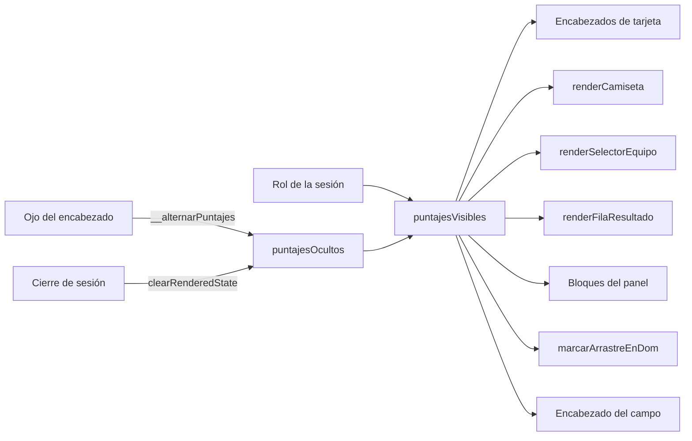
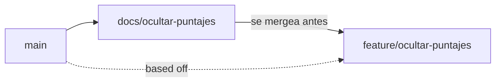

# Ocultar los puntajes de la pantalla de equipos — Implementation Plan

> **Status:** Draft · **Date:** 2026-11-20 · **Owner:** Lucas Manoukian
>
> **Reviewers:** *pending*
>
> **Spec:** [OCULTAR_PUNTAJES_SPEC.md](./OCULTAR_PUNTAJES_SPEC.md)
>
> **Concept note:** [OCULTAR_PUNTAJES_CONCEPT.md](./OCULTAR_PUNTAJES_CONCEPT.md)

> **Grounding evidence (`MD-25`).** Este Plan se apoya en el ledger §6.5 del Concept Note y
> en las citas en línea de la Spec. Donde una tarea `T-N.*`, una decisión `TD-*` o una
> elección de módulo se apoya en una ubicación de código que ninguno de los dos cubre, la
> cita va en línea acá. Todas las líneas de `index.html` y de `tests/` citadas se leyeron el
> 2026-11-20 sobre `docs/ocultar-puntajes` en `bad0178`; `index.html` y `tests/` no
> cambiaron desde `e77e06d`, el commit de las anclas de la Spec (`git diff --stat e77e06d
> bad0178 -- index.html tests/` vacío).

## 1. Summary

Se agrega a `index.html` un único estado de pantalla, `puntajesOcultos`, y un único
predicado, `puntajesVisibles()` —`isAdmin() && !puntajesOcultos`—, que consultan todas las
funciones que hoy dibujan un puntaje, una marca de posición principal o un dato de cómo se
armaron los equipos. Con ese predicado se resuelven a la vez las dos mitades de la Spec:
el ojo de `admin` (§7.1 a §7.4) y lo que `jugador` deja de ver siempre (§7.5), porque para
`jugador` el predicado es falso sin importar el estado (`TC-013`). El ojo es un botón de
ícono más en los dos encabezados de tarjeta que ya existen, con un manejador que alterna el
estado y repinta sin guardar nada; cerrar sesión lo vuelve a "visible". No hay datos
nuevos, no hay flag, el motor no se toca. Lo único no obvio antes de leer el resto: la
página tiene una escucha general que cancela la selección para intercambiar puesto ante
cualquier toque fuera de las camisetas
([index.html:5775-5783](../../index.html#L5775-L5783)); el ojo corta la propagación de su
clic para no cancelarla (`FR-016b`, `TD-05`). Y se borra `updateTeamTotalsDisplay`, que no
tiene llamadores (`TD-12`). La entrega sigue `AGENTS.md` § Ramas: esta rama de documentos
primero, la de código después.

## 2. Goals & non-goals

- **Technical goal 1** — Una sola condición decide si algo de §7.3 o §7.5 de la Spec se
  dibuja, para que agregar un elemento de puntaje nuevo sin pasar por ella sea un olvido
  visible y no una decisión silenciosa (`NFR-006`, riesgo de la Spec §15).
- **Technical goal 2** — Lo oculto no existe en el documento: cada función de dibujo omite
  el HTML, no lo esconde con CSS (`TC-012`).
- **Technical goal 3** — Cero cambios en el motor, en la persistencia, en lo que se lee de
  Firestore y en las reglas (`TC-002`, `TC-010`, `TC-013`).

**Non-goals:**

- No se refactoriza `renderTeamsSectionImpl` ni `renderCamiseta` más allá de consultar el
  predicado.
- No se toca `__copiarFormacion` ni el texto que copia (`FR-060`).
- No se toca la lista de convocados ni el listado de jugadores (Spec §3.2).
- No se agrega `aria-pressed` al ojo: la Spec eligió que el estado lo exponga el nombre, que
  cambia (`FR-007`), y anunciar a la vez un nombre que cambia y un estado de presionado
  dice dos veces lo mismo de dos formas distintas.

## 3. Architecture overview



Un solo valor entra al predicado desde dos lados —el rol y el estado del ojo— y todo lo que
dibuja un puntaje pregunta ahí. "Bloques del panel" son la píldora, la grilla por línea,
"Por qué quedaron así", el combo de estrategia y el aviso de desactualizado, todos dentro
de la rama de `admin` de `renderTeamsSectionImpl`
([index.html:7252-7289](../../index.html#L7252-L7289)).

Capas (`AGENTS.md`, Arquitectura desacoplada): el estado y el predicado son de la interfaz.
El motor de generación no participa (`TC-010`), y la persistencia tampoco: ni el manejador
del ojo ni el predicado llaman a `saveMatches` ni a `window.storage` (`TC-002`).

### 3.1 Key design decisions

| ID | Decision | Spec ref | Rationale |
|---|---|---|---|
| TD-01 | Sin feature flag: la rama sin mergear es la red de seguridad, como en `editar-fecha-partido` (su `TD-01`) | — (convención del proyecto: `AGENTS.md` § Ramas y Simplicidad ante todo) | El proyecto publica por merge a `main` después de probar contra staging; un flag sería infraestructura anticipada |
| TD-02 | El estado vive en `let puntajesOcultos = false;`, declarado junto a `copiadoDelPartido` ([index.html:2145](../../index.html#L2145)), otro estado de pantalla que no se persiste. Lo escriben sólo `window.__alternarPuntajes` (`TD-05`) y `clearRenderedState` (`TD-13`) | FR-012, FR-013, FR-014, FR-018, FR-019, TC-002 | Un `let` del IIFE sobrevive a abrir otro partido, porque abrirlo no recarga la página (Spec `A-01`), y muere al recargar. Que lo escriban sólo dos lugares es lo que hace verdad `FR-019`; lo comprueba un `grep` en §12.9 (`TC-013`) |
| TD-03 | `function puntajesVisibles(){ return isAdmin() && !puntajesOcultos; }`, declarada junto a `isAdmin` ([index.html:1617](../../index.html#L1617)). Toda guarda de un elemento de §7.3 o §7.5 de la Spec pasa a consultar esta función; las guardas `admin` que hoy cubren puntajes (`renderCamiseta`, [index.html:5388](../../index.html#L5388), [5423](../../index.html#L5423), [5433](../../index.html#L5433); `renderEncabezadoTarjeta`, [6957](../../index.html#L6957)) se reemplazan por ella | FR-020 a FR-038, FR-050 a FR-056, TC-013 | Una sola condición para las dos mitades de la Spec: para `jugador` da `false` siempre, así que lo que `jugador` deja de ver depende sólo del rol (`TC-013`), y para `admin` sigue al ojo. Es lo que la Spec §17 deja libre ("si cada función consulta el estado o recibe un parámetro"); se elige consultar, porque las funciones afectadas están a cuatro niveles de llamada de `renderTeamsSectionImpl` y un parámetro habría que pasarlo por todas |
| TD-04 | `renderBotonOjo()` devuelve `''` si `!isAdmin()`; si no, `<button type="button" class="panel-icono panel-icono-ojo" aria-label="X" title="X" onclick="event.stopPropagation();window.__alternarPuntajes()">` + `ICON_OJO` o `ICON_OJO_TACHADO`, con X = "Ocultar puntajes" en "visible" y "Mostrar puntajes" en "oculto". Se inserta, sólo con `admin`, en `renderEncabezadoTarjeta` inmediatamente antes del `push` de Copiar ([index.html:6947](../../index.html#L6947)) y en `renderEncabezadoPartidoFinalizado` como primer elemento de `botones` ([index.html:7477](../../index.html#L7477)). Los dos íconos se declaran junto a `ICON_COPIAR` ([index.html:6892](../../index.html#L6892)), con los trazos copiados tal cual de `https://unpkg.com/lucide-static@0.544.0/icons/eye.svg` y `…/eye-off.svg` en `T-2.9`, no escritos de memoria. El ícono y el nombre se eligen con `puntajesVisibles()`, no leyendo `puntajesOcultos` (para `admin` son lo mismo, y así la variable se lee en un solo lugar) | FR-001 a FR-007, FR-004, TC-001, TC-011, NFR-004 | Sólo literales fijos, sin texto de jugador (`TC-040`). Los dos encabezados ya son los únicos lugares donde está Copiar, y ninguno se dibuja sin equipos generados ([index.html:7145-7176](../../index.html#L7145-L7176)), así que `FR-004` sale sin condición propia. Insertar antes de Copiar da el orden de `FR-002` en las cuatro situaciones sin ramas: en carga y edición `sePuedenIntercambiarColores` es falso ([index.html:6315-6317](../../index.html#L6315-L6317)) y el ojo queda primero |
| TD-05 | `window.__alternarPuntajes = function(){ if(!isAdmin()) return; puntajesOcultos = !puntajesOcultos; const scrollY = window.scrollY; renderMatchesTab(); window.scrollTo(0, scrollY); };`, declarado junto a `window.__intercambiarColores` ([index.html:6324](../../index.html#L6324)). El `event.stopPropagation()` del `onclick` (`TD-04`) es parte de la decisión | FR-010, FR-011, FR-015, FR-016, FR-016b, FR-016c, FR-016d | Sin el `stopPropagation`, el clic del ojo burbujea hasta la escucha de `document` que cancela la selección por toque ([index.html:5775-5783](../../index.html#L5775-L5783)) y rompe `FR-016b`; es el mismo recurso que usa el candado ([index.html:5447](../../index.html#L5447)). No llama a `saveMatches` ni toca `m` (`FR-015`). El equipo visible (`equipoVisibleCancha`) y el tipo de evento (`tipoEventoActivo`) son variables que el repintado no reinicia mientras el partido no cambie ([index.html:5856-5860](../../index.html#L5856-L5860), [4936-4941](../../index.html#L4936-L4941)) (`FR-016`, `FR-016c`). El `scrollY` se guarda y se repone como en `window.__verEquipo` ([index.html:5824-5837](../../index.html#L5824-L5837)), porque `renderMatchesTab` repinta también la lista de convocados y el encabezado del detalle, fuera de `renderTeamsSection` (`FR-016d`). La guarda de rol va adentro, como en `__intercambiarColores` |
| TD-06 | En `renderCamiseta` ([index.html:5381](../../index.html#L5381)), `const ver = puntajesVisibles();` y: `valor` sólo con `ver`; `conCosto` sólo con `ver` (la clase `con-costo` y la mención "se puede intercambiar pero queda fuera de puesto" se van juntas); "sin puntaje" sólo con `ver`; en la parte del puesto, con `ver` el texto de hoy y sin `ver` sólo `nombreDe(posAsignada)`; `secHtml` sólo con `ver`; `candadoHtml` sólo con `ver && esFilaEditable(m)`. Nada más cambia: los gestos, el `data-id`, los chips y los nombres siguen igual | FR-020, FR-021, FR-022, FR-024, FR-033, FR-036, FR-053, FR-054, FR-056, TC-040 | Una sola variable por camiseta y no una llamada por guarda. Sin `ver`, la camiseta del candidato con costo queda con la clase `candidata` sola, que es el estilo del candidato común ([index.html:809](../../index.html#L809)), sin regla nueva (`TC-031`). El `title` se sigue armando con `escaparHtml` sobre `partes.join(' · ')` ([index.html:5428](../../index.html#L5428)) (`TC-040`). Para `jugador`, `valor` y el candado ya eran nulos por rol; lo nuevo es la «2º», la «!» y las tres menciones del `title` (`D-07`) |
| TD-07 | En `renderSelectorEquipo` ([index.html:5785](../../index.html#L5785)), `const ver = puntajesVisibles();`: `fuera` es `{ blanco: 0, negro: 0 }` sin `ver`, y `cuenta` es `null` sin `ver`. Con eso la «!», la cuenta y sus dos partes del nombre accesible desaparecen juntas, y el nombre queda "Equipo Blanco" o "Equipo Negro" | FR-023, FR-035, FR-037, FR-055, FR-055b | El nombre accesible ya se arma concatenando sólo lo que existe ([index.html:5803-5805](../../index.html#L5803-L5805)): anular las dos fuentes alcanza |
| TD-08 | En `marcarArrastreEnDom` ([index.html:6171-6178](../../index.html#L6171-L6178)), la clase `con-costo` se agrega sólo si `puntajesVisibles()` | FR-034 | El arrastre marca camisetas ya dibujadas sin repintar ([index.html:6158-6163](../../index.html#L6158-L6163)), así que no pasa por `renderCamiseta` y necesita su propia guarda. Es la única guarda fuera del HTML de la tarjeta, por eso `NFR-006` la excluye y la cubre `S-06a` |
| TD-09 | En la rama de `admin` de `renderTeamsSectionImpl` ([index.html:7252-7289](../../index.html#L7252-L7289)), `const ver = puntajesVisibles();` y: el aviso queda `renderAvisoBloqueo(m) \|\| (ver ? renderAvisoDesactualizado(m) : '')`; la fila de la píldora, `ver && enUnaColumna()`; el `totalHtml` de los dos `encabezadoCampoEquipos`, `''` sin `ver` (se conservan los `id` `totalBlancoSpan`/`totalNegroSpan`, que leen tres escenarios, [tests/layout.test.js:2440](../../tests/layout.test.js#L2440), [2533](../../tests/layout.test.js#L2533), [3172](../../tests/layout.test.js#L3172)); `renderDiferenciaPorLinea` y `renderPorQueQuedaronAsi`, sólo con `ver`; `renderFilaResultado(m, !ver)`. En `renderEncabezadoTarjeta`, la píldora pasa a `ver && resumen && !enUnaColumna()` y `renderComboEstrategia(m)` a `ver ? renderComboEstrategia(m) : ''` ([index.html:6957-6961](../../index.html#L6957-L6961)) | FR-025, FR-028, FR-029, FR-030, FR-031, FR-032, FR-041 | Las guardas van en el lugar que compone la tarjeta con equipos, no dentro de `renderComboEstrategia` ni de `renderAvisoDesactualizado`: el combo también se dibuja en las dos pantallas sin equipos ([index.html:7139](../../index.html#L7139)), que no cambian con el ojo (`FR-017`). El aviso de bloqueo no se guarda (`FR-041`). `bindSelectorEstrategia` ya no hace nada si el combo no está ([index.html:7101-7103](../../index.html#L7101-L7103)) |
| TD-10 | En la rama del finalizado sin edición ([index.html:7198-7227](../../index.html#L7198-L7227)), `const ver = puntajesVisibles();`: `encabezadoCampo` devuelve el total sólo si `ver && enUnaColumna()` y `''` en cualquier otro caso; `renderFilaResultado(m, !ver)`. En la rama de `jugador` ([index.html:7229-7250](../../index.html#L7229-L7250)), `renderFilaResultado(m, !puntajesVisibles())` | FR-026, FR-027, FR-050, FR-051, FR-052 | La rama del finalizado es compartida por los dos roles (su comentario, [index.html:7194-7197](../../index.html#L7194-L7197)), así que la misma guarda corrige a `jugador` y sigue al ojo de `admin`. En la rama de `jugador` el argumento es siempre `true`; se escribe con el predicado para que la regla se lea igual en las tres ramas |
| TD-11 | `renderFilaResultado(m, sinPuntaje = false)`: con `sinPuntaje`, cada lado conserva `<span class="resultado-nombre">` y omite el `<span>` del puntaje y del "pts" ([index.html:7460-7463](../../index.html#L7460-L7463)). `encabezadoCampoEquipos(m, nombre, totalHtml)` suma al principio `if(!totalHtml && enUnaColumna()) return '';` ([index.html:5851-5854](../../index.html#L5851-L5854)) | FR-026, FR-038, FR-050, NFR-003 | El valor por defecto deja a `tests/finalizado.test.js`, que recorta y llama `renderFilaResultado(m)` ([tests/finalizado.test.js:186](../../tests/finalizado.test.js#L186)), sin cambios. En una columna el nombre del equipo está escondido por CSS ([index.html:834](../../index.html#L834)): sin total, el `<h4>` sólo tendría ese nombre invisible, y `renderZonaEquipos` ya omite el `<h4>` cuando el encabezado es `''` ([index.html:5863](../../index.html#L5863)). Vale para los dos roles, como fija la nota a `FR-038` |
| TD-12 | Se borra `updateTeamTotalsDisplay` ([index.html:5211-5216](../../index.html#L5211-L5216)); `teamHeaderTotalText` se queda, porque la usa la rama de `admin` | Spec `OPEN-Q-01`, `A-04` | Decisión del owner del 2026-11-20 (§15.1). No tiene llamadores en `index.html` ni en `tests/` (Concept Note §6.5, verificado otra vez el 2026-11-20 con `grep -rn updateTeamTotalsDisplay index.html tests/`: sólo su definición), no está en ninguna lista `DECLARACIONES`, y protegerla sería código para algo que no se usa (Simplicidad ante todo) |
| TD-13 | `clearRenderedState` ([index.html:8423](../../index.html#L8423)) suma `puntajesOcultos = false;` junto a `editandoResultadoFinalizado = null;` | FR-018, TC-013 | Es la función que ya reinicia el estado de pantalla ligado a la cuenta al cerrar sesión (Spec §3.3, `D-05`) |
| TD-14 | Clase propia `.panel-icono-ojo`, sumada al selector de `.panel-icono-copiar` y de su `:hover` ([index.html:902-903](../../index.html#L902-L903)). No se reutiliza `panel-icono-copiar` | FR-005, TC-011, TC-031, NFR-004, AC-18 | Mismo tamaño (44 × 44, `.panel-icono`, [index.html:899](../../index.html#L899)), trazo y color que Copiar, sin valores nuevos. Clase aparte porque `tests/layout.test.js` busca Copiar por la clase `.panel-icono-copiar` en ocho lugares, tres de ellos para hacerle clic ([tests/layout.test.js:1913](../../tests/layout.test.js#L1913), [1928](../../tests/layout.test.js#L1928), [3538](../../tests/layout.test.js#L3538)); con la misma clase encontrarían primero el ojo, que va antes. Mismo motivo que `TD-09` de `editar-fecha-partido`. `AC-18` decía "con la clase de Copiar"; se enmendó a "el patrón `.panel-icono` y el color de Copiar", que es lo que pide su `TC-011` (Spec, Change log del 2026-11-20) |
| TD-15 | Todos los tests nuevos son escenarios de `tests/layout.test.js`, con el prefijo `ocultar/` en su `spec`, salvo uno: `S-07g` va en `tests/intercambio.test.js` | TC-030, AC-50 | Todo lo que la Spec pide es lo que se ve o lo que se lee en la pantalla, y la única forma de verlo con las funciones reales es la aplicación real. `S-07g` no se puede producir en el navegador, porque la aplicación no escucha cambios de otra sesión: es el mismo caso que `S-01j` de `posiciones-del-jugador`, que por eso vive en unidad ([POSICIONES_DEL_JUGADOR_IMPLEMENTATION_PLAN.md:271](../posiciones-del-jugador/POSICIONES_DEL_JUGADOR_IMPLEMENTATION_PLAN.md)) |
| TD-16 | El doble de Firebase aprende a cerrar y abrir sesión: `onAuthStateChanged` guarda su callback; `signOut` lo llama con `null`; y un global nuevo, `window.__entrarComo(rol)`, cambia el `rol` del doble y lo llama con una cuenta nueva ([tests/fixtures-app.js:497-516](../../tests/fixtures-app.js#L497-L516)) | FR-018, S-05c, S-09d, TC-013 | Hoy `signOut` no hace nada ([tests/fixtures-app.js:501](../../tests/fixtures-app.js#L501)), como señala la Spec §17. La aplicación lo llama sólo desde `window.auth.logout` ([index.html:1535-1538](../../index.html#L1535-L1538)), y ningún escenario cierra sesión hoy (`grep -n "logout\|Cerrar sesión" tests/*.js` sólo encuentra un comentario de `tests/sesion.test.js:216`), así que el cambio no altera a ninguno. Cerrar sesión de verdad pasa por `onAuthChange(null)`, que es lo que hay que probar ([index.html:8775-8786](../../index.html#L8775-L8786)) |
| TD-17 | Una transformación de datos de prueba nueva en `tests/layout.test.js`, `conPuestosCruzados(datos)`: aplica `agregarDatosDeIntercambio` y, en `m-int-8`, `m-int-9`, `m-int-cerrado` y `m-int-finalizado`, cambia `posicionAsignada` de `int-juan` a `LD` y de `int-pedro` a `DC`, y le saca a Pedro el puntaje de `DC` | S-08, S-09, S-09e | Los partidos de prueba con puestos ([tests/fixtures-app.js:300-412](../../tests/fixtures-app.js#L300-L412)) tienen duplas en puesto secundario y jugadores fuera de puesto, pero ningún jugador suelto en su secundario: los dos cruzados quedan en su secundario, con «2º» y "(su puesto es …)", y Pedro además "sin puntaje", que es el caso de Ana en `S-08`. No se toca `agregarDatosDeIntercambio`, que usan los escenarios `intercambio-*` |
| TD-18 | El runner de `tests/layout.test.js` acepta, en `invariantes`, una entrada `[función, argumento]` además de una función sola, y la evalúa con `page.evaluate(función, argumento)` ([tests/layout.test.js:4563](../../tests/layout.test.js#L4563)). `INVARIANTE_OJO`, `INVARIANTE_OCULTO` e `INVARIANTE_JUGADOR` reciben así su situación, su estado y `LISTA_OCULTO`; `ocultar-barrido` usa la misma `LISTA_OCULTO` del lado de Node | TC-030, NFR-001, NFR-003, NFR-006 | `page.evaluate(inv)` serializa el texto de la función: ni los valores de una fábrica ni una constante de Node viajan a la página, y un `ReferenceError` ahí tira la suite entera, no el escenario. Todos los invariantes de hoy son funciones cerradas; correrlos desde `comprobar` no sirve porque `comprobar` corre en un solo ancho. Es un cambio de dos líneas, compatible con los escenarios que ya existen; `T-2.2b` corre la suite completa |

## 4. Module map

| Module / package | Role | Status |
|---|---|---|
| `index.html` — `puntajesOcultos` (nueva, junto a `copiadoDelPartido`, [index.html:2145](../../index.html#L2145)) | Estado de pantalla (`TD-02`) | new |
| `index.html` — `puntajesVisibles` (nueva, junto a `isAdmin`, [index.html:1617](../../index.html#L1617)) | Predicado único (`TD-03`) | new |
| `index.html` — `ICON_OJO`, `ICON_OJO_TACHADO`, `renderBotonOjo` (nuevas, junto a `ICON_COPIAR`, [index.html:6892](../../index.html#L6892)) | El botón (`TD-04`) | new |
| `index.html` — `window.__alternarPuntajes` (nuevo, junto a `window.__intercambiarColores`, [index.html:6324](../../index.html#L6324)) | Manejador (`TD-05`) | new |
| `index.html` — `renderCamiseta` ([index.html:5381](../../index.html#L5381)) | Puntaje, «2º», «!», candado, costo y `title` (`TD-06`) | modified |
| `index.html` — `renderSelectorEquipo` ([index.html:5785](../../index.html#L5785)) | «!», cuenta y nombre accesible de las pestañas (`TD-07`) | modified |
| `index.html` — `marcarArrastreEnDom` ([index.html:6171](../../index.html#L6171)) | Costo durante el arrastre (`TD-08`) | modified |
| `index.html` — `renderEncabezadoTarjeta`, `renderEncabezadoPartidoFinalizado` ([index.html:6931](../../index.html#L6931), [7474](../../index.html#L7474)) | Suman el ojo; la píldora y el combo siguen al predicado (`TD-04`, `TD-09`) | modified |
| `index.html` — `renderTeamsSectionImpl`, ramas del finalizado, de `jugador` y de `admin` ([index.html:7198-7289](../../index.html#L7198-L7289)) | Bloques del panel, totales y fila de resultado (`TD-09`, `TD-10`) | modified |
| `index.html` — `renderFilaResultado`, `encabezadoCampoEquipos` ([index.html:7455](../../index.html#L7455), [5851](../../index.html#L5851)) | Parámetro `sinPuntaje`; encabezado vacío (`TD-11`) | modified |
| `index.html` — `updateTeamTotalsDisplay` ([index.html:5211-5216](../../index.html#L5211-L5216)) | Sin llamadores (`TD-12`) | deleted |
| `index.html` — `clearRenderedState` ([index.html:8423](../../index.html#L8423)) | Reinicia el ojo al cerrar sesión (`TD-13`) | modified |
| CSS — `.panel-icono-copiar` y su `:hover` ([index.html:902-903](../../index.html#L902-L903)) | Selector ampliado con `.panel-icono-ojo` (`TD-14`) | modified |
| `index.html` — `renderComboEstrategia`, `renderAvisoDesactualizado`, `renderAvisoBloqueo`, `renderDiferenciaPorLinea`, `renderPorQueQuedaronAsi`, `renderPildoraDiferencia` | Se llaman o no según el predicado; por dentro no cambian | untouched |
| `index.html` — `__copiarFormacion` | El texto que copia (`FR-060`) | untouched |
| `index.html` — `saveMatches`, `window.storage`, `iniciarLecturas` | Persistencia y lecturas por rol | untouched (`TC-002`, `TC-013`) |
| `index.html` — `generarEquiposEstrategia1` a `4`, `resolverArqueros`, `window.__generarEquipos`, `explicacionesDelArmado` | Motor y resumen de generación | untouched (`TC-010`) |
| `tests/fixtures-app.js` — `fakeFirebase` ([tests/fixtures-app.js:422](../../tests/fixtures-app.js#L422)) | Cerrar y abrir sesión (`TD-16`) | modified |
| `tests/layout.test.js` | Escenarios `ocultar-*`, `conPuestosCruzados` (`TD-17`), invariantes con argumento en el runner (`TD-18`), y los tres escenarios que fijan el orden o la cantidad de botones (§7.3.6) | modified |
| `tests/intercambio.test.js` | Un caso `'ocultar/S-07g: …'` (`TD-15`) | modified |
| `docs/` — diez specs acotadas, nueve con la nota "Acotado el 2026-11-20" (`CARGA_POR_TOQUE_SPEC.md` se acota por herencia y no se marca, Spec, Declaración de reemplazo) | Las de las tablas 1 y 2 ya estaban en `bad0178`; las de la tabla 3 se marcaron en la rama 1 (`T-1.1`) | modified |

## 5. Engineering rules / project conventions reference

Restatadas de [`AGENTS.md`](../../AGENTS.md).

| Rule | Summary |
|---|---|
| Estructura | Toda la aplicación en `index.html`, dentro de un IIFE. Sin build, bundler ni framework. |
| Imports | No aplica: no hay módulos. |
| Typing | No aplica: JavaScript sin anotaciones ni type-checker. |
| Logging | No aplica: la feature no tiene caminos de error; el ojo no escribe ni lee nada. |
| Estilo | Interfaz por plantillas de cadena e `innerHTML`; todo texto de jugador se escapa. El ojo inserta sólo literales fijos; los `title` recortados siguen pasando por `escaparHtml` (`TC-040`). |
| Tests | `tests/*.test.js`, con `node`, devuelven 1 sólo ante regresión. `tests/harness.js` recorta de `index.html` por nombre: `renderFilaResultado` lo recorta `tests/finalizado.test.js` y su firma nueva conserva la vieja (`TD-11`). Un escenario nuevo de `tests/layout.test.js` se ve fallar antes de darlo por bueno (`TC-030`, §7.3.6). |
| Binding | `variant-a` — el ID va en forma canónica con guion dentro de un string literal, con el prefijo `ocultar/`: el campo `spec: ['ocultar/S-01', …]` de cada escenario de `tests/layout.test.js` y el título del caso en `tests/intercambio.test.js` (`'ocultar/S-07g: …'`). Nunca en comentarios. Los mensajes de falla de los requisitos que enumeran elementos (`FR-036`, `FR-040`, `FR-042`, `FR-056`) nombran el ID y el elemento, una aserción por elemento (Spec §11.5). |
| Supply-chain | `none — el repositorio no versiona ningún lockfile y la aplicación no tiene dependencias instaladas (Firebase por CDN; Playwright es dev-only externo, AGENTS.md § Dependencias)` |
| Lint / type-check | `none — el repositorio no tiene linter ni type-checker configurados`. `T-N.D3`/`T-N.D4` pasan de forma vacua y se declaran como tales. |
| Constants | Los dos nombres del ojo son literales fijos de la Spec (`FR-007`); los dos íconos son constantes `ICON_*` como las demás; ningún número mágico nuevo. |
| Commits | Conventional Commits con asunto en español: `tipo(scope): asunto (IDs de la Spec)`, la línea entera ≤ 72 caracteres, un cambio lógico por commit, cada commit pasa los tests. Scope `ocultar-puntajes`. Si los IDs no entran, van al cuerpo. Nunca `chore: bump version`. La versión la sube el workflow (`AGENTS.md` § Versionado). |
| Backwards compat | Requerida en los datos: ningún documento ni campo cambia (`TC-002`). En la interfaz, `jugador` deja de ver el "pts" por equipo y las marcas de posición principal desde el merge (`D-06`, `D-07`), y el encabezado de `admin` suma un botón (Declaración de reemplazo, tabla 3). |

## 6. Definition of Done (every branch)

- [ ] La implementación sigue §5
- [ ] Cada FR/TC de la Spec asignado a la rama está implementado
- [ ] Cada escenario y variante tiene un test ejecutable (`AC-50`; `T-N.D8`, `T-N.D8b`)
- [ ] Cada NFR cuantificado tiene un test de medición (`AC-51`; `T-N.D9`)
- [ ] Cada `TC-*` de la Spec §4 tiene entrada en §12 de este Plan (`AC-52`; `T-N.D10`, `T-N.D10b`)
- [ ] §12.2 tiene una fila `IMP-*` por alcance afectado (`AC-53`; `T-N.D15`)
- [ ] Cada NFR cuantificado tiene una fila `OBS-*` en §11 (`AC-54`; `T-N.D16`)
- [ ] Supply-chain: `none` declarado en §5 (`AC-55`; `T-N.D20`, pasa de forma vacua)
- [ ] Cada `R-*` de §14 registra una vía de mitigación (`T-N.D17`)
- [ ] Auto-consistencia (`T-N.D18`) y unicidad de definiciones (`T-N.D18b`)
- [ ] Consistencia cruzada con Spec y Concept Note (`T-N.D19`)
- [ ] Tests nuevos y existentes pasan
- [ ] Linter y type-checker: no aplican (§5), declarado
- [ ] Sin `TODO`/`FIXME`/`HACK`
- [ ] Historial de commits limpio, formato §5 (`T-N.D11`)
- [ ] Descripción del PR con resumen, referencias a la Spec y decisiones (`T-N.D12`)
- [ ] **Gate propio del proyecto:** la pantalla se miró en un navegador real contra staging a 360 px y a 1200 px, con `admin` en los dos estados y con `jugador` (`T-N.D13`)
- [ ] PR abierto contra `main` (`T-N.D14`)

## 7. Branch / phase plan

### 7.0 Branch strategy — model (`MD-33`) + sizing (`MD-27`)

```
Branching model: trunk-based — detected by <skill-dir>/scripts/detect-branching-model.sh el 2026-11-20 (basis: fallback; default branch main, sin develop/release/hotfix ni ramas de entorno). Confirmado por el owner el 2026-11-20 (OPEN-Q-03): las ramas salen de main y vuelven a main, como en editar-fecha-partido; AGENTS.md § Ramas coincide
Long-lived branches: none
```

```
Custom arc: 2 branches — AGENTS.md § Ramas fija dos ramas por entrega: docs/<slug> con Spec y Plan, que se mergea primero, y feature/<slug> con el código. El owner eligió el 2026-11-20 una sola rama de código para el ojo y la corrección de jugador (OPEN-Q-03): las dos mitades comparten el predicado de TD-03, y separarlas obligaría a escribirlo dos veces o a mergear una rama que la otra necesita.
```

### 7.1 Branch tracker

| # | Git branch | Base branch | Status | PR | Tests | Notes |
|---|---|---|---|---|---|---|
| 1 | `docs/ocultar-puntajes` | `main` | In progress | — | — | Concept Note, Spec, sus tres críticas y las marcas de las tres tablas ya commiteadas (`08a4b04`), y este Plan (`6195087`, `06b10c9`); faltan aplicar la crítica independiente del Plan y el merge |
| 2 | `feature/ocultar-puntajes` | `main` | Not started | — | — | Sale de `main` una vez mergeada la rama 1 |



Flechas continuas = orden de merge. Línea punteada = base en git: la rama 2 sale de `main`
una vez mergeada la 1, no de la rama 1.

---

### 7.2 Branch 1 — `docs/ocultar-puntajes`

**Goal:** dejar mergeados en `main` los tres documentos de la feature, sus críticas y las
marcas de la Declaración de reemplazo en las nueve specs que se marcan (de diez acotadas). Sin cambios de código.

**Spec coverage:** Declaración de reemplazo completa (`AC-04`); la tabla 3 se agrega en esta
rama (`T-1.1`).

#### 7.2.7 Verification

- [ ] `AC-04`, mitad por requisito: el script de abajo no imprime nada. Recorre las 49
  partes acotadas de las tres tablas y, para cada una, busca el enlace a
  `OCULTAR_PUNTAJES_SPEC.md` dentro de su bloque —desde su definición hasta la siguiente—,
  no en la línea de al lado. Imprime `SIN NOTA` o `NO DEFINIDO` por cada par que falla.
  Corrido el 2026-11-20 con la tabla 3 ya marcada: vacío. Visto fallar el mismo día
  agregando a la lista `FR-001`, `S-01b` y un identificador que no existe en `PANEL_ARMADO_SPEC.md`:
  imprimió `SIN NOTA` para los dos primeros y `NO DEFINIDO` para el tercero.
- [ ] `AC-04`, mitad de completitud: `grep -rnE "2º|fuera de puesto|posición secundaria|su puesto es|pts|píldora|candado|Por qué quedaron así|diferencia por línea" docs --include='*SPEC.md' --include=spec.md | grep -v ocultar-puntajes`, revisado a mano: ningún requisito vigente que obligue a mostrar uno de esos elementos queda sin nota. El barrido lo hizo la Spec el 2026-11-20 (su Change log, segunda crítica); esta rama lo repite sólo si `main` cambió alguna spec desde `bad0178`
- [ ] Los enlaces cruzados de los tres documentos resuelven

```bash
# AC-04 de OCULTAR_PUNTAJES_SPEC.md — vacío = pasa
cd "$(git rev-parse --show-toplevel)"
E=docs/equipos-en-el-campo
while read -r f ids; do
  for id in $ids; do
    awk -v id="$id" '
      function esDef(l){ return l ~ /^- \*\*(FR|NFR|AC|TC)-[0-9]+[a-z]*\*\*/ || l ~ /^- `S-[0-9]+[a-z]* \[/ || l ~ /^#/ }
      function abre(l){
        if (id ~ /^S-[0-9]+$/) return l ~ ("^#+ +Scenario +" id "[^0-9a-z]")
        if (id ~ /^S-/) return index(l, "- `" id " [") == 1
        return index(l, "- **" id "**") == 1
      }
      !dentro && abre($0) { dentro=1; encontrado=1; next }
      dentro && esDef($0) { exit }
      dentro && /OCULTAR_PUNTAJES_SPEC\.md/ { ok=1; exit }
      END { if (!encontrado) print "NO DEFINIDO: " FILENAME " " id; else if (!ok) print "SIN NOTA: " FILENAME " " id }
    ' "$f"
  done
done <<EOF
$E/rebanada-4-partido-finalizado/PARTIDO_FINALIZADO_SPEC.md FR-041 FR-042b S-04 S-04b FR-060 AC-06 AC-05 S-01
docs/posiciones-del-jugador/POSICIONES_DEL_JUGADOR_SPEC.md FR-025 FR-025b FR-025c FR-021b FR-012b FR-070 FR-071
$E/rebanada-1-cancha/CANCHA_SPEC.md FR-023b FR-024 FR-025 FR-027 FR-030
docs/desglose-posiciones/DESGLOSE_POSICIONES_SPEC.md FR-076 FR-077
$E/rebanada-3-panel-armado/PANEL_ARMADO_SPEC.md FR-003 FR-003b FR-003c FR-004 FR-005 FR-009 FR-010 FR-020 FR-030 FR-037 FR-040 FR-052 FR-072b FR-054 FR-070 FR-070b FR-070c FR-071 FR-074 S-01 AC-02
docs/003-motor-generacion-equipos/spec.md FR-009
docs/008-duplas-rotacion/spec.md FR-015
docs/009-ventaja-sin-arquero/spec.md FR-008 FR-011
docs/intercambiar-colores/INTERCAMBIAR_COLORES_SPEC.md FR-042 S-05
EOF
```

`FR-003` de `CARGA_POR_TOQUE_SPEC.md` no está en la lista porque la Spec lo excluye de
`AC-04`: hereda el acotamiento de `FR-041` sin cambiar de texto.

#### 7.2.8 Files inventory

**New files:**
```
docs/ocultar-puntajes/OCULTAR_PUNTAJES_IMPLEMENTATION_PLAN.md
```

**Modified files** (desde `bad0178`; contra `main` la rama trae además todo lo commiteado antes, Concept Note, Spec, críticas, marcas de las tablas 1 y 2 y `Roadmap.md`):
```
docs/ocultar-puntajes/OCULTAR_PUNTAJES_SPEC.md        (tabla 3, AC-18, AC-23, Change log, enlace al Plan)
docs/ocultar-puntajes/OCULTAR_PUNTAJES_CONCEPT.md     (enlace al Plan en la cabecera)
docs/intercambiar-colores/INTERCAMBIAR_COLORES_SPEC.md
docs/equipos-en-el-campo/rebanada-4-partido-finalizado/PARTIDO_FINALIZADO_SPEC.md
docs/equipos-en-el-campo/rebanada-3-panel-armado/PANEL_ARMADO_SPEC.md
```

#### 7.2.9 Task checklist (agent-runnable)

- [x] T-1.1 Agregar la tabla 3 a la Declaración de reemplazo de la Spec (`FR-042` y `S-05`
  de `INTERCAMBIAR_COLORES_SPEC.md`, `S-01` de `PARTIDO_FINALIZADO_SPEC.md`, `S-01` y `AC-02`
  de `PANEL_ARMADO_SPEC.md`), marcar esas cinco partes en sus specs con la nota "Acotado el
  2026-11-20" y una fila o un agregado en sus Change log, y registrar la enmienda en el
  Change log de la Spec. Hecho el 2026-11-20 al derivar este Plan, aprobado por el owner
- [x] T-1.C1 Commit — `docs(ocultar-puntajes): declara el cambio de botones del encabezado`
- [x] T-1.2 Escribir este Plan y enlazarlo desde la cabecera de la Spec (línea 9) y de la
  Concept Note (línea 7)
- [x] T-1.C2 Commit — `docs(ocultar-puntajes): agrega el implementation plan`

DoD verification (§6):

- [ ] T-1.D1 Tests nuevos: no aplica, rama de documentos — declarado
- [ ] T-1.D2 Tests existentes: no aplica, no se toca código — declarado
- [ ] T-1.D3 Linter: no aplica (§5), declarado
- [ ] T-1.D4 Type-checker: no aplica (§5), declarado
- [ ] T-1.D5 Sin `TODO`/`FIXME`/`HACK` — `git grep -nE "TODO|FIXME|HACK" -- docs/ocultar-puntajes/ ':!docs/ocultar-puntajes/OCULTAR_PUNTAJES_IMPLEMENTATION_PLAN.md' ':!docs/ocultar-puntajes/*_CRITIQUE_*'` vacío. El Plan se excluye porque nombra las tres palabras en este mismo gate y en §6; los reportes de crítica, porque no se editan nunca (`AGENTS.md`)
- [ ] T-1.D6 Documentos revisados contra §5 (formato de commits): lo cubre la medición de `T-1.D11`; la descripción del PR lo declara
- [ ] T-1.D7 La Declaración de reemplazo tiene sus marcas en las nueve specs que se marcan — el script de §7.2.7, guardado en un archivo y corrido con `bash` (con `zsh` el `for id in $ids` no parte la lista y da `NO DEFINIDO` falsos), vacío
- [ ] T-1.D8 Binding de escenarios: vacío en esta rama (no hay tests); el gate real corre en `T-2.D8`
- [ ] T-1.D8b Cada `Scenario S-NN` de la Spec tiene `Variants:` o `Variants: none` — ``awk 'BEGIN{in_fence=0} /^```/{in_fence=!in_fence; next} in_fence{next} /^#{2,5} +Scenario +S-[0-9]+([^a-z0-9]|$)/ {if(current!="" && !found) print "MISSING Variants block: " current; current=$0; found=0; next} /^[ \t]*\*\*Variants:\*\*/ || /^[ \t]*Variants: *none/ {found=1} END{if(current!="" && !found) print "MISSING Variants block: " current}' docs/ocultar-puntajes/OCULTAR_PUNTAJES_SPEC.md`` vacío
- [ ] T-1.D9 NFRs: vacío en esta rama; el gate real corre en `T-2.D9`
- [ ] T-1.D10 Cada `TC-*` de la Spec §4 aparece en §12 de este Plan — `comm -23 <(sed -n '/^## 4\./,/^## 5\./p' docs/ocultar-puntajes/OCULTAR_PUNTAJES_SPEC.md | grep -oE "TC-[0-9]+" | sort -u) <(sed -n '/^## 12\./,/^## 13\./p' docs/ocultar-puntajes/OCULTAR_PUNTAJES_IMPLEMENTATION_PLAN.md | grep -oE "TC-[0-9]+" | sort -u)` vacío
- [ ] T-1.D10b Cada `TC-*` de la Spec §4 tiene chequeo en su §11.3 — `comm -23 <(sed -n '/^## 4\./,/^## 5\./p' docs/ocultar-puntajes/OCULTAR_PUNTAJES_SPEC.md | grep -oE "TC-[0-9]+" | sort -u) <(sed -nE '/^#{2,4} +11\.3/,/^#{2,4} +11\.4/p' docs/ocultar-puntajes/OCULTAR_PUNTAJES_SPEC.md | grep -oE "TC-[0-9]+" | sort -u)` vacío
- [ ] T-1.D11 Historial limpio — `git log --oneline main..HEAD`, y la línea entera ≤ 72 caracteres: `git log --format=%s main..HEAD | awk 'length > 72'` vacío
- [ ] T-1.D12 Descripción del PR con resumen de los tres documentos, las tres críticas, la enmienda de `T-1.1` y las nueve specs marcadas (de diez acotadas)
- [ ] T-1.D13 Gate propio: no aplica a una rama de documentos — declarado
- [ ] T-1.D14 PR abierto contra `main` (o merge directo a pedido del owner, como en `editar-fecha-partido`)
- [ ] T-1.D15 §12.2 no vacía — `sed -n '/^### 12\.2/,/^### 12\.3/p' docs/ocultar-puntajes/OCULTAR_PUNTAJES_IMPLEMENTATION_PLAN.md | grep -cE "^\| *IMP-[0-9]+"` ≥ 1
- [ ] T-1.D16 Cada NFR de la Spec §8 tiene fila `OBS-*` — `comm -23 <(sed -n '/^## 8\./,/^## 9\./p' docs/ocultar-puntajes/OCULTAR_PUNTAJES_SPEC.md | grep -oE "NFR-[0-9]+" | sort -u) <(sed -n '/^## 11\./,/^## 12\./p' docs/ocultar-puntajes/OCULTAR_PUNTAJES_IMPLEMENTATION_PLAN.md | grep -oE "NFR-[0-9]+" | sort -u)` vacío
- [ ] T-1.D17 Cada `R-*` de §14 tiene vía de mitigación, y cada `T-N.*` citado en §14 está definido en un checklist. Dos comandos, los dos vacíos: (a) `sed -n '/^## 14\./,/^## 15\./p' docs/ocultar-puntajes/OCULTAR_PUNTAJES_IMPLEMENTATION_PLAN.md | awk -F'|' '/^\| *R-[0-9]+/ { g=$7; gsub(/ /,"",g); if (g=="") print $2 }'`; (b) `comm -23 <(sed -n '/^## 14\./,/^## 15\./p' docs/ocultar-puntajes/OCULTAR_PUNTAJES_IMPLEMENTATION_PLAN.md | grep -oE "T-[0-9]+\.[A-Z]?[0-9]+[a-z]?" | sort -u) <(grep -oE "^- \[[ x]\] T-[0-9]+\.[A-Z]?[0-9]+[a-z]?" docs/ocultar-puntajes/OCULTAR_PUNTAJES_IMPLEMENTATION_PLAN.md | grep -oE "T-[0-9]+\.[A-Z]?[0-9]+[a-z]?" | sort -u)`
- [ ] T-1.D18 Auto-consistencia del Plan (`references/review-passes.md`, Pass 1): toda referencia a un ID propio del Plan resuelve a una definición en el Plan — ``P=docs/ocultar-puntajes/OCULTAR_PUNTAJES_IMPLEMENTATION_PLAN.md; for p in TD OBS IMP R OPEN-Q; do comm -23 <(sed '/^## 17\./,$d' $P | grep -oE "(^|[^A-Za-z-])${p}-[0-9]+" | sed -E 's/^[^A-Z]//' | sort -u) <(grep -oE "^\| *${p}-[0-9]+" $P | grep -oE "${p}-[0-9]+" | sort -u); done; comm -23 <(sed '/^## 17\./,$d' $P | grep -oE "T-[0-9]+\.[A-Z]?[0-9]+[a-z]?" | sort -u) <(grep -oE "^- \[[ x]\] T-[0-9]+\.[A-Z]?[0-9]+[a-z]?" $P | grep -oE "T-[0-9]+\.[A-Z]?[0-9]+[a-z]?" | sort -u)`` vacío. Los `OPEN-Q-01` y `OPEN-Q-02` que este Plan cita son los de la Spec §16, que se definen otra vez en §15.1 para resolverlos acá; el Plan no cita por número ninguna `OPEN-Q` del Concept Note. Los IDs de `editar-fecha-partido` que se citan (`TD-01` y `TD-09` en `TD-01` y `TD-14`, `T-2.D6` en `T-2.D6`) van siempre junto al nombre de esa feature, y los tres existen también en este Plan, así que el gate no los marca
- [ ] T-1.D18b Unicidad de definiciones — por cada documento por separado: ``for f in docs/ocultar-puntajes/OCULTAR_PUNTAJES_CONCEPT.md docs/ocultar-puntajes/OCULTAR_PUNTAJES_SPEC.md docs/ocultar-puntajes/OCULTAR_PUNTAJES_IMPLEMENTATION_PLAN.md; do { for p in D FR NFR TC AC TD OBS IMP R A US OPEN-Q; do { grep -ohE "^- \*\*${p}-[0-9]+[a-z]*\*\*" "$f"; grep -ohE "^\| *${p}-[0-9]+[a-z]* *\|" "$f"; } | grep -ohE "${p}-[0-9]+[a-z]*"; done; grep -ohE "^#### +Scenario +S-[0-9]+" "$f" | grep -oE "S-[0-9]+"; grep -ohE '^- `S-[0-9]+[a-z]* \[' "$f" | grep -oE "S-[0-9]+[a-z]*"; } | sort | uniq -d; done`` vacío en los tres
- [ ] T-1.D19 Consistencia cruzada, por familia (`FR`, `NFR`, `TC`, `AC`, `S`), con el left-anchor de la receta del template: `for p in FR NFR TC AC S; do comm -23 <(sed '/^## 17\./,$d' docs/ocultar-puntajes/OCULTAR_PUNTAJES_IMPLEMENTATION_PLAN.md | grep -oE "(^|[^A-Za-z])${p}-[0-9]+[a-z]*" | sed -E 's/^[^A-Za-z]//' | sort -u) <(grep -oE "(^|[^A-Za-z])${p}-[0-9]+[a-z]*" docs/ocultar-puntajes/OCULTAR_PUNTAJES_SPEC.md | sed -E 's/^[^A-Za-z]//' | sort -u); done` vacío, y lo mismo con `D` entre el Plan y la Concept Note. Como el Plan cita IDs de otras specs (`FR-042` de `intercambiar-colores`, `S-01j` de `posiciones-del-jugador`), el gate compara contra todo el texto de la Spec, que también los nombra en su Declaración de reemplazo y en `S-07g`
- [ ] T-1.D20 Supply-chain: `none` declarado en §5, pasa de forma vacua

---

### 7.3 Branch 2 — `feature/ocultar-puntajes`

**Goal:** el ojo funcionando para `admin` en las cuatro situaciones, `jugador` sin "pts" por
equipo ni marcas de posición principal, todos los escenarios de la Spec cubiertos por
tests, probado contra staging.

**Spec coverage:** FR-001 a FR-060 (incluidos los `b`, `c`, `d`), NFR-001 a NFR-006,
TC-001 a TC-040, AC-01 a AC-55, S-01 a S-11 y sus variantes.

#### 7.3.1 Design decisions specific to this branch

`TD-02` a `TD-18` (§3.1). El orden de las tareas pone cada escenario antes del código que
verifica, para verlo fallar (`TC-030`), sin commitear el estado rojo. Va primero la
corrección de `jugador` (`T-2.3` a `T-2.5`), que no depende del ojo y se puede ver fallar
contra el código de hoy; después el botón (`T-2.8` a `T-2.9`), y al final el resto de lo
que se oculta (`T-2.10` a `T-2.12`). `OPEN-Q-02` (§15.1) se resuelve en `T-2.1`, antes de
tocar nada.

#### 7.3.5 New / modified interfaces

File: `index.html`

| Symbol | Signature | Notes |
|---|---|---|
| `puntajesOcultos` | `let`, `boolean` | `TD-02` |
| `puntajesVisibles` | `() -> boolean` | `TD-03` |
| `ICON_OJO`, `ICON_OJO_TACHADO` | `const`, string SVG | `TD-04` |
| `renderBotonOjo` | `() -> string` | `TD-04` |
| `window.__alternarPuntajes` | `() -> void` | `TD-05` |
| `renderCamiseta` | sin cambio de firma | `TD-06` |
| `renderSelectorEquipo` | sin cambio de firma | `TD-07` |
| `marcarArrastreEnDom` | sin cambio de firma | `TD-08` |
| `renderEncabezadoTarjeta`, `renderEncabezadoPartidoFinalizado` | sin cambio de firma | `TD-04`, `TD-09` |
| `renderTeamsSectionImpl` | sin cambio de firma | `TD-09`, `TD-10` |
| `renderFilaResultado` | `(m, sinPuntaje = false) -> string` | `TD-11` |
| `encabezadoCampoEquipos` | sin cambio de firma | `TD-11` |
| `updateTeamTotalsDisplay` | borrada | `TD-12` |
| `clearRenderedState` | sin cambio de firma | `TD-13` |
| `.panel-icono-ojo` | CSS | `TD-14` |

File: `tests/layout.test.js`

| Symbol | Signature | Notes |
|---|---|---|
| entradas de `invariantes` | función, o `[función, argumento]` | `TD-18` |
| `arrastrarSobre` | sin cambio de firma; destino `{ pestana }` y `foto.conCosto` nuevos | §7.3.6 |

File: `tests/fixtures-app.js`

| Symbol | Signature | Notes |
|---|---|---|
| `signOut` del doble | `async () -> void`, llama al callback guardado con `null` | `TD-16` |
| `window.__entrarComo` | `(rol) -> void` | `TD-16`. Cambia el `rol` del doble y entrega una cuenta nueva con ese claim |

#### 7.3.6 Tests

**Ayudantes nuevos en `tests/layout.test.js`.**

- `conPuestosCruzados(datos)` (`TD-17`).
- `alternarOjo(page)`: `page.click('#teamsSection .panel-icono-ojo')` y espera 200 ms. Con
  `page.click`, y no con `evaluate`, para que el clic pase por el `onclick` real y su
  `stopPropagation` (`TD-05`).
- `LISTA_OCULTO`: los selectores y textos de §7.3 de la Spec, uno por requisito, con el ID
  de cada uno: `.camiseta-puntaje` (`FR-020`), `.camiseta-sec` (`FR-021`), `.camiseta-fuera`
  (`FR-022`), `.equipo-tab-fuera` (`FR-023`), `.camiseta-candado` (`FR-024`), `.team-total`
  (`FR-025`, `FR-027`), `.resultado-puntaje` y `.resultado-pts` (`FR-026`), `.panel-pildora`
  y `.panel-pildora-fila` (`FR-028`), `.panel-lineas` (`FR-029`), `.panel-receipt`
  (`FR-030`), `.chip-estrategia` (`FR-031`), `.panel-aviso:not(.panel-aviso-bloqueo)`
  (`FR-032`), `.con-costo` (`FR-033`), `.equipo-tab-cuenta` (`FR-035`); en los `title` de
  `.camiseta`, "sin puntaje", "su puesto es", "posición secundaria", "fuera de puesto" y
  "queda fuera de puesto" (`FR-036`); en el `aria-label` de `.equipo-tab`, todo lo que no sea
  exactamente "Equipo Blanco" o "Equipo Negro" (`FR-037`). `INVARIANTE_OCULTO` busca cada uno
  dentro de `#teamsSection` por presencia (`querySelector`, nunca por tamaño: `TC-012`) y
  devuelve un problema por elemento encontrado, con su ID.
- `INVARIANTE_OJO(situacion, estado)`: `.panel-icono-ojo` dentro de
  `#teamsSection .panel-header-acciones`; el orden de los `.panel-icono` del encabezado
  (armado: intercambiar, ojo, copiar, regenerar; carga y edición: ojo, copiar; finalizado:
  ojo, copiar, editar); `aria-label` y `title` según el estado; el ícono tachado sólo en
  "oculto" (`ICON_OJO` lleva un `<circle>` y `ICON_OJO_TACHADO` no); el color calculado igual
  al de Copiar; los botones del encabezado con centros verticales a menos de 12 px entre sí
  (una misma fila, `NFR-002`). El tamaño de 44 × 44 y el nombre no vacío ya los mide
  `INVARIANTE_PANEL` ([tests/layout.test.js:268-296](../../tests/layout.test.js#L268-L296))
  sobre todo `.panel-icono`.
- `INVARIANTE_SIN_VACIOS` (`NFR-003`): ningún `.team-panel h4` sin un descendiente con
  ancho mayor que 0 y texto, y ningún `.panel-pildora-fila`.
- `INVARIANTE_JUGADOR`: ningún `.panel-icono-ojo`; sí `.panel-icono-copiar`; ningún
  `.resultado-puntaje`, `.resultado-pts`, `.team-total`, `.camiseta-sec`, `.camiseta-fuera`
  ni `.equipo-tab-fuera`; ningún `title` de `.camiseta` con "su puesto es", "posición
  secundaria" ni "fuera de puesto", y todo `title` de camiseta con el nombre de su puesto
  asignado; todo `aria-label` de `.equipo-tab` exactamente "Equipo Blanco" o "Equipo Negro";
  el texto de `#teamsSection` sin `/\bpts\b/`.
- `arrastrarSobre` ([tests/layout.test.js:583-621](../../tests/layout.test.js#L583-L621))
  suma el destino `{ pestana: 'negro' }` (la `.equipo-tab` de ese equipo), para `S-07d`, y
  `conCosto` a la `foto` que toma después del `dragstart` (los `data-id` de
  `.camiseta.con-costo`), para `S-06a`: hoy la `foto` no trae el costo, y al volver el
  `dragend` ya quitó las marcas ([index.html:6166-6170](../../index.html#L6166-L6170)). Es el equivalente que el repositorio ya usa a lo que la Spec §17 llama "invocar los manejadores directamente": despacha los `DragEvent` sobre los `ondrag*` reales, porque Playwright no puede conducir un arrastre nativo.
- `mulberry32`, copiado de [tests/intercambio.test.js:468-469](../../tests/intercambio.test.js#L468-L469): en `tests/layout.test.js` no existe.
- `escenarioOjo` y los tres `ocultar-jugador-*` llaman `mostrarEquiposMobile` en su `preparar` ([tests/layout.test.js:4430](../../tests/layout.test.js#L4430)): por debajo del corte de columnas, con la inscripción abierta, la columna de equipos arranca oculta y `MEDIR` saltea lo oculto.
- `INVARIANTE_OJO`, `INVARIANTE_OCULTO` e `INVARIANTE_JUGADOR` se declaran en `invariantes` como `[función, argumento]` (`TD-18`).
- Un contador de almacenamiento del navegador para `NFR-005`, instalado con `evaluate` antes
  de los toques: envuelve `getItem`, `setItem`, `removeItem` y `clear` de
  `Storage.prototype`, `indexedDB.open` y el descriptor de `document.cookie`, y cuenta las
  llamadas en `window.__almacenamiento`.

**Escenarios de layout** (`anchos: ANCHOS`, los diecisiete,
[tests/layout.test.js:45](../../tests/layout.test.js#L45)). Los anchos de `NFR-001` —360,
768, 1099, 1100 y 1200— están todos en `ANCHOS`, que además mide los dos lados de cada
breakpoint de CSS.

| File | Case / scenario | What it covers |
|---|---|---|
| `tests/layout.test.js` | ocho escenarios `ocultar-encabezado-<situación>-<estado>`, generados por `escenarioOjo(situacion, estado)` para armado (`m-abierto`), carga (`m-cerrado`), finalizado (`m-finalizado`) y edición (`m-finalizado` con `__editarResultadoFinalizado`), cada uno en "visible" y en "oculto"; `admin`. `spec` común: `'ocultar/S-11'`, `'ocultar/S-11a'`, `'ocultar/S-11b'`, `'ocultar/NFR-001'`, `'ocultar/NFR-002'`, `'ocultar/NFR-004'`; el finalizado suma `'ocultar/S-11c'`; los cuatro "oculto" suman `'ocultar/NFR-003'`; armado-oculto `'ocultar/S-01a'`, carga-oculto `'ocultar/S-04b'`, finalizado-oculto `'ocultar/S-03a'` | `INVARIANTE_PANEL` e `INVARIANTE_OJO` en los ocho; en los cuatro "oculto", además `INVARIANTE_OCULTO` e `INVARIANTE_SIN_VACIOS`. El desborde lo mide `MEDIR` en cada ancho. Cubren `FR-001`, `FR-002`, `FR-005`, `FR-006`, `FR-007` y, en "oculto", toda la lista de §7.3 en los dos anchos de columna |
| `tests/layout.test.js` | tres escenarios `ocultar-jugador-armado` (`m-int-9`), `-carga` (`m-int-cerrado`), `-finalizado` (`m-int-finalizado`), `rol: 'jugador'`, `transformarDatos: conPuestosCruzados`. `spec` común: `'ocultar/S-11d'`, `'ocultar/NFR-001'`, `'ocultar/NFR-003'`; finalizado suma `'ocultar/S-09'` y `'ocultar/S-09a'`; carga `'ocultar/S-09b'`; armado `'ocultar/S-09e'`, `'ocultar/S-09f'` y `'ocultar/S-09g'` | `INVARIANTE_JUGADOR` e `INVARIANTE_SIN_VACIOS` en cada ancho. `m-int-9` trae la dupla en secundario y tres fuera de puesto en el Negro; `conPuestosCruzados` suma dos sueltos en su secundario. Cubren `FR-003`, `FR-050` a `FR-056`, `FR-055b` |

**Escenarios de comportamiento** (un ancho, o dos con el segundo puesto dentro de
`comprobar` con `setViewportSize`, como `partido-finalizado`,
[tests/layout.test.js:1594](../../tests/layout.test.js#L1594): `comprobar` corre
sólo en el primer ancho de la lista).

| File | Case / scenario | What it covers |
|---|---|---|
| `tests/layout.test.js` | `ocultar-alternar`, `admin`, `anchos: [1200]`, `m-abierto`, `spec: ['ocultar/S-01', 'ocultar/S-02', 'ocultar/S-08d']` | En "visible", antes del toque: la píldora, los dos `.team-total`, la grilla, el receipt, los candados, el combo y el ojo "Ocultar puntajes" están (si alguno falta, el escenario lo dice: sin esto el resto se cumpliría en vacío). Toca el ojo: `INVARIANTE_OCULTO` vacío; cada cancha con sus camisetas y sus `.camiseta-nombre` (`FR-040`, una aserción por elemento: canchas, nombres, Intercambiar, Copiar, Regenerar, botonera); el ojo dice "Mostrar puntajes" y su `getByRole('button', { name })` lo encuentra (`S-08d`). Lo toca otra vez: `innerHTML` de `#teamsSection` idéntico al de antes del primer toque (`S-02`) |
| `tests/layout.test.js` | `ocultar-armado-casos`, `admin`, `anchos: [360]`, `transformarDatos: conPuestosCruzados`, `spec: ['ocultar/S-01b', 'ocultar/S-01d', 'ocultar/S-01e']` | `m-int-8`: el aviso de desactualizado está en "visible" (los partidos `m-int-*` no traen `configHash`, [index.html:3310](../../index.html#L3310)) y no en "oculto" (`S-01b`). `m-int-9`: en "visible" la dupla tiene `.camiseta-puntaje` y hay `.camiseta-sec` y `.camiseta-fuera`; en "oculto", ninguno (`S-01d`). `m-int-cerrado`: el encabezado es ojo, Copiar, sin Intercambiar ni Regenerar (`S-01e`) |
| `tests/layout.test.js` | `ocultar-bloqueo`, `admin`, `anchos: [1200]`, `fixture: { aRevisar: ['anibal', 'gonzalo'] }`, `m-abierto`, `spec: ['ocultar/S-01c']` | Con ese `fixture`, `puestos-bloqueo-flujo` ya ve el aviso sobre `m-abierto`, un partido con equipos ([tests/layout.test.js:1363-1365](../../tests/layout.test.js#L1363-L1365)). Precondición: `.panel-aviso-bloqueo` en "visible"; después, el mismo texto en "oculto" (`FR-041`) |
| `tests/layout.test.js` | `ocultar-finalizado`, `admin`, `anchos: [360]`, `transformarDatos: agregarDatosDeIntercambio`, `spec: ['ocultar/S-03', 'ocultar/S-03a', 'ocultar/S-03b']` | `m-finalizado` a 1200: en "visible" la fila tiene dos `.resultado-nombre` y dos `.resultado-puntaje`; en "oculto", los dos nombres, el marcador y ningún `.resultado-puntaje` ni `.resultado-pts`; los chips y las filas de detalle tienen el mismo `outerHTML` en los dos estados (`S-03`). A 360: la fila sólo con el marcador y ningún `.team-panel h4` (`S-03a`). `m-int-finalizado` (sin eventos): "0 – 0" y los nombres, sin "pts" (`S-03b`) |
| `tests/layout.test.js` | `ocultar-carga`, `admin`, `anchos: [360]`, `spec: ['ocultar/S-04', 'ocultar/S-04a', 'ocultar/S-04b', 'ocultar/S-04c', 'ocultar/S-04d']` | `m-cerrado` en "oculto" a 1200: "Gol" y `tocarCamiseta` sobre un jugador del Blanco ([tests/layout.test.js:500-505](../../tests/layout.test.js#L500-L505)): el marcador pasa de "0 – 0" a "1 – 0", aparece el chip, `INVARIANTE_OCULTO` vacío y el ojo sigue diciendo "Mostrar puntajes" (`S-04`, `FR-043`, `FR-043b`). Con el gol cargado, toca el ojo dos veces: el marcador sigue "1 – 0" y el chip sigue en la camiseta (`FR-015`, el borrador de carga). Deshacer: vuelve a "0 – 0" (`S-04c`). A 360: sin `.team-panel h4` (`S-04b`). A 360, pestaña Negro, tipo "Asistencia" y un `window.scrollTo` que deje la cancha a la vista sin sacar el ojo del viewport, con `scrollY > 0` afirmado antes del clic (si `page.click` tuviera que desplazar para alcanzar el ojo, la comparación dejaría de medir `FR-016d`); toca el ojo: `aria-pressed` del Negro, el tipo activo y `window.scrollY` iguales (`S-04d`). `m-finalizado` con `__editarResultadoFinalizado`: la misma carga (`S-04a`) |
| `tests/layout.test.js` | `ocultar-pagina`, `admin`, `anchos: [1200]`, `transformarDatos` suma `m-sin-titulares` (copia de `m-sin-equipos` con `convocados: []` y fecha `2026-10-05`), `spec: ['ocultar/S-05', 'ocultar/S-05a', 'ocultar/S-05b', 'ocultar/S-05d']` | `m-abierto` en "oculto"; `cambiarDePartido` a `m-nueve`: "Mostrar puntajes" y `INVARIANTE_OCULTO` vacío. A `m-sin-equipos`: sin ojo, con "Generar equipos" y el combo (`FR-004`, `FR-017`). A `m-sin-titulares`: el combo y "Sin titulares", sin ojo (`S-05a`). De vuelta en `m-abierto`: "Mostrar puntajes". `__generarEquipos('m-sin-equipos')`: ese partido se dibuja con el ojo tachado y sin píldora (`S-05b`). `setViewportSize` 1100 → 1099 → 1100 en "oculto": `INVARIANTE_OCULTO` e `INVARIANTE_SIN_VACIOS` vacíos después de cada cruce (`S-05d`). `recargarEn(page, 1200, '2026-09-03')` ([tests/layout.test.js:624](../../tests/layout.test.js#L624)): "Ocultar puntajes" y la píldora a la vista (`FR-012`) |
| `tests/layout.test.js` | `ocultar-sesion`, `admin`, `anchos: [1200]`, `transformarDatos: conPuestosCruzados`, `spec: ['ocultar/S-05c', 'ocultar/S-09d', 'ocultar/TC-013']` | `m-abierto` en "oculto"; `window.auth.logout()` vía `evaluate` ([index.html:1535-1538](../../index.html#L1535-L1538)), que con `TD-16` llega a `onAuthChange(null)`; `window.__entrarComo('admin')` y abre `m-abierto`: "Ocultar puntajes" y la píldora a la vista (`S-05c`). Otra vez en "oculto", cierra sesión y `__entrarComo('jugador')`, abre `m-int-finalizado`: `INVARIANTE_JUGADOR` vacío (`S-09d`, `TC-013`). Que `jugador` reciba los mismos documentos no se mide acá —`window.__lecturas` cuenta por colección, no por documento ([tests/fixtures-app.js:444](../../tests/fixtures-app.js#L444))—: lo cubre la comparación de `iniciarLecturas` de §12.9 |
| `tests/layout.test.js` | `ocultar-intercambio`, `admin`, `anchos: [360]`, `transformarDatos: agregarDatosDeIntercambio`, `m-int-9`, `spec: ['ocultar/S-06', 'ocultar/S-06a', 'ocultar/S-06b', 'ocultar/S-06c']` | En "visible", `tocarCamiseta('int-lucas')`: hay al menos un `.candidata.con-costo` y `.equipo-tab-cuenta` (`S-06c`; sin eso el resto se cumpliría en vacío); toca el ojo con la selección viva: la misma `leerSeleccion` ([tests/layout.test.js:512-519](../../tests/layout.test.js#L512-L519)) que antes, ningún `.con-costo`, ningún `.equipo-tab-cuenta` (`S-06b`, `FR-016b`). En "oculto", el `title` de un candidato que en "visible" tenía costo no dice "queda fuera de puesto"; tocarlo intercambia, igual que `intercambio-toque`, sin «!» (`S-06`). `arrastrarSobre(page, 'int-lucas', …, { soltar: false })`: en "visible" `foto.conCosto` no está vacía (precondición) y en "oculto" sí (`S-06a`) |
| `tests/layout.test.js` | `ocultar-gestos`, `admin`, `anchos: [360]`, `transformarDatos: agregarDatosDeIntercambio`, `spec: ['ocultar/S-07', 'ocultar/S-07a', 'ocultar/S-07b', 'ocultar/S-07c', 'ocultar/S-07d', 'ocultar/S-07e', 'ocultar/S-07f']` | Todo en "oculto". `m-abierto` a 1200: `arrastrarSobre` de un jugador del Blanco al panel Negro: queda en el Negro, sin `.team-total` ni `.panel-pildora` (`S-07`). Regenerar: sin `.panel-receipt` (`S-07a`). Intercambiar colores: `INVARIANTE_OCULTO` vacío (`S-07b`). `m-int-8`: sin `.camiseta-candado`; de vuelta en "visible", `int-pedro` sigue `.fijado` (`S-07c`, `FR-015`). A 360, `arrastrarSobre` con `{ pestana: 'negro' }`: el jugador pasa al Negro (`S-07d`). De vuelta a 1200, porque `int-diego` está en el Negro: `int-img` sobre `int-diego`, el aviso "… no juega de Defensor central" (`S-07e`, `FR-044`). `tocarCamiseta('int-img')`: "Nadie puede intercambiar puesto con …" (`S-07f`, `FR-044b`). Los avisos se leen con `textoDelAviso` ([tests/layout.test.js:521-526](../../tests/layout.test.js#L521-L526)) |
| `tests/intercambio.test.js` | `'ocultar/S-07g: …'` | Reusa el armado de `"intercambio/S-01j"` de ese archivo ([tests/intercambio.test.js:237](../../tests/intercambio.test.js#L237)): con el reparto cambiado entre los dos toques, `resolverToqueCamiseta` devuelve `reparto-cambio` y `textoAvisoIntercambio('reparto-cambio')` es "Ya no se puede intercambiar: el reparto cambió". Además, el texto recortado de `resolverToqueCamiseta`, `evaluarIntercambio`, `textoAvisoIntercambio` y el cuerpo de `window.__tocarCamiseta` —que es quien muestra el aviso, recortado como `cuerpoDeManejador` de `tests/orden.test.js:353-358`— no menciona `puntajesVisibles` ni `puntajesOcultos`: el aviso no depende del ojo por construcción (`FR-044c`) |
| `tests/layout.test.js` | `ocultar-textos`, `admin`, `anchos: [360]`, `transformarDatos: conPuestosCruzados`, `spec: ['ocultar/S-08', 'ocultar/S-08a', 'ocultar/S-08b', 'ocultar/S-08c', 'ocultar/TC-040']` | `m-int-8` en "visible": el `title` de `int-pedro` dice "su puesto es" y "sin puntaje" (precondición). En "oculto": dice "Pedro", "Defensor central" y "tocala para intercambiar puesto", y no "su puesto es" ni "sin puntaje" (`S-08`, una aserción por mención). `m-int-9`: la dupla sin "(posición secundaria)" (`S-08a`); `int-hernan` sin "fuera de puesto" (`S-08b`); a 360 la pestaña Negro con `aria-label` "Equipo Negro" (`S-08c`). `int-img`: su `title` contiene el texto literal ``, no hay ningún `img` dentro de `.cancha` y `pageerror` está vacío (`TC-040`, `AC-23`) |
| `tests/layout.test.js` | `ocultar-jugador-propiedad`, `rol: 'jugador'`, `anchos: [360]`, `transformarDatos: conPuestosCruzados`, `spec: ['ocultar/S-09c', 'ocultar/S-09h']` | Para cada partido con equipos de los datos —la lista se deriva de `docsDesde` y `conPuestosCruzados` filtrando los que tienen `equipos`, hoy doce, incluidos `m-int-puntaje`, sin `posicionAsignada`, y `m-int-sin-arquero`— y cada ancho de 360, 768, 1099, 1100 y 1200: `INVARIANTE_JUGADOR` vacío. `window.__alternarPuntajes()` no cambia el `innerHTML` de `#teamsSection` (guarda de rol, `TD-05`) |
| `tests/layout.test.js` | `ocultar-datos`, `admin`, `anchos: [1200]`, `spec: ['ocultar/S-10', 'ocultar/S-10a', 'ocultar/NFR-005', 'ocultar/TC-002']` | Con permisos de portapapeles ([tests/layout.test.js:3535](../../tests/layout.test.js#L3535)): copia en "visible". Instala el contador. Diez toques del ojo y copia otra vez: el mismo texto (`FR-060`); `window.__escrituras` y `window.__lecturas` iguales a antes de los toques; `window.__almacenamiento` en cero (`S-10`, `NFR-005`, `AC-30`). Propiedad: 30 secuencias de 1 a 12 pasos entre tocar el ojo y `cambiarDePartido` a `m-abierto`, `m-cerrado`, `m-finalizado` o `m-nueve`, con `mulberry32` de semilla fija (ayudante nuevo, arriba): cero escrituras y el ojo dice "Mostrar puntajes" sólo si la cantidad de toques fue impar (`S-10a`) |
| `tests/layout.test.js` | `ocultar-barrido`, `admin`, `anchos: [1200]`, `transformarDatos: conPuestosCruzados`, `spec: ['ocultar/NFR-006', 'ocultar/S-02a', 'ocultar/TC-012']` | Para cada situación —armado (`m-abierto`, `m-int-8`, `m-int-9`), carga (`m-cerrado`, `m-int-cerrado`), finalizado (`m-finalizado`, `m-int-finalizado`), edición (`m-int-finalizado` con `__editarResultadoFinalizado`)—, a 360 y a 1200, y en `m-int-8` y `m-int-9` con y sin una selección viva (`tocarCamiseta` sobre `int-lucas`; la selección por toque es de los partidos con puestos): en "oculto", `INVARIANTE_OCULTO` vacío; tocar el ojo dos veces deja el `innerHTML` de `#teamsSection` idéntico (`S-02a`). En cada combinación, además, cada elemento de `FR-040` cuenta lo mismo en los dos estados, una aserción por elemento: `.cancha`, `.camiseta`, `.camiseta-nombre`, `.camiseta-dupla`, `.resultado-marcador`, `.resultado-nombre`, `.stat-goles`, `.stat-asistencias`, `.detalle-fila`, `.carga-toolbar`, `.carga-acciones`, `.panel-icono-intercambiar`, `.panel-icono-copiar`, `.panel-icono-regenerar`, `.panel-icono-editar`, `.panel-botonera` y `.explain-box` (`FR-040`). El barrido en "visible" tiene que encontrar cada entrada de `LISTA_OCULTO` en al menos una combinación: si alguna no aparece nunca, el escenario falla, porque un selector mal escrito haría pasar el barrido en vacío (`AC-13`) |

**Escenarios que ya existen y cambian con esta rama** (Declaración de reemplazo, tabla 3):

- `panel-armado` ([tests/layout.test.js:1856-1857](../../tests/layout.test.js#L1856-L1857),
  [1876](../../tests/layout.test.js#L1876)): la clasificación de íconos suma
  `panel-icono-ojo → 'ojo'` y el orden esperado pasa a `intercambiar,ojo,copiar,regenerar`.
- `colores-encabezado` ([tests/layout.test.js:3449-3453](../../tests/layout.test.js#L3449-L3453)):
  lo mismo.
- `partido-finalizado` ([tests/layout.test.js:1580-1581](../../tests/layout.test.js#L1580-L1581)):
  de 2 a 3 íconos.
- Todo escenario `admin` con equipos tiene ahora el ojo en el encabezado, y los que aplican
  `INVARIANTE_PANEL` (`partido-finalizado`, `cancha-8`, `cancha-9`, `colores-encabezado`)
  también lo miden. Por eso `T-2.9b` corre la suite de layout completa después del commit del
  botón.
- Todo escenario con `rol: 'jugador'` que abre un partido con equipos (`cancha-jugador`,
  `arrastre-jugador`, `arrastre-permisos`, `partido-jugador`, `colores-jugador`,
  `fecha-encabezado-jugador`, `fecha-jugador` y la página `jugador` de
  `intercambio-permisos`) ve la corrección de `T-2.4`. Lo
  que afirman hoy no contradice la Spec (verificado el 2026-11-20 en los ocho, también por la crítica independiente: ninguno
  afirma que `jugador` vea «2º», «!», un `<h4>` ni un `.team-total`); `T-2.6` corre la suite completa después de la
  corrección para confirmarlo.

**Cómo se ve fallar cada escenario nuevo (`TC-030`).** Cada escenario se escribe y se corre
antes del código que verifica; la salida roja se guarda para el PR y no se commitea. Los que
en esa corrida pasan —porque verifican algo que la feature no debe cambiar— se hacen fallar
con una regresión introducida a mano, que se revierte después:

| Escenario | Corrida roja | Por qué falla |
|---|---|---|
| `ocultar-jugador-*`, `ocultar-jugador-propiedad` | `T-2.3`, sobre el código de hoy | `jugador` ve el "pts" de la fila y del encabezado del finalizado, la «2º», la «!» y las menciones del `title` |
| `INVARIANTE_SIN_VACIOS` en `ocultar-jugador-armado` | `T-2.5`: se saca a mano la línea de `FR-038` de `encabezadoCampoEquipos` | A 360, el `<h4>` del armado de `jugador` queda con el nombre escondido y nada más |
| `ocultar-encabezado-*-visible` y los tres escenarios de la tabla 3 actualizados | `T-2.8`, antes del botón | Falta el ojo, o el orden no lo incluye |
| `ocultar-encabezado-armado-oculto`, `-carga-oculto`, `-edicion-oculto`, `ocultar-alternar`, `ocultar-armado-casos`, `ocultar-carga`, `ocultar-pagina`, `ocultar-intercambio`, `ocultar-gestos`, `ocultar-barrido` | `T-2.10`, con el botón ya puesto y sin las guardas de `TD-08` y `TD-09` | La píldora, los totales del armado, la grilla, el receipt, el combo, el aviso de desactualizado y el costo del arrastre se siguen dibujando en "oculto" |
| `ocultar-encabezado-finalizado-oculto`, `ocultar-finalizado`, `ocultar-textos` | `T-2.10`: se reemplaza a mano `puntajesVisibles()` por `isAdmin()` en `renderCamiseta` y en la rama del finalizado | Lo que estos tres miran ya lo guarda `T-2.4` desde que el ojo existe (`TD-06`, `TD-10`), así que sin la regresión pasarían: con ella, el `title`, la «2º», la «!», el total del encabezado y el "pts" de la fila vuelven en "oculto" |
| `S-06b` dentro de `ocultar-intercambio` | `T-2.10`: se quita a mano el `stopPropagation` de `TD-04` | El toque del ojo cancela la selección |
| `ocultar-sesion` | `T-2.10`: se saca a mano la línea de `TD-13` | Al volver a entrar con `admin`, el ojo sigue en "Mostrar puntajes" |
| `ocultar-bloqueo` | `T-2.10`: se guarda a mano `renderAvisoBloqueo` con `ver` | El aviso de bloqueo desaparece en "oculto" |
| `ocultar-datos` | `T-2.10`: se agrega a mano `saveMatches()` en `__alternarPuntajes` | Diez toques producen diez escrituras |
| `'ocultar/S-07g: …'` | `T-2.13`: se agrega a mano `if(!puntajesVisibles()) return { accion: 'seleccionar', id: idTocado };` al principio de `resolverToqueCamiseta` | El texto recortado menciona `puntajesVisibles` |

#### 7.3.7 Verification

- [ ] `LAYOUT_STRICT=1 node tests/layout.test.js` pasa, incluidos los escenarios que ya
  existían
- [ ] `node tests/intercambio.test.js` y `node tests/finalizado.test.js` pasan
- [ ] Cada escenario nuevo se vio fallar como dice la tabla de §7.3.6, con la salida pegada
  en el PR (`TC-030`, `AC-21`)
- [ ] Probado contra staging en navegador real a 360 y 1200 px (`T-2.15`)

#### 7.3.8 Files inventory

**Modified files:**
```
index.html
tests/layout.test.js
tests/fixtures-app.js
tests/intercambio.test.js
```

#### 7.3.9 Task checklist (agent-runnable)

Implementation tasks (grouped into atomic commits):

- [ ] T-2.1 Antes de tocar nada: abrir `index.html` localmente contra staging con la cuenta
  `jugador` y anotar qué dice el "pts" de la fila de resultado de un partido finalizado y de
  uno con la inscripción cerrada (credenciales de staging fuera del repositorio). Resuelve
  `OPEN-Q-02`; el número va a la descripción del PR
- [ ] T-2.2 En `tests/fixtures-app.js`, `signOut` y `window.__entrarComo` (`TD-16`). Correr
  `LAYOUT_STRICT=1 node tests/layout.test.js` para confirmar que ningún escenario cambia
- [ ] T-2.C1 Commit — `test(ocultar-puntajes): el doble de Firebase cierra y abre sesión`
- [ ] T-2.2b En el runner de `tests/layout.test.js`, aceptar `[función, argumento]` en `invariantes` (`TD-18`) y correr la suite completa: ningún escenario cambia
- [ ] T-2.C1b Commit — `test(ocultar-puntajes): los invariantes de layout aceptan argumento`

- [ ] T-2.3 Escribir `conPuestosCruzados`, `INVARIANTE_JUGADOR`, `INVARIANTE_SIN_VACIOS`, los
  tres `ocultar-jugador-*` y `ocultar-jugador-propiedad`, y **correrlos sobre el código de
  hoy**: tienen que fallar como dice §7.3.6. Guardar la salida para el PR. No se commitea
  todavía
- [ ] T-2.4 Declarar `puntajesOcultos` y `puntajesVisibles` (`TD-02`, `TD-03`) y aplicar el
  predicado en `renderCamiseta`, `renderSelectorEquipo`, `renderFilaResultado`, la rama del
  finalizado, la rama de `jugador` y `encabezadoCampoEquipos` (`TD-06`, `TD-07`, `TD-10`,
  `TD-11`). Con `puntajesOcultos` siempre en `false`, `admin` ve lo mismo que hoy
- [ ] T-2.5 Ver que `FR-038` hace falta: sacar a mano la línea nueva de
  `encabezadoCampoEquipos`, correr `ocultar-jugador-armado`, confirmar que
  `INVARIANTE_SIN_VACIOS` falla a 360 px, y revertir. Guardar esa salida también
- [ ] T-2.6 Correr la suite de layout completa: los escenarios `jugador` existentes siguen
  verdes (§7.3.6)
- [ ] T-2.C2 Commit — `fix(ocultar-puntajes): jugador no ve el pts ni las marcas (FR-050)`,
  incluye `T-2.3` y `T-2.4`; el cuerpo lista `FR-051` a `FR-056` y `FR-038`

- [ ] T-2.7 Borrar `updateTeamTotalsDisplay` (`TD-12`); `grep -rn updateTeamTotalsDisplay
  index.html tests/` vacío
- [ ] T-2.C3 Commit — `refactor(ocultar-puntajes): borra updateTeamTotalsDisplay sin uso`

- [ ] T-2.8 Escribir `INVARIANTE_OJO`, `escenarioOjo` y los cuatro
  `ocultar-encabezado-*-visible`, y actualizar `panel-armado`, `colores-encabezado` y
  `partido-finalizado` (§7.3.6); **correrlos antes de `T-2.9`**: fallan por falta del ojo.
  Guardar la salida. No se commitea todavía
- [ ] T-2.9 Copiar los trazos de `eye.svg` y `eye-off.svg` de `lucide-static@0.544.0` desde
  unpkg a `ICON_OJO` e `ICON_OJO_TACHADO`; declarar `renderBotonOjo` y
  `window.__alternarPuntajes`; insertar el ojo en los dos encabezados; agregar
  `.panel-icono-ojo` al CSS; sumar el reinicio a `clearRenderedState` (`TD-04`, `TD-05`,
  `TD-13`, `TD-14`)
- [ ] T-2.9b Correr la suite de layout completa: ningún escenario que ya existía se rompió
  con el botón (§7.3.6)
- [ ] T-2.C4 Commit — `feat(ocultar-puntajes): agrega el ojo al encabezado (FR-001, FR-007)`,
  incluye `T-2.8` y `T-2.9`

- [ ] T-2.10 Escribir `LISTA_OCULTO`, `INVARIANTE_OCULTO`, `alternarOjo`, el contador de
  almacenamiento, el destino `pestana` de `arrastrarSobre`, los cuatro
  `ocultar-encabezado-*-oculto` y los escenarios `ocultar-alternar`, `ocultar-armado-casos`,
  `ocultar-bloqueo`, `ocultar-finalizado`, `ocultar-carga`, `ocultar-pagina`,
  `ocultar-sesion`, `ocultar-intercambio`, `ocultar-gestos`, `ocultar-textos`, `ocultar-datos`
  y `ocultar-barrido`, y **correrlos antes de `T-2.11`**. Los que fallan sin las guardas
  fallan; los demás se hacen fallar con la regresión de la tabla de §7.3.6 y se revierte.
  Guardar cada salida. No se commitea todavía
- [ ] T-2.11 Aplicar las guardas de `TD-08` y `TD-09` y ver pasar los escenarios de `T-2.10`
- [ ] T-2.12 Correr la suite de layout completa
- [ ] T-2.C5 Commit — `feat(ocultar-puntajes): oculta los puntajes de la tarjeta (FR-020)`,
  incluye `T-2.10` y `T-2.11`; el cuerpo lista `FR-021` a `FR-044c`

- [ ] T-2.13 Agregar `'ocultar/S-07g: …'` a `tests/intercambio.test.js`, verlo fallar con la
  regresión de §7.3.6, revertirla y verlo pasar
- [ ] T-2.C6 Commit — `test(ocultar-puntajes): el aviso del reparto no depende del ojo`

- [ ] T-2.14 Correr el gate de binding (`T-2.D8`) y cerrar cualquier hueco antes de seguir
- [ ] T-2.15 Abrir `index.html` localmente contra staging: como `admin`, en un partido de
  cada situación, tocar el ojo, recargar y confirmar que vuelve a "visible"; con una
  selección para intercambiar viva, tocar el ojo y confirmar que la selección sigue; cerrar
  sesión en "oculto" y entrar como `jugador`: sin "pts", sin «2º» ni «!», sin ojo. Mirar en
  un teléfono real que el toque del ojo no se confunda con el de Copiar
- [ ] T-2.16 [P] Capturas a 360 y 1200 px de las cuatro situaciones en los dos estados y de
  la vista de `jugador`, para que el owner las apruebe

DoD verification (§6). Todo arreglo hecho durante la verificación va en un commit propio,
con un número de `T-2.C*` nuevo y tipo `fix(...)`:

- [ ] T-2.D1 Tests nuevos pasan — `LAYOUT_STRICT=1 node tests/layout.test.js && node tests/intercambio.test.js`
- [ ] T-2.D2 Tests existentes pasan — `node tests/motor.test.js && node tests/cancha.test.js && node tests/panel.test.js && node tests/finalizado.test.js && node tests/eventos.test.js && node tests/toque.test.js && node tests/escapado.test.js && node tests/colores.test.js && node tests/fecha.test.js && node tests/puestos.test.js && node tests/orden.test.js && node tests/sesion.test.js && node tests/rol-script.test.js`
- [ ] T-2.D3 Linter: no aplica (§5), declarado
- [ ] T-2.D4 Type-checker: no aplica (§5), declarado
- [ ] T-2.D5 Sin `TODO`/`FIXME`/`HACK` — `git diff main -- index.html tests/ | grep -E "^\+.*(TODO|FIXME|HACK)"` vacío
- [ ] T-2.D6 Implementación revisada contra §5 — revisión humana; como el proyecto tiene una sola persona, la hace un agente nuevo de otra familia de modelo sin la conversación de la rama, como en `editar-fecha-partido` (su `T-2.D6`), y el autor verifica cada hallazgo contra el código. La descripción del PR lista las filas de §5 con su resultado
- [ ] T-2.D7 Cada FR/NFR/TC de la Spec está implementado — misma revisión independiente que `T-2.D6`; la descripción del PR copia la tabla de §7.3.5 con un tilde por símbolo. Lo mecánico lo cubren `T-2.D8`, `T-2.D9` y `T-2.D10c`
- [ ] T-2.D8 Binding de escenarios y variantes —  ``comm -23 <({ grep -oE "^#### +Scenario +S-[0-9]+" docs/ocultar-puntajes/OCULTAR_PUNTAJES_SPEC.md | grep -oE "S-[0-9]+"; grep -oE '^- `S-[0-9]+[a-z]* \[' docs/ocultar-puntajes/OCULTAR_PUNTAJES_SPEC.md | grep -oE "S-[0-9]+[a-z]*"; } | sort -u) <(grep -rEho "ocultar/S-[0-9]+[a-z]*" tests/ | sed 's#ocultar/##' | sort -u)`` vacío. Se toman los escenarios **definidos** en la Spec, no todo `S-NN` mencionado en §9: `S-07g` nombra a `S-01j` de `posiciones-del-jugador`, que no es de esta Spec
- [ ] T-2.D8b Bloques `Variants:` presentes — mismo `awk` que `T-1.D8b`, vacío
- [ ] T-2.D9 Binding de NFRs — `comm -23 <(sed -n '/^## 8\./,/^## 9\./p' docs/ocultar-puntajes/OCULTAR_PUNTAJES_SPEC.md | grep -oE "NFR-[0-9]+" | sort -u) <(grep -rEho "ocultar/NFR-[0-9]+" tests/ | sed 's#ocultar/##' | sort -u)` vacío
- [ ] T-2.D10 Mismo comando que `T-1.D10`, vacío
- [ ] T-2.D10b Mismo comando que `T-1.D10b`, vacío
- [ ] T-2.D10c Cada TC que §12.9 verifica con un test lleva su etiqueta en `tests/` — `comm -23 <(printf 'TC-002\nTC-012\nTC-013\nTC-040\n') <(grep -rEho "ocultar/TC-[0-9]+" tests/ | sed 's#ocultar/##' | sort -u)` vacío. Los demás TC de §12.9 se verifican por revisión, `diff` o `grep` del código
- [ ] T-2.D11 Historial limpio — `git log --oneline main..HEAD`, cada commit con formato §5 y la línea entera ≤ 72 caracteres: `git log --format=%s main..HEAD | awk 'length > 72'` vacío
- [ ] T-2.D12 Descripción del PR: resumen, IDs de la Spec, `TD-*` tomadas, las salidas rojas de la tabla de §7.3.6, el número que vio `jugador` en `T-2.1`, las revisiones de `T-2.D6` y `T-2.D7`
- [ ] T-2.D13 Gate propio: `T-2.15` y `T-2.16` hechos
- [ ] T-2.D14 PR abierto contra `main` (o merge directo a pedido del owner, con el contenido de `T-2.D12` en el commit de merge)
- [ ] T-2.D15 Mismo comando que `T-1.D15`, ≥ 1
- [ ] T-2.D16 Mismo comando que `T-1.D16`, vacío
- [ ] T-2.D17 Mismo comando que `T-1.D17`, vacío
- [ ] T-2.D18 Mismo comando que `T-1.D18`, vacío
- [ ] T-2.D18b Unicidad de definiciones — mismo comando que `T-1.D18b`, vacío en los tres documentos
- [ ] T-2.D19 Consistencia cruzada — mismo comando que `T-1.D19`, vacío
- [ ] T-2.D20 Supply-chain: `none` declarado en §5, pasa de forma vacua

## 8. Data model & migrations

No aplica: sin cambios de esquema ni de forma. El estado del ojo es un valor de la página y
no se guarda (Spec §10.1, `TC-002`).

## 9. API & contract changes

No aplica: sin endpoints ni contratos nuevos, y ningún documento de Firestore cambia de
forma ni de contenido (Spec §10.2, §10.3). No hay pares productor/consumidor nuevos, así que
no corresponde diagrama §9.2.1.

## 10. Configuration & feature flags

No aplica — `TD-01`. Como no hay flag, el kill-switch es revertir el merge. Revertir no deja
nada atrás: la feature no escribe ningún dato.

## 11. Observability

> El proyecto no tiene telemetría de producción (riesgo aceptado, `R-01`). Como fija la
> Spec (`AC-54`), cada `OBS-*` es un *automated check*: el test que mide el NFR, con su
> umbral de falla, que corre en cada PR.

| ID | Signal | Type | Source | Binds to | Threshold / use |
|---|---|---|---|---|---|
| OBS-01 | `scrollWidth === clientWidth` y ningún borde derecho fuera del viewport, en los diecisiete anchos | automated check | `MEDIR` en `ocultar-encabezado-*` y `ocultar-jugador-*` | NFR-001, R-07 | Falla ante cualquier desborde |
| OBS-02 | Botones del encabezado en una misma fila, 44 × 44 cada uno | automated check | `INVARIANTE_OJO` + `INVARIANTE_PANEL` en `ocultar-encabezado-*` | NFR-002, R-07 | Falla si un centro vertical se aparta 12 px o más, o un botón mide menos |
| OBS-03 | Ningún `.team-panel h4` sin contenido visible ni `.panel-pildora-fila` | automated check | `INVARIANTE_SIN_VACIOS` en `ocultar-encabezado-*-oculto` y `ocultar-jugador-*` | NFR-003, R-08 | Falla ante uno solo |
| OBS-04 | Nombre accesible y `title` del ojo según el estado | automated check | `INVARIANTE_OJO` + `ocultar-alternar` | NFR-004 | Falla ante otro texto o ante un ícono que no corresponde |
| OBS-05 | Escrituras, lecturas y llamadas al almacenamiento del navegador durante los toques | automated check | `ocultar-datos` | NFR-005 | Falla ante una sola |
| OBS-06 | Elementos de `LISTA_OCULTO` presentes en "oculto" | automated check | `ocultar-barrido` | NFR-006, R-02 | Falla ante uno solo, o si alguna entrada no aparece nunca en "visible" |

**Dashboards:** ninguno — no aplica a este proyecto.

## 12. Test plan

### 12.1 Scenario Traceability Matrix

| Spec scenario | Test | Level | Branch |
|---|---|---|---|
| S-01 | `tests/layout.test.js` `ocultar-alternar` | e2e | Branch 2 |
| S-01a `[boundary]` | `tests/layout.test.js` `ocultar-encabezado-armado-oculto` | e2e | Branch 2 |
| S-01b `[boundary]` | `tests/layout.test.js` `ocultar-armado-casos` | e2e | Branch 2 |
| S-01c `[boundary]` | `tests/layout.test.js` `ocultar-bloqueo` | e2e | Branch 2 |
| S-01d `[boundary]` | `tests/layout.test.js` `ocultar-armado-casos` | e2e | Branch 2 |
| S-01e `[boundary]` | `tests/layout.test.js` `ocultar-armado-casos` | e2e | Branch 2 |
| S-02 | `tests/layout.test.js` `ocultar-alternar` | e2e | Branch 2 |
| S-02a `[property]` | `tests/layout.test.js` `ocultar-barrido` | e2e + property | Branch 2 |
| S-03 | `tests/layout.test.js` `ocultar-finalizado` | e2e | Branch 2 |
| S-03a `[boundary]` | `tests/layout.test.js` `ocultar-finalizado` + `ocultar-encabezado-finalizado-oculto` | e2e | Branch 2 |
| S-03b `[boundary]` | `tests/layout.test.js` `ocultar-finalizado` | e2e | Branch 2 |
| S-04 | `tests/layout.test.js` `ocultar-carga` | e2e | Branch 2 |
| S-04a `[boundary]` | `tests/layout.test.js` `ocultar-carga` | e2e | Branch 2 |
| S-04b `[boundary]` | `tests/layout.test.js` `ocultar-carga` + `ocultar-encabezado-carga-oculto` | e2e | Branch 2 |
| S-04c `[boundary]` | `tests/layout.test.js` `ocultar-carga` | e2e | Branch 2 |
| S-04d `[boundary]` | `tests/layout.test.js` `ocultar-carga` | e2e | Branch 2 |
| S-05 | `tests/layout.test.js` `ocultar-pagina` | e2e | Branch 2 |
| S-05a `[boundary]` | `tests/layout.test.js` `ocultar-pagina` | e2e | Branch 2 |
| S-05b `[boundary]` | `tests/layout.test.js` `ocultar-pagina` | e2e | Branch 2 |
| S-05c `[boundary]` | `tests/layout.test.js` `ocultar-sesion` | e2e | Branch 2 |
| S-05d `[boundary]` | `tests/layout.test.js` `ocultar-pagina` | e2e | Branch 2 |
| S-06 | `tests/layout.test.js` `ocultar-intercambio` | e2e | Branch 2 |
| S-06a `[boundary]` | `tests/layout.test.js` `ocultar-intercambio` | e2e | Branch 2 |
| S-06b `[boundary]` | `tests/layout.test.js` `ocultar-intercambio` | e2e | Branch 2 |
| S-06c `[boundary]` | `tests/layout.test.js` `ocultar-intercambio` | e2e | Branch 2 |
| S-07 | `tests/layout.test.js` `ocultar-gestos` | e2e | Branch 2 |
| S-07a `[boundary]` | `tests/layout.test.js` `ocultar-gestos` | e2e | Branch 2 |
| S-07b `[boundary]` | `tests/layout.test.js` `ocultar-gestos` | e2e | Branch 2 |
| S-07c `[boundary]` | `tests/layout.test.js` `ocultar-gestos` | e2e | Branch 2 |
| S-07d `[boundary]` | `tests/layout.test.js` `ocultar-gestos` | e2e | Branch 2 |
| S-07e `[failure]` | `tests/layout.test.js` `ocultar-gestos` | e2e | Branch 2 |
| S-07f `[failure]` | `tests/layout.test.js` `ocultar-gestos` | e2e | Branch 2 |
| S-07g `[concurrency]` | `tests/intercambio.test.js` `'ocultar/S-07g: …'` | unit | Branch 2 |
| S-08 | `tests/layout.test.js` `ocultar-textos` | e2e | Branch 2 |
| S-08a `[boundary]` | `tests/layout.test.js` `ocultar-textos` | e2e | Branch 2 |
| S-08b `[boundary]` | `tests/layout.test.js` `ocultar-textos` | e2e | Branch 2 |
| S-08c `[boundary]` | `tests/layout.test.js` `ocultar-textos` | e2e | Branch 2 |
| S-08d `[boundary]` | `tests/layout.test.js` `ocultar-alternar` + `ocultar-encabezado-*` | e2e | Branch 2 |
| S-09 | `tests/layout.test.js` `ocultar-jugador-finalizado` | e2e | Branch 2 |
| S-09a `[boundary]` | `tests/layout.test.js` `ocultar-jugador-finalizado` | e2e | Branch 2 |
| S-09b `[boundary]` | `tests/layout.test.js` `ocultar-jugador-carga` | e2e | Branch 2 |
| S-09c `[property]` | `tests/layout.test.js` `ocultar-jugador-propiedad` | e2e + property | Branch 2 |
| S-09d `[boundary]` | `tests/layout.test.js` `ocultar-sesion` | e2e | Branch 2 |
| S-09e `[boundary]` | `tests/layout.test.js` `ocultar-jugador-armado` | e2e | Branch 2 |
| S-09f `[boundary]` | `tests/layout.test.js` `ocultar-jugador-armado` | e2e | Branch 2 |
| S-09g `[boundary]` | `tests/layout.test.js` `ocultar-jugador-armado` | e2e | Branch 2 |
| S-09h `[property]` | `tests/layout.test.js` `ocultar-jugador-propiedad` | e2e + property | Branch 2 |
| S-10 | `tests/layout.test.js` `ocultar-datos` | e2e | Branch 2 |
| S-10a `[property]` | `tests/layout.test.js` `ocultar-datos` | e2e + property | Branch 2 |
| S-11 | `tests/layout.test.js` `ocultar-encabezado-armado-*` | e2e | Branch 2 |
| S-11a `[boundary]` | `tests/layout.test.js` `ocultar-encabezado-*` (1099 y 1100 en `ANCHOS`) | e2e | Branch 2 |
| S-11b `[boundary]` | `tests/layout.test.js` `ocultar-encabezado-*` (768 en `ANCHOS`) | e2e | Branch 2 |
| S-11c `[boundary]` | `tests/layout.test.js` `ocultar-encabezado-finalizado-*` | e2e | Branch 2 |
| S-11d `[boundary]` | `tests/layout.test.js` `ocultar-jugador-*` | e2e | Branch 2 |

### 12.2 Impact Traceability

| ID | Scope | Description | Triggered by | Risk | OBS | Mitigation task |
|---|---|---|---|---|---|---|
| IMP-01 | code | `index.html` suma un estado, un predicado, un botón y un manejador, y ocho funciones de dibujo pasan a consultar el predicado; se borra `updateTeamTotalsDisplay` | FR-001, FR-010, FR-020 a FR-038, TC-012 | R-02, R-03 | OBS-06 | `T-2.4`, `T-2.11` |
| IMP-02 | business | Toda cuenta `jugador` deja de ver, desde el merge, el "pts" por equipo y las marcas de posición principal de la cancha | FR-050 a FR-056, D-06, D-07 | R-06 | — | `T-2.4`, `T-2.15` |
| IMP-03 | business | El administrador puede sacar una captura de los equipos sin puntajes, con un toque, en las cuatro situaciones | FR-001, FR-010, US-01 | R-01 | OBS-04 | `T-2.9`, `T-2.15` |
| IMP-04 | code | El encabezado de `admin` suma un botón de 44 px; tres escenarios existentes que fijan el orden o la cantidad de botones cambian | FR-002, Declaración de reemplazo (tabla 3) | R-05, R-07 | OBS-01, OBS-02 | `T-2.8`, `T-2.9b` |
| IMP-05 | code | El doble de Firebase de los tests aprende a cerrar y abrir sesión, y el runner de layout acepta invariantes con argumento | FR-018, S-05c, S-09d, NFR-006 | R-09, R-10 | — | `T-2.2`, `T-2.2b` |
| IMP-06 | code | Diez specs vigentes quedan acotadas y nueve llevan la nota "Acotado el 2026-11-20"; cinco partes se marcan en esta rama | Declaración de reemplazo, AC-04 | — | — | `T-1.1` |

Alcance `system`: sin filas. Ningún documento de Firestore, regla ni lectura cambia
(`TC-002`, `TC-013`). Alcance `external`: sin filas. La aplicación no tiene consumidores
fuera del repositorio; la feature de captura que el owner anunció (Concept Note §13.1) es
futura y parte de la pantalla en "oculto", que esta rama deja definida.

### 12.3 Unit tests

- `tests/intercambio.test.js` `'ocultar/S-07g: …'` (§7.3.6).
- Los demás archivos de `tests/` corren sin cambios para confirmar que no hay regresión
  (`T-2.D2`); `tests/finalizado.test.js` en particular, por la firma de
  `renderFilaResultado` (`TD-11`).

### 12.4 Integration tests

*No aplica* — el cableado entre el estado, el predicado y las funciones de dibujo se prueba
de punta a punta en §12.6.

### 12.5 Contract tests

*No aplica* — sin pares productor/consumidor.

### 12.6 End-to-end / smoke tests

- `tests/layout.test.js` con `LAYOUT_STRICT=1`, escenarios `ocultar-*` (§7.3.6).
- Prueba contra staging en navegador real (`T-2.15`).

### 12.7 Manual QA

- `T-2.1`: el "pts" que ve hoy `jugador` en staging; resuelve `OPEN-Q-02`.
- `T-2.15`: el toque del ojo en un teléfono real, junto a Copiar.
- `T-2.16`: capturas para el owner.

### 12.8 Performance / load tests

Ningún NFR de la Spec es de tiempo ni de carga. Las mediciones de los seis NFR (`AC-51`):

- `NFR-001`: `MEDIR` en `ocultar-encabezado-*` y `ocultar-jugador-*`, diecisiete anchos (`OBS-01`).
- `NFR-002`: `INVARIANTE_OJO` + `INVARIANTE_PANEL` (`OBS-02`).
- `NFR-003`: `INVARIANTE_SIN_VACIOS`, por presencia (`OBS-03`).
- `NFR-004`: `INVARIANTE_OJO` y `ocultar-alternar` (`OBS-04`).
- `NFR-005`: `ocultar-datos` (`OBS-05`).
- `NFR-006`: `ocultar-barrido` (`OBS-06`).

### 12.9 Technical constraint verification (`AC-52`)

| TC | Verification |
|---|---|
| TC-001 | `git diff main -- index.html \| grep -E "^\+.*<(script\|link)"` vacío; revisión de código: los trazos de `ICON_OJO` e `ICON_OJO_TACHADO` coinciden con los de `eye.svg` y `eye-off.svg` de `lucide-static@0.544.0` (`AC-15`) |
| TC-002 | `ocultar-datos` con `'ocultar/TC-002'`; `git diff main -- index.html \| grep -E "^\+.*(localStorage\|sessionStorage\|indexedDB\|document\.cookie)"` vacío (`AC-16`) |
| TC-010 | `node -e` que recorta con `extraer` de `tests/harness.js` `generarEquiposEstrategia1` a `4`, `resolverArqueros` y `explicacionesDelArmado` de `git show main:index.html` y de `index.html`, y sale con 1 si alguno difiere; en el mismo `node -e`, el cuerpo de `window.__generarEquipos` recortado de las dos versiones como hace `cuerpoDeManejador` ([tests/orden.test.js:353-358](../../tests/orden.test.js#L353-L358)), porque `extraer` sólo reconoce `function`, `const` y `let` y un `git diff -U0` sólo vería la línea de la declaración; `node tests/motor.test.js` pasa sin cambios (`AC-17`) |
| TC-011 | Revisión de código: el ojo se dibuja sólo desde `renderEncabezadoTarjeta` y `renderEncabezadoPartidoFinalizado`, con `.panel-icono`; `INVARIANTE_OJO` lo busca dentro de `#teamsSection .panel-header-acciones` (`AC-18`) |
| TC-012 | `ocultar-barrido` con `'ocultar/TC-012'`: `INVARIANTE_OCULTO` usa `querySelector` y atributos, nunca rectángulos (`AC-19`) |
| TC-013 | `ocultar-sesion` con `'ocultar/TC-013'` (`S-09d`, `AC-20`); `grep -cE "puntajesOcultos[[:space:]]*=[^=]" index.html` da 3 —declaración, alternancia y reinicio—, que mide quién escribe la variable y no cuántas líneas la nombran (`FR-019`); el mismo `node -e` de `TC-010` sobre `iniciarLecturas` |
| TC-030 | `T-2.D8`, `T-2.D9` y las salidas rojas de la tabla de §7.3.6 pegadas en el PR (`AC-21`) |
| TC-031 | Revisión de código contra `.claude/skills/football-app-design/`: el diff de CSS es sólo `.panel-icono-ojo` sumada a dos selectores existentes (`TD-14`); `git diff main -- index.html \| grep -E "^\+.*(#[0-9a-fA-F]{3,6}\b\|rgba?\()"` vacío (`AC-22`) |
| TC-040 | `ocultar-textos` con `'ocultar/TC-040'` sobre `int-img`, cuyo nombre contiene HTML (`AC-23`, enmendado: antes nombraba un `<b>Ana</b>`) |

## 13. Rollout plan

1. Mergear la rama 1 (`docs/ocultar-puntajes`) a `main`.
2. Crear la rama 2 desde `main`, completar su checklist y su DoD.
3. Probar contra staging (`T-2.15`, `T-2.16`).
4. Mergear a `main`: GitHub Pages publica contra la base real y el workflow sube la versión.
5. No hay flag que retirar (`TD-01`).

## 14. Risks & rollback

| ID | Risk | Likelihood | Severity | Detection signal | Mitigation task | Rollback procedure |
|---|---|---|---|---|---|---|
| R-01 | Sin telemetría, un problema que los tests no atrapen se descubre cuando alguien del grupo lo cuenta | med | low | manual — reporte del grupo | accepted (rationale: agregar telemetría para un botón sería infraestructura anticipada, prohibida por Simplicidad ante todo; el grupo es chico y el canal es inmediato) | Revertir el merge |
| R-02 | Una feature futura agrega un dato de puntaje a la tarjeta sin pasar por `puntajesVisibles` y la captura vuelve a mostrarlo | med | med | `OBS-06` | `T-2.10` (`ocultar-barrido` falla ante cualquier elemento de la lista; el elemento nuevo hay que sumarlo a `LISTA_OCULTO`, y la Spec lo exige por la Declaración de reemplazo) | Agregar la guarda que falta |
| R-03 | El toque del ojo cancela la selección para intercambiar puesto | med | low | `ocultar-intercambio` (`S-06b`) | `T-2.9` (`stopPropagation`, `TD-05`) | Revertir el commit del botón |
| R-04 | Un escenario que busca Copiar por su clase encuentra el ojo y le hace clic | med | low | `T-2.9b` | `T-2.9` (clase propia, `TD-14`) | — |
| R-05 | Los escenarios que fijan el orden o la cantidad de botones fallan con el ojo | high | low | `T-2.9b` | `T-2.8` | — |
| R-06 | Algún jugador extraña el "pts" junto al resultado (Spec §15) | low | low | manual — reporte del grupo | accepted (rationale: es lo que `007-permisos-por-usuario` ya prometía y el número no era el real, Concept Note Pain 3) | Ninguno: es una corrección |
| R-07 | A 360 px, cuatro botones de 44 px no entran en una fila junto al título | low | med | `OBS-01`, `OBS-02` | `T-2.8` | Revertir el commit del botón |
| R-08 | Dejar de dibujar el encabezado vacío del campo cambia el espacio de la vista de `jugador` en una columna (nota a `FR-038`) | med | low | `OBS-03`, `T-2.16` | `T-2.5` | Revertir el commit de la corrección de `jugador` |
| R-09 | El doble de Firebase que cierra sesión cambia el comportamiento de algún escenario existente | low | low | `T-2.2` (suite completa) | `T-2.2` | Revertir el commit del doble |
| R-10 | El cambio del runner (`TD-18`) altera cómo se evalúa un invariante existente | low | low | `T-2.2b` (suite completa) | `T-2.2b` | Revertir el commit del runner |

**Worst-case blast radius:** la tarjeta de equipos se dibuja mal para un rol en alguna
situación. Ningún dato se pierde ni se modifica, porque la feature no escribe nada
(`FR-015`, `TC-002`); revertir el merge devuelve la pantalla de antes.

## 15. Open questions & assumptions

### 15.1 Open questions

| ID | Question | Owner | Resolution by branch | Notes |
|---|---|---|---|---|
| OPEN-Q-01 | (Spec §16) `updateTeamTotalsDisplay` reescribe el total por `id` y nadie la llama: ¿se borra o se protege con la guarda de "oculto"? | Lucas Manoukian | Resuelta en este Plan | **Se borra**, decidido por el owner el 2026-11-20 (`TD-12`) |
| OPEN-Q-02 | (Spec §16) Ver una vez, con la cuenta `jugador` de staging, qué dice hoy el "pts" por equipo | Lucas Manoukian | Rama 2 (`T-2.1`) | No bloquea: la corrección saca el "pts" sea cual sea el número. Se mira antes de tocar el código, porque después ya no se puede |
| OPEN-Q-03 | ¿El owner confirma `trunk-based` y una sola rama de código (§7.0)? | Lucas Manoukian | Resuelta en este Plan | **Sí**, confirmado el 2026-11-20: la rama de documentos y una de código, las dos desde `main` y de vuelta a `main` |

### 15.2 Assumptions

| ID | Assumption | Owner | If false |
|---|---|---|---|
| A-01 | Abrir otro partido no recarga la página (heredada de la Spec, `[INFERRED]` allá). `ocultar-pagina` lo comprueba en el navegador: si el estado sobrevive al cambio de partido, la suposición es cierta | Lucas Manoukian | `S-05` falla y el estado tendría que vivir en otro lado, lo que choca con `TC-002`; habría que volver a la Spec |
| A-02 | En un `onclick` en línea, `event.stopPropagation()` impide que el clic llegue a la escucha de `document` (orden de propagación del DOM). `ocultar-intercambio` lo comprueba (`S-06b`) | Lucas Manoukian | `S-06b` falla y la escucha de `document` tendría que excluir al ojo por selector, como ya excluye `.camiseta` y `.equipo-tabs` |
| A-03 | Los partidos de prueba `m-int-*` no traen `configHash`, así que muestran el aviso de desactualizado (`equiposStale`, [index.html:3310](../../index.html#L3310)). `ocultar-armado-casos` lo afirma como precondición en "visible" | Lucas Manoukian | La precondición falla con un mensaje propio, y `S-01b` se prueba sembrando un `configHash` distinto con `transformarDatos` |

## 16. Acceptance criteria coverage

| Spec AC | Satisfied by | Test |
|---|---|---|
| AC-01 | Branch 2 | escenarios `ocultar-*` de `tests/layout.test.js` con `admin` y `'ocultar/S-07g: …'` — `S-01` a `S-08` (§12.1) |
| AC-02 | Branch 2 | `ocultar-jugador-*`, `ocultar-jugador-propiedad`, `ocultar-sesion` — `S-09` (§12.1) |
| AC-03 | Branch 2 | `ocultar-datos` (`S-10`) |
| AC-04 | Branch 1 | el script de §7.2.7 y el barrido de completitud (`T-1.D7`) |
| AC-10 | Branch 2 | `ocultar-encabezado-*` y `ocultar-jugador-*` (`NFR-001` a `NFR-003`) + salidas rojas de §7.3.6 |
| AC-11 | Branch 2 | `INVARIANTE_OJO`, `ocultar-alternar` (`NFR-004`) |
| AC-12 | Branch 2 | `ocultar-datos` (`NFR-005`) |
| AC-13 | Branch 2 | `ocultar-barrido` (`NFR-006`) |
| AC-15 | Branch 2 | §12.9 `TC-001` |
| AC-16 | Branch 2 | §12.9 `TC-002` |
| AC-17 | Branch 2 | §12.9 `TC-010` |
| AC-18 | Branch 2 | §12.9 `TC-011` |
| AC-19 | Branch 2 | §12.9 `TC-012` |
| AC-20 | Branch 2 | `ocultar-sesion` (`TC-013`) |
| AC-21 | Branch 2 | `T-2.D8`, `T-2.D9`, tabla de §7.3.6 (`TC-030`) |
| AC-22 | Branch 2 | §12.9 `TC-031` |
| AC-23 | Branch 2 | `ocultar-textos` (`TC-040`) |
| AC-30 | Branch 2 | `ocultar-datos` |
| AC-31 | Branch 2 | `ocultar-jugador-propiedad` (`S-09c`) |
| AC-50 | Branch 2 | meta-gate — §12.1 completa; `T-2.D8` y `T-2.D8b` vacíos |
| AC-51 | Branch 2 | meta-gate — §12.8 y `T-2.D9` |
| AC-52 | Branch 1 y 2 | meta-gate — §12.9, `T-N.D10` y `T-N.D10b` |
| AC-53 | Branch 1 y 2 | meta-gate — §12.2, `T-N.D15` |
| AC-54 | Branch 1 y 2 | meta-gate — §11, `T-N.D16` |
| AC-55 | Branch 1 y 2 | meta-gate — `Supply-chain: none` en §5, `T-N.D20` |

## 17. Change log

| Date | Author | Change |
|---|---|---|
| 2026-11-20 | Lucas Manoukian (claude-opus-5-5) | Initial draft desde la Spec (`bad0178`). Hueco encontrado al derivar y resuelto antes de escribir, con aprobación del owner: `FR-001`/`FR-002` cambiaban el orden y la cantidad de botones que fijan `FR-042` y `S-05` de `intercambiar-colores`, `S-01` del partido finalizado y `S-01`/`AC-02` del panel de armado, sin declararlo; la Spec suma la tabla 3 y las cinco partes se marcan (`T-1.1`). Decisiones del owner: `updateTeamTotalsDisplay` se borra (`OPEN-Q-01`, `TD-12`); `trunk-based` con una sola rama de código (`OPEN-Q-03`). Hallazgos al leer el código: la escucha de `document` cancelaría la selección al tocar el ojo (`TD-05`); ocho búsquedas de Copiar por su clase en `tests/layout.test.js` (`TD-14`); `comprobar` corre sólo en el primer ancho; `S-07g` sólo es reproducible en unidad (`TD-15`). `AC-04` verificado con el script de §7.2.7 (vacío, y visto fallar). Gates `T-1.D5`, `T-1.D7`, `T-1.D8b`, `T-1.D10`, `T-1.D10b`, `T-1.D15` a `T-1.D19` corridos sobre este borrador: vacíos (`T-1.D15`, 6 filas); `T-1.D11` todavía no, porque no había commits. Los dos diagramas se renderizaron con mermaid-cli y se revisó el PNG. Self-critique: skipped (pendiente de decisión del owner). |
| 2026-11-20 | Lucas Manoukian (claude-opus-5-5) | Autocrítica contra la rúbrica (per-doc y cross-doc contra la Spec), mismo modelo que el autor, sobre `6195087`. 🔴 resuelto: la tabla de corridas rojas de §7.3.6 decía que `ocultar-encabezado-finalizado-oculto`, `ocultar-finalizado` y `ocultar-textos` fallaban en `T-2.10` por falta de guardas, pero lo que miran ya lo guarda `T-2.4` desde que existe el ojo, así que habrían pasado y `TC-030` se habría dado por cumplido sin verlos fallar; pasan a una regresión propia (`puntajesVisibles()` → `isAdmin()`), y `S-06b` y `ocultar-gestos` quedan con su motivo correcto. 🟡 resueltos: `ocultar-sesion` pedía `window.__lecturas` por documento, y el doble cuenta por colección (`tests/fixtures-app.js:444`); esa parte de `TC-013` queda en la comparación de `iniciarLecturas` de §12.9. El mismo escenario cerraba sesión con `auth.signOut()`, que la página no expone: es `window.auth.logout()` (`index.html:1535-1538`). La Spec §11.5 pide una aserción por elemento de `FR-040` y la barra de carga, sus acciones y los textos del finalizado no se miraban en ningún escenario; `ocultar-barrido` compara los diecisiete elementos entre los dos estados. La fila anterior decía que se corrieron los gates `T-1.D5` a `T-1.D19`, y `T-1.D11` a `T-1.D14` no se habían corrido; se corrige esa fila. 🔵 resueltos: la selección del barrido queda en `m-int-8` y `m-int-9`, los partidos con puestos; `IMP-01` decía nueve funciones y son ocho; la nota de `T-1.D18` sobre IDs ajenos nombraba uno solo de tres; `ocultar-sesion` abre un partido con puestos para que la ausencia de «2º» y «!» diga algo; `TD-04` dice que el ojo se inserta sólo con `admin`; `arrastrarSobre` se declara equivalente a lo que la Spec §17 llama invocar los manejadores. Self-critique: passed (1🔴 / 4🟡 / 6🔵). |
| 2026-11-20 | Lucas Manoukian (claude-opus-5-5) | Enmiendas desde la crítica independiente [`OCULTAR_PUNTAJES_PLAN_CRITIQUE_2026-11-20_fable-5-2.md`](./OCULTAR_PUNTAJES_PLAN_CRITIQUE_2026-11-20_fable-5-2.md) (COMMENT, 0🔴 / 7🟡 / 5🔵), cada hallazgo verificado contra el código antes de aplicarlo; se aplicaron los doce. 🟡 1: `AC-18` ("con la clase de Copiar") contradecía a su `TC-011` y `AC-23` nombraba un `<b>Ana</b>` que el fixture no tiene; se enmiendan en la Spec y `TD-14` y §12.9 lo citan. 🟡 2: el gate de `TC-013` contaba líneas con la variable; pasa a contar asignaciones (3), y `TD-04` lee el estado por `puntajesVisibles()`. 🟡 3: el gate de `TC-010` no comparaba el cuerpo de `window.__generarEquipos`; se recorta como `cuerpoDeManejador`. 🟡 4: `arrastrarSobre` no devolvía el costo y su `dragend` borra las marcas; la `foto` suma `conCosto`, con precondición en "visible". 🟡 5: los invariantes con parámetros no viajan por `page.evaluate`; nueva `TD-18`, `T-2.2b`, `T-2.C1b` y `R-10`. 🟡 6: tres referencias a `T-2.7` eran `T-2.8` o `T-2.9`. 🟡 8: `ocultar-bloqueo` nombra `m-abierto` con precondición (el crítico decía que ningún escenario mostraba el aviso sobre un partido con equipos; `puestos-bloqueo-flujo` sí lo hace, `tests/layout.test.js:1363-1365`, así que se cita en vez de deducirlo); `mostrarEquiposMobile` en los escenarios de layout; `S-04d` con el ojo a la vista y `scrollY > 0`; `S-07e` a 1200; la lista de `ocultar-jugador-propiedad` se deriva de los datos; `mulberry32` entre los ayudantes. 🔵 7: diez specs acotadas y nueve marcadas; tracker y §7.2.8 al día. 🔵 9: `ocultar-carga` alterna el ojo con un gol cargado. 🔵 10: `S-07g` revisa también `window.__tocarCamiseta`. 🔵 11: `T-1.D7` se corre con `bash`. 🔵 12: `TD-16` busca cierres de sesión en los tests, no llamadas a `signOut`, y la lista de escenarios `jugador` pasa de cuatro a ocho. Self-critique: skipped (enmienda desde una crítica independiente ya hecha). |

---

*This Implementation Plan is the contract a coding agent (human or AI) executes. Behavioural
questions belong in [OCULTAR_PUNTAJES_SPEC.md](./OCULTAR_PUNTAJES_SPEC.md).
Motivation and decision rationale belong in
[OCULTAR_PUNTAJES_CONCEPT.md](./OCULTAR_PUNTAJES_CONCEPT.md).*
