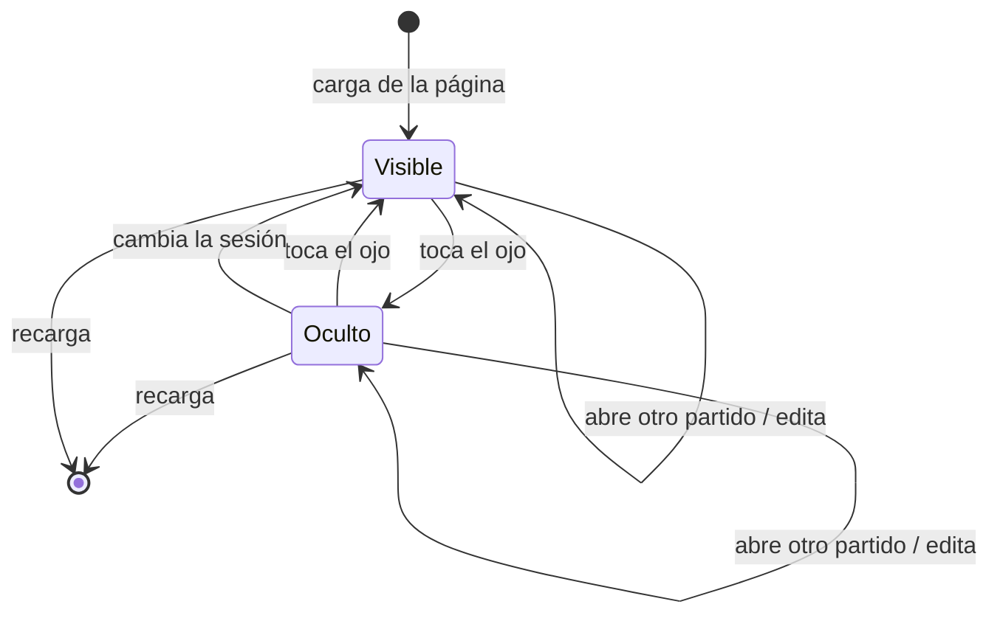

# Ocultar los puntajes de la pantalla de equipos — Spec

> **Status:** Draft · **Date:** 2026-11-20 · **Owner:** Lucas Manoukian
>
> **Reviewers:** *pending*
>
> **Concept note:** [OCULTAR_PUNTAJES_CONCEPT.md](./OCULTAR_PUNTAJES_CONCEPT.md)
>
> **Implementation plan:** *not yet written*

> **Grounding evidence (`MD-25`).** Esta Spec se apoya en el ledger §6.5 *Sources &
> Origins* del Concept Note. Donde un `FR-*`/`NFR-*`/`TC-*` se apoya en una ubicación de
> código o en una Spec vigente que el Concept Note no cubre, la cita va **en línea** en la
> sección donde se define el requisito. Las líneas de `index.html` citadas son las de la
> rama `docs/ocultar-puntajes` al 2026-11-20 (commit `e77e06d`).

> **Declaración de reemplazo (gobernanza vigente en [`AGENTS.md`](../../AGENTS.md)).**
> Esta Spec acota requisitos de cinco specs vigentes. Ninguno se deroga: todos siguen
> valiendo tal cual **mientras el ojo está en "visible"**, y los de la primera tabla
> además dejan de valer para `jugador` en cualquier estado.
>
> **1. Lo que `jugador` deja de ver siempre (`D-06`, `FR-050` a `FR-052` de esta Spec).**
>
> | Spec | Parte acotada | Qué cambia |
> |---|---|---|
> | [`PARTIDO_FINALIZADO_SPEC.md`](../equipos-en-el-campo/rebanada-4-partido-finalizado/PARTIDO_FINALIZADO_SPEC.md) | `FR-041` | El puntaje de armado a cada costado del marcador, en dos columnas, sólo lo ve `admin`, y sólo en "visible". El nombre del equipo lo siguen viendo los dos roles. |
> | ídem | `FR-042b` | El puntaje en el encabezado del campo, en una columna: ídem. Sin puntaje, el encabezado no se dibuja (`FR-038`). |
> | ídem | `S-04`, `S-04b` | Pasan a describir a `admin` en "visible". |
> | ídem | `FR-060`, `AC-06` | "La fila de resultado … sin restricciones" pasa a "la fila de resultado sin el puntaje de armado". |
> | ídem | `AC-05` | Pasa a describir a `admin` en "visible". Además, **ya contradice hoy a `S-04` y al código**: dice "sin ningún nombre ni puntaje de armado en esa fila, en cualquier ancho", el texto de la enmienda del 2026-09-02, y no se actualizó con la del 2026-09-04, que devolvió nombre y puntaje a la fila en dos columnas (§18 de ese spec). Se corrige al marcarlo: con un resultado 4-3, a 1200 px la fila muestra los dos nombres, "4 – 3" y los dos puntajes, y no hay encabezado arriba del campo; a 360 px la fila muestra sólo el marcador y el encabezado del campo visible muestra sólo el puntaje. |
> | [`CARGA_POR_TOQUE_SPEC.md`](../equipos-en-el-campo/rebanada-6-carga-por-toque/CARGA_POR_TOQUE_SPEC.md) | `FR-003` (por herencia) | No se edita. `FR-003` dice que, con la inscripción cerrada, `jugador` ve "la cancha … en el modo de lectura de la rebanada 4"; ese modo de lectura incluye la fila de resultado de `FR-041`, que es lo que hoy dibuja el "pts" de `jugador` durante la carga ([index.html:7238](../../index.html#L7238)). Al acotarse `FR-041`, la carga queda cubierta. Esto responde la pregunta de §16 del Concept Note. |
>
> **2. Lo que deja de dibujarse mientras el ojo está en "oculto" (`D-02`, `FR-020` a
> `FR-038`).**
>
> | Spec | Parte acotada |
> |---|---|
> | [`CANCHA_SPEC.md`](../equipos-en-el-campo/rebanada-1-cancha/CANCHA_SPEC.md) (rebanada 1) | `FR-023b` (el `title` declara que no juega en su principal), `FR-024` (el puntaje sobre la camiseta), `FR-025` (la mención "sin puntaje" en el `title`), `FR-030` (el candado) |
> | [`PANEL_ARMADO_SPEC.md`](../equipos-en-el-campo/rebanada-3-panel-armado/PANEL_ARMADO_SPEC.md) (rebanada 3) | `FR-003`, `FR-004`, `FR-005`, `FR-009` (la píldora de diferencia y su descripción emergente), `FR-010` (el combo de estrategia), `FR-020` (el aviso de equipos desactualizados), `FR-030` (la grilla de diferencia por línea), `FR-040` ("Por qué quedaron así"), `FR-054` (el total en el encabezado del panel) |
> | [`POSICIONES_DEL_JUGADOR_SPEC.md`](../posiciones-del-jugador/POSICIONES_DEL_JUGADOR_SPEC.md) | `FR-025` (las pastillas «2º» y «!»), `FR-025b` (la «!» de las pestañas y su cantidad en el nombre accesible), `FR-025c` sólo en su `title` del número (el número se va con `FR-024`; cómo se valúa no cambia), `FR-021b` (el recuadro del candidato con costo y su `title`; vale también para el arrastre), `FR-012b` (la cuenta de candidatos en cada pestaña) |
> | [`PARTIDO_FINALIZADO_SPEC.md`](../equipos-en-el-campo/rebanada-4-partido-finalizado/PARTIDO_FINALIZADO_SPEC.md) | `FR-041`, `FR-042b` también para `admin` (ver tabla 1) |
>
> **No reemplaza** —y lo declara para que no se lea como contradicción— a
> [`DESGLOSE_POSICIONES_SPEC.md`](../desglose-posiciones/DESGLOSE_POSICIONES_SPEC.md)
> `FR-042`: el aviso de bloqueo se sigue viendo en los dos estados (`FR-041` de esta Spec,
> enmienda de `D-02` del 2026-11-20). Tampoco reemplaza a
> [`007-permisos-por-usuario/spec.md`](../007-permisos-por-usuario/spec.md): la tabla 1 lo
> hace cumplir (`FR-004`, `FR-013`), no lo cambia. Ni a `FR-008` de `PANEL_ARMADO_SPEC.md`:
> el texto que copia Copiar no cambia (`FR-060`).
>
> Cada parte acotada quedó marcada el 2026-11-20 en su spec con una nota que apunta a esta
> Spec, y con una fila en el Change log de cada una.
> `tests/layout.test.js:1602-1606`, que hoy exige los dos puntajes de la fila de resultado
> a 1200 px (`S-04` de la rebanada 4), pasa a correr sólo con `admin` en "visible".

## 1. Purpose

Esta Spec define el comportamiento del botón "Ocultar puntajes": para quién está, dónde va,
cómo se ve en cada estado, qué deja de dibujarse mientras está activo y qué no cambia. Define
también la corrección del "pts" por equipo que hoy ve `jugador`. Está escrita para quien
implemente y pruebe la feature. No cubre la motivación ni las alternativas descartadas (ver
Concept Note §2 y §9) ni el detalle de funciones, archivos y ramas, que vive en el
Implementation Plan.

## 2. Summary

El administrador arma los equipos y quiere mandarlos al grupo como imagen, pero la tarjeta
de equipos muestra puntajes por todos lados. Esta feature agrega al encabezado de la
tarjeta, a la izquierda de Copiar, un botón con un ojo. Tocarlo deja de dibujar todo lo que
revela un puntaje o cómo se armaron los equipos —el número sobre cada camiseta, los totales,
la píldora de diferencia, la grilla por línea, "Por qué quedaron así", el combo de
estrategia, el aviso de desactualizado, los candados y las marcas de posición— y deja a la
vista los jugadores, el marcador y los goles y asistencias. Tocarlo otra vez lo devuelve
todo. No guarda nada: el estado vive en la memoria de la página, vale para todos los
partidos con equipos y vuelve a "visible" al recargar. Aparte del botón, y siempre, el rol
`jugador` deja de ver el puntaje de cada equipo junto al marcador, que hoy le aparece en
contra de lo que manda `007-permisos-por-usuario`. El producto sigue siendo el mismo
organizador de partidos: el motor no cambia y ningún dato del partido se modifica.

## 3. Scope

### 3.1 In scope

- El botón del ojo en el encabezado de la tarjeta de equipos, sólo para `admin`, en las
  cuatro situaciones con equipos generados.
- El estado "visible"/"oculto": cómo se alterna, cuánto dura, a qué partidos alcanza.
- La lista cerrada de lo que no se dibuja en "oculto", incluidos los textos emergentes y
  los nombres accesibles que lo mencionan.
- La lista de lo que se sigue viendo y de los gestos que siguen funcionando.
- La corrección del "pts" por equipo de `jugador` (`D-06`).
- El comportamiento responsive de los encabezados y de la tarjeta en los dos estados.

### 3.2 Out of scope / non-goals

Restatean los non-goals del Concept Note §4 y los diferidos de su §14 como límites
verificables.

- El sistema no sacará ni compartirá la captura de pantalla.
- El sistema no cambiará el texto que el botón Copiar escribe en el portapapeles.
- El sistema no ofrecerá el ojo al rol `jugador`.
- El sistema no modificará el motor de generación ni el resumen de generación por causa del
  ojo.
- El sistema no recordará el estado del ojo entre recargas de la página (diferido, Concept
  Note §14; se agrega a `Roadmap.md` con esta Spec).
- El sistema no ocultará a `jugador` las pastillas «2º» y «!» (`D-07`; diferido, Concept
  Note §14).
- El sistema no cambiará lo que `jugador` recibe de Firestore ni las reglas de Firestore.

### 3.3 Constraints inherited from the Concept Note

- **D-01** (botón de ícono con un ojo, sólo `admin`, a la izquierda de Copiar, en las cuatro
  situaciones) — heredada. Ver `FR-001` a `FR-007`, `TC-011`.
- **D-02** (lista de lo que no se dibuja en "oculto") — heredada **con la enmienda del
  2026-11-20**: el aviso de bloqueo sale de la lista y el rojo del candidato con costo
  también se oculta durante el arrastre (Concept Note §18). Ver `FR-020` a `FR-038`.
- **D-03** (lo que se sigue viendo) — heredada, con el aviso de bloqueo agregado por la
  misma enmienda. Ver `FR-040` a `FR-043`.
- **D-04** (sólo visual; los gestos siguen funcionando, bloquear no) — heredada. Ver
  `FR-015`, `FR-016`, `FR-042`, `TC-010`.
- **D-05** (un único estado para la página, arranca en "visible", no se guarda; la pantalla
  sin equipos no se ve afectada) — heredada. Ver `FR-004`, `FR-012` a `FR-014`, `FR-017`,
  `TC-002`. La Spec agrega `FR-018` (vuelve a "visible" al cambiar la sesión), que `D-05`
  no previó porque supone que la única forma de empezar de nuevo es recargar.
- **D-06** (`jugador` no ve ningún "pts" por equipo) — heredada. Ver `FR-050` a `FR-052`,
  `TC-013`, y la tabla 1 de la declaración de reemplazo.
- **D-07** (`jugador` no cambia en nada más) — heredada. Ver `FR-003`, `FR-061`.

**Preguntas abiertas del Concept Note, resueltas acá** (respuestas del owner del
2026-11-20):

- **`OPEN-Q-01`** (nombre accesible) → el nombre y el texto emergente cambian con el estado:
  "Ocultar puntajes" en "visible", "Mostrar puntajes" en "oculto" (`FR-007`), el mismo
  patrón que Copiar, que pasa a "Equipos copiados"
  ([index.html:6935](../../index.html#L6935)).
- **`OPEN-Q-02`** (textos emergentes y nombres accesibles) → también se limpian en "oculto"
  (`FR-036`, `FR-037`). Motivo del owner: con el mouse encima de una camiseta, el texto
  emergente puede salir en la captura.
- **`OPEN-Q-03`** (rebanada 7) → esta feature cubre la necesidad de `showRatings` y
  `showLocks` como gesto momentáneo, no como ajuste guardado. La entrada de
  [`Roadmap.md:47`](../../Roadmap.md) se acota a `nameFormat`.
- **`OPEN-Q-04`** (Regenerar sin efecto visible en "oculto") → el aviso de bloqueo se ve
  siempre (`FR-041`). Habla de posiciones del catálogo anterior y nombra jugadores, no
  puntajes. Esto enmienda `D-02` y `D-03`.

## 4. Technical & architectural constraints

### 4.1 Platform / stack constraints

- **TC-001** — La feature no agregará ninguna dependencia. Los íconos `eye` y `eye-off` de
  Lucide (`lucide-static@0.544.0`, la versión del design system,
  [`Icon.jsx:3`](../../.claude/skills/football-app-design/components/core/Icon.jsx)) se
  incrustarán como SVG en línea, igual que `ICON_COPIAR`
  ([index.html:6892](../../index.html#L6892)).
- **TC-002** — El estado del ojo vivirá sólo en la memoria de la página. No se escribirá ni
  se leerá de `window.storage`, Firestore, `localStorage`, `sessionStorage`, IndexedDB ni
  cookies (`D-05`; `AGENTS.md` ya prohíbe el almacenamiento del navegador como fuente de
  datos).

### 4.2 Architectural / integration constraints

- **TC-010** — Las funciones del motor de generación (`generarEquiposEstrategia1` a `4`,
  `resolverArqueros`, `window.__generarEquipos`) y el texto que produce el resumen de
  generación no se modificarán por causa de esta feature (`D-04`, principio de
  Explicabilidad del motor de `AGENTS.md`).
- **TC-011** — El botón vivirá en los dos encabezados de tarjeta que ya existen,
  `renderEncabezadoTarjeta` ([index.html:6931-6961](../../index.html#L6931-L6961)) y
  `renderEncabezadoPartidoFinalizado`
  ([index.html:7474-7488](../../index.html#L7474-L7488)), con el patrón `.panel-icono` y el
  mismo color que Copiar (`.panel-icono-copiar`,
  [index.html:899-904](../../index.html#L899-L904)), y no en un contenedor nuevo.
- **TC-012** — Lo que esta Spec dice que "no se dibuja" estará ausente del documento de la
  página, no escondido con CSS. Tres razones: el test de layout mide rectángulos, y un
  elemento con `display:none` devuelve uno de cero
  ([index.html:5843-5846](../../index.html#L5843-L5846), mismo criterio que
  `renderZonaEquipos`); un elemento escondido sigue teniendo su texto emergente; y un lector
  de pantalla puede seguir leyéndolo.
- **TC-013** — La corrección de `D-06` dependerá sólo del rol de la sesión, nunca del estado
  del ojo, y no cambiará qué documentos de Firestore recibe `jugador`.

### 4.3 Compliance / regulatory constraints

*Ninguna* — ver Concept Note §5.2: no hay datos regulados. La accesibilidad del botón la
cubre `NFR-004`.

### 4.4 Conventions to follow

- **TC-030** — Cada superficie responsive de §8 tendrá su escenario en
  `tests/layout.test.js`, y cada escenario nuevo se verá fallar al menos una vez (revirtiendo
  el arreglo que lo motiva) antes de darlo por bueno. Todo test que satisfaga un `S-NN`,
  `NFR-NNN` o `TC-NNN` llevará el identificador dentro de un string literal, nunca en un
  comentario (`AGENTS.md` → Tests).
- **TC-031** — La feature no agregará colores, tipografías, radios, sombras ni íconos fuera
  del design system ([`.claude/skills/football-app-design/`](../../.claude/skills/football-app-design/)).
  En "oculto", el candidato con costo se dibuja con el estilo que ya tiene el candidato
  común ([index.html:809](../../index.html#L809)), no con uno nuevo.

### 4.5 Security constraints (`MD-31`)

CWE Top 25 consultado en vivo el 2026-11-20: edición 2025
(`https://cwe.mitre.org/top25/archive/2025/2025_cwe_top25.html`, 25 categorías leídas de la
página).

- **TC-040** — Los textos emergentes y los nombres accesibles que esta feature recorta
  (`FR-036`, `FR-037`) seguirán armándose con el nombre del jugador escapado con
  `escaparHtml`, como hoy ([index.html:5428](../../index.html#L5428)); el botón del ojo sólo
  inserta literales fijos, **defends `CWE-79` *Cross-site Scripting***.
- **`CWE-200` *Exposure of Sensitive Information*** — ruling, no commitment: el ojo es una
  decisión de presentación, no un control de acceso. Los puntajes siguen llegando al
  navegador del `admin`, como hoy, y siguen sin llegar al de `jugador`, porque las reglas de
  Firestore no se lo permiten (Concept Note §5.2,
  [`firestore-rules.md` §3](../rol-en-el-token/contracts/firestore-rules.md)). La
  corrección de `D-06` saca de la pantalla de `jugador` un número que no era un dato real
  (Concept Note, Pain 3).
- **`CWE-862` / `CWE-863` / `CWE-284`** — no aplican: el ojo no escribe nada (`FR-015`,
  `TC-002`), así que no hay ninguna acción que autorizar. Que el botón se dibuje sólo para
  `admin` es una decisión de interfaz, no una barrera.
- Resto de la lista (`CWE-89`, `-352`, `-787`, `-22`, `-416`, `-125`, `-78`, `-94`, `-120`,
  `-434`, `-476`, `-121`, `-502`, `-122`, `-20`, `-306`, `-918`, `-77`, `-639`, `-770`) —
  no aplica: sin entrada de datos, sin consultas, sin archivos, sin endpoints, sin código
  nativo ni deserialización.

## 5. Users & use cases

### 5.1 Personas / actors

| Actor | Description | Primary need |
|---|---|---|
| Administrador (`admin`) | Arma los equipos, carga el resultado y los comparte con el grupo | Mostrar los equipos sin puntajes, con un toque, y volver a verlos con otro |
| Jugador (`jugador`) | Mira los equipos y el resultado desde su cuenta | No ver puntajes en ninguna parte, como ya promete `007` |
| Destinatario de la captura | Integrante del grupo que recibe la imagen | Ver quién juega con quién, el marcador y los goles, sin números que comparen a las personas |

### 5.2 User stories

| ID | Story | Implements |
|---|---|---|
| US-01 | Como administrador, quiero ocultar con un toque todos los puntajes de la tarjeta de equipos, para sacar una captura y mandarla al grupo. | FR-001 a FR-007, FR-010, FR-020 a FR-038 |
| US-02 | Como administrador, quiero volver a ver los puntajes con otro toque, para seguir ajustando los equipos. | FR-011, FR-016 |
| US-03 | Como administrador, quiero que el marcador y los goles y asistencias sigan a la vista en "oculto", porque son lo que interesa compartir. | FR-040 |
| US-04 | Como administrador, quiero poder seguir moviendo jugadores y cargando goles en "oculto", sin tener que volver a "visible" para cada cosa. | FR-042, FR-043 |
| US-05 | Como administrador, quiero que recargar la página me devuelva siempre los puntajes, para no quedarme armando a ciegas sin darme cuenta. | FR-012, FR-014, FR-018 |
| US-06 | Como jugador, no quiero ver el puntaje de ningún equipo junto al resultado. | FR-050 a FR-052 |

## 6. Glossary

| Term | Definition |
|---|---|
| Ojo | El botón de ícono que alterna el estado de ocultamiento. |
| Estado de ocultamiento | Un único valor para toda la página, "visible" u "oculto", que decide si se dibujan los elementos de §7.3. |
| "Visible" | El estado de ocultamiento en el que la tarjeta se dibuja como hoy. Es el estado inicial. |
| "Oculto" | El estado de ocultamiento en el que no se dibujan los elementos de §7.3. |
| Situación | Cada una de las cuatro formas en que la tarjeta muestra equipos generados: **armado** (inscripción abierta), **carga** (inscripción cerrada, partido sin finalizar), **finalizado** (partido finalizado, sin edición) y **edición** (editando el resultado de un partido finalizado). No son los estados de `001-organizacion-partidos`: la carga es una condición y la edición, un modo (Concept Note `D-01`). |
| Partido sin equipos | Un partido sin titulares o con titulares y sin equipos generados. Su pantalla dibuja "Generar equipos" y no tiene el ojo ([index.html:7145-7176](../../index.html#L7145-L7176)). |
| "Pts" por equipo | El puntaje total de un equipo que la tarjeta dibuja en tres lugares: el encabezado del campo en armado, carga y edición; la fila de resultado en dos columnas; y el encabezado del campo del finalizado en una columna (Concept Note §6.5). |
| Una columna / dos columnas | La tarjeta en una columna hasta 1099 px de ancho y en dos desde 1100 px ([index.html:829](../../index.html#L829)). En una columna se ve un equipo por vez, elegido con las pestañas Blanco/Negro. |
| Candidato con costo | Durante la selección para intercambiar puesto o durante un arrastre, la camiseta con la que el intercambio dejaría a alguien fuera de puesto; hoy se pinta de rojo (`FR-021b` de `posiciones-del-jugador`). |

## 7. Functional requirements

### 7.1 El botón

- **FR-001** — Donde el rol de la sesión sea `admin`, el sistema mostrará el ojo en el
  encabezado de la tarjeta de equipos en cada una de las cuatro situaciones.
- **FR-002** — El sistema ubicará el ojo inmediatamente a la izquierda del botón Copiar: en
  armado, entre Intercambiar colores y Copiar; en carga y en edición, primero, porque ahí no
  hay Intercambiar colores ([index.html:6315-6317](../../index.html#L6315-L6317)); en
  finalizado, antes de Copiar y Editar resultado.
- **FR-003** — Donde el rol de la sesión sea `jugador`, el sistema no mostrará el ojo.
- **FR-004** — Mientras el partido abierto no tenga equipos generados, el sistema no
  mostrará el ojo.
- **FR-005** — El sistema dibujará el ojo con el mismo tamaño (44 × 44 px), forma y color
  que Copiar.
- **FR-006** — El sistema mostrará en el ojo el ícono `eye` mientras el estado sea
  "visible" y el ícono `eye-off` mientras sea "oculto".
- **FR-007** — El sistema dará al ojo el nombre accesible y el texto emergente "Ocultar
  puntajes" mientras el estado sea "visible", y "Mostrar puntajes" mientras sea "oculto".

### 7.2 Alternar el estado

- **FR-010** — When el administrador toca el ojo con el estado en "visible", el sistema
  pasará el estado a "oculto" y repintará la tarjeta.
- **FR-011** — When el administrador toca el ojo con el estado en "oculto", el sistema
  pasará el estado a "visible" y repintará la tarjeta.
- **FR-012** — When se carga la página, el sistema iniciará el estado en "visible".
- **FR-013** — When el administrador abre otro partido, el sistema conservará el estado de
  ocultamiento.
- **FR-014** — El sistema no guardará el estado de ocultamiento en ningún lugar que
  sobreviva a una recarga.
- **FR-015** — When el administrador toca el ojo, el sistema no modificará ningún dato del
  partido: equipos, bloqueados, posiciones asignadas, resultado ni borrador de carga.
- **FR-016** — When el administrador toca el ojo, el sistema conservará el resto del estado
  de la pantalla: el equipo visible en una columna, la selección para intercambiar puesto en
  curso, el tipo de evento activo de la carga y la posición de scroll.
- **FR-017** — While el partido abierto no tenga equipos generados, el sistema mostrará el
  combo de estrategia, el aviso de bloqueo y "Generar equipos" sea cual sea el estado de
  ocultamiento.
- **FR-018** — When se cierra la sesión o se abre una sesión nueva, el sistema volverá el
  estado a "visible". Cerrar sesión no recarga la página
  ([index.html:8740-8782](../../index.html#L8740-L8782)), así que sin este requisito el
  estado de un `admin` pasaría a la cuenta siguiente que entre en la misma pestaña.

### 7.3 Lo que no se dibuja en "oculto"

Cada requisito de esta sección vale en las cuatro situaciones y en los dos anchos, y se
cumple con el elemento ausente del documento (`TC-012`).

- **FR-020** — While el estado sea "oculto", el sistema no dibujará el puntaje sobre
  ninguna camiseta, tampoco el de una dupla de rotación.
- **FR-021** — While el estado sea "oculto", el sistema no dibujará la pastilla «2º» en
  ninguna camiseta.
- **FR-022** — While el estado sea "oculto", el sistema no dibujará la pastilla «!» en
  ninguna camiseta.
- **FR-023** — While el estado sea "oculto", el sistema no dibujará la «!» de las pestañas
  Blanco/Negro.
- **FR-024** — While el estado sea "oculto", el sistema no dibujará los candados.
- **FR-025** — While el estado sea "oculto", el sistema no dibujará el "pts" por equipo en
  el encabezado del campo, en armado, carga y edición.
- **FR-026** — While el estado sea "oculto", el sistema no dibujará el "pts" por equipo en
  la fila de resultado; el nombre de cada equipo y el marcador se siguen dibujando.
- **FR-027** — While el estado sea "oculto", el sistema no dibujará el "pts" por equipo en
  el encabezado del campo del finalizado en una columna.
- **FR-028** — While el estado sea "oculto", el sistema no dibujará la píldora de
  diferencia, ni en el encabezado (dos columnas) ni en su fila propia (una columna).
- **FR-029** — While el estado sea "oculto", el sistema no dibujará la grilla de diferencia
  por línea.
- **FR-030** — While el estado sea "oculto", el sistema no dibujará "Por qué quedaron así".
- **FR-031** — While el estado sea "oculto", el sistema no dibujará el combo de estrategia.
- **FR-032** — While el estado sea "oculto", el sistema no dibujará el aviso de equipos
  desactualizados.
- **FR-033** — While el estado sea "oculto" y haya una selección para intercambiar puesto,
  el sistema dibujará todo candidato con costo igual que un candidato común.
- **FR-034** — While el estado sea "oculto" y haya un arrastre en curso, el sistema marcará
  todo candidato con costo igual que un candidato común.
- **FR-035** — While el estado sea "oculto" y haya una selección para intercambiar puesto,
  el sistema no dibujará la cuenta de candidatos de cada pestaña.
- **FR-036** — While el estado sea "oculto", el sistema dará a cada camiseta un texto
  emergente con el nombre del jugador (o de la dupla), "dupla de rotación" cuando
  corresponda, el nombre de su puesto asignado y los gestos disponibles, sin las menciones
  "sin puntaje", "(su puesto es …)", "(posición secundaria)", "fuera de puesto" ni "se puede
  intercambiar pero queda fuera de puesto" ([index.html:5412-5428](../../index.html#L5412-L5428)).
- **FR-037** — While el estado sea "oculto", el sistema dará a cada pestaña Blanco/Negro
  sólo el nombre accesible "Equipo Blanco" o "Equipo Negro", sin la cantidad fuera de puesto
  ni la cuenta de opciones ([index.html:5800-5805](../../index.html#L5800-L5805)).
- **FR-038** — If el encabezado de un campo quedaría sin ningún contenido visible, then el
  sistema no lo dibujará. Pasa en una columna, donde el nombre del equipo ya está escondido
  ([index.html:834](../../index.html#L834)) y el encabezado se quedaría sin el "pts"; vale
  también para `jugador` (`FR-051`).

### 7.4 Lo que se sigue viendo en "oculto"

- **FR-040** — While el estado sea "oculto", el sistema dibujará igual que en "visible"
  todo elemento de la tarjeta que §7.3 no nombra: las canchas, los jugadores y las duplas,
  el marcador, los nombres de equipo de la fila de resultado, los chips de goles, goles en
  contra y asistencias, las filas de detalle, la barra y las acciones de carga, los demás
  botones del encabezado (Intercambiar colores, Copiar, Regenerar, Editar resultado), la
  botonera al pie y los textos de partido finalizado o en edición.
- **FR-041** — El sistema dibujará el aviso de bloqueo igual en "visible" y en "oculto".
- **FR-042** — While el estado sea "oculto", el sistema mantendrá disponibles todos los
  gestos de edición que hay en "visible": arrastrar, tocar para intercambiar puesto, cargar
  por toque, deshacer, intercambiar colores, regenerar y editar el resultado. Bloquear no,
  porque el candado no se dibuja (`FR-024`).
- **FR-043** — When un gesto de edición cambia los equipos o el resultado con el estado en
  "oculto", el sistema repintará la tarjeta respetando §7.3 y conservará el estado en
  "oculto".

### 7.5 El "pts" por equipo de `jugador`

- **FR-050** — Donde el rol de la sesión sea `jugador`, el sistema no dibujará el "pts"
  por equipo en la fila de resultado, en carga ni en finalizado; el nombre de cada equipo y
  el marcador se siguen dibujando.
- **FR-051** — Donde el rol de la sesión sea `jugador`, el sistema no dibujará el "pts"
  por equipo en el encabezado del campo del finalizado en una columna.
- **FR-052** — Donde el rol de la sesión sea `jugador`, el sistema no dibujará ningún
  puntaje de equipo en ninguna situación ni ancho.

### 7.6 Lo que no cambia

- **FR-060** — El sistema escribirá en el portapapeles, al tocar Copiar, el mismo texto en
  "visible" y en "oculto".
- **FR-061** — Donde el rol de la sesión sea `jugador`, el sistema seguirá dibujando las
  pastillas «2º» y «!» y la «!» de las pestañas como hoy.

## 8. Non-functional requirements

| ID | Category | Requirement |
|---|---|---|
| NFR-001 | Responsive | En cada situación que el rol puede ver —las cuatro para `admin`, en "visible" y en "oculto"; armado, carga y finalizado para `jugador`—, a 360, 768, 1099, 1100 y 1200 px de ancho: la página no produce scroll horizontal (`scrollWidth === clientWidth`) y ningún elemento queda con el borde derecho fuera del viewport (`AGENTS.md`, Responsive por diseño). |
| NFR-002 | Responsive | A 360 px, en armado con Intercambiar colores presente, los cuatro botones de ícono del encabezado (Intercambiar, ojo, Copiar, Regenerar) quedan en una misma fila, cada uno de 44 × 44 px. En finalizado, lo mismo para el ojo, Copiar y Editar resultado. |
| NFR-003 | Responsive | En "oculto", y para `jugador` en cualquier estado, la tarjeta no deja ningún contenedor vacío con alto mayor que 0 donde estaban los elementos de §7.3: ni la fila de la píldora en una columna, ni el encabezado de un campo (`FR-038`). Se mide a 360 y a 1200 px. |
| NFR-004 | Accessibility | El ojo tiene un nombre accesible que expone en qué estado está (`FR-007`; WCAG 2.1, criterio 4.1.2 *Name, Role, Value*, nivel A, verificado en el Concept Note §6.5) y un área táctil de 44 × 44 px. |
| NFR-005 | Persistence | Alternar el ojo 10 veces seguidas produce 0 escrituras y 0 lecturas sobre `window.storage` y sobre el almacenamiento del navegador. |
| NFR-006 | Maintainability | En "oculto", para las cuatro situaciones, en una y dos columnas, con y sin selección para intercambiar puesto, el HTML de la tarjeta no contiene ninguno de los elementos de §7.3. Se verifica con un único test que recorre esas combinaciones, para que un elemento de puntaje agregado en el futuro sin pasar por el ojo lo haga fallar (riesgo de Concept Note §11). |

## 9. System behaviour & scenarios

### 9.1 Happy path scenarios

#### Scenario S-01 — Ocultar en el armado (covers FR-001, FR-002, FR-005, FR-006, FR-007, FR-010, FR-020, FR-024, FR-025, FR-028 a FR-032, FR-040)

- **Given** un partido con la inscripción abierta y equipos generados, una sesión `admin`,
  un viewport de 1200 px y el estado en "visible"
- **And** la tarjeta muestra la píldora "Diferencia 1.5 pts", los totales "52.5 pts" y
  "51 pts", la grilla por línea y "Por qué quedaron así"
- **And** el encabezado muestra, en este orden, Intercambiar colores, el ojo, Copiar y
  Regenerar, y el ojo dice "Ocultar puntajes"
- **When** el administrador toca el ojo
- **Then** la tarjeta deja de dibujar los puntajes de las camisetas, los candados, los dos
  totales, la píldora, la grilla, "Por qué quedaron así" y el combo de estrategia
- **And** cada cancha sigue mostrando sus jugadores con su nombre
- **And** el ojo muestra el ícono tachado y dice "Mostrar puntajes"
- **And** Intercambiar colores, Copiar, Regenerar y la botonera al pie siguen en su lugar

**Variants:**

- `S-01a [boundary]` — a 360 px (una columna): no se dibuja la fila de la píldora ni la «!»
  de las pestañas, y el encabezado del campo, que sólo tenía el total, no se dibuja
  (`FR-023`, `FR-028`, `FR-038`)
- `S-01b [boundary]` — con el aviso de equipos desactualizados presente en "visible": en
  "oculto" no se dibuja (`FR-032`)
- `S-01c [boundary]` — con un titular de posiciones del catálogo anterior: el aviso de
  bloqueo se dibuja igual en los dos estados (`FR-041`)
- `S-01d [boundary]` — con una dupla de rotación y un jugador «2º» y otro «!»: en "oculto"
  no se dibuja el puntaje de la dupla ni ninguna de las dos pastillas (`FR-020`, `FR-021`,
  `FR-022`)
- `S-01e [boundary]` — con la inscripción cerrada (carga), donde no hay Intercambiar
  colores ni Regenerar: el encabezado muestra el ojo y Copiar, en ese orden (`FR-002`)

#### Scenario S-02 — Volver a "visible" (covers FR-011, FR-006, FR-007)

- **Given** el partido de `S-01` con el estado en "oculto"
- **When** el administrador toca el ojo
- **Then** la tarjeta vuelve a dibujar todo lo que `S-01` dejó de dibujar, con los mismos
  valores
- **And** el ojo muestra el ícono sin tachar y dice "Ocultar puntajes"

**Variants:**

- `S-02a [property]` — para cualquier partido con equipos y cualquier situación, tocar el
  ojo dos veces deja el HTML de la tarjeta idéntico al de antes del primer toque

#### Scenario S-03 — Ocultar en un partido finalizado (covers FR-001, FR-002, FR-026, FR-027, FR-040)

- **Given** un partido finalizado 5 a 3, una sesión `admin`, un viewport de 1200 px y el
  estado en "visible"
- **And** la fila de resultado muestra "Equipo Blanco 52.5 pts", "5 – 3" y "Equipo Negro
  51.5 pts"
- **And** el encabezado muestra el ojo, Copiar y Editar resultado, en ese orden
- **When** el administrador toca el ojo
- **Then** la fila de resultado muestra "Equipo Blanco", "5 – 3" y "Equipo Negro", sin
  ningún "pts"
- **And** los chips de goles y asistencias de cada camiseta y las filas de detalle siguen
  igual

**Variants:**

- `S-03a [boundary]` — a 360 px: la fila muestra sólo "5 – 3" y no se dibuja ningún
  encabezado arriba del campo visible (`FR-027`, `FR-038`)
- `S-03b [boundary]` — resultado 0 a 0: la fila muestra "0 – 0" y los nombres, sin "pts"

#### Scenario S-04 — Ocultar durante la carga del resultado (covers FR-001, FR-025, FR-026, FR-042, FR-043)

- **Given** un partido con la inscripción cerrada y sin finalizar, una sesión `admin`, un
  viewport de 1200 px y el estado en "oculto"
- **When** el administrador elige "Gol" en la barra de carga y toca la camiseta de un
  jugador del Blanco
- **Then** el marcador pasa de "0 – 0" a "1 – 0" y aparece el chip de gol sobre esa
  camiseta
- **And** la fila de resultado sigue sin "pts" y no se dibuja ningún total
- **And** el estado sigue en "oculto"

**Variants:**

- `S-04a [boundary]` — editando el resultado de un partido finalizado: la misma carga, con
  el mismo resultado (`FR-001`, situación edición)
- `S-04b [boundary]` — a 360 px: la fila muestra sólo el marcador y no se dibuja ningún
  encabezado arriba del campo visible (`FR-025`, `FR-038`)
- `S-04c [boundary]` — tocar Deshacer en "oculto" saca el gol y el marcador vuelve a
  "0 – 0" (`FR-042`)
- `S-04d [boundary]` — a 360 px, con la pestaña Negro y el tipo "Asistencia" activos y la
  página desplazada hasta la cancha: tocar el ojo deja la pestaña Negro, "Asistencia" y la
  posición de scroll como estaban (`FR-016`)

#### Scenario S-05 — El estado vale para toda la página y no sobrevive a la recarga (covers FR-004, FR-012, FR-013, FR-014, FR-017, FR-018)

- **Given** una sesión `admin` con el estado en "oculto" en el partido A, que tiene equipos
- **When** el administrador abre el partido B, que también tiene equipos
- **Then** el partido B se dibuja en "oculto" y su ojo dice "Mostrar puntajes"
- **When** después abre el partido C, que no tiene equipos generados
- **Then** el partido C no tiene ojo y muestra "Generar equipos", el combo de estrategia y,
  si corresponde, el aviso de bloqueo
- **When** vuelve al partido A
- **Then** el partido A sigue en "oculto"
- **When** recarga la página y abre el partido A
- **Then** el partido A se dibuja en "visible"

**Variants:**

- `S-05a [boundary]` — un partido sin titulares, con el estado en "oculto": muestra el
  combo de estrategia y no tiene ojo (`FR-004`, `FR-017`)
- `S-05b [boundary]` — generar los equipos del partido C con el estado en "oculto": C pasa
  a tener equipos y se dibuja en "oculto", con el ojo tachado (`FR-013`, `FR-043`)
- `S-05c [boundary]` — cerrar sesión con el estado en "oculto" y volver a entrar con la
  misma cuenta `admin`, sin recargar: el partido A se dibuja en "visible" (`FR-018`)

#### Scenario S-06 — Intercambiar puesto en "oculto" (covers FR-033, FR-035, FR-036, FR-042)

- **Given** un partido en armado con puestos, una sesión `admin`, un viewport de 360 px y
  el estado en "oculto"
- **And** con Lucas seleccionado, dos de sus candidatos son con costo y uno es común
- **When** el administrador toca la camiseta de Lucas
- **Then** los tres candidatos se dibujan con el mismo estilo, sin ningún recuadro rojo
- **And** ninguna pestaña muestra la cuenta de candidatos
- **And** el texto emergente de un candidato con costo no dice "queda fuera de puesto"
- **When** toca un candidato con costo
- **Then** el intercambio se aplica igual que en "visible" y no aparece ninguna pastilla «!»

**Variants:**

- `S-06a [boundary]` — arrastrar la camiseta de Lucas en "oculto": ningún candidato se
  marca de rojo durante el arrastre (`FR-034`)
- `S-06b [concurrency]` — tocar el ojo con la selección de Lucas viva: la selección se
  conserva y se vuelve a dibujar según el estado nuevo, sin intercambiar ni cancelar nada
  (`FR-016`)
- `S-06c [boundary]` — en "visible", la misma selección sigue mostrando el rojo y las
  cuentas como hoy

#### Scenario S-07 — Editar los equipos en "oculto" (covers FR-042, FR-043, FR-015, FR-024)

- **Given** un partido en armado, una sesión `admin`, un viewport de 1200 px y el estado en
  "oculto"
- **When** el administrador arrastra un jugador del Blanco al Negro
- **Then** el jugador queda en el Negro y ningún total ni píldora aparece
- **And** el estado sigue en "oculto"

**Variants:**

- `S-07a [boundary]` — tocar Regenerar en "oculto": los equipos se regeneran y la tarjeta
  se vuelve a dibujar en "oculto", sin "Por qué quedaron así"
- `S-07b [boundary]` — tocar Intercambiar colores en "oculto": los colores se intercambian
  y la tarjeta sigue en "oculto"
- `S-07c [failure]` — en "oculto" no hay candado, así que no hay forma de bloquear un
  jugador; los que ya estaban bloqueados siguen bloqueados al volver a "visible" (`FR-015`,
  `FR-024`)
- `S-07d [boundary]` — a 360 px, soltar un jugador sobre la pestaña del otro equipo en
  "oculto" lo mueve igual que en "visible"

#### Scenario S-08 — Los textos que se leen sin verse (covers FR-036, FR-037, NFR-004)

- **Given** un partido en armado, una sesión `admin`, el estado en "oculto", y Ana, que
  juega de Defensor con Mediocampista como puesto principal y no tiene puntaje
- **When** se lee el texto emergente de la camiseta de Ana
- **Then** dice su nombre, "Defensor" y los gestos disponibles
- **And** no dice "su puesto es Mediocampista" ni "sin puntaje"

**Variants:**

- `S-08a [boundary]` — una dupla en un puesto secundario: el texto emergente no dice
  "(posición secundaria)"
- `S-08b [boundary]` — un jugador fuera de puesto: el texto emergente no dice "fuera de
  puesto"
- `S-08c [boundary]` — a 360 px, con dos jugadores del Blanco fuera de puesto: el nombre
  accesible de la pestaña es "Equipo Blanco", sin "2 fuera de puesto" (`FR-037`)
- `S-08d [boundary]` — el ojo se anuncia como botón con el nombre "Ocultar puntajes" en
  "visible" y "Mostrar puntajes" en "oculto" (`NFR-004`)

#### Scenario S-09 — `jugador` no ve el "pts" por equipo (covers FR-050, FR-051, FR-052, FR-003, FR-061)

- **Given** un partido finalizado 4 a 3 y una sesión `jugador`, en un viewport de 1200 px
- **When** se muestra la tarjeta
- **Then** la fila de resultado muestra "Equipo Blanco", "4 – 3" y "Equipo Negro", sin
  ningún "pts"
- **And** el encabezado muestra Copiar y no muestra el ojo
- **And** las pastillas «2º» y «!» se ven como hoy

**Variants:**

- `S-09a [boundary]` — a 360 px: la fila muestra sólo "4 – 3" y no se dibuja ningún
  encabezado arriba del campo (`FR-051`, `FR-038`)
- `S-09b [boundary]` — con la inscripción cerrada y sin finalizar, a 1200 px: la fila
  muestra los nombres y el marcador, sin "pts" (`FR-050`)
- `S-09c [property]` — para `jugador`, en cualquier situación y ancho, el texto de la
  tarjeta no contiene "pts" ni ningún puntaje de equipo (`FR-052`)
- `S-09d [boundary]` — un `admin` deja el estado en "oculto", cierra sesión y entra una
  cuenta `jugador` en la misma pestaña, sin recargar: `jugador` ve las pastillas «2º» y «!»
  como siempre y sigue sin ver ningún "pts" (`FR-018`, `FR-061`, `TC-013`)

#### Scenario S-10 — El ojo no toca los datos (covers FR-014, FR-015, FR-060, NFR-005)

- **Given** un partido en armado, una sesión `admin` y el guardado observado
- **When** el administrador toca el ojo 10 veces seguidas y después toca Copiar
- **Then** no hubo ninguna escritura ni lectura de `window.storage` ni del almacenamiento
  del navegador
- **And** los equipos, los bloqueados y las posiciones asignadas son los mismos que antes
- **And** el texto copiado es el mismo que se copia en "visible"

**Variants:**

- `S-10a [property]` — para cualquier secuencia de toques del ojo intercalada con abrir
  partidos, los datos de todos los partidos quedan iguales y el estado final es "oculto" si
  la cantidad de toques es impar

#### Scenario S-11 — Los encabezados entran desde 360 px (covers NFR-001, NFR-002, FR-002, FR-005)

- **Given** un partido en armado con Intercambiar colores presente y una sesión `admin`
- **When** se muestra la tarjeta a 360 px
- **Then** los cuatro botones de ícono quedan en una misma fila, de 44 × 44 px cada uno
- **And** la página no produce scroll horizontal y ningún elemento queda fuera del viewport
  por la derecha

**Variants:**

- `S-11a [boundary]` — a 1099 y 1100 px, de los dos lados del cambio de una a dos columnas,
  en "visible" y en "oculto"
- `S-11b [boundary]` — a 768 px (franja de tablet), en las cuatro situaciones
- `S-11c [boundary]` — el encabezado del finalizado a 360 px: el ojo, Copiar y Editar
  resultado en una misma fila
- `S-11d [boundary]` — la tarjeta de `jugador` a 360 y 1200 px, una vez aplicada la
  corrección: sin scroll horizontal y sin contenedores vacíos (`NFR-003`)

### 9.2 Edge cases

Sin escenarios propios: los casos de borde viven como variantes de §9.1.

### 9.3 Failure / unwanted-behaviour scenarios

Sin escenarios propios: la única acción no disponible en "oculto" (bloquear) es la variante
`S-07c`, y la ausencia del ojo para `jugador` está en `S-09`.

## 10. Data model & external contracts

### 10.1 Domain entities (conceptual)

No hay entidades nuevas. El estado de ocultamiento es un valor de la página, no un dato del
dominio: no se guarda ni pertenece a ningún partido (`D-05`, `TC-002`). Sin entidades
nuevas, no corresponde el diagrama de §10.1.1.

### 10.2 External APIs / events the feature consumes

Ninguno. La feature no lee nada nuevo de Firestore.

### 10.3 External APIs / events the feature exposes

Ninguno.

## 11. Acceptance criteria

### 11.1 Functional acceptance

- **AC-01** — `S-01` a `S-08` y sus variantes pasan con una sesión `admin` (cubre `FR-001`
  a `FR-043`).
- **AC-02** — `S-09` y sus variantes pasan con una sesión `jugador` (cubre `FR-003`,
  `FR-050` a `FR-052`, `FR-061`).
- **AC-03** — `S-10` pasa: el texto de Copiar es el mismo en los dos estados (cubre
  `FR-060`).
- **AC-04** — Cada parte acotada de la declaración de reemplazo está marcada en su spec con
  una nota que apunta a esta Spec, y `AC-05` de `PARTIDO_FINALIZADO_SPEC.md` está corregido
  (cubre la obligación de `AGENTS.md`; lo verifica quien revisa).

### 11.2 Non-functional acceptance

- **AC-10** — `NFR-001`, `NFR-002` y `NFR-003` verificados por escenarios de
  `tests/layout.test.js` (`S-11` y sus variantes, `S-01a`, `S-03a`, `S-04b`, `S-09a`), cada
  uno visto fallar antes del arreglo (`TC-030`).
- **AC-11** — `NFR-004` verificado por `S-08d` y por la medida de 44 × 44 px de `S-11`.
- **AC-12** — `NFR-005` verificado por `S-10` con el guardado observado.
- **AC-13** — `NFR-006` verificado por un test que recorre las cuatro situaciones × una y
  dos columnas × con y sin selección, y falla si encuentra cualquier elemento de §7.3.

### 11.3 Constraint compliance

- **AC-15** — `TC-001`: el diff no agrega ningún `<script>`, `<link>` ni dependencia, y los
  dos íconos son SVG en línea (revisión del diff).
- **AC-16** — `TC-002`: `S-10` pasa, y una búsqueda en el diff no encuentra
  `localStorage`, `sessionStorage`, `indexedDB` ni `document.cookie`.
- **AC-17** — `TC-010`: el diff no toca las funciones del motor nombradas en el TC (revisión
  del diff, `git diff` sobre esas funciones vacío).
- **AC-18** — `TC-011`: el ojo se dibuja dentro de los dos encabezados existentes con la
  clase de Copiar (revisión del diff y `S-01`, `S-03`).
- **AC-19** — `TC-012`: los tests de §7.3 verifican que el elemento no existe en el
  documento, no que mide cero.
- **AC-20** — `TC-013`: `S-09d` pasa.
- **AC-21** — `TC-030`: cada escenario nuevo de `tests/layout.test.js` se vio fallar, y el
  Plan lo registra; los IDs están en strings literales (gates del Plan).
- **AC-22** — `TC-031`: el diff no agrega colores ni estilos fuera de los tokens del design
  system (revisión contra `.claude/skills/football-app-design/`).
- **AC-23** — `TC-040`: un test con un jugador de nombre `<b>Ana</b>` verifica que su
  texto emergente en "oculto" lo muestra escapado.

### 11.4 Negative / safety acceptance

- **AC-30** — `S-10` no produce ninguna escritura sobre el guardado, observado con un
  guardado de prueba.
- **AC-31** — `S-09c` no encuentra "pts" en la tarjeta de `jugador` en ninguna combinación.

### 11.5 Test & traceability obligations

> **Convención de binding.** Todo test que satisfaga un ID de esta Spec lo lleva en forma
> canónica con guion dentro de un string literal: el nombre del caso, o el campo `spec:` de
> un escenario de `layout.test.js` (`AGENTS.md` → Tests). Nunca en un comentario.

- **AC-50** — Every scenario in §9 — including every enumerated variant (`S-NNa`, `S-NNb`, …) — has at least one runnable test referenced in the Plan's §12.1 *Scenario Traceability Matrix*, with the scenario or variant ID embedded via a **structurally-anchored** binding (a string literal in the test case name or in a `spec:` field — *not* in a comment or docstring; those false-match the `T-N.D8` grep gate). The §16 *AC coverage* matrix should also cite the scenarios or scenario ranges each `AC-*` aggregates — this half is **reviewer-checked, not mechanically gated**. Additionally, every scenario heading in §9 is followed by either a `Variants:` block enumerating its shifts or the explicit `Variants: none — single-path scenario` declaration. Mechanically enforced by Plan `T-N.D8` **and** `T-N.D8b`.
- **AC-51** — Every NFR in §8 with a quantified target has a measurement test referenced in the Plan's §12, with the NFR ID embedded similarly.
- **AC-52** — Every TC in §4 has a §11.3 compliance check AND a corresponding entry in the Plan's §12 (a runnable verification with the TC ID embedded, or the named reviewer / review checklist for non-mechanical TCs). Mechanically gated by Plan `T-N.D10` **and** `T-N.D10b`.
- **AC-53** — The change has at least one `IMP-*` row in the Plan's §12.2 *Impact Traceability* matrix for every materially-affected scope (`code` / `system` / `business` / `external`), at feature granularity. Mechanically gated by Plan `T-N.D15`.
- **AC-54** — Every NFR in §8 with a quantified target has at least one `OBS-*` row in the Plan's §11 *Observability*, with the NFR ID in its *Binds to* column. Mechanically gated by Plan `T-N.D16`.
- **AC-55** — Every direct and transitive dependency in the branch's committed lockfile passes a current-advisory-DB check with no unwaived advisory. The repository versions no lockfile (`AGENTS.md` → Dependencias), so the Plan declares `Supply-chain: none — <reason>` in §5 and this AC is satisfied vacuously. Mechanically gated by Plan `T-N.D20`.

## 12. Success metrics

| Metric | Target | Measurement |
|---|---|---|
| Capturas compartidas sin recortar | El owner deja de recortar capturas de los equipos | Observación del owner en el grupo; la aplicación no registra el uso del ojo (`D-05`) |
| Puntajes vistos por jugadores | Ningún jugador comenta ver puntajes en una captura ni en su cuenta | Observación del owner en el grupo |

## 13. Dependencies

- **Upstream specs:** `007-permisos-por-usuario` (`FR-004`, `FR-013`); rebanadas 1, 3, 4 y
  6 de `equipos-en-el-campo`; `posiciones-del-jugador`; `intercambiar-colores` (el botón que
  queda a la izquierda del ojo); `desglose-posiciones` (el aviso de bloqueo, que no se
  oculta).
- **Internal modules:** el dibujo de la tarjeta de equipos en `index.html` (Concept Note
  §6); `tests/layout.test.js` y los tests de Node de `tests/`.
- **Feature flags / config:** ninguno.
- **Third-party APIs:** ninguna nueva. Los íconos se copian de Lucide al código; no se
  cargan en ejecución.

## 14. Assumptions

- **A-01** — Abrir otro partido no recarga la página: la aplicación cambia de partido en la
  misma página, así que un valor en memoria sobrevive al cambio (`FR-013`).
  `[INFERRED — de que el partido abierto es una variable, `currentMatchId`, que se lee al
  repintar (index.html:7491-7494); no se probó la navegación en el navegador]`
- **A-02** — `jugador` nunca recibe `playerScores` ni `partidosArmado`
  ([index.html:2276](../../index.html#L2276)). Si dejara de ser así, la corrección de `D-06`
  seguiría valiendo, pero el riesgo de §5.2 del Concept Note cambiaría.
- **A-03** — Las cuatro situaciones son todas aquellas en que la tarjeta muestra equipos
  generados ([index.html:7198-7289](../../index.html#L7198-L7289)).
- **A-04** — `updateTeamTotalsDisplay`
  ([index.html:5211-5216](../../index.html#L5211-L5216)) sigue sin llamadores, así que el
  total sólo se dibuja al repintar. Si alguien la vuelve a conectar, `S-07` lo detecta.

## 15. Risks

| Risk | Severity | Likelihood | Spec-level mitigation |
|---|---|---|---|
| Una feature futura agrega un dato de puntaje a la tarjeta y se olvida del ojo | Med | Med | `NFR-006`: un único test que recorre todas las combinaciones y falla ante cualquier elemento de §7.3 |
| El administrador queda armando en "oculto" sin darse cuenta | Med | Med | Ícono tachado y nombre "Mostrar puntajes" (`FR-006`, `FR-007`); la recarga vuelve a "visible" (`FR-012`) |
| A 360 px, cuatro botones de 44 px no entran en una fila junto al título | Med | Low | `NFR-002` y `S-11`; el encabezado ya puede pasar el título arriba (`flex-wrap`, [index.html:888](../../index.html#L888)) |
| Un encabezado de campo vacío queda con margen | Low | Med | `FR-038`, `NFR-003` |
| Marcar las partes acotadas en cinco specs se olvida o queda a medias | Med | Low | `AC-04`, revisado antes de mergear la rama de docs |
| Algún jugador extraña el "pts" junto al resultado | Low | Low | Es lo que `007` ya prometía, y el número no era el real (Concept Note, Pain 3) |

## 16. Open questions

| ID | Question | Owner | Target stage | Notes |
|---|---|---|---|---|
| OPEN-Q-01 | `updateTeamTotalsDisplay` reescribe el total por `id` y hoy nadie la llama: ¿se borra o se protege con la guarda de "oculto"? | Lucas Manoukian | Implementation Plan | Heredada del Concept Note §16; `A-04` |
| OPEN-Q-02 | Ver una vez, con la cuenta `jugador` de staging, que hoy el "pts" por equipo dice "0 pts" | Lucas Manoukian | Implementation Plan | Heredada del Concept Note §16. No bloquea: la Spec saca el "pts" sea cual sea el número |

## 17. Handoff to the Implementation Plan

- **Plan must respect (no relitigation):** every FR-* (§7), every NFR-* (§8), every TC-* (§4), every AC-* (§11 — including the `AC-50`/`AC-51`/`AC-52` test-obligation gates, the `AC-53`/`AC-54` traceability gates, and the `AC-55` supply-chain gate in §11.5), and every Concept Note constraint inherited in §3.3. En particular: lo oculto se omite del documento, no se esconde con CSS (`TC-012`); la corrección de `jugador` no depende del ojo (`TC-013`); el aviso de bloqueo no se oculta (`FR-041`).
- **Plan has freedom over:** dónde vive la variable del estado y cómo se llama; si cada función de dibujo consulta el estado o recibe un parámetro; si reutiliza partes de la rama de `jugador` (Concept Note §9.1); el texto exacto de los comentarios; cómo se arma el test de `NFR-006`.
- **Plan must resolve:** `OPEN-Q-01`, `OPEN-Q-02`.
- **Plan must also:** mover `tests/layout.test.js:1602-1606` a `admin` en "visible"; agregar un escenario de `tests/layout.test.js` por cada superficie de `AC-10`, visto fallar; respetar que `tests/harness.js` recorta funciones por nombre (`AGENTS.md` → Estilo).
- **Deuda de verificación heredada (`MD-26`):** ningún `[UNVERIFIED]` abierto. Un `[INFERRED]` en `A-01`.

## 18. Change log

| Date | Author | Change |
|---|---|---|
| 2026-11-20 | Lucas Manoukian (claude-opus-5-5) | Initial draft. Resuelve `OPEN-Q-01` a `OPEN-Q-04` del Concept Note con respuestas del owner del mismo día: el nombre del ojo cambia con el estado; los textos emergentes y los nombres accesibles también se limpian; el aviso de bloqueo se ve siempre (enmienda `D-02`/`D-03`); la entrada de la rebanada 7 en `Roadmap.md` se acota a `nameFormat`. Hueco encontrado al redactar y resuelto por el owner: el rojo del candidato con costo también se oculta durante el arrastre (`FR-034`, misma enmienda de `D-02`). Ubica el requisito de la rebanada 6 que cubre la fila de `jugador` en carga (`FR-003` de `CARGA_POR_TOQUE_SPEC.md`, por herencia de `FR-041`). Marca las partes acotadas en `CANCHA_SPEC.md`, `PANEL_ARMADO_SPEC.md`, `PARTIDO_FINALIZADO_SPEC.md` (con la corrección de su `AC-05`) y `POSICIONES_DEL_JUGADOR_SPEC.md`. Autocrítica contra la rúbrica, mismo modelo que el autor. 🔴 resuelto: cerrar sesión no recarga la página (`index.html:8740-8782`), así que el estado "oculto" de un `admin` pasaba a la cuenta siguiente de la misma pestaña y, para `jugador`, contradecía `FR-061`; se agrega `FR-018` (vuelve a "visible" al cambiar la sesión), `S-05c` y se reescribe `S-09d`. 🟡 resueltos: `S-01e` describía un armado sin Intercambiar colores, que no existe (`sePuedenIntercambiarColores`, `index.html:6315-6317`); se reemplaza por la carga, y `FR-002` nombra la carga y la edición. `FR-016` no tenía escenario para el equipo visible, el tipo de evento ni el scroll; se agrega `S-04d`. Seis citas de línea corridas, corregidas. 🔵 resuelto: `NFR-001` exigía cuatro situaciones a `jugador`, que ve tres. 🔵 aceptado sin cambio: `FR-042` repite que bloquear no está disponible, ya dicho en `FR-024`; se deja como aclaración. Diagrama de `S-05` renderizado con `mermaid-cli` y revisado a ojo. Self-critique: passed (1🔴 / 2🟡 / 2🔵). |

---

*This Spec defines what the system shall do, how it shall behave, and which
solutions are admissible. Concrete implementation choices (module layout,
file paths, design patterns, library picks within TC-* limits) live in
[OCULTAR_PUNTAJES_IMPLEMENTATION_PLAN.md](./OCULTAR_PUNTAJES_IMPLEMENTATION_PLAN.md).
Motivation and decision rationale live in
[OCULTAR_PUNTAJES_CONCEPT.md](./OCULTAR_PUNTAJES_CONCEPT.md).*
