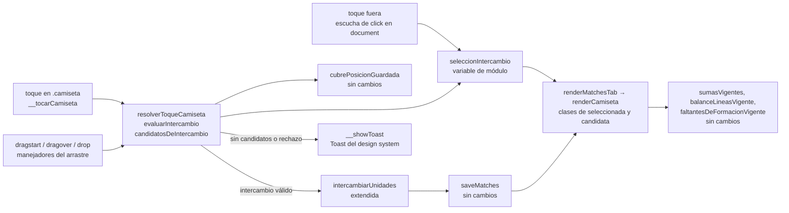
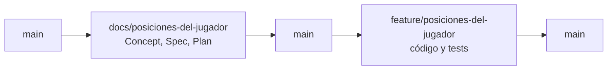

# Posiciones del jugador — Implementation Plan

> **Status:** Draft · **Date:** 2026-10-30 · **Owner:** Lucas Manoukian (claude-opus-5-5)
>
> **Reviewers:** *pending*
>
> **Spec:** [POSICIONES_DEL_JUGADOR_SPEC.md](./POSICIONES_DEL_JUGADOR_SPEC.md)
>
> **Concept note:** [POSICIONES_DEL_JUGADOR_CONCEPT.md](./POSICIONES_DEL_JUGADOR_CONCEPT.md)
>
> **Diseño de referencia:** turno 18h de
> [`diseño/design_handoff_equipos_en_el_campo/Equipos en el campo.dc.html`](./diseño/design_handoff_equipos_en_el_campo/Equipos%20en%20el%20campo.dc.html)
> y su nota [`OPEN-Q-05 - selección e intercambio (18h).md`](./diseño/design_handoff_equipos_en_el_campo/OPEN-Q-05%20-%20selecci%C3%B3n%20e%20intercambio%20(18h).md)

> **Grounding evidence (`MD-25`).** Este Plan se apoya en el ledger §6.5 del Concept Note y en
> las citas en línea de la Spec. Cada tarea que toca un lugar concreto de `index.html` o de
> `tests/` lo cita en la propia tarea. **Los números de línea son los de `index.html` en
> `3f5c5ce`** (punta de `docs/posiciones-del-jugador`, con `index.html` idéntico al de `main`
> `5a98e2a`), verificados leyendo el archivo antes de escribir este Plan. Dentro de la rama de
> código las ediciones corren las líneas: toda tarea posterior a otra que edita el mismo archivo
> ubica su lugar por el nombre de la función o el selector, no por el número.

## 1. Summary

Se agrega a la cancha de armado un segundo gesto sobre la camiseta: tocarla la selecciona, la
cancha resalta a los compañeros y rivales con los que puede intercambiar puesto, y tocar uno de
ellos aplica el intercambio. El arrastre sobre una camiseta pasa a usar la misma regla y los
mismos resaltados. Todo pasa por **una** decisión pura nueva (`evaluarIntercambio`, construida
sobre `cubrePosicionGuardada`, `TC-010`) y por **una** ruta de escritura, la que ya existía
(`intercambiarUnidades`, extendida para escribir el puesto asignado y para intercambiar dentro
del mismo equipo, `TC-011`). El motor de generación no se toca (`TC-012`, `D-30`). El dibujo de
la camiseta tocada y de los candidatos sale del diseño 18h, aprobado por el propietario el
2026-10-30, del que se toma **sólo el dibujo**: el comportamiento es el de la Spec (`TD-13`).
Los avisos pasan al `Toast` del design system, y con ellos los avisos que la aplicación ya
mostraba (`TD-14`).

## 2. Goals & non-goals

- **Objetivo técnico 1** — Una sola función decide si dos unidades pueden intercambiar, y la
  consultan el toque, el resaltado durante el arrastre, el drop y la revalidación del segundo
  toque. Coincide con "lugares sin cubrir" por construcción, porque arma la unidad igual que
  `faltantesDeFormacionVigente` (`TC-010`, `AC-33`).
- **Objetivo técnico 2** — Una sola ruta de escritura para el intercambio, por toque o por
  arrastre: `intercambiarUnidades` (`TC-011`). Escribe sólo `equipos.blanco`, `equipos.negro` y
  las entradas de `equipos.posicionAsignada` de las dos unidades (`NFR-005`).
- **Objetivo técnico 3** — La selección es estado de pantalla en una variable de módulo, nunca
  persistida (`TC-013`), y toda guarda de rol y de ventana vive dentro del manejador, no sólo en
  el render (`TC-040`).

**Non-goals:**

- No se modifica ninguna estrategia del motor, ni `resolverArqueros`, ni `__generarEquipos`
  salvo una línea que descarta la selección (`TC-012`, `FR-019b`).
- No se agrega equivalente de teclado (Spec §3.2, `OPEN-Q-03`), aunque el diseño 18h lo dibuje.
- No se adoptan las conductas del 18h que contradicen la Spec: tocar el pasto **sí** cancela
  (`FR-016`); se puede soltar fuera de un candidato, con el pase y el aviso de hoy (`FR-042`,
  `FR-043`); la pestaña **no** se abre al pasar arrastrando. Decisión del propietario, 2026-10-30.
  El contador de candidatos en las pestañas también había quedado afuera, y el propietario lo
  sumó el mismo día al probar la rama en un iPhone (`D-33`, `FR-012b`, `TD-21`).
- No se agrega ningún feature flag: el proyecto no tiene, y la simplicidad lo prohíbe
  (`AGENTS.md`, Principios).
- No se migra ningún partido ni se agrega ningún campo (`TC-002`).

## 3. Architecture overview



Las dos flechas que importan: toque y arrastre entran por el **mismo** `decide`, que es lo único
que pregunta a `cubrePosicionGuardada`; y sólo `escribe` toca el partido. La interfaz no calcula
la compatibilidad (`TC-010`), el motor no aparece en el diagrama (`TC-012`), y la persistencia
sigue entrando por `saveMatches` y `window.storage` (`TC-002`).

### 3.1 Key design decisions

| ID | Decision | Spec ref | Rationale |
|---|---|---|---|
| TD-01 | La selección es `let seleccionIntercambio = null;` (`{ matchId, id }`, donde `id` es el del primer integrante de la unidad, `grupo[0].id`), declarada junto a `equipoVisibleCancha` ([index.html:5479-5480](../../index.html#L5479-L5480)). Se lee siempre a través de `seleccionVigente(m)`, que la descarta si el partido salió de la ventana de edición o la unidad ya no está en el reparto | `TC-013`, `FR-003`, `FR-019` | Mismo patrón que `equipoVisibleCancha`/`partidoDelEquipoVisible`: estado de pantalla, de módulo, que sobrevive al repintado y al cambio de pestaña (`FR-012`) y muere al recargar. Leerla por una sola función hace que `FR-003` no dependa de acordarse de limpiarla en cada lugar que cierra la ventana |
| TD-02 | `evaluarIntercambio(m, idA, idB, porId)` es la única regla. Devuelve `{ valido, motivo }` con `motivo` de un conjunto cerrado: `null`, `'ajeno'`, `'misma'`, `'mismo-equipo'`, `'mismo-puesto'`, `'a-no-cubre'` (desde `TD-22`; hasta entonces también `'b-no-cubre'` y `'ninguno-cubre'`). `candidatosDeIntercambio` y el drop la consultan; nadie reimplementa la regla | `TC-010`, `FR-020`–`FR-024`, `FR-042b`–`FR-042d`, `TC-042` | Separar "decidir" de "aplicar" es lo que deja testear la regla sin navegador, como hizo `TD-05` de la rebanada 2 con `resolverDestinoDrop`. El motivo sale de la misma evaluación que decide la validez, así el texto del aviso no puede contradecir la decisión |
| TD-03 | La unidad que se evalúa la arma `unidadDeCobertura(m, id, porId)`: el jugador, o `construirUnidadDupla(p, pareja)` si tiene pareja de dupla en el mismo equipo. Es exactamente lo que hace `colapsarDuplasParaLinea` ([index.html:5847](../../index.html#L5847)) antes de que `faltantesDeFormacionVigente` llame a `cubrePosicionGuardada` | `TC-010`, `AC-33`, `D-07` | Si la unidad se armara distinto, "es candidato" y "este lugar está cubierto" podrían disentir para la misma dupla. Armarla igual es la única forma de que `AC-33` sea cierto por construcción y no por casualidad |
| TD-04 | `intercambiarUnidades(m, idA, idB)` ([index.html:5635-5645](../../index.html#L5635-L5645)) deja de rechazar unidades del mismo equipo y, si el partido tiene puestos, intercambia las entradas de `equipos.posicionAsignada` de los integrantes de las dos unidades, leídas **antes** de mover a nadie. No valida la regla: la valida quien la llama | `TC-011`, `FR-030`–`FR-033`, `NFR-005` | Es la ruta que §17 de la Spec pide extender en vez de duplicar. Que no valide mantiene el criterio que ya tenía (la llaman también los tests) y deja una sola regla, en `TD-02` |
| TD-05 | `resolverDestinoDrop` ([index.html:5606-5625](../../index.html#L5606-L5625)) queda geométrica: soltar sobre cualquier camiseta que no sea la propia unidad devuelve `{ tipo: 'intercambiar' }`, sea del propio equipo o del otro. La regla se aplica después, en `aplicarDrop`, con `evaluarIntercambio` | `FR-041`, `FR-042`, `FR-044`, `FR-045b` | El drop pregunta primero "¿sobre qué cayó?" y después "¿se puede?". Así el aviso de `FR-042` y el silencio de `FR-045b` salen del `motivo` de `TD-02` y no de una segunda regla dentro del drop |
| TD-06 | El toque se resuelve con `resolverToqueCamiseta(m, seleccion, idTocado, porId)`, pura, que devuelve `{ accion }` con `accion` ∈ `'seleccionar'`, `'cancelar'`, `'intercambiar'`, `'reparto-cambio'`. El manejador `window.__tocarCamiseta(event, matchId, playerId)` sólo guarda rol y ventana, llama a esta función y ejecuta la acción | `FR-010`, `FR-013`–`FR-015`, `FR-034`, `FR-034b` | La máquina de estados de §9 de la Spec queda testeable sin DOM. `'reparto-cambio'` es el caso de `FR-034b`: había selección, el tocado era candidato cuando se pintó y ya no lo es al revalidar |
| TD-07 | El toque va en el **mismo** contenedor `.camiseta` que ya lleva el arrastre, con `onclick` (`TC-003`), bajo el mismo predicado `arrastrable = esFilaEditable(m)`. El candado pasa a cortar la propagación (`event.stopPropagation()`), para que su click no seleccione (`FR-017`) | `TC-003`, `FR-001`, `FR-017`, `A-01` | No se agrega ningún `pointer*` ni `touch*`. Que `click` y `dragstart` no se disparen juntos en un teléfono es `A-01`, y se verifica a mano (§12.7): un navegador de escritorio no emite `click` después de un arrastre, pero eso no prueba nada en un celular |
| TD-08 | "Tocar fuera cancela" es **una** escucha de `click` en `document`, registrada una sola vez al arrancar: si hay selección y el objetivo no está dentro de una `.camiseta` ni de `.equipo-tabs`, descarta la selección y repinta. `__tocarCamiseta` corta la propagación para no llegar a ella | `FR-016`, `FR-012`, `TC-003` | Una escucha global, y no un `onclick` en cada fondo posible, cubre también los toques sobre el encabezado, el resumen o fuera de la tarjeta, que la Spec cuenta como "fuera de las camisetas" |
| TD-09 | Al empezar un arrastre **no se repinta**: `__dragStartJugador` ([index.html:5755-5758](../../index.html#L5755-L5758)) primero quita del DOM todo rastro de la selección por toque que hubiera (clases `seleccionada`, `candidata`, `atenuada` en las camisetas y `con-seleccion` en las canchas), descarta la selección, guarda `arrastreEnCurso = { matchId, id }` en una variable de módulo y agrega las clases de tocada y de candidato con `classList` sobre las camisetas ya dibujadas, que se identifican por un `data-id` nuevo. `__dragFin` las quita | `FR-040`, `FR-046`, `S-03f` | Repintar durante `dragstart` reemplaza el nodo que se está arrastrando y el navegador aborta el gesto. La variable hace falta porque durante `dragover` el `dataTransfer` no deja leer su contenido |
| TD-10 | Durante el arrastre, el realce "bajo el puntero" (`__dragSobre`, [index.html:5699-5706](../../index.html#L5699-L5706)) se aplica a un candidato y a las zonas de pase de siempre, pero **no** a una camiseta que no es candidata. Esa camiseta igual cancela el `dragover`, para que el `drop` llegue y dé el aviso de `FR-042` | `FR-040`, `FR-042` | Realzar una camiseta incompatible invitaría a soltar ahí. No cancelar su `dragover` (como hace el 18h) haría imposible el aviso que la Spec exige |
| TD-11 | Toda escritura de la feature y todo cambio al partido de la selección la descartan en el mismo lugar donde ya se escribía: `aplicarDrop`, `__moverJugadorManual`, `__generarEquipos`, `__intercambiarColores` y el propio `__tocarCamiseta` tras intercambiar | `FR-019b`, `FR-046` | Es una línea por manejador, sin mecanismo nuevo. `__toggleBloqueo` **no** la descarta (`FR-017`) |
| TD-12 | El nombre de una unidad en un aviso es el que la camiseta ya usa para el candado y el `title`: `grupo.map(fullName).join(' / ')` ([index.html:5222](../../index.html#L5222)). Se extrae a `nombreDeGrupo(grupo)` y `renderCamiseta` pasa a llamarla | `FR-018`, `FR-042b`, `FR-042c`, `TC-041` | Decisión del propietario, 2026-10-30: "como se hace actualmente". Cierra el hallazgo 🔵 10 de la crítica de claude-fable-5-1 (qué nombre va con una dupla) sin requisito nuevo: "Juan Pérez / Pedro Gómez" es el texto que la aplicación ya muestra para esa unidad |
| TD-13 | **`OPEN-Q-05` resuelta con el diseño 18h**, sólo en su dibujo (§7.2.3). Tocada: placa `--pitch-pale` detrás de camiseta y nombre, y elevación (sube 3 px y escala a 1.06). Candidato: recuadro propio con borde `--pitch-light` y fondo blanco al 16 %. Resto: opacidad 0.3 y velo sobre la cancha. Más los ajustes de columna de la fila de cuatro y del 2º | `OPEN-Q-05`, `TC-020`, `NFR-003`, `TC-030` | Decisión del propietario, 2026-10-30. La placa y el recuadro son un elemento real (`span.camiseta-placa` dentro de `.camiseta`) y no un `::before`, para que `tests/layout.test.js` pueda medirlos: un pseudo-elemento no tiene rectángulo propio. Cada estado tiene dos señales, y una no es color: la elevación en la tocada, la forma del recuadro en el candidato, la opacidad en el resto. Todos los colores son tokens que la aplicación ya define (`--pitch-pale` es `--green-100`, `--pitch-light` es `--green-400`, `--ink` es `--ink-900`); los alfas sobre blanco y tinta ya son excepciones declaradas del bloque de la cancha (`tests/cancha.test.js`, caso `"NFR-007"`) |
| TD-14 | **`OPEN-Q-09` resuelta: el `Toast` del design system**, para estos avisos y para los que la aplicación ya mostraba. `.toast` ([index.html:1114-1124](../../index.html#L1114-L1124)) se rehace: superficie `--chalk`, radio `--radius-card` (24 px), sombra `--shadow-floating`, ancho tope 400 px, franja izquierda de 3 px en `--ink` (neutro) o `--brick-light` (error). La región del aviso (`#appToast`, con `role="status"` y `aria-live="polite"`) se crea **vacía al arrancar** y queda siempre en el DOM y en el árbol de accesibilidad: se oculta con opacidad, no con `visibility:hidden`. `__showToast` ([index.html:1937-1951](../../index.html#L1937-L1951)) pone el texto con `textContent` en el cuadro siguiente (`requestAnimationFrame`) al que la muestra, y lo vacía cuando se oculta. Dura 3 s, como hoy. A 360 px ocupa `calc(100vw - 32px)`, abajo al centro | `OPEN-Q-09`, `NFR-003`, `NFR-006`, `TC-030`, `TC-041` | Decisión del propietario, 2026-10-30, opción 2. El `.toast` de hoy no es el del design system y no lo anuncia un lector de pantalla, que `NFR-003` exige. Cambiarlo para todos evita que convivan dos estilos de aviso. Una región viva que aparece ya con texto, o que pasa de oculta a visible en el mismo momento en que cambia, muchos lectores no la anuncian: por eso existe antes y el texto llega después (hallazgo 2 de la crítica de claude-sonnet-5-5). `textContent` vuelve imposible que un nombre se interprete como HTML |
| TD-15 | `--shadow-floating`, `--duration-fast` y `--ease-out` se agregan al `:root` de `index.html` ([index.html:14-50](../../index.html#L14-L50)) con los valores de `tokens/elevation.css` y `tokens/motion.css` del design system | `TC-030`, `NFR-006` | Son tokens existentes del design system que la aplicación todavía no había copiado. Se usan por nombre, no como números sueltos |
| TD-16 | Los tests de unidad van en un archivo nuevo, `tests/intercambio.test.js`, con su propia lista `DECLARACIONES`, y el prefijo de binding es `intercambio/` | `TC-031`, `TC-032` | `puestos/` ya es el prefijo de `desglose-posiciones`; `posiciones/` se confundiría con él. Archivo propio por el mismo criterio que `TD-10` de la rebanada 1: no acoplar el sandbox del motor a funciones que no usa |
| TD-17 | Los datos de los escenarios nuevos los agrega `agregarDatosDeIntercambio(datos)`, nueva en `tests/fixtures-app.js`, que se engancha con el `transformarDatos` que `tests/layout.test.js` ya ofrece. Suma jugadores y partidos **con los ocho puestos actuales**; no toca `docsDesde` | `D-32`, `A-07` | Los partidos de `docsDesde` guardan posiciones del catálogo viejo a propósito (`tests/fixtures-app.js`, comentario de `reclasificados`), y `D-32` dice que un partido editable ya no las tiene. Escribir los escenarios sobre esos datos probaría un estado que la feature declara inexistente; agregarlos aparte no cambia ninguno de los escenarios que ya pasan |
| TD-18 | Cinco casos de `tests/cancha.test.js` (`"arrastre/S-02a"`, los dos `"arrastre/S-02e"`, `"arrastre/S-03a"`, `"arrastre/S-03b"`) pasan a correr sobre un partido **sin puestos**, con una opción nueva `sinPuestos` en `P()`. `"arrastre/S-02c"` se reescribe: su comportamiento lo reemplazó `S-03` de esta Spec, y el título lo dice | Declaración de reemplazo de la Spec, `FR-045` | Esos casos intercambian unidades incompatibles (un Volante con un Defensor). Con puestos, el intercambio ahora también mueve los puestos y sus números cambian. Sin puestos es exactamente lo que la rebanada 2 especificó y lo que `FR-045` conserva, así que el caso sigue probando lo mismo |
| TD-19 | Sin feature flag | §2 Non-goals | Heredado de las rebanadas anteriores; el proyecto publica por merge a `main` |
| TD-20 | La camiseta tocable **no** se anuncia como botón: sin `role="button"`, sin `tabindex` y sin `aria-pressed`. Lleva la clase `tocable`, que toma el cursor y el bloqueo del menú de "copiar" que hoy tiene `.camiseta[role="button"]` en el modo de carga ([index.html:542-544](../../index.html#L542-L544)). El gesto lo anuncia el `title` | `NFR-003`, `OPEN-Q-03`, §3.2 | Decisión del propietario, 2026-10-30 (hallazgo 13 de la crítica de claude-sonnet-5-5): anunciar un botón que no se puede enfocar ni activar con teclado confunde más que no anunciarlo, y el teclado quedó fuera de esta versión. `aria-pressed` sólo vale sobre un botón, así que se va con él. Del 18h se descarta por eso su `aria-pressed="true"`; se agrega todo junto cuando se resuelva `OPEN-Q-03` |
| TD-21 | **El contador de candidatos del 18h, en cada pestaña del selector.** `renderSelectorEquipo` cuenta los candidatos de `seleccionVigente(m)` por equipo —son los `candidatos` que la selección ya guarda (`TD-01`), así que no evalúa nada nuevo— y dibuja una `span.equipo-tab-cuenta` en cada pestaña, también con cero. La cuenta va en el `aria-label` de la pestaña ("Equipo Negro, 3 candidatos") y la cápsula visible va con `aria-hidden`. Sólo con una selección por toque: durante un arrastre la selección se descarta (`FR-046`) y el selector no se repinta (`TD-09`). Que no aparezca al arrastrar lo confirmó el propietario el 2026-10-30: en una columna la pestaña no se abre al pasar arrastrando (§2), y soltar sobre ella es un pase (`FR-043`), así que una cuenta en la pestaña invitaría a soltar ahí esperando un intercambio | `FR-012b`, `NFR-003`, `TC-030` | Decisión del propietario, 2026-10-30, al probar la rama en un iPhone: con todos los candidatos de un jugador en el otro equipo, la cancha a la vista no mostraba ninguno (`D-33`). El dibujo es el del 18h; los colores, `--ink` y `--chalk` |
| TD-22 | **La regla de `D-34`:** `evaluarIntercambio` deja de exigir que B cubra el puesto de A; sólo exige que A cubra el de B (salvo `FR-023`). El costo es otra pregunta, no otra regla: `intercambioConCosto(m, idA, idB, porId)` es `cubrePosicionGuardada(unidadDeCobertura(B), puesto de A) >= COSTO_DESCUBIERTA`, contra el lugar **que deja A**. La selección guarda además `conCosto` (los candidatos con costo), calculados al seleccionar, como los candidatos (`TD-01`) | `FR-021`, `FR-021b`, `FR-042c`, `TC-010` | Decisión del propietario, 2026-10-30. Medir el costo con la misma función de cobertura hace que "con costo" y "lugar sin cubrir" no puedan disentir: el que se dibuja con costo es exactamente el que queda contado como lugar sin cubrir después del cambio |
| TD-23 | **El estado de puesto se calcula en el render** con `estadoDePuesto(grupo, pos)`: `'fuera'` si `cubrePosicionGuardada(unidad, pos) >= COSTO_DESCUBIERTA`; `'secundario'` si no, y alguno de los integrantes juega fuera de su principal (`juegaFueraDePuesto`, que ya resuelve las posiciones viejas por línea); `'natural'` en otro caso. La unidad es la del jugador o la de la dupla (`construirUnidadDupla`), como en `TD-03`. Reemplaza el cálculo de la «2º» de `renderCamiseta`, que marcaba «2º» también a quien no juega el puesto | `FR-025`, `TC-010` | Diseño 19a, aprobado el 2026-10-30. La «2º» de antes ya salía del puesto del lugar, pero sólo comparaba contra la principal, así que confundía secundario con fuera de puesto. Con `cubrePosicionGuardada`, la «!» coincide con "lugares sin cubrir" por construcción |
| TD-24 | **Las dos pastillas comparten lugar y son excluyentes:** `.camiseta-sec` («2º», sin cambios) o `.camiseta-fuera` («!», 26×20, `--brick-light` con tinta `--ink`). La «!» tiene tamaño fijo y su borde izquierdo (`--fuera-edge`) se decide por escalón con la regla del 19a —lejos del puntaje y adentro de la columna—: −5 px con camiseta de 56 y 52 px, −12 px con 48 y 44 px. Los textos que el 19a y el 20b ponen en un `aria-label` de la camiseta van a su `title`, porque la camiseta no se anuncia como botón (`TD-20`) | `FR-025`, `NFR-003`, `TC-030` | El 19a sólo da el escritorio (−5) y el compacto de 48 px (−12); el propietario pidió aplicar la misma lógica en todos los escalones. La «2º» del compacto queda en −5 px: es la decisión abierta del final de OPEN-Q-05b, que no se resuelve acá |
| TD-25 | **La «!» de la pestaña:** `renderSelectorEquipo` cuenta, para los dos equipos y con o sin selección, las unidades con `estadoDePuesto` `'fuera'`, y dibuja `span.equipo-tab-fuera` antes de la cuenta de candidatos. La pestaña pasa a `display:inline-flex; gap:6px`; el `aria-label` es "{Equipo}, N fuera de puesto[, M opciones]" | `FR-025b`, `FR-012b` | Diseño 19a. Se mantiene "Equipo Blanco" como texto de la pestaña, el de la aplicación, en vez del "Blanco" del prototipo |

## 4. Module map

| Module / package | Role | Status |
|---|---|---|
| `index.html` — `seleccionIntercambio`, `arrastreEnCurso` (junto a `equipoVisibleCancha`, [index.html:5479-5480](../../index.html#L5479-L5480)) | Estado de pantalla (`TD-01`, `TD-09`) | new |
| `index.html` — `tienePuestos`, `unidadDeCobertura`, `evaluarIntercambio`, `candidatosDeIntercambio`, `resolverToqueCamiseta`, `nombreDeGrupo`, `textoAvisoIntercambio`, `seleccionVigente` (bloque del arrastre, después de `unidadDelPartido`, [index.html:5592](../../index.html#L5592)) | Decisión pura (`TD-02`, `TD-03`, `TD-06`, `TD-12`) | new |
| `index.html` — `window.__tocarCamiseta` y la escucha de `click` en `document` | Manejadores del toque (`TD-06`, `TD-07`, `TD-08`) | new |
| `index.html` — `intercambiarUnidades` ([index.html:5635-5645](../../index.html#L5635-L5645)) | Escribe el puesto y acepta el mismo equipo (`TD-04`) | modified |
| `index.html` — `resolverDestinoDrop` ([index.html:5606-5625](../../index.html#L5606-L5625)) | Camiseta del propio equipo también es destino (`TD-05`) | modified |
| `index.html` — `aplicarDrop` ([index.html:5717-5741](../../index.html#L5717-L5741)) | Evalúa la regla, avisa o aplica, descarta la selección (`TD-05`, `TD-11`) | modified |
| `index.html` — `__dragStartJugador`, `__dragFin`, `__dragSobre` ([index.html:5699-5708](../../index.html#L5699-L5708), [5755-5758](../../index.html#L5755-L5758)) | Resaltado durante el arrastre sin repintar (`TD-09`, `TD-10`) | modified |
| `index.html` — `renderCamiseta` ([index.html:5214-5332](../../index.html#L5214-L5332)) | `data-id`, `onclick`, clase `tocable`, clases de estado, `span.camiseta-placa`, `title` con el gesto, candado que corta la propagación, `nombreDeGrupo` (`TD-07`, `TD-12`, `TD-13`, `TD-20`) | modified |
| `index.html` — `renderCanchaEquipo` ([index.html:5340-5356](../../index.html#L5340-L5356)) | Clase `con-seleccion` sobre `.cancha` para el velo y el atenuado (`TD-13`) | modified |
| `index.html` — `__moverJugadorManual` ([index.html:5779](../../index.html#L5779)), `__generarEquipos` ([index.html:4670](../../index.html#L4670)), `__intercambiarColores` ([index.html:5804](../../index.html#L5804)) | Una línea cada uno: descartan la selección (`TD-11`) | modified |
| `index.html` — `__showToast` ([index.html:1937-1951](../../index.html#L1937-L1951)) y `.toast` ([index.html:1114-1124](../../index.html#L1114-L1124)) | `Toast` del design system, `role="status"` (`TD-14`) | modified |
| `index.html` — `:root` ([index.html:14-50](../../index.html#L14-L50)) | Tres tokens del design system (`TD-15`) | modified |
| `index.html` — CSS de la cancha: escalones `data-max-fila="4"` ([index.html:616](../../index.html#L616), [619](../../index.html#L619)), `.camiseta-sec` ([index.html:567](../../index.html#L567)), `.drop-realce` ([index.html:715-729](../../index.html#L715-L729)) y reglas nuevas de los tres estados | Dibujo del 18h (`TD-13`) | modified |
| `index.html` — `cubrePosicionGuardada`, `costoEncaje`, `construirUnidadDupla`, `getDuplaPartner`, `unidadDelPartido`, `moverUnJugadorDeEquipo`, `posicionAsignadaDe`, `valorDePuntaje`, `esFilaEditable`, `sumasVigentes`, `balanceLineasVigente`, `faltantesDeFormacionVigente`, `colapsarDuplasParaLinea`, `saveMatches` | Se consultan; no cambian (`TC-010`, `TC-011`) | untouched |
| `index.html` — estrategias del motor, `resolverArqueros`, `expandirUnidadesEnResultado`, `posicionesPreviasVigentes` | El motor (`TC-012`) | untouched |
| `index.html` — `renderSelectorEquipo` | Cuenta de candidatos por pestaña (`TD-21`, `FR-012b`) | modified |
| `index.html` — `__verEquipo` | Cambiar de pestaña repinta y la selección sobrevive por `TD-01` (`FR-012`) | untouched |
| `tests/intercambio.test.js` | Archivo nuevo, unidad y propiedad (`TD-16`) | new |
| `tests/fixtures-app.js` | `agregarDatosDeIntercambio` (`TD-17`) | modified |
| `tests/layout.test.js` | Siete escenarios nuevos (§12.6) | modified |
| `tests/cancha.test.js` | Seis casos adaptados (`TD-18`) | modified |
| `tests/harness.js` | Su lista `DECLARACIONES` no cambia: ninguna función suya se renombra ni se borra | untouched |
| `tools/revisar-historial.js` | Tercer chequeo: ningún partido en la ventana de edición guarda un puesto viejo (`A-07`) | modified |
| `AGENTS.md` | Gana `node tests/intercambio.test.js` en el bloque de tests | modified |

## 5. Engineering rules / project conventions reference

Restatadas de [`AGENTS.md`](../../AGENTS.md), leído al escribir este Plan.

| Rule | Summary |
|---|---|
| Estructura | Toda la aplicación en `index.html`, dentro del IIFE. Sin build, sin bundler, sin framework, sin dependencias nuevas (`TC-001`) |
| Imports | No aplica: no hay módulos |
| Typing | No aplica: JavaScript sin type-checker |
| Logging | No aplica |
| Escapado | Todo texto que venga de un jugador se escapa en contenido y en atributos (`escaparHtml`); el `Toast` usa `textContent` (`TC-041`) |
| Tests | `tests/*.test.js`, se corren con `node tests/<archivo>` y devuelven 1 sólo ante una regresión. `tests/harness.js` recorta por nombre: renombrar o borrar una función de una lista `DECLARACIONES` obliga a actualizar la lista en el mismo commit (`TC-032`) |
| Binding | `variant-a` — el ID de la Spec va con guion, dentro de un string literal y con el prefijo `intercambio/`: el título del caso en `tests/intercambio.test.js` (`prueba('"intercambio/S-01a" …')`) o el campo `spec: ['intercambio/S-01']` de un escenario de `tests/layout.test.js`. Nunca en un comentario (`TC-031`) |
| Supply-chain | `none — el repositorio no versiona ningún lockfile y la aplicación no tiene dependencias instaladas (AGENTS.md § Dependencias); Playwright y mermaid-cli son dependencias opcionales de desarrollo, externas al repositorio` |
| Constants | Los valores visuales nuevos son tokens o las excepciones de alfa ya declaradas en `tests/cancha.test.js` (`TD-13`, `TD-15`) |
| Commits | Conventional Commits con asunto en español: `tipo(scope): asunto (IDs de la Spec)`, en minúscula, sin punto final. **El límite de 72 caracteres cuenta la línea entera**, tipo y scope incluidos; si los IDs no entran, van al cuerpo (decisión del propietario, 2026-10-30, aclarada en `AGENTS.md` § Commits). Scope `posiciones` para el código de la feature, o `tests`/`layout`/`tools`/`agents` según la zona. Un cambio lógico por commit; cada uno compila. **Nunca** `chore: bump version` como asunto, y la versión no se toca a mano (`AGENTS.md` § Versionado) |
| Backwards compat | Requerida en los datos: ningún campo nuevo, ningún documento nuevo (`TC-002`). Un partido guardado antes de la feature se lee igual |
| Lint / type-check | `none — el repositorio no tiene linter ni type-checker configurados`. `T-1.D3` y `T-1.D4` pasan de forma vacua y se declaran como tales |
| Responsive | Cada escenario nuevo de `tests/layout.test.js` se ve fallar una vez antes de darlo por bueno (`TC-033`, `AGENTS.md` Principios) |

## 6. Definition of Done (every branch)

- [ ] La implementación sigue §5
- [ ] Cada requisito de la Spec asignado a la rama está implementado
- [ ] Cada escenario y cada variante tiene un test ejecutable, salvo `S-03h`, que la Spec declara de verificación manual (`AC-50`; `T-1.D8`, `T-1.D8b`)
- [ ] Cada NFR cuantificado (`NFR-001`, `NFR-002`, `NFR-004`) tiene un test de medición (`AC-51`; `T-1.D9`)
- [ ] Cada `TC-*` tiene su entrada en §12.9 y su criterio en Spec §11.3 (`AC-52`; `T-1.D10`, `T-1.D10b`)
- [ ] Las consecuencias están en §12.2 (`AC-53`; `T-1.D15`)
- [ ] Cada NFR cuantificado tiene una fila `OBS-*` en §11 (`AC-54`; `T-1.D16`)
- [ ] §5 declara `Supply-chain: none` (`AC-55`; `T-1.D20`)
- [ ] Cada `R-*` de §14 registra su vía de mitigación (`T-1.D17`)
- [ ] Auto-consistencia y unicidad de IDs dentro de este Plan (`T-1.D18`, `T-1.D18b`)
- [ ] Consistencia cruzada con la Spec y el Concept Note (`T-1.D19`)
- [ ] Los tests nuevos pasan
- [ ] Los tests existentes que la rama toca pasan, sin regresiones (lista en `T-1.D2`)
- [ ] Linter y type-checker: no aplican (§5), declarado
- [ ] No quedan `TODO`, `FIXME` ni `HACK`
- [ ] El historial sigue §5 (`T-1.D11`)
- [ ] La descripción del PR resume los cambios, cita la Spec y registra el resultado de la verificación manual (`T-1.D12`)
- [ ] **Gate propio:** la verificación manual de `A-01`/`S-03h` en un teléfono y el chequeo de `A-07` contra los partidos reales están hechos y su resultado está en el PR (`T-1.D13`)
- [ ] PR abierto contra `main` (`T-1.D14`)

## 7. Branch / phase plan

### 7.0 Branch strategy — model (`MD-33`) + sizing (`MD-27`)

```
Branching model: trunk-based — detected by <skill-dir>/scripts/detect-branching-model.sh (basis: fallback — default branch main, no develop/release/hotfix), confirmed with the user on 2026-10-30
Long-lived branches: none
```

```
Custom arc: 1 branch — el árbol de decisión cae en el arco por defecto de tres ramas (no es refactor, no hay migración ni par productor/consumidor ni despliegue progresivo, no hay backend, y tiene bastante más de 3 FR, así que no es single-branch), pero sin feature flag tres ramas mergeadas por separado dejarían en main estados a medias: la regla sin el toque, o el toque sin el dibujo que muestra a quién tocar. El código es una unidad indivisible. Mismo criterio que las seis rebanadas de equipos-en-el-campo.
```

La rama `docs/posiciones-del-jugador`, donde vive este Plan, no es parte del arco: es el paso
previo que `AGENTS.md` § Ramas fija para toda feature (Spec y Plan primero, código después).

### 7.1 Branch tracker

| # | Git branch | Base branch | Status | PR | Tests | Notes |
|---|---|---|---|---|---|---|
| 1 | `feature/posiciones-del-jugador` | `main` | Not started | — | — | Se abre después de mergear `docs/posiciones-del-jugador`, según `AGENTS.md` § Ramas |



Las flechas son el orden de merge. Las dos ramas salen de `main` (`trunk-based`): la de código se
abre recién cuando la de documentos ya está en `main`.

---

### 7.2 Branch 1 — `feature/posiciones-del-jugador`

**Goal:** que en la ventana de edición el administrador pueda seleccionar una camiseta, ver sus
candidatos con el dibujo del 18h, intercambiar por toque o por arrastre con la regla de puestos,
y recibir los avisos de la Spec en el `Toast` del design system; que `node tests/intercambio.test.js`
y los escenarios nuevos de `tests/layout.test.js` lo verifiquen; que los casos de
`tests/cancha.test.js` que cubren lo reemplazado queden adaptados, y ningún otro test cambie de
resultado.

**Spec coverage:** `FR-001` a `FR-072` vigentes (los retirados no se implementan), los siete
`NFR-*`, los dieciséis `TC-*`, y los `AC-*` de §11 (mapa en §16; los `FR` que no tienen tarea
propia, en §16.1).

#### 7.2.1 Design decisions specific to this branch

> **El orden de los commits deja la app usable en cada punto.** Primero la regla pura, sin ningún
> llamador: nada observable cambia (`T-1.C1`). Después, en **un solo** commit, `intercambiarUnidades`
> pasa a escribir el puesto, `resolverDestinoDrop` pasa a aceptar la camiseta propia y `aplicarDrop`
> pasa a consultar la regla. Cualquiera de los tres solo dejaría un commit donde soltar una
> camiseta intercambia puestos sin regla y lo guarda: sobre un compañero, o sobre un rival, porque
> `aplicarDrop` ya llama a `intercambiarUnidades` entre equipos (`T-1.C2`; hallazgo 3 de la crítica
> de claude-sonnet-5-5, y la autorrevisión del 2026-10-30). Después el toque, después el dibujo y el aviso.

> **Los casos de `tests/cancha.test.js` se adaptan en el mismo commit que cambia el
> comportamiento que prueban** (`T-1.C2`). Separarlos dejaría un commit donde
> `cancha.test.js` falla por un cambio deliberado, lo que confunde a `git bisect`.

> **La única excepción a eso es `T-1.C4`, y es deliberada.** Los escenarios de
> `tests/layout.test.js` se commitean en rojo antes del toque y del dibujo, con la salida del
> fallo en el cuerpo del commit. Ese rojo sólo prueba que la feature todavía no existe. La prueba
> que pide `AGENTS.md` —que cada escenario detecte lo que lo motiva, revirtiendo el arreglo— la
> hace `T-1.28`, una vez que todo está en verde (`TC-033`, `AC-41`; hallazgo 10 de la misma
> crítica). Un `git bisect` que caiga entre `T-1.C4` y `T-1.C7` (o `T-1.C9`, si `T-1.24`
> agranda el área tocable) tiene que saltear `tests/layout.test.js` en esos escenarios: el toque
> llega en `T-1.C5`, el dibujo en `T-1.C6` y la región del aviso en `T-1.C7`.

> **`S-01j` sólo se puede producir en unidad.** La aplicación no escucha cambios de otra sesión
> en vivo (no hay `onSnapshot`; el reparto se lee al cargar, `loadAll`,
> [index.html:2150](../../index.html#L2150)), y todo cambio local al partido descarta la
> selección (`FR-019b`). Entre dos toques el reparto en memoria no puede cambiar sin recargar.
> La revalidación de `FR-034`/`FR-034b` se implementa igual —es la guarda contra un estado
> viejo— y se prueba sobre `resolverToqueCamiseta` con un partido mutado entre las dos llamadas.

#### 7.2.2 New types / enums

No hay sistema de tipos. Formas conceptuales nuevas:

| Forma | Campos | Notas |
|---|---|---|
| Selección | `{ matchId: string, id: string }` | `id` es `grupo[0].id` de la unidad; nunca se persiste (`TC-013`) |
| Arrastre en curso | `{ matchId: string, id: string }` | Vive entre `dragstart` y `dragend` (`TD-09`) |
| Evaluación | `{ valido: boolean, motivo: null \| 'ajeno' \| 'misma' \| 'mismo-equipo' \| 'mismo-puesto' \| 'a-no-cubre' }` | `TD-02`, `TD-22` |
| Acción de toque | `{ accion: 'seleccionar' \| 'cancelar' \| 'intercambiar' \| 'reparto-cambio', id?: string }` | `TD-06` |

#### 7.2.3 New constants and visual values

Tokens nuevos en `:root` (`TD-15`), copiados de `.claude/skills/football-app-design/tokens/`:

| Token | Valor | Origen |
|---|---|---|
| `--shadow-floating` | `0 12px 32px -8px rgb(17 24 39 / 0.18)` | `tokens/elevation.css` |
| `--duration-fast` | `140ms` | `tokens/motion.css` |
| `--ease-out` | `cubic-bezier(0.22, 0.61, 0.36, 1)` | `tokens/motion.css` |

Los estados del 18h (`TD-13`), traducidos a los nombres de la aplicación. Los valores son los de
la nota del 18h; la traducción de nombre es la única diferencia:

| Estado | Regla | Valor |
|---|---|---|
| Todos | `span.camiseta-placa` | `position:absolute; inset:-11px 1px -4px; border-radius:var(--radius-control); pointer-events:none; display:none`; debajo de la figura y del nombre. Se muestra sólo en la tocada y en los candidatos (`TD-13`) |
| Tocada | placa (`.camiseta.seleccionada .camiseta-placa`) | `display:block; background:var(--pitch-pale); box-shadow:0 6px 16px rgb(17 24 39 / 0.35)` |
| Tocada | camiseta (`.seleccionada .camiseta-fig`) | `transform: translateY(-3px) scale(1.06)` |
| Tocada | nombre | `color: var(--ink); text-shadow: none` |
| Tocada | cápsula de dupla | `background: rgb(17 24 39 / 0.82)` (normal: `0.34`) |
| Candidato | recuadro (`.camiseta.candidata .camiseta-placa`) | `display:block;` y lo de la fila siguiente |
| Candidato | recuadro, valores | `inset:-11px 1px -4px; border-radius:var(--radius-control); background:rgb(255 255 255 / 0.16); box-shadow:inset 0 0 0 1.5px var(--pitch-light)` |
| Candidato | bajo el puntero o el dedo (`:hover`, `.drop-activo`) | `background:rgb(255 255 255 / 0.22); box-shadow:inset 0 0 0 2px #ffffff` |
| Resto | camisetas que no son ni tocada ni candidata, con selección activa | `opacity: 0.3` |
| Resto | velo (`.cancha.con-seleccion`) | `rgb(17 24 39 / 0.32)` sobre las marcas de cal, debajo de las camisetas |
| Todos | transición | `opacity` y `transform` con `var(--duration-fast) var(--ease-out)` |
| Layout | `data-max-fila="4"`, ancho | `--chip-w` 88 → 80 px y `--row-gap` 3 → 4 px ([index.html:616](../../index.html#L616)); compacto: `--chip-w` 80 → 72 px, `--row-gap` 2 → 3 px ([index.html:619](../../index.html#L619)) |
| Layout | pastilla 2º | `--sec-edge` −11 → −5 px en los escalones de camiseta de 56 px. Los demás escalones se corren en la misma proporción (−10 → −4, −9 → −3, −8 → −2) `[INFERRED — el 18h sólo da el de 56 px; se confirma en la revisión visual de §12.7]` |

Con un arrastre en curso la camiseta arrastrada toma el dibujo de "tocada" y sus candidatos el de
"candidato", como en el 18h: es lo que `FR-040` pide ("como en `FR-011`").

Del 18h no se toma su `aria-pressed="true"` (`TD-20`).

`Toast` (`TD-14`):

| Regla | Valor |
|---|---|
| `.toast` | `position:fixed; left:50%; bottom:24px; transform:translateX(-50%) translateY(8px); width:calc(100vw - 32px); max-width:400px; box-sizing:border-box; display:flex; gap:12px; padding:12px 16px; border-radius:var(--radius-card); background:var(--chalk); color:var(--ink); font:400 14px/1.4 var(--font-body); box-shadow:var(--shadow-floating); z-index:80; opacity:0; pointer-events:none; transition: opacity var(--duration-fast) var(--ease-out), transform var(--duration-fast) var(--ease-out)`. Sin `visibility:hidden`, para que la región no salga del árbol de accesibilidad (`TD-14`) |
| `.toast .toast-franja` | `width:3px; align-self:stretch; flex:0 0 auto; border-radius:var(--radius-pill); background:var(--ink)` |
| `.toast.toast--error .toast-franja` | `background: var(--brick-light)` (`--color-negative`, la franja de error del `Toast`) |
| `.toast.show` | `opacity:1; pointer-events:auto; transform:translateX(-50%) translateY(0)` |

Contador de candidatos en la pestaña (`TD-21`), del 18h: `.equipo-tab-cuenta` con
`display:inline-block; margin-left:6px; min-width:20px; padding:0 6px; border-radius:var(--radius-pill);
background:var(--ink); color:var(--chalk); font:900 11px/20px var(--font-display); text-align:center`.

Fuera de puesto y candidato con costo (`TD-23` a `TD-25`), del 19a y el 20b:

| Regla | Valor |
|---|---|
| `.camiseta-fuera` | `position:absolute; top:-3px; left:var(--fuera-edge); display:flex; align-items:center; justify-content:center; width:26px; height:20px; padding:0; border-radius:var(--radius-pill); background:var(--brick-light); color:var(--ink); font:900 13px/20px var(--font-display); box-shadow:inset 0 0 0 1.5px rgb(255 255 255 / 0.72), 0 2px 6px rgb(17 24 39 / 0.45)` |
| `--fuera-edge` | −5 px con camiseta de 56 y 52 px; −12 px con 48 y 44 px (`TD-24`) |
| `.camiseta.candidata.con-costo .camiseta-placa` | `background:rgb(239 68 68 / 0.18); box-shadow:inset 0 0 0 1.5px var(--brick-light)` |
| hover / drag-over de cualquier candidato | el del 18h, sin cambios |
| `.equipo-tab-fuera` | `flex:none; display:flex; align-items:center; justify-content:center; width:26px; height:20px; border-radius:var(--radius-pill); background:var(--brick-light); color:var(--ink); font:900 13px/20px var(--font-display); box-shadow:inset 0 0 0 1.5px rgb(255 255 255 / 0.72)` |
| `.equipo-tab` | suma `display:inline-flex; align-items:center; justify-content:center; gap:6px`; la cuenta de candidatos pierde su `margin-left` |

`--brick-light` es `--negative-500` (`--color-negative`), `#ef4444`, el par de la píldora de diferencia
excedida. `239 68 68` es ese mismo token con alfa, que se suma a las excepciones de alfa del bloque de
la cancha (`tests/cancha.test.js`, caso `"NFR-007"`).

Excepción documentada (`TC-030`): el `Toast` del design system tiene título y botón de cerrar
opcionales; los avisos de la aplicación son de una línea y se van solos, así que no llevan
ninguno de los dos. No es una desviación de token: es usar el componente sin sus partes
opcionales.

#### 7.2.4 Configuration

Ninguna (`TD-19`).

#### 7.2.5 New / modified interfaces

File: `index.html`

| Función | Firma | Notas |
|---|---|---|
| `tienePuestos` | `(m) -> boolean` | `!!(m.equipos && m.equipos.posicionAsignada)`, el mismo criterio que `valorDePuntaje` ([index.html:5067](../../index.html#L5067)) |
| `unidadDeCobertura` | `(m, id, porId) -> Unidad \| null` | `TD-03`. `null` si `id` no está en el reparto |
| `evaluarIntercambio` | `(m, idA, idB, porId) -> Evaluacion` | `TD-02`. En orden: `'ajeno'` si alguna no está en el reparto (`TC-042`); `'misma'` si `idB` es `idA` o su pareja; sin puestos, válido sólo entre equipos distintos, si no `'mismo-equipo'` (`FR-024`); con puestos, `'mismo-puesto'` si es el mismo equipo y el mismo puesto (`FR-023`); si no, válido cuando A cubre el puesto de B y B el de A (`cubrePosicionGuardada(...) < COSTO_DESCUBIERTA`, `FR-021`), y si no, el motivo de cuál no cubre |
| `candidatosDeIntercambio` | `(m, idA, porId) -> string[]` | El `grupo[0].id` de cada unidad B con `evaluarIntercambio(...).valido` (`FR-011`) |
| `resolverToqueCamiseta` | `(m, seleccion, idTocado, porId) -> AccionToque` | `TD-06`. Sin selección o de otro partido → `'seleccionar'` (`FR-010`, `FR-019`); la misma unidad → `'cancelar'` (`FR-015`); candidata → `'intercambiar'` (`FR-013`); no candidata → `'seleccionar'` (`FR-014`). `'reparto-cambio'` cuando el tocado estaba marcado como candidato al pintarse y la revalidación ya no lo da por válido (`FR-034b`) |
| `nombreDeGrupo` | `(grupo) -> string` | `grupo.map(fullName).join(' / ')` (`TD-12`) |
| `textoAvisoIntercambio` | `(clave, { a, b, puestoA, puestoB }) -> string \| null` | Texto plano. `'sin-candidatos'` → "Nadie puede intercambiar puesto con {a}" (`FR-018`); `'reparto-cambio'` → "Ya no se puede intercambiar: el reparto cambió" (`FR-034b`); `'b-no-cubre'` → "{b} no juega de {puestoA}" (`FR-042b`); `'a-no-cubre'` → "{a} no juega de {puestoB}" (`FR-042c`); `'ninguno-cubre'` → "Ninguno de los dos juega en el puesto del otro" (`FR-042d`); cualquier otra → `null` (sin aviso: `FR-042` mismo puesto, `FR-045b`). Los puestos van por `nombreDe` ("Defensor Central"). Ningún texto lleva puntajes (`TC-043`) |
| `estadoDePuesto` | `(grupo, pos) -> 'natural' \| 'secundario' \| 'fuera'` | `TD-23` |
| `intercambioConCosto` | `(m, idA, idB, porId) -> boolean` | `TD-22`. B no cubre el puesto que deja A |
| `seleccionVigente` | `(m) -> Seleccion \| null` | `TD-01`. Si `seleccionIntercambio` es de `m` y `m` ya no está en la ventana o la unidad ya no está en el reparto, la pone en `null` (`FR-003`) |
| `window.__tocarCamiseta` | `(event, matchId, playerId) -> void` | Corta la propagación. Guardas: `isAdmin()` (`FR-002`, `TC-040`), partido existente y `esFilaEditable(m)` (`FR-001`, `FR-034`), `unidadDelPartido(m, playerId)` (`TC-042`). Ejecuta la acción de `resolverToqueCamiseta`: seleccionar (y si es con puestos y no tiene candidatos, `__showToast` con `'sin-candidatos'`, `FR-018`), cancelar, intercambiar (`intercambiarUnidades`, descarta la selección, `saveMatches`, `renderMatchesTab`, `FR-036`), o `'reparto-cambio'` (aviso, descarta, repinta). Mide con `performance.now()` sólo en los tests, no en producción |
| `intercambiarUnidades` | *(firma sin cambios)* | `TD-04`. Sin cambio de equipo cuando las dos son del mismo; sin escribir puestos cuando `!tienePuestos(m)` (`FR-033`) |
| `resolverDestinoDrop` | *(firma sin cambios)* | `TD-05`. Se quita la línea `if(!equipoDestino \|\| equipoDestino === origen) return null;` en su parte `=== origen`; se agrega el rechazo de la propia unidad y de su pareja (`FR-044`) |
| `aplicarDrop` | *(firma sin cambios)* | Para `'intercambiar'`: `evaluarIntercambio`; inválido → aviso por `textoAvisoIntercambio(motivo)` sólo si `tienePuestos(m)` (`FR-042`, `FR-045b`); válido → `intercambiarUnidades`, `saveMatches`, `renderMatchesTab`. En todos los casos descarta la selección (`FR-019b`) |
| `window.__dragStartJugador` | *(firma sin cambios)* | Además: guarda de `esFilaEditable`; quita del DOM las clases de la selección previa; descarta la selección (`FR-046`); `arrastreEnCurso`; clases del arrastre por `classList` (`TD-09`) |
| `window.__dragFin` | *(firma sin cambios)* | Además: quita las clases de estado y pone `arrastreEnCurso = null` (`S-03f`) |
| `renderSelectorEquipo` | *(firma sin cambios)* | `TD-21`: con `seleccionVigente(m)`, cada pestaña suma `span.equipo-tab-cuenta` (`aria-hidden`) con la cantidad de sus candidatos y un `aria-label` con el nombre del equipo y la cuenta (`FR-012b`) |
| `window.__dragSobre` | *(firma sin cambios)* | `TD-10`: sobre una `.camiseta` no candidata cancela el `dragover` sin realzar |
| `renderCamiseta` | *(firma sin cambios)* | `data-id="{p.id}"` en `.camiseta`; con `arrastrable`, la clase `tocable` y `onclick="window.__tocarCamiseta(event,'{m.id}','{p.id}')"`, sin `role` ni `tabindex` ni `aria-pressed` (`TD-20`); un `span.camiseta-placa` vacío antes de `.camiseta-fig`; clases `seleccionada`/`candidata`/`atenuada` según `seleccionVigente(m)` y `candidatosDeIntercambio`; el `title` suma "tocala para intercambiar puesto" (`NFR-003`); el candado suma `event.stopPropagation();` a su `onclick` (`FR-017`); `completos` pasa a `nombreDeGrupo(grupo)` |
| `renderCanchaEquipo` | *(firma sin cambios)* | Clase `con-seleccion` cuando `seleccionVigente(m)` no es `null` |
| `__moverJugadorManual`, `__generarEquipos`, `__intercambiarColores` | *(firmas sin cambios)* | `seleccionIntercambio = null;` después de su guarda de rol (`TD-11`) |
| `asegurarRegionDeAviso` | `() -> HTMLElement` | Nueva. Crea `#appToast` vacío, con `role="status"`, `aria-live="polite"`, una `span.toast-franja` y una `span.toast-texto`, si todavía no existe; se llama una vez al arrancar (`TD-14`) |
| `window.__showToast` | *(firma sin cambios)* | `TD-14`. Usa `asegurarRegionDeAviso()`; agrega `.show` y, en el `requestAnimationFrame` siguiente, pone el mensaje en `.toast-texto` con `textContent`; a los 3 s quita `.show` y, terminada la transición, vacía el texto |

`porId` es `Object.fromEntries(players.map(p => [p.id, p]))`, igual que en `renderTeamsSection`
([index.html:6737](../../index.html#L6737)). Se arma una vez por render y una vez por manejador.
Los candidatos de la selección vigente también se calculan **una vez por render del partido**
(un `Set` de ids que `renderCamiseta` consulta), no una vez por camiseta: con 18 titulares serían
18 evaluaciones contra 324, y `NFR-004` da 100 ms para seleccionar y repintar.

#### 7.2.6 Tests

```
tests/intercambio.test.js   — nuevo: la regla, el toque, la escritura, los textos; propiedades
tests/layout.test.js        — siete escenarios nuevos, conducidos en el navegador real
tests/cancha.test.js        — seis casos adaptados (TD-18)
tools/revisar-historial.js  — chequeo de A-07 contra los partidos reales (no es un test de CI)
```

| File | What it covers |
|---|---|
| `tests/intercambio.test.js` | `evaluarIntercambio`, `candidatosDeIntercambio`, `resolverToqueCamiseta`, `intercambiarUnidades` extendida, `resolverDestinoDrop` extendida, `textoAvisoIntercambio`, `unidadDeCobertura` contra `faltantesDeFormacionVigente` (`TC-010`); las propiedades `S-01l`, `S-01m`, `S-04d`. Filas `unit` de §12.1 |
| `tests/layout.test.js` | Escenarios `intercambio-toque`, `intercambio-arrastre`, `intercambio-solo-puntaje`, `intercambio-regenerar`, `intercambio-cancha`, `intercambio-permisos`, `intercambio-escapado`. Filas `e2e` de §12.1, `NFR-001`, `NFR-002`, `NFR-003`, `NFR-004`, `NFR-005`, `NFR-007` |

#### 7.2.7 Verification

- [ ] En `m-int-8`, como `admin` a 1200 px, tocar a Juan resalta a Pedro y a nadie que no cumpla la regla; tocar a Pedro deja a Juan en LD y a Pedro en DC, y el total del Blanco baja 4
- [ ] A 360 px, la selección sigue viva al cambiar de pestaña y el intercambio entre equipos se aplica
- [ ] Arrastrar a Juan sobre un compañero incompatible no cambia nada y muestra el `Toast`; sobre la cancha del otro equipo hace el pase de siempre
- [ ] En "Solo por puntaje" se resaltan todas las del otro equipo y ninguna del propio
- [ ] Con rol `jugador` no se dibuja nada y los manejadores no escriben
- [ ] Los avisos de "Copiar formación" y del orden de jugadores se ven con el `Toast` nuevo
- [ ] Todos los tests de `T-1.D2` pasan

#### 7.2.8 Files inventory

**New files:**
```
tests/intercambio.test.js
```

**Modified files:**
```
index.html
tests/fixtures-app.js
tests/layout.test.js
tests/cancha.test.js
tools/revisar-historial.js
AGENTS.md
```

**Deleted files:** ninguno.

#### 7.2.9 Task checklist (agent-runnable)

Implementation tasks (agrupadas en commits atómicos):

- [ ] T-1.1 Agregar `tienePuestos`, `unidadDeCobertura`, `evaluarIntercambio`, `candidatosDeIntercambio`, `nombreDeGrupo` y `textoAvisoIntercambio` después de `unidadDelPartido` ([index.html:5592](../../index.html#L5592)), según §7.2.5 (`FR-020` a `FR-024`, `TD-02`, `TD-03`, `TD-12`). Todavía nadie las llama
- [ ] T-1.C1 Commit — `feat(posiciones): regla de intercambio en funciones puras (FR-021)`. Cuerpo: `FR-020` a `FR-024`; nadie las llama todavía

- [ ] T-1.2 Extender `intercambiarUnidades` ([index.html:5635-5645](../../index.html#L5635-L5645)) según `TD-04` (`FR-030` a `FR-033`). Va en el mismo commit que `T-1.4` y `T-1.5`: hoy `aplicarDrop` la llama sin regla entre equipos distintos, y extendida sola intercambiaría puestos sin regla (§7.2.1)
- [ ] T-1.3 En `tests/cancha.test.js`: agregar la opción `sinPuestos` a `P()` y `ochoContraOcho()` ([tests/cancha.test.js:264-292](../../tests/cancha.test.js#L264-L292)) y pasar a `sinPuestos` los casos `"arrastre/S-02a"`, `"arrastre/S-02e"` (los dos), `"arrastre/S-03a"` y `"arrastre/S-03b"` ([tests/cancha.test.js:406-461](../../tests/cancha.test.js#L406-L461)) (`TD-18`)
- [ ] T-1.4 Extender `resolverDestinoDrop` ([index.html:5606-5625](../../index.html#L5606-L5625)) según `TD-05` (`FR-041`, `FR-044`)
- [ ] T-1.5 Modificar `aplicarDrop` ([index.html:5717-5741](../../index.html#L5717-L5741)) según §7.2.5 (`FR-041`, `FR-042` a `FR-042d`, `FR-045`, `FR-045b`, `FR-045c`, `TD-05`). Va en el mismo commit que `T-1.4`: separados, soltar sobre un compañero intercambiaría puestos sin regla (§7.2.1)
- [ ] T-1.6 Agregar `arrastreEnCurso` y modificar `__dragStartJugador`, `__dragFin` y `__dragSobre` ([index.html:5699-5708](../../index.html#L5699-L5708), [5755-5758](../../index.html#L5755-L5758)) según `TD-09` y `TD-10` (`FR-040`, `FR-046`)
- [ ] T-1.7 Agregar `data-id` a `.camiseta` en `renderCamiseta` (lo usa `T-1.6`)
- [ ] T-1.8 Reescribir `"arrastre/S-02c"` de `tests/cancha.test.js` ([tests/cancha.test.js:320-324](../../tests/cancha.test.js#L320-L324)) con el título `'"arrastre/S-02c" reemplazado por S-03 de la Spec de posiciones-del-jugador: soltar sobre una camiseta propia es un intercambio a evaluar'`, afirmando que `resolverDestinoDrop` devuelve `{ tipo: 'intercambiar' }`. El título no lleva el prefijo `intercambio/`, para no contar como test de `S-03` en `T-1.D8` (`TD-18`)
- [ ] T-1.C2 Commit — `feat(posiciones): el arrastre sigue la regla de puestos (FR-041, FR-042)`. Cuerpo: `FR-030` a `FR-033`, `FR-040`, `FR-044` a `FR-046`, y por qué se adaptan los casos de `cancha.test.js` en el mismo commit

- [ ] T-1.9 En `tests/fixtures-app.js`, agregar y exportar `agregarDatosDeIntercambio(datos)` (`TD-17`): jugadores con los ocho puestos (Juan DC con LD, Pedro LD con DC, Lucas MC con MD, Tomás MD con MC, un jugador con Arquero de secundaria, una dupla con un integrante que cubre LD y otro que no, un jugador llamado `` sin candidatos) y los partidos `m-int-8` (Fútbol 8, "Por posición y puntaje", inscripción abierta, Pedro con candado), `m-int-9` (Fútbol 9, 18 titulares y una dupla), `m-int-sin-arquero` (el arquero del Blanco pasado al Negro; un jugador del Blanco con Arquero de secundaria y candado), `m-int-puntaje` ("Solo por puntaje", sin `posicionAsignada`, el Blanco sin arquero), `m-int-cerrado` (inscripción cerrada) y `m-int-finalizado`. Fechas propias, distintas de las de `docsDesde`, para que `abrirPartido` los encuentre
- [ ] T-1.10 Agregar a `tests/layout.test.js` los siete escenarios de §12.6, con `transformarDatos: agregarDatosDeIntercambio` y cada `spec:` con sus IDs `intercambio/…`
- [ ] T-1.11 Correr cada uno con `node tests/layout.test.js --solo=<clave>` y guardar la salida. Se espera rojo en todos menos, posiblemente, en las partes que ya son comportamiento de hoy (el rol `jugador` de `intercambio-permisos`, los candados de `intercambio-regenerar`). Lo que salga en verde acá se anota tal cual: su prueba de que detecta algo es la mutación de `T-1.28`, no este rojo
- [ ] T-1.C3 Commit — `test(tests): datos con los ocho puestos para el intercambio (D-32)`
- [ ] T-1.C4 Commit — `test(layout): escenarios de intercambio, todavía en rojo (TC-033)`. Cuerpo: la salida de `T-1.11`, escenario por escenario, y que este rojo es deliberado (§7.2.1)

- [ ] T-1.12 Agregar `seleccionIntercambio` junto a `equipoVisibleCancha` ([index.html:5479-5480](../../index.html#L5479-L5480)), `seleccionVigente` y `resolverToqueCamiseta` (`TD-01`, `TD-06`; `FR-003`, `FR-010`, `FR-013` a `FR-015`, `FR-019`, `FR-034`, `FR-034b`)
- [ ] T-1.13 Agregar `window.__tocarCamiseta` después de `__toggleBloqueo` ([index.html:5358](../../index.html#L5358)), según §7.2.5 (`FR-001`, `FR-002`, `FR-018`, `FR-035`, `FR-036`, `TC-040`, `TC-042`)
- [ ] T-1.14 Registrar la escucha de `click` en `document` (`TD-08`, `FR-016`), en el arranque, junto a la escucha de `matchMedia` ([index.html:5506-5508](../../index.html#L5506-L5508))
- [ ] T-1.15 En `renderCamiseta`: clase `tocable`, `onclick`, `span.camiseta-placa`, clases de estado, `title` con el gesto, `stopPropagation` en el candado, `nombreDeGrupo` (§7.2.5; `FR-010`, `FR-011`, `FR-017`, `NFR-003`, `TD-20`). Sumar `.camiseta.tocable` al selector de `.camiseta[role="button"]` ([index.html:542-544](../../index.html#L542-L544)). En `renderCanchaEquipo`: clase `con-seleccion`
- [ ] T-1.16 Agregar `seleccionIntercambio = null;` a `__moverJugadorManual`, `__generarEquipos` y `__intercambiarColores` (`TD-11`, `FR-019b`)
- [ ] T-1.C5 Commit — `feat(posiciones): intercambiar puesto tocando la camiseta (FR-010)`. Cuerpo: `FR-001` a `FR-019b`, `FR-034`, `FR-034b`, `FR-036`

- [ ] T-1.17 Agregar los tres tokens de `TD-15` al `:root` ([index.html:14-50](../../index.html#L14-L50))
- [ ] T-1.18 Agregar, dentro del bloque CSS de la cancha (el que mide el caso `"NFR-007"` de `tests/cancha.test.js`), las reglas de §7.2.3 para la placa, tocada, candidato, resto, velo y transiciones; aplicar los cambios de `--chip-w`, `--row-gap` y `--sec-edge` ([index.html:567](../../index.html#L567), [616](../../index.html#L616), [619](../../index.html#L619)) (`TD-13`, `TC-020`, `NFR-003`)
- [ ] T-1.C6 Commit — `style(posiciones): camiseta tocada y candidatos del diseño 18h (TC-020)`. Cuerpo: `NFR-003`, `TD-13`

- [ ] T-1.19 Agregar `asegurarRegionDeAviso`, llamarla al arrancar, y rehacer `.toast` ([index.html:1114-1124](../../index.html#L1114-L1124)) y `__showToast` ([index.html:1937-1951](../../index.html#L1937-L1951)) según `TD-14` y §7.2.3 (`NFR-003`, `TC-041`)
- [ ] T-1.C7 Commit — `style(posiciones): los avisos pasan al toast del design system`. Cuerpo: `NFR-003`, `TC-041`, y que cambia también la apariencia de los avisos que ya existían, por decisión del propietario

- [ ] T-1.20 [P] Crear `tests/intercambio.test.js` con su lista `DECLARACIONES`, reutilizando `extraer` y `DECLARACIONES_CATALOGO` de [`tests/harness.js`](../../tests/harness.js), y las funciones de §7.2.5 más las que consultan (`computeAvg`, `valorGeneralDe`, `puntajeEnPosicion`, `COSTO_DESCUBIERTA`, `costoEncaje`, `cubrePosicionGuardada`, `getDuplaPartner`, `construirUnidadDupla`, `posicionAsignadaDe`, `valorDePuntaje`, `unidadDelPartido`, `moverUnJugadorDeEquipo`, `resolverDestinoDrop`, `intercambiarUnidades`, `jugadoresDeEquipoOrdenados`, `agruparFilasDeEquipo`, `sumaVigenteDeEquipo`, `sumasVigentes`, `colapsarDuplasParaLinea`, `faltantesDeFormacionVigente`, `fullName`, `escaparHtml`, `nombreDe`)
- [ ] T-1.21 Escribir los casos `unit` de §12.1, cada uno con su ID en el título
- [ ] T-1.22 Escribir los casos `property`: 500 pares al azar sobre partidos generados al azar con los ocho puestos y con duplas (`S-01l`: tras todo intercambio válido cada unidad cubre su puesto; `S-01m`: la cantidad de unidades por equipo no cambia; `S-04d`: `equipos.arquerosInfo` es idéntico antes y después). Semilla fija para que una falla se pueda repetir
- [ ] T-1.23 Escribir el caso `"intercambio/TC-010"`: para todo par (unidad, puesto) de un partido con duplas, `cubrePosicionGuardada(unidadDeCobertura(...), pos) < COSTO_DESCUBIERTA` coincide con que `faltantesDeFormacionVigente` no cuente ese lugar como descubierto (`AC-33`)
- [ ] T-1.C8 Commit — `test(tests): regla, toque y textos del intercambio (TC-010)`. Cuerpo: `S-01` a `S-07`, `S-20b`, `S-21`

- [ ] T-1.24 Correr los siete escenarios nuevos y `node tests/cancha.test.js`; si `NFR-002` falla porque la camiseta de la fila de cuatro mide menos de 44 px de alto o de ancho (`A-02`), agrandar el área tocable con un `::after` transparente sobre `.camiseta`, sin cambiar la camiseta (Spec `A-02`), y repetir
- [ ] T-1.C9 Commit, sólo si `T-1.24` cambió código — `fix(posiciones): área tocable de la camiseta de 44 px (NFR-002)`

- [ ] T-1.25 Agregar a `tools/revisar-historial.js` un tercer chequeo: para cada partido con `equipos`, inscripción abierta y sin finalizar, ninguna entrada de `equipos.posicionAsignada` es una posición vieja (`esPosicionVieja`). Imprime cada partido que lo viola y sale con 1 si hay alguno (`A-07`)
- [ ] T-1.C10 Commit — `chore(tools): revisar-historial detecta puestos viejos abiertos (A-07)`

- [ ] T-1.26 [P] Agregar `node tests/intercambio.test.js` al bloque de tests de `AGENTS.md`
- [ ] T-1.C11 Commit — `docs(agents): agrega node tests/intercambio.test.js al bloque de tests`

- [ ] T-1.27 **Verificación manual (`A-01`, `A-02`, `S-03h`):** hacer los seis pasos de §12.7 en un teléfono contra staging, en los dos navegadores del grupo (`OPEN-Q-13`), y pegar en el PR el resultado de cada paso. Si falla el paso 1 o el 2, se detiene la rama
- [ ] T-1.28 **Ver fallar cada escenario por lo que lo motiva (`TC-033`, `AGENTS.md`):** con todo en verde, aplicar una por una las mutaciones de la tabla de §12.6.1, correr el escenario con `--solo`, confirmar que falla con el mensaje esperado, revertir la mutación y confirmar que vuelve a verde. Pegar las catorce salidas en el PR. Las mutaciones no se commitean. Si un escenario no falla con su mutación, no mide lo que dice: se corrige el escenario, en un commit `test(layout): …`, y se repite
- [ ] T-1.29 **Chequeo de `A-07`:** sincronizar staging desde producción con `tools/sync-staging-data.html`, correr `node tools/revisar-historial.js` con las credenciales de admin de staging, y pegar la salida en el PR. Si encuentra un partido, **se detiene la rama**: la premisa de `D-32` es falsa y se vuelve a la Spec

- [ ] T-1.30 Agregar a `renderSelectorEquipo` la cuenta de candidatos por pestaña y su CSS, según `TD-21` y §7.2.3 (`FR-012b`), y a `intercambio-toque` la afirmación de `S-02h` a 360 px, vista fallar antes del cambio
- [ ] T-1.C12 Commit — `feat(posiciones): candidatos por equipo en las pestañas (FR-012b)`

- [ ] T-1.31 Cambiar `evaluarIntercambio` y `textoAvisoIntercambio` a la regla de `TD-22`, agregar `intercambioConCosto` y guardar `conCosto` en la selección; adaptar los datos de prueba y los casos de `tests/intercambio.test.js` y de `tests/layout.test.js` cuyo resultado cambia con la regla (`FR-021`, `FR-042c`)
- [ ] T-1.C13 Commit — `feat(posiciones): el candidato sólo depende del seleccionado (FR-021)`
- [ ] T-1.32 Agregar `estadoDePuesto`, las pastillas de `TD-24` y `TD-25`, y el recuadro con costo en el toque y en el arrastre, según §7.2.3 (`FR-021b`, `FR-025`, `FR-025b`), con sus casos de unidad y de layout, vistos fallar antes
- [ ] T-1.33 Verificar a 390 px y en escritorio contra las capturas del 19a y el 20b
- [ ] T-1.C14 Commit — `feat(posiciones): fuera de puesto y candidato con costo (FR-025)`

DoD verification (§6). Todo cambio de código hecho durante esta verificación va en su propio
commit de arreglo, nunca doblado dentro de uno anterior:

- [ ] T-1.D1 Los tests nuevos pasan — `node tests/intercambio.test.js` y `LAYOUT_STRICT=1 node tests/layout.test.js`
- [ ] T-1.D2 Los tests existentes que la rama toca pasan — `node tests/motor.test.js` (sin cambios, `AC-34`, `AC-35`, `AC-40`), `node tests/cancha.test.js`, `node tests/panel.test.js`, `node tests/colores.test.js`, `node tests/toque.test.js`, `node tests/puestos.test.js`, `node tests/escapado.test.js`
- [ ] T-1.D3 Linter — no aplica (§5). Se declara, no se marca en silencio
- [ ] T-1.D4 Type-checker — no aplica (§5). Se declara, no se marca en silencio
- [ ] T-1.D5 No quedan `TODO`/`FIXME`/`HACK` — `git diff main -- index.html tests/ tools/ | grep -nE '^\+.*(TODO|FIXME|HACK)'` sin resultados
- [ ] T-1.D6 La implementación sigue §5
- [ ] T-1.D7 Cada `FR-*`, `NFR-*`, `TC-*` y `AC-*` vigente está implementado o verificado (§16)
- [ ] T-1.D8 Cada escenario y variante tiene test, salvo `S-03h` (manual por declaración de la Spec). La enumeración del lado de la Spec se ancla a las **definiciones** —cabecera `#### Scenario S-NN` y viñeta de variante—, porque el texto de la Spec cita IDs retirados y de otras Specs: `comm -23 <(grep -oE '^#### Scenario S-[0-9]+|^- \`S-[0-9]+[a-z]+' docs/posiciones-del-jugador/POSICIONES_DEL_JUGADOR_SPEC.md | grep -oE 'S-[0-9]+[a-z]*' | grep -vx 'S-03h' | sort -u) <(grep -rEho "intercambio/S-[0-9]+[a-z]*" tests/ | sed 's|intercambio/||' | sort -u)` devuelve vacío (`AC-50`)
- [ ] T-1.D8b Cada cabecera de escenario de Spec §9 lleva bloque `Variants:` — ``awk 'BEGIN{in_fence=0} /^```/{in_fence=!in_fence; next} in_fence{next} /^#{2,5} +Scenario +S-[0-9]+([^a-z0-9]|$)/ {if(current!="" && !found) print "MISSING Variants block: " current; current=$0; found=0; next} /^[ \t]*\*\*Variants:\*\*/ || /^[ \t]*Variants: *none/ {found=1} END{if(current!="" && !found) print "MISSING Variants block: " current}' docs/posiciones-del-jugador/POSICIONES_DEL_JUGADOR_SPEC.md`` devuelve vacío (`AC-50`)
- [ ] T-1.D9 Cada NFR cuantificado tiene test de medición — `comm -23 <(printf 'NFR-001\nNFR-002\nNFR-004\n') <(grep -rEho "intercambio/NFR-[0-9]+" tests/ | sed 's|intercambio/||' | sort -u)` devuelve vacío (`AC-51`)
- [ ] T-1.D10 Cada `TC-*` de Spec §4 aparece en §12 de este Plan — `comm -23 <(sed -n '/^## 4\./,/^## 5\./p' docs/posiciones-del-jugador/POSICIONES_DEL_JUGADOR_SPEC.md | grep -oE '\*\*TC-[0-9]+' | grep -oE 'TC-[0-9]+' | sort -u) <(sed -n '/^## 12\./,/^## 13\./p' docs/posiciones-del-jugador/POSICIONES_DEL_JUGADOR_IMPLEMENTATION_PLAN.md | grep -oE 'TC-[0-9]+' | sort -u)` devuelve vacío (`AC-52`)
- [ ] T-1.D10b Cada `TC-*` de Spec §4 tiene su criterio en Spec §11.3 — `comm -23 <(sed -n '/^## 4\./,/^## 5\./p' docs/posiciones-del-jugador/POSICIONES_DEL_JUGADOR_SPEC.md | grep -oE '\*\*TC-[0-9]+' | grep -oE 'TC-[0-9]+' | sort -u) <(sed -nE '/^#{2,4} +11\.3/,/^#{2,4} +11\.4/p' docs/posiciones-del-jugador/POSICIONES_DEL_JUGADOR_SPEC.md | grep -oE 'TC-[0-9]+' | sort -u)` devuelve **exactamente** `TC-041` y `TC-042`, ni más ni menos: los dos están dentro del rango "`TC-040` a `TC-043`" de `AC-42`, que el `grep` no expande. Cualquier otra salida es una falla (`AC-52`; hallazgo 4 de la crítica de claude-sonnet-5-5)
- [ ] T-1.D11 El historial es limpio y sigue §5 — `git log --oneline main..HEAD`; ningún asunto es `chore: bump version`
- [ ] T-1.D12 Descripción del PR redactada: resumen, Spec citada, decisiones (`TD-13`, `TD-14`, `TD-20`), salida de `T-1.27`, `T-1.28` y `T-1.29`
- [ ] T-1.D13 **Gate propio:** `T-1.27`, `T-1.28` y `T-1.29` están hechos y su resultado está en el PR
- [ ] T-1.D14 PR abierto contra `main`
- [ ] T-1.D15 §12.2 tiene al menos una fila `IMP-*` por ámbito afectado — `sed -n '/^### 12\.2/,/^### 12\.3/p' docs/posiciones-del-jugador/POSICIONES_DEL_JUGADOR_IMPLEMENTATION_PLAN.md | grep -cE "^\| *IMP-[0-9]+"` ≥ 1 (`AC-53`)
- [ ] T-1.D16 Cada NFR cuantificado tiene fila `OBS-*` en §11 — `comm -23 <(printf 'NFR-001\nNFR-002\nNFR-004\n') <(sed -n '/^## 11\./,/^## 12\./p' docs/posiciones-del-jugador/POSICIONES_DEL_JUGADOR_IMPLEMENTATION_PLAN.md | grep -oE 'NFR-[0-9]+' | sort -u)` devuelve vacío (`AC-54`)
- [ ] T-1.D17 Cada `R-*` de §14 registra vía de mitigación (ninguna celda *Mitigation task* vacía) y cada `T-1.*` citado en §14 está definido en §7.2.9 — `comm -23 <(sed -n '/^## 14\./,/^## 15\./p' docs/posiciones-del-jugador/POSICIONES_DEL_JUGADOR_IMPLEMENTATION_PLAN.md | grep -oE 'T-1\.[A-Z]?[0-9]+' | sort -u) <(grep -oE '^- \[[ x]\] T-1\.[A-Z]?[0-9]+' docs/posiciones-del-jugador/POSICIONES_DEL_JUGADOR_IMPLEMENTATION_PLAN.md | grep -oE 'T-1\.[A-Z]?[0-9]+' | sort -u)` devuelve vacío
- [ ] T-1.D18 Pasada de auto-consistencia dentro de este Plan (`references/review-passes.md`, Pass 1). Para cada prefijo definido acá (`TD`, `R`, `OBS`, `IMP`): `comm -23 <(grep -oE "(^|[^A-Za-z])${X}-[0-9]+" docs/posiciones-del-jugador/POSICIONES_DEL_JUGADOR_IMPLEMENTATION_PLAN.md | sed -E 's/^[^A-Za-z]//' | sort -u) <(grep -oE "^\| *${X}-[0-9]+ *\|" docs/posiciones-del-jugador/POSICIONES_DEL_JUGADOR_IMPLEMENTATION_PLAN.md | grep -oE "${X}-[0-9]+" | sort -u)` devuelve vacío; y todo `T-1.*` citado está definido como `- [ ] T-1.*` en §7.2.9
- [ ] T-1.D18b Ningún ID está definido dos veces en este Plan — `grep -oE "^\| *(TD|R|OBS|IMP)-[0-9]+ *\|" docs/posiciones-del-jugador/POSICIONES_DEL_JUGADOR_IMPLEMENTATION_PLAN.md | grep -oE "(TD|R|OBS|IMP)-[0-9]+" | sort | uniq -d` y `grep -oE "^- \[ \] T-1\.[A-Z]?[0-9]+b?" docs/posiciones-del-jugador/POSICIONES_DEL_JUGADOR_IMPLEMENTATION_PLAN.md | sort | uniq -d` devuelven vacío
- [ ] T-1.D19 Pasada de consistencia cruzada (`references/review-passes.md`, Pass 2). Para `X` en `FR`, `NFR`, `TC`, `AC`, `S`: `comm -23 <(grep -oE "(^|[^A-Za-z])${X}-[0-9]+[a-z0-9]*" docs/posiciones-del-jugador/POSICIONES_DEL_JUGADOR_IMPLEMENTATION_PLAN.md | sed -E 's/^[^A-Za-z]//' | sort -u) <(grep -oE "(^|[^A-Za-z])${X}-[0-9]+[a-z0-9]*" docs/posiciones-del-jugador/POSICIONES_DEL_JUGADOR_SPEC.md | sed -E 's/^[^A-Za-z]//' | sort -u)` devuelve vacío; lo mismo con `D` contra docs/posiciones-del-jugador/POSICIONES_DEL_JUGADOR_CONCEPT.md
- [ ] T-1.D20 Auditoría de cadena de suministro — §5 declara `Supply-chain: none`; pasa de forma vacua. `git ls-files package-lock.json package.json` sin resultado (`AC-55`)

## 8. Data model & migrations

### 8.1 Schema changes

Ninguno. El intercambio escribe campos que ya existen (`equipos.blanco`, `equipos.negro`,
`equipos.posicionAsignada`) en el documento que ya existe (`data/partidos`), por `saveMatches`
([index.html:2351-2373](../../index.html#L2351-L2373)) (`TC-002`). `saveMatches` reescribe además
`partidosArmado` con lo que ya tenía: `sumaBlanco` y `sumaNegro` quedan con su valor de la
generación (`NFR-005`).

### 8.2 Migration strategy

No aplica: no hay nada que migrar. La selección no se persiste (`TC-013`).

### 8.3 Reversibility

Revertir el merge quita el toque, la regla del arrastre y el dibujo, y devuelve el `.toast`
anterior. Un partido intercambiado entre el merge y el revert queda con su puesto asignado nuevo,
que la versión anterior lee sin problema: es el mismo campo, con un valor del catálogo.

## 9. API & contract changes

No hay endpoints ni contratos entre servicios, y no se introduce ningún par productor/consumidor
(Spec §10.2, §10.3). No hace falta el diagrama de §9.2.1.

## 10. Configuration & feature flags

Ninguno (`TD-19`).

## 11. Observability

> **Declaración heredada de las rebanadas anteriores.** La aplicación no tiene telemetría de uso
> (Spec §12). `AC-54` se satisface con dos tipos de señal: las **mediciones de Playwright**, que
> corren antes de cada merge y fallan si un NFR cuantificado se rompe, y el **testimonio del
> propietario y del grupo** después del merge, que es la fuente que la Spec fija para sus métricas.

| ID | Signal | Type | Source | Binds to | Threshold / use |
|---|---|---|---|---|---|
| OBS-01 | `scrollWidth === clientWidth`, bordes derechos dentro del viewport y camisetas sin superponerse, con selección activa, en cada ancho | métrica (pre-merge) | `tests/layout.test.js`, `intercambio-cancha` | NFR-001 | Falla ante cualquier desborde o superposición |
| OBS-02 | Ancho y alto de `.camiseta` y del candado con `getBoundingClientRect()`, en cada ancho | métrica (pre-merge) | `tests/layout.test.js`, `intercambio-cancha` | NFR-002 | Falla por debajo de 44×44 px (camiseta) o 24×24 px (candado) |
| OBS-03 | `performance.now()` alrededor de seleccionar y repintar, y de intercambiar, guardar y repintar | métrica (pre-merge) | `tests/layout.test.js`, `intercambio-toque` | NFR-004 | Falla por encima de 100 ms (seleccionar) o 150 ms (intercambiar) |
| OBS-04 | Diff del documento persistido antes y después de cada gesto | métrica (pre-merge) | `tests/layout.test.js`, `intercambio-toque` y `intercambio-arrastre` | NFR-005 | Falla si cambia algo fuera de `equipos.blanco`, `equipos.negro` y las entradas de `posicionAsignada` de las dos unidades |
| OBS-05 | Correcciones hechas fuera de la app y coincidencia de la cancha con lo jugado, en los 4 partidos siguientes al merge | testimonio | el propietario | Spec §12, R-01 | Ninguna corrección fuera de la app |
| OBS-06 | Mensajes del grupo del tipo "el arrastre dejó de funcionar" o "el toque no anda" | señal cualitativa | los usuarios | R-01, R-02 | Ninguno en 30 días (Spec §12) |

**Dashboards:** ninguno.

## 12. Test plan

### 12.1 Scenario Traceability Matrix

> **Cómo se eligió el nivel.** Lo que es una decisión pura —la regla, el toque como máquina de
> estados, la escritura, los textos— va a `unit`, con `property` donde la Spec enuncia un
> invariante. Lo que sólo existe en el navegador —que un toque llegue al manejador, que el fondo
> cancele, que el arrastre resalte sin repintar, el layout, el `Toast`, el rol— va a `e2e` en
> `tests/layout.test.js`. `S-03h` es manual por declaración de la Spec.

| Spec scenario | Test | Level | Branch |
|---|---|---|---|
| S-01 (parent) intercambio dentro del equipo por toque | `tests/layout.test.js` `intercambio-toque` (`spec: ['intercambio/S-01']`) | e2e | Branch 1 |
| S-01a `[boundary]` dupla con un integrante que cubre | `tests/intercambio.test.js` — `prueba('"intercambio/S-01a" …')` | unit | Branch 1 |
| S-01b `[failure]` tocar un no candidato lo selecciona | `tests/intercambio.test.js` `"intercambio/S-01b"` + `intercambio-toque` | unit + e2e | Branch 1 |
| S-01c `[failure]` tocar la seleccionada cancela | `tests/intercambio.test.js` `"intercambio/S-01c"` + `intercambio-toque` | unit + e2e | Branch 1 |
| S-01d `[failure]` tocar el fondo cancela | `intercambio-toque` (`intercambio/S-01d`) | e2e | Branch 1 |
| S-01e `[failure]` sin candidatos: aviso | `intercambio-toque` (`intercambio/S-01e`) + `"intercambio/S-01e"` sobre `textoAvisoIntercambio` | e2e + unit | Branch 1 |
| S-01f `[boundary]` intercambio con candado | `tests/intercambio.test.js` `"intercambio/S-01f"` | unit | Branch 1 |
| S-01g `[boundary]` el candado no cambia la selección | `intercambio-toque` (`intercambio/S-01g`) | e2e | Branch 1 |
| S-01h `[boundary]` mismo puesto no se resalta | `tests/intercambio.test.js` `"intercambio/S-01h"` | unit | Branch 1 |
| S-01j `[concurrency]` el reparto cambió entre toques | `tests/intercambio.test.js` `"intercambio/S-01j"` (ver §7.2.1) | unit | Branch 1 |
| S-01k `[concurrency]` doble toque rápido | `intercambio-toque` (`intercambio/S-01k`) | e2e | Branch 1 |
| S-01l `[property]` cada unidad queda en un puesto que cubre | `tests/intercambio.test.js` `"intercambio/S-01l"` | unit + property | Branch 1 |
| S-01m `[property]` misma cantidad de unidades | `tests/intercambio.test.js` `"intercambio/S-01m"` | unit + property | Branch 1 |
| S-01n `[boundary]` candidato con costo | `tests/intercambio.test.js` `"intercambio/S-01n"` + `intercambio-toque` | unit + e2e | Branch 1 |
| S-01o `[boundary]` el estado de puesto se recalcula | `tests/intercambio.test.js` `"intercambio/S-01o"` + `intercambio-toque` | unit + e2e | Branch 1 |
| S-02 (parent) entre equipos en el celular | `intercambio-toque` a 360 px (`intercambio/S-02`) | e2e | Branch 1 |
| S-02a `[boundary]` las dos canchas a la vez | `intercambio-toque` a 1200 px (`intercambio/S-02a`) | e2e | Branch 1 |
| S-02b `[boundary]` mismo puesto entre equipos | `tests/intercambio.test.js` `"intercambio/S-02b"` | unit | Branch 1 |
| S-02c `[boundary]` dupla con jugador suelto | `tests/intercambio.test.js` `"intercambio/S-02c"` | unit | Branch 1 |
| S-02d `[failure]` cubre uno solo de los dos | `tests/intercambio.test.js` `"intercambio/S-02d"` | unit | Branch 1 |
| S-02e `[failure]` se cierra la inscripción | `intercambio-toque` (`intercambio/S-02e`), vía `__toggleInscripcion` ([index.html:4760](../../index.html#L4760)) | e2e | Branch 1 |
| S-02f `[boundary]` intercambiar colores descarta | `intercambio-toque` (`intercambio/S-02f`) | e2e | Branch 1 |
| S-02g `[boundary]` camiseta de otro partido | `intercambio-toque` (`intercambio/S-02g`), abriendo `m-int-9` después de `m-int-8` | e2e | Branch 1 |
| S-02h `[boundary]` cuenta de candidatos en cada pestaña | `intercambio-toque` a 360 px (`intercambio/S-02h`) | e2e | Branch 1 |
| S-02i `[boundary]` la «!» de la pestaña, para los dos equipos | `intercambio-toque` a 360 px (`intercambio/S-02i`) + `"intercambio/S-02i"` | e2e + unit | Branch 1 |
| S-03 (parent) el arrastre sobre una camiseta propia | `intercambio-arrastre` (`intercambio/S-03`) | e2e | Branch 1 |
| S-03a `[failure]` compañero que no cubre: aviso | `intercambio-arrastre` (`intercambio/S-03a`) | e2e | Branch 1 |
| S-03b `[failure]` no candidato del otro equipo: aviso | `intercambio-arrastre` (`intercambio/S-03b`) | e2e | Branch 1 |
| S-03c `[boundary]` sobre la cancha del otro equipo: pase | `intercambio-arrastre` (`intercambio/S-03c`) | e2e | Branch 1 |
| S-03d `[failure]` sobre la cancha propia o sí misma | `intercambio-arrastre` (`intercambio/S-03d`) + `"intercambio/S-03d"` sobre `resolverDestinoDrop` | e2e + unit | Branch 1 |
| S-03e `[boundary]` el arrastre descarta la selección | `intercambio-arrastre` (`intercambio/S-03e`) | e2e | Branch 1 |
| S-03f `[failure]` el arrastre se cancela | `intercambio-arrastre` (`intercambio/S-03f`) | e2e | Branch 1 |
| S-03g `[boundary]` a 360 px sobre un candidato propio | `intercambio-arrastre` a 360 px (`intercambio/S-03g`) | e2e | Branch 1 |
| S-03h `[concurrency]` toque y arrastre en el celular | Verificación manual, `T-1.27` (§12.7) | manual | Branch 1 |
| S-04 (parent) un equipo sin arquero se resuelve regenerando | `intercambio-regenerar` sobre `m-int-sin-arquero` (`intercambio/S-04`) | e2e | Branch 1 |
| S-04a `[boundary]` arquero de secundaria con candado | `tests/intercambio.test.js` `"intercambio/S-04a"` | unit | Branch 1 |
| S-04b `[failure]` soltar sobre el arco vacío propio | `intercambio-arrastre` (`intercambio/S-04b`) | e2e | Branch 1 |
| S-04c `[boundary]` "Solo por puntaje" sin arquero | `intercambio-solo-puntaje` (`intercambio/S-04c`) | e2e | Branch 1 |
| S-04d `[property]` la ventaja por arquero no cambia | `tests/intercambio.test.js` `"intercambio/S-04d"` | unit + property | Branch 1 |
| S-05 (parent) "Solo por puntaje" | `intercambio-solo-puntaje` (`intercambio/S-05`) | e2e | Branch 1 |
| S-05a `[boundary]` compañero del Blanco: pasa a seleccionada | `intercambio-solo-puntaje` (`intercambio/S-05a`) | e2e | Branch 1 |
| S-05b `[boundary]` el arco no aparece como destino | `intercambio-solo-puntaje` (`intercambio/S-05b`) | e2e | Branch 1 |
| S-05c `[boundary]` el arrastre como hoy | `intercambio-solo-puntaje` (`intercambio/S-05c`) | e2e | Branch 1 |
| S-06 (parent) regenerar con candado | `intercambio-regenerar` (`intercambio/S-06`) | e2e | Branch 1 |
| S-06a `[boundary]` arquero con candado y ARQ | `intercambio-regenerar` (`intercambio/S-06a`) | e2e | Branch 1 |
| S-06b `[boundary]` dupla con candado | `intercambio-regenerar` (`intercambio/S-06b`) | e2e | Branch 1 |
| S-07 (parent) el resumen se divide | `intercambio-toque` (`intercambio/S-07`), leyendo "Con tus cambios" ([index.html:6555](../../index.html#L6555)) | e2e | Branch 1 |
| S-07a `[boundary]` mismo puesto y mismo puntaje | `intercambio-toque` (`intercambio/S-07a`) | e2e | Branch 1 |
| S-20 (parent) rol `jugador` | `intercambio-permisos`, rol `jugador` (`intercambio/S-20`) | e2e | Branch 1 |
| S-20a `[failure]` inscripción cerrada | `intercambio-permisos` sobre `m-int-cerrado` (`intercambio/S-20a`) | e2e | Branch 1 |
| S-20b `[failure]` identificadores ajenos o `dataTransfer` arbitrario | `intercambio-permisos` (`intercambio/S-20b`) + `"intercambio/S-20b"` sobre `evaluarIntercambio` | e2e + unit | Branch 1 |
| S-20c `[failure]` partido finalizado | `intercambio-permisos` sobre `m-int-finalizado` (`intercambio/S-20c`) | e2e | Branch 1 |
| S-21 (parent) nombre con marcado en el aviso de `FR-042` | `intercambio-escapado` (`intercambio/S-21`) + `"intercambio/S-21"` | e2e + unit | Branch 1 |
| S-21a `[failure]` nombre con marcado en el aviso de `FR-018` | `intercambio-escapado` (`intercambio/S-21a`) + `"intercambio/S-21a"` | e2e + unit | Branch 1 |
| S-22 (parent) la cancha con selección no rompe el layout | `intercambio-cancha` en todos los anchos (`intercambio/S-22`) | e2e | Branch 1 |
| S-22a `[boundary]` 360 px después de cambiar de pestaña | `intercambio-cancha` (`intercambio/S-22a`) | e2e | Branch 1 |
| S-22b `[boundary]` 699/701 px, los dos lados del corte | `intercambio-cancha` (`intercambio/S-22b`) | e2e | Branch 1 |
| S-22c `[boundary]` la «!» y el recuadro rojo en todos los anchos | `intercambio-cancha` (`intercambio/S-22c`) | e2e | Branch 1 |

`S-22b` dice "700 y 701 px"; la lista de anchos de `tests/layout.test.js` mide 699 y 701, que son
los dos lados del corte. El escenario usa esos dos, y se anota así.

Reparto: 58 filas, una por escenario o variante definidos en la Spec. 21 llevan `unit` (3 de ellas
`property`), 46 llevan `e2e` (10 de ellas también `unit`) y 1 es manual. No se declara proporción
objetivo.

### 12.2 Impact Traceability

| ID | Scope | Description | Triggered by | Risk | OBS | Mitigation task |
|---|---|---|---|---|---|---|
| IMP-01 | code | `index.html` gana ocho funciones puras, un manejador y una escucha global, y modifica ocho funciones de la cancha y del arrastre. `intercambiarUnidades` y `resolverDestinoDrop` cambian de comportamiento | FR-020, FR-030, FR-041, TC-010, TC-011 | R-03 | OBS-01, OBS-04 | `T-1.1`–`T-1.7`, `T-1.12`–`T-1.16` |
| IMP-02 | code | Seis casos de `tests/cancha.test.js` cambian de datos o de afirmación porque su comportamiento lo reemplazó esta Spec | TD-18 | R-03 | — | `T-1.3`, `T-1.8` |
| IMP-03 | business | El arrastre al otro equipo empieza a rechazar intercambios que hoy se aplican, con un aviso que explica por qué (`D-08`) | FR-042, S-03b | R-01 | OBS-06 | `T-1.5`, `T-1.10` |
| IMP-04 | business | Todos los avisos de la aplicación cambian de apariencia (oscuro → `Toast` blanco) y pasan a ser anunciados por un lector de pantalla | TD-14, NFR-003 | R-04 | OBS-06 | `T-1.19` |
| IMP-05 | business | La fila de cuatro de la cancha se angosta (88 → 80 px y 80 → 72 px) en todos los estados del partido, no sólo con selección | TD-13 | R-05 | OBS-01 | `T-1.18`, `T-1.10` |
| IMP-06 | system | Lo que un intercambio escribe en `data/partidos` incluye `posicionAsignada`, que el motor lee al regenerar como punto de partida | FR-030, FR-061 | R-06 | OBS-04 | `T-1.10` (`intercambio-regenerar`) |

`external` no se ve afectado: ningún consumidor fuera de este repositorio lee el reparto.

### 12.3 Unit tests

`tests/intercambio.test.js`, sin navegador (`TD-16`). Cubre las filas `unit` de §12.1 y el caso
`"intercambio/TC-010"` (`AC-33`).

### 12.4 Integration tests

No aplica como categoría propia, mismo criterio que las rebanadas anteriores: la integración
entre el toque, la regla, la escritura y el recálculo se prueba en el navegador real (§12.6).

### 12.5 Contract tests

No aplica (§9).

### 12.6 End-to-end / smoke tests

Siete escenarios nuevos en `tests/layout.test.js`, todos con `transformarDatos:
agregarDatosDeIntercambio`. Toques con `page.click` sobre `.camiseta[data-id=…]` (nunca sobre el
nombre ni el candado, salvo donde se prueba el candado). Arrastres despachando `DragEvent` con su
`DataTransfer`, como `arrastre-drop` ([tests/layout.test.js:1711-1821](../../tests/layout.test.js#L1711-L1821)). Escrituras leídas de
`window.__ultimosDocs`.

| Escenario | Anchos | Qué hace | IDs |
|---|---|---|---|
| `intercambio-toque` | 360, 1200 | `S-01` completo con sus toques y el total; fondo, candado, doble toque, sin candidatos; a 360 el intercambio entre equipos con cambio de pestaña; cerrar inscripción, intercambiar colores, otro partido; el resumen dividido o no; medición de tiempos; diff de lo escrito | `S-01`, `S-01b`–`S-01e`, `S-01g`, `S-01k`, `S-02`, `S-02a`, `S-02e`–`S-02h`, `S-07`, `S-07a`, `NFR-004`, `NFR-005` |
| `intercambio-arrastre` | 360, 1200 | Al `dragstart`, candidatos resaltados sin repintar; soltar sobre candidato, sobre incompatible (aviso, sin escritura), sobre la cancha contraria (pase, puesto conservado), sobre la propia y sobre sí misma, sobre el arco vacío propio; cancelar; con selección previa; diff de lo escrito | `S-03`, `S-03a`–`S-03g`, `S-04b`, `NFR-005` |
| `intercambio-solo-puntaje` | 1200 | `m-int-puntaje`: candidatos todos del otro equipo; intercambio sin `posicionAsignada`; arrastre como hoy; sin arco como destino | `S-04c`, `S-05`, `S-05a`–`S-05c` |
| `intercambio-regenerar` | 1200 | Intercambiar en `m-int-8` y `m-int-sin-arquero` y llamar a `__generarEquipos`: la unidad con candado sigue en su equipo, el arquero con candado y ARQ sigue en el arco, la dupla con candado sigue en su equipo; antes de regenerar, lo guardado de Juan en `posicionAsignada` es LD (lo que el motor recibe como punto de partida); sin arco como destino antes de regenerar | `S-04`, `S-06`, `S-06a`, `S-06b` |
| `intercambio-cancha` | todos (`ANCHOS`) | `m-int-9` con una selección con candidatos en los dos equipos: desborde, viewport, superposición entre camisetas, área tocable, `title` con el gesto, que ninguna camiseta lleve `role="button"` (`TD-20`), `role="status"` del `Toast` presente desde el arranque y vacío, cada `.camiseta-placa` visible dentro del rectángulo de su `.cancha`, y que la tocada tenga `transform` distinto de `none` y los candidatos su placa visible (la señal no cromática, en el DOM); a 360 después de cambiar de pestaña | `S-22`, `S-22a`, `S-22b`, `NFR-001`, `NFR-002`, `NFR-003` |
| `intercambio-permisos` | 1200 | Rol `jugador`: tocar no dibuja nada; `__tocarCamiseta`, `__dropEnCamiseta` con ids válidos no escriben. Rol `admin`: ids ajenos y `dataTransfer` arbitrario, partido cerrado, partido finalizado, sin escritura | `S-20`, `S-20a`–`S-20c`, `NFR-007` |
| `intercambio-escapado` | 1200 | El jugador ``: los dos avisos lo muestran como texto (`textContent` igual al nombre, ningún `img` dentro del `Toast`, ningún diálogo) | `S-21`, `S-21a` |

#### 12.6.1 Mutaciones para ver fallar cada escenario (`T-1.28`)

`AGENTS.md` pide ver fallar cada escenario nuevo "revirtiendo el arreglo que lo motiva". Ese
arreglo es distinto en cada escenario, así que cada uno tiene su mutación: un cambio chico y
temporal en `index.html` que deshace lo que el escenario protege. Ninguna se commitea.

| Escenario | Mutación | Falla esperada |
|---|---|---|
| `intercambio-toque` | Quitar `event.stopPropagation()` de `__tocarCamiseta` | La escucha de `document` cancela la selección en el mismo toque: `S-01` no ve a Juan seleccionado |
| `intercambio-toque` | Quitar la revalidación de `resolverToqueCamiseta` y devolver siempre `'intercambiar'` sobre un tocado marcado | `S-01b` intercambia con un no candidato |
| `intercambio-toque` | Quitar `seleccionIntercambio = null;` de `__intercambiarColores` | `S-02f`: la selección sobrevive |
| `intercambio-toque` | `renderSelectorEquipo` sin la cuenta de candidatos (`TD-21`) | `S-02h`: las pestañas no dicen cuántos candidatos tienen |
| `intercambio-toque` | `estadoDePuesto` lee un dato fijo del jugador en vez del puesto del lugar | `S-01o`: después del intercambio la pastilla no cambia |
| `intercambio-toque` | `intercambioConCosto` mide contra el puesto del candidato en vez del que deja el elegido | `S-01n`: Nico no se dibuja con costo |
| `intercambio-arrastre` | En `aplicarDrop`, aplicar `intercambiarUnidades` sin consultar `evaluarIntercambio` | `S-03a`: hay escritura y no hay aviso |
| `intercambio-arrastre` | En `__dragStartJugador`, no quitar las clases de la selección previa | `S-03e`: dos camisetas con `.seleccionada` |
| `intercambio-arrastre` | `resolverDestinoDrop` sin el rechazo de la propia unidad | `S-03d`: soltar sobre sí misma escribe |
| `intercambio-solo-puntaje` | `tienePuestos` devuelve siempre `true` | `S-05`: no se resaltan todas las del otro equipo |
| `intercambio-regenerar` | Revertir `T-1.2` (el intercambio no escribe el puesto) | `S-06`: lo guardado de Juan antes de regenerar sigue siendo DC |
| `intercambio-cancha` | Volver `--chip-w` y `--row-gap` de la fila de cuatro a sus valores de antes | Alguna `.camiseta-placa` sale del rectángulo de su `.cancha` en algún ancho `[UNVERIFIED — si no sale en ningún ancho, el ajuste del 18h no es necesario para el layout y se anota así en el PR]` |
| `intercambio-cancha` | Volver a ocultar el `Toast` con `visibility:hidden` y crearlo al mostrar | La región `role="status"` no existe al arrancar |
| `intercambio-cancha` | Quitar el agrandado del área tocable de `T-1.24`, si se hizo | `NFR-002` por debajo de 44 px |
| `intercambio-permisos` | Quitar la guarda `isAdmin()` de `__tocarCamiseta` | `S-20`: hay escritura con rol `jugador` |
| `intercambio-permisos` | Quitar la guarda `unidadDelPartido` de `__tocarCamiseta` | `S-20b`: un id ajeno llega a escribir |
| `intercambio-escapado` | Poner el texto del aviso con `innerHTML` en vez de `textContent` | `S-21`: aparece un `img` dentro del `Toast` |

### 12.7 Manual QA

Lo que un test automatizado no puede afirmar (`A-01`, `A-02`, `S-03h`). Se hace con la rama abierta
en un teléfono contra staging (`index.html` apunta a staging fuera de producción), como `admin`,
en los dos navegadores móviles que usa el grupo `[UNVERIFIED — no se sabe cuáles son; se le pregunta
al propietario antes de la prueba]`:

1. Tocar una camiseta y verificar que se selecciona sin iniciar un arrastre; repetir 10 veces.
2. Arrastrar una camiseta sobre un candidato y verificar que se aplica un solo gesto, sin selección
   residual (`S-03h`); repetir 10 veces, sobre un jugador suelto y sobre una dupla.
3. Tocar el candado de una camiseta seleccionada: alterna el bloqueo y no cambia la selección.
4. Revisión visual del dibujo contra el 18h, a 360 px y en la fila de cuatro de Fútbol 9: placa,
   elevación, recuadros, atenuado, velo, y la posición del 2º (`[INFERRED]` de §7.2.3).
5. Que el `Toast` se lea completo y no tape la camiseta tocada.
6. Con el lector de pantalla del teléfono encendido (VoiceOver o TalkBack), provocar el aviso "Nadie puede intercambiar puesto con …" dos veces seguidas: las dos veces se tiene que oír (`NFR-003`, `TD-14`). `[UNVERIFIED — ningún test automatizado puede afirmar lo que un lector de pantalla anuncia]`

Si el paso 1 o el 2 fallan, `A-01` es falsa: se detiene la rama y se vuelve a la Spec, porque
`TC-003` prohíbe resolverlo con manejadores de `pointer` o `touch`.

### 12.8 Performance / load tests

`NFR-004` se mide en `intercambio-toque` (`OBS-03`) con `performance.now()` en el Chromium de
Playwright, sobre `m-int-9` (18 titulares): seleccionar y repintar ≤ 100 ms; intercambiar,
guardar y repintar ≤ 150 ms. Mismo método que `arrastre/NFR-004`.

### 12.9 Verificación de las restricciones técnicas

| TC | Evidencia | Forma |
|---|---|---|
| TC-001 | Revisión de código: el diff no toca archivos de dependencias ni agrega `<script>` externos (`AC-30`) | revisor |
| TC-002 | Revisión de código: ningún documento nuevo en `window.storage`, ningún cambio en `firestore-rules.md` (`AC-31`); `OBS-04` | mecánica + revisor |
| TC-003 | `git diff main -- index.html \| grep -E '^\+.*on(pointer\|touch)'` sin resultados (`AC-32`); `T-1.27` | mecánica + manual |
| TC-010 | `tests/intercambio.test.js` `"intercambio/TC-010"` (`AC-33`) | mecánica |
| TC-011 | Revisión: la única escritura nueva pasa por `intercambiarUnidades`; `node tests/motor.test.js` sin cambios (`AC-34`) | mecánica + revisor |
| TC-012 | `git diff main -- index.html` no toca `generarEquiposEstrategia1` a `4`, `resolverArqueros` ni `expandirUnidadesEnResultado`; `node tests/motor.test.js` (`AC-35`) | mecánica + revisor |
| TC-013 | Revisión: `seleccionIntercambio` no aparece en `saveMatches` ni en `window.storage` (`AC-36`); `OBS-04` | mecánica + revisor |
| TC-020 | `intercambio-cancha` afirma la señal no cromática en el DOM (`transform`, recuadro, opacidad); revisión (`AC-37`) | mecánica + revisor |
| TC-030 | Revisión contra `.claude/skills/football-app-design/` (`TD-13`, `TD-14`, `TD-15`); `tests/cancha.test.js` `"NFR-007"` sobre el bloque de la cancha (`AC-38`) | mecánica + revisor |
| TC-031 | `git grep -nE '(//\|/\*).*intercambio/(S\|NFR\|TC)-' tests/` sin resultados (`AC-39`) | mecánica |
| TC-032 | `node tests/motor.test.js` pasa (`AC-40`) | mecánica |
| TC-033 | El commit `T-1.C4` lleva la salida de los escenarios fallando (`AC-41`) | mecánica |
| TC-040 | `intercambio-permisos` (`S-20`, `S-20a`, `S-20c`) (`AC-42`) | mecánica |
| TC-041 | `intercambio-escapado` (`S-21`, `S-21a`) (`AC-42`) | mecánica |
| TC-042 | `intercambio-permisos` (`S-20b`); `tests/intercambio.test.js` `"intercambio/S-20b"` (`AC-42`) | mecánica |
| TC-043 | Revisión: `textoAvisoIntercambio` y el `title` nuevo no llevan puntajes; `tests/intercambio.test.js` afirma que ningún texto contiene dígitos salvo los del nombre (`AC-42`) | mecánica + revisor |

## 13. Rollout plan

1. Mergear `docs/posiciones-del-jugador` a `main` (Concept, Spec, Plan y el handoff del 18h).
2. Abrir `feature/posiciones-del-jugador` desde `main` y ejecutar §7.2.9.
3. Hacer `T-1.27` (teléfono) y `T-1.29` (`A-07`) antes de pedir el merge.
4. Mergear a `main`. El workflow de versionado sube la versión solo; no se toca a mano.
5. Escuchar `OBS-05` y `OBS-06` en los 4 partidos siguientes y durante 30 días.

**Rollback:** revertir el merge (§8.3).

## 14. Risks & rollback

| ID | Risk | Likelihood | Severity | Detection signal | Mitigation task | Rollback procedure |
|---|---|---|---|---|---|---|
| R-01 | El arrastre al otro equipo rechaza intercambios que antes se aplicaban y el grupo lo vive como que "se rompió" (`D-08`) | Med | Med | `OBS-06` | `T-1.5` (aviso que explica), `T-1.6` (candidatos resaltados al empezar) | Revertir el merge |
| R-02 | En el celular, toque y arrastre se disparan juntos o el toque inicia un arrastre (`A-01`) | Med | High | `T-1.27`; `OBS-06` | `T-1.27` antes del merge; si falla, se detiene la rama (§12.7) | No se mergea |
| R-03 | Un caso existente de `tests/cancha.test.js` o de `tests/layout.test.js` dependía de que el intercambio no tocara el puesto o de que la camiseta propia no fuera destino, y falla por un motivo que no es el reemplazado | Low | Med | `T-1.D2` | `T-1.3` y `T-1.8` adaptan los seis conocidos; `T-1.D2` corre el resto | Revertir el commit que lo introdujo |
| R-04 | El `Toast` nuevo cambia todos los avisos de la app y alguno queda peor (texto largo, contraste) | Low | Low | `intercambio-cancha`; escenario `toast` existente ([tests/layout.test.js:2447](../../tests/layout.test.js#L2447)) | `T-1.19`, `T-1.D1` | Revertir el commit de `T-1.C7` |
| R-05 | Angostar la fila de cuatro corta nombres que hoy entran | Low | Low | `OBS-01`; §12.7 paso 4 | `T-1.18`, `T-1.27` | Revertir el commit de `T-1.C6` |
| R-06 | Existe un partido abierto con puestos viejos y `D-32` es falsa (`A-07`) | Low | Med | `T-1.29` | `T-1.29`; si encuentra alguno, se detiene la rama | No se mergea |
| R-07 | La camiseta de la fila de cuatro mide menos de 44 px tocables (`A-02`) | Med | Low | `OBS-02` | `T-1.24` | No aplica: se corrige antes del merge |

**Worst-case blast radius:** un intercambio que escriba mal el puesto asignado de dos unidades en un
partido abierto. Se corrige regenerando o intercambiando de vuelta; ningún partido finalizado se
toca, porque fuera de la ventana de edición nada de esto se ejecuta.

## 15. Open questions & assumptions

### 15.1 Open questions

| ID | Question | Owner | Resolution by branch | Notes |
|---|---|---|---|---|
| OPEN-Q-03 | ¿Cómo se selecciona e intercambia con el teclado? | Lucas Manoukian | Post-launch | Heredada de la Spec. El 18h lo dibuja; no entra en esta versión (§2) |
| OPEN-Q-05 | ~~Tokens de la seleccionada y los candidatos~~ | Lucas Manoukian | — | **Resuelta** por `TD-13`: diseño 18h, sólo el dibujo |
| OPEN-Q-09 | ~~Componente, duración y lugar del aviso~~ | Lucas Manoukian | — | **Resuelta** por `TD-14`: `Toast` del design system, 3 s, abajo al centro |
| OPEN-Q-11 | `PANEL_ARMADO_SPEC.md` repite `S-05j` | Lucas Manoukian | Fuera de esta feature | Heredada de la Spec, sin cambios |
| OPEN-Q-13 | ¿Cuáles son los dos navegadores móviles del grupo? | Lucas Manoukian | Branch 1, antes de `T-1.27` | Nueva; la necesita §12.7 |

**Deuda de verificación de este Plan.** Lo que está marcado `[UNVERIFIED]` no lo prueba ningún
test automatizado y queda pendiente hasta la rama de código:

| Marcador | Dónde | Lo paga |
|---|---|---|
| `A-01`: toque y arrastre no se disparan juntos en el teléfono | §15.2 | `T-1.27`, pasos 1 a 3 de §12.7 |
| `A-02`: la camiseta mide 44×44 px tocables | §15.2 | `OBS-02` en cada ancho, y `T-1.24` si no alcanza |
| `A-07`: ningún partido abierto guarda puestos viejos | §15.2 | `T-1.29` |
| El lector de pantalla anuncia el `Toast` | §12.7, paso 6 | `T-1.27` |
| La posición del 2º en los escalones chicos | §7.2.3 | `T-1.27`, paso 4 de §12.7 |
| Que la fila de cuatro necesite el ajuste del 18h | §12.6.1 | `T-1.28` |
| Cuáles son los navegadores del grupo | §12.7 | `OPEN-Q-13` |

### 15.2 Assumptions

| ID | Assumption | Owner | If false |
|---|---|---|---|
| A-01 | `click` y arrastre nativo no se disparan juntos sobre la misma camiseta en los navegadores del grupo. Restata `A-01` de la Spec `[UNVERIFIED — se verifica en T-1.27]` | Lucas Manoukian | Se detiene la rama y se vuelve a la Spec (§12.7) |
| A-02 | La camiseta mide al menos 44×44 px tocables. Restata `A-02` de la Spec `[UNVERIFIED — lo mide OBS-02 en cada ancho]` | Lucas Manoukian | `T-1.24` agranda el área tocable |
| A-03 | Totales, diferencia por línea y lugares sin cubrir leen el puesto asignado en vivo. Verificado en la Spec | Lucas Manoukian | — |
| A-06 | Un solo administrador edita un partido a la vez. Restata la Spec | Lucas Manoukian | Gana la última escritura, como hoy |
| A-07 | Ningún partido en la ventana de edición guarda puestos viejos. Restata `A-07` de la Spec `[UNVERIFIED — se verifica en T-1.29]` | Lucas Manoukian | Se detiene la rama (`R-06`) |

## 16. Acceptance criteria coverage

| Spec AC | Satisfied by | Test |
|---|---|---|
| AC-01 | `T-1.1`–`T-1.19` | `tests/intercambio.test.js` y los siete escenarios de §12.6; cada `S-NN` en §12.1 |
| AC-02 | Rama `docs/posiciones-del-jugador`, ya hecho (Spec §17) | Revisión fila por fila de la declaración de reemplazo |
| AC-03 | Concept Note §10, ya hecho | Revisión del Concept Note |
| AC-10 | `T-1.10`, `T-1.18` | `intercambio-cancha` (`NFR-001`, `NFR-002`), visto fallar en `T-1.C4` |
| AC-11 | `T-1.15`, `T-1.19` | `intercambio-cancha` (`NFR-003`) y revisión |
| AC-12 | `T-1.10` | `intercambio-toque` (`NFR-004`, §12.8) |
| AC-13 | `T-1.2`, `T-1.10` | `intercambio-toque` e `intercambio-arrastre` (`NFR-005`, `OBS-04`) |
| AC-14 | `T-1.17`–`T-1.19` | Revisión contra el design system (`NFR-006`) |
| AC-15 | `T-1.13`, `T-1.5` | `intercambio-permisos` (`NFR-007`) |
| AC-20 | `T-1.13` | `intercambio-permisos` con el diff de `OBS-04` |
| AC-30 a AC-42 | ver §12.9 | ver §12.9, fila por `TC-*` |
| AC-50 | `T-1.D8`, `T-1.D8b` | Gates mecánicos; `S-03h` manual por la Spec |
| AC-51 | `T-1.D9` | `NFR-001`, `NFR-002`, `NFR-004` en §12.6 y §12.8 |
| AC-52 | `T-1.D10`, `T-1.D10b` | §12.9 de este Plan y §11.3 de la Spec |
| AC-53 | `T-1.D15` | §12.2: seis filas `IMP-*` en `code`, `business` y `system` |
| AC-54 | `T-1.D16` | §11: `OBS-01` a `OBS-04` con su *Binds to* |
| AC-55 | `T-1.D20` | §5 declara `Supply-chain: none` |

### 16.1 Requisitos sin tarea propia

Los `FR` que este Plan no nombra en ninguna tarea, porque se cumplen con lo que la aplicación ya
hace o porque son la ausencia de un comportamiento (hallazgo 5 de la crítica de
claude-sonnet-5-5). Para cada uno, por qué se cumple y qué lo verifica:

| FR | Por qué se cumple | Verificado por |
|---|---|---|
| FR-050 | No existe ninguna zona de drop para el arco: `renderCanchaEquipo` pone el drop sobre la cancha entera ([index.html:5340-5356](../../index.html#L5340-L5356)), y soltar sobre la cancha propia no hace nada (`FR-044`, `TD-05`). Los candidatos son siempre unidades, nunca lugares (`TD-02`), así que el arco no puede resaltarse | `S-04`, `S-04b`, `S-04c`, `S-05b` |
| FR-057 | `intercambiarUnidades` no lee ni escribe `equipos.arquerosInfo` (`TD-04`) | `S-04d` (propiedad) |
| FR-060 | `__generarEquipos` no cambia salvo la línea de `TD-11`: sigue descartando lo manual sin candado | `S-06` (Pedro, sin candado) |
| FR-061 | Igual que `FR-060`: el candado retiene el equipo y el motor arranca de lo guardado, que ahora incluye el puesto que escribió el intercambio (`TD-04`) | `S-06`, `S-06a`, `S-06b` |
| FR-070 | Cada intercambio termina en `renderMatchesTab`, que repinta con `sumasVigentes`, `balanceLineasVigente` y `faltantesDeFormacionVigente` sin cambios (`TC-011`) | `S-01` (el total baja 4), `S-07` |
| FR-071 | El resumen no se toca: se divide por la regla que ya existe ([index.html:6555](../../index.html#L6555)) | `S-07`, `S-07a` |
| FR-072 | Nada de la feature escribe fuera de lo que fija `NFR-005` | `OBS-04` |

## 17. Change log

| Date | Author | Change |
|---|---|---|
| 2026-10-30 | Lucas Manoukian (claude-opus-5-5) | A pedido del propietario: `D-34` y `D-35` (diseños 19a y 20b). Nuevas `TD-22` a `TD-25`; `TD-02` y la forma de la evaluación pierden `'b-no-cubre'` y `'ninguno-cubre'`; §7.2.3 suma la «!», `--fuera-edge` por escalón, el recuadro con costo y la «!» de la pestaña, con `239 68 68` como excepción de alfa; §7.2.5 suma `estadoDePuesto` e `intercambioConCosto`; tareas `T-1.31` a `T-1.33` y commits `T-1.C13` y `T-1.C14`; §12.1 suma `S-01n`, `S-01o`, `S-02i` y `S-22c` (58 filas); §12.6.1, dos mutaciones. Self-critique: skipped (cambio acotado a pedido explícito) |
| 2026-10-30 | Lucas Manoukian (claude-opus-5-5) | A pedido del propietario, al probar la rama de código en un iPhone (`D-33`): el contador de candidatos del 18h entra en esta versión. Se retira de los non-goals de §2; nueva `TD-21` (cuenta por pestaña, en el nombre accesible); `renderSelectorEquipo` pasa a modified; §7.2.3 suma la cápsula, §7.2.5 la firma, §7.2.9 las tareas `T-1.30` y `T-1.C12`, §12.1 la fila de `S-02h` (54 filas), §12.6 el ID en `intercambio-toque` y §12.6.1 su mutación. Self-critique: skipped (cambio acotado a pedido explícito) |
| 2026-10-30 | Lucas Manoukian (claude-opus-5-5) | Atiende la crítica [`POSICIONES_DEL_JUGADOR_PLAN_CRITIQUE_2026-10-30_claude-sonnet-5-5.md`](./POSICIONES_DEL_JUGADOR_PLAN_CRITIQUE_2026-10-30_claude-sonnet-5-5.md) (0🔴 / 9🟡 / 5🔵). Se verificaron con comandos los hallazgos 1, 3, 4, 5 y 11 antes de corregirlos. 🟡: la región del `Toast` existe vacía desde el arranque y el texto llega después, con verificación manual con lector de pantalla (2, `TD-14`, §12.7); `resolverDestinoDrop` y `aplicarDrop` pasan al mismo commit (3, §7.2.1); `T-1.D10b` declara su salida exacta, `TC-041` y `TC-042` (4); nueva §16.1 con los `FR` sin tarea propia (5); `dragstart` limpia la selección previa del DOM (6, `TD-09`); la deuda `[UNVERIFIED]` queda en una lista en §15 (7); `T-1.D8b`, `T-1.D18`, `T-1.D18b` y `T-1.D19` llevan su comando (8); nueva §12.6.1 con una mutación por escenario y la tarea `T-1.28` para verlos fallar por lo que los motiva, y la placa pasa a ser un elemento medible (10, `TD-13`); los asuntos de commit se acortan a 72 caracteres de línea entera con scope `posiciones`, por decisión del propietario, que se aclara en `AGENTS.md` § Commits (11). 🔵: dieciséis `TC`, ocho funciones (1); `T-1.27` dice qué hacer (9); la justificación del arco se reescribe (12); la camiseta deja de anunciarse como botón, por decisión del propietario (13, nueva `TD-20`); el rojo de `T-1.C4` se declara excepción al criterio de bisect y el título reescrito de `"arrastre/S-02c"` pierde el prefijo de binding (14). No se tomó el cambio de arco a `single-branch` del hallazgo 12: ese arco es para hasta 3 FR y esta feature tiene más de 40. Las tareas de §7.2.9 se renumeraron. Self-critique (Step 5, sobre la versión corregida): passed (0🔴 / 3🟡 / 3🔵), todos resueltos. 🟡: la extensión de `intercambiarUnidades` había quedado en `T-1.C1`, donde el arrastre entre equipos ya la llama sin regla; pasa a `T-1.C2` junto con `resolverDestinoDrop` y `aplicarDrop` (el mismo defecto del hallazgo 3, en el otro caso); el rango de commits en rojo de §7.2.1 llegaba a `T-1.C6` y el aviso llega en `T-1.C7`; `T-1.D16` y `T-1.D17` no tenían comando. 🔵: `T-1.D5` con comando exacto; los candidatos se calculan una vez por render, no por camiseta (`NFR-004`); marcadores `[P]` en `T-1.20` y `T-1.26`. |
| 2026-10-30 | Lucas Manoukian (claude-opus-5-5) | Initial draft, derivado de la Spec revisada. Modelo de ramas `trunk-based`, detectado con el script de la metodología y confirmado por el propietario. Resuelve `OPEN-Q-05` con el diseño 18h, del que el propietario eligió tomar sólo el dibujo y dejar el comportamiento de la Spec (`TD-13`; quedan fuera tocar el pasto sin cancelar, soltar sólo sobre candidatos, abrir la pestaña al pasar, teclado y contador de candidatos), y `OPEN-Q-09` con el `Toast` del design system para todos los avisos de la app (`TD-14`, opción elegida por el propietario). El nombre de una dupla en los avisos es el que la app ya usa (`TD-12`), lo que cierra el hallazgo 🔵 10 de la crítica de claude-fable-5-1 sin tocar la Spec. Hallazgos al leer el código: el `.toast` actual no tiene `aria-live`; los partidos de prueba guardan puestos viejos (`TD-17`); seis casos de `cancha.test.js` prueban comportamiento reemplazado (`TD-18`); `S-01j` sólo es reproducible en unidad porque la app no escucha cambios en vivo (§7.2.1). Verificado con `comm`: los 53 escenarios y variantes de la Spec tienen fila en §12.1, y todo `FR`/`NFR`/`TC`/`AC`/`S`/`D` citado existe en la Spec o el Concept Note; los dos diagramas se renderizaron con mermaid-cli y se revisó el PNG. Self-critique: skipped (el propietario pidió el commit antes de decidir; si se corre, va en una fila nueva). |

---

*Este Plan es el contrato ejecutable de la feature. Lo que el sistema debe hacer vive en
[POSICIONES_DEL_JUGADOR_SPEC.md](./POSICIONES_DEL_JUGADOR_SPEC.md); la motivación y el fundamento
de las decisiones, en [POSICIONES_DEL_JUGADOR_CONCEPT.md](./POSICIONES_DEL_JUGADOR_CONCEPT.md).*
