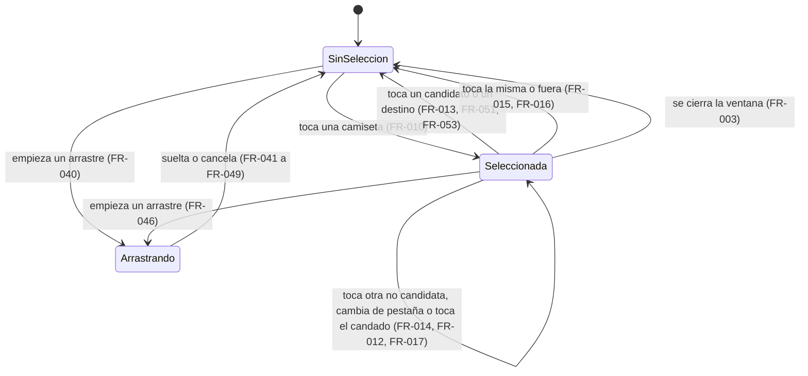

# Posiciones del jugador — Spec

> **Status:** Draft · **Date:** 2026-10-28 · **Owner:** Lucas Manoukian (claude-opus-5-5)
>
> **Reviewers:** *pending*
>
> **Concept note:** [POSICIONES_DEL_JUGADOR_CONCEPT.md](./POSICIONES_DEL_JUGADOR_CONCEPT.md)
>
> **Implementation plan:** *not yet written*

> **Grounding evidence (`MD-25`).** Esta Spec se apoya en el ledger §6.5 *Sources &
> Origins* del Concept Note. Donde un `FR-*`/`NFR-*`/`TC-*` se apoya en una ubicación de
> código o en una Spec vigente que el Concept Note no cubre, la cita va **en línea** en la
> sección donde se define el requisito.

> **Declaración de reemplazo (gobernanza vigente en [`AGENTS.md`](../../AGENTS.md)).**
> Esta Spec cambia el comportamiento de la edición manual del reparto que describen la
> rebanada 2 (arrastre) y, en menor medida, las rebanadas 1 y 3 de `equipos-en-el-campo`.
> Cada parte de abajo queda marcada como reemplazada en su documento de origen, en la
> misma rama que esta Spec (`AC-02`). La lista parte del §16 del Concept Note y suma lo
> que encontró el barrido completo de `CANCHA_SPEC.md` y `CARGA_POR_TOQUE_SPEC.md` y el
> barrido dirigido de `ARRASTRE_SPEC.md`, `PANEL_ARMADO_SPEC.md` e
> `INTERCAMBIAR_COLORES_SPEC.md` (2026-10-28); cada línea citada se abrió.
>
> | Documento | Parte | Qué dice hoy | Reemplazado por |
> |---|---|---|---|
> | [`EQUIPOS_EN_EL_CAMPO_CONCEPT.md`](../equipos-en-el-campo/EQUIPOS_EN_EL_CAMPO_CONCEPT.md) | `D-19` (l. 508), en parte | la edición manual se acota a movimientos entre equipos | `FR-030`, `FR-041`. El pase sigue siendo sólo entre equipos (`FR-043`) |
> | `EQUIPOS_EN_EL_CAMPO_CONCEPT.md` | `D-20` (l. 509), en parte | un movimiento manual no escribe la posición asignada | `FR-030`, `FR-051`, `FR-053`, `FR-054`. El pase la conserva (`FR-043`), salvo el arquero elegido |
> | [`ARRASTRE_SPEC.md`](../equipos-en-el-campo/rebanada-2-arrastre/ARRASTRE_SPEC.md) | §2 (l. 79-80), última frase | "No cambia la posición asignada de nadie." | `FR-030` |
> | `ARRASTRE_SPEC.md` | §3.1 (l. 89-90), las zonas | dos zonas en dos columnas, ambas del otro equipo | `FR-041`: una camiseta compatible del propio equipo también es zona |
> | `ARRASTRE_SPEC.md` | §3.2, primera viñeta (l. 105-109) | no se intercambia con otra camiseta del mismo equipo | `FR-041`. Mover a otra línea sin intercambio sigue sin existir (§3.2 de esta Spec) |
> | `ARRASTRE_SPEC.md` | §3.2, segunda viñeta (l. 111-113), sólo para los destinos | no se suelta sobre una línea | `FR-048`, `FR-049`: el arco vacío del propio equipo y el puesto anterior del arquero elegido aceptan el arrastre. Soltar sobre las demás líneas sigue sin efecto |
> | `ARRASTRE_SPEC.md` | §3.2, tercera viñeta (l. 114-118) y `R-02` (l. 991) | no hay intercambio en una sola columna | `FR-012`, `FR-013`: existe, por toque |
> | `ARRASTRE_SPEC.md` | §3.3, líneas de `D-19` y `D-20` (l. 159-163) | heredadas enteras | las partes de arriba |
> | `ARRASTRE_SPEC.md` | `TC-010` (l. 203-208), en el efecto | la única ruta de escritura es la que cambia de equipo | `TC-011`: la misma ruta, que ahora también escribe el puesto asignado |
> | `ARRASTRE_SPEC.md` | `TC-012` (l. 213), `FR-022` (l. 430), `NFR-005` (l. 550), `AC-14` (l. 801), `AC-23` (l. 829) | no se escribe `posicionAsignada`; los campos escritos son exactamente cuatro | `NFR-005` de esta Spec |
> | `ARRASTRE_SPEC.md` | Glosario "Dos columnas", "Zona de drop", "Intercambio" (l. 356, 357, 360) | el intercambio sólo cambia de equipo y sólo existe en dos columnas | Glosario de esta Spec ("Intercambio") |
> | `ARRASTRE_SPEC.md` | `FR-011` (l. 397) y `US-02` (l. 336) | intercambio sin regla de puestos, sólo en dos columnas | `FR-021`, `FR-030`, `FR-031`, `FR-041` |
> | `ARRASTRE_SPEC.md` | `FR-012` (l. 400), en su alcance | la camiseta gana sobre la cancha del equipo contrario | `FR-041`: también sobre la cancha propia |
> | `ARRASTRE_SPEC.md` | `FR-013` (l. 402), sólo "sobre otra camiseta de su propio equipo" | sin efecto | `FR-041`, `FR-042`. Sobre la cancha o la pestaña propias sigue sin efecto (`FR-044`) |
> | `ARRASTRE_SPEC.md` | `FR-014` (l. 406) y `FR-015` (l. 408) | sólo se realza la zona bajo el puntero, nunca el propio equipo | `FR-040` |
> | `ARRASTRE_SPEC.md` | `FR-021` (l. 425), en el puntaje | el puntaje de la unidad en su posición asignada | `FR-056` para el arquero elegido; para el resto sigue vigente |
> | `ARRASTRE_SPEC.md` | `S-02` (l. 590), el encabezado "en pantalla ancha" y el último *Then* | "ninguna de las dos posiciones asignadas cambió" | `S-02`, `S-03` de esta Spec |
> | `ARRASTRE_SPEC.md` | `S-02c` (l. 603) | soltar sobre una camiseta propia no modifica nada | `S-03`, `S-03b` |
> | `ARRASTRE_SPEC.md` | `S-03a`, `S-03b` (l. 616-617), "en dos columnas" | intercambio de duplas sin regla de puestos | `S-02c` de esta Spec |
> | `ARRASTRE_SPEC.md` | `A-02` (l. 968) | el candado es el único otro control sobre la camiseta | `FR-017`, `A-01` de esta Spec |
> | `ARRASTRE_SPEC.md` | §17, "Debe seguir siendo no-objetivo" (l. 1038-1039) | mover dentro del propio equipo y el intercambio en una columna | esta Spec los vuelve objetivo |
> | [`CANCHA_SPEC.md`](../equipos-en-el-campo/rebanada-1-cancha/CANCHA_SPEC.md) | `TC-012` (l. 166-169) | "La cancha no escribirá nada" salvo el candado | `FR-030`, `FR-051`, `FR-053` |
> | `CANCHA_SPEC.md` | Glosario "Posición asignada" (l. 279) | la fija el motor o una override | Glosario de esta Spec ("Puesto asignado") |
> | `CANCHA_SPEC.md` | `A-04` (l. 764-766) | el candado es el único elemento interactivo de la cancha | `FR-010`, `FR-050` |
> | [`PANEL_ARMADO_SPEC.md`](../equipos-en-el-campo/rebanada-3-panel-armado/PANEL_ARMADO_SPEC.md) | §3.3, línea de `D-19`/`D-20` (l. 217-220) y `A-03` (l. 1147) | un movimiento manual no cambia el puesto asignado de nadie | `FR-030`, `FR-070`: el recálculo vigente ya lee el puesto asignado en vivo (`A-03` de esta Spec) |
>
> **Complementa sin reemplazar:**
>
> - `ARRASTRE_SPEC.md` §3.2, cuarta viñeta (l. 119-123): el cambio de pestaña por
>   sobrevuelo sigue fuera de alcance, pero su justificación ("la única razón sería
>   habilitar el intercambio en angosto") ya no aplica: el intercambio en angosto existe
>   por toque (`FR-012`).
> - `ARRASTRE_SPEC.md` `TC-003` y `AC-21` (l. 190, 824): siguen vigentes; `TC-003` de esta
>   Spec los extiende al toque.
> - `CANCHA_SPEC.md` `TC-011` (l. 160-163): sigue vigente; el arquero elegido no la rompe
>   porque su valor se resuelve en la misma función que define "el número que suma al
>   total" (`TC-011` de esta Spec).
> - `CANCHA_SPEC.md` `NFR-003` (l. 455), "hoy únicamente el candado": sigue vigente;
>   `NFR-003` de esta Spec suma los destinos nuevos.
> - `CARGA_POR_TOQUE_SPEC.md` §3.2, última viñeta (l. 194-197) y glosario "Modo de carga
>   por toque" (l. 344): siguen vigentes. Fuera del modo de carga la cancha ahora también
>   responde a toques, con otro significado y en una ventana que no se superpone (`FR-001`).
> - `INTERCAMBIAR_COLORES_SPEC.md` `FR-016` (l. 271): sigue vigente; el registro del
>   arquero elegido es por jugador y viaja con él (`FR-058`).
>
> **No reemplaza:** el resumen dividido (`D-26` de `equipos-en-el-campo`, `FR-072b` a
> `FR-072d` de `PANEL_ARMADO_SPEC.md`) queda intacto (`D-12`); el pase suelto (`FR-010`
> de `ARRASTRE_SPEC.md`) queda como hoy salvo para el arquero elegido (`FR-054`).
>
> **Hallazgo ajeno a esta feature:** `PANEL_ARMADO_SPEC.md` usa dos veces el ID `S-05j`
> (l. 805 `[property]` y l. 806 `[boundary]`). No se corrige acá; queda anotado en §16
> (`OPEN-Q-11`).

## 1. Purpose

Esta Spec define cómo el administrador cambia el puesto de los jugadores de un partido
ya generado sin regenerar: qué pasa al tocar una camiseta, qué compañeros se resaltan,
cuándo un intercambio es válido, qué hace el arrastre sobre una camiseta, cómo se ocupa
un arco vacío, qué suma un arquero elegido, qué se conserva al regenerar y qué se ve
después. El porqué está en el Concept Note; cómo se construye, en el Implementation Plan.

## 2. Summary

Hoy, una vez generados los equipos, la cancha deja cambiar a un jugador de equipo pero
no de puesto, y el intercambio entre equipos conserva el puesto de cada uno. Con esta
feature, el administrador toca una camiseta, la cancha resalta a los jugadores —de los
dos equipos— con los que puede intercambiar puesto sin que ninguno quede en un puesto
que no declaró, y un segundo toque hace el intercambio: cada uno toma el puesto del otro
y, si eran de equipos distintos, también el equipo. Lo mismo pasa al arrastrar una
camiseta sobre otra. En el celular se toca, se cambia de pestaña y se toca. Si un equipo
quedó sin arquero, cualquiera de sus jugadores puede pasar al arco para ese partido, sin
tocar su ficha y sin que el total del equipo salte. Totales, diferencias, lugares sin
cubrir y el resumen se actualizan con el recálculo que ya existe. La aplicación sigue
siendo un organizador de partidos entre amigos; lo que cambia es que lo guardado vuelve a
coincidir con lo que se juega.

## 3. Scope

### 3.1 In scope

- Seleccionar una camiseta, resaltar a los candidatos y aplicar el intercambio por
  toque, en una y en dos columnas.
- La regla de compatibilidad, incluidas las duplas de rotación y los partidos con
  puestos del catálogo viejo.
- El arrastre sobre una camiseta —propia o del otro equipo— con la misma regla, el
  resaltado de candidatos durante el arrastre y el aviso al soltar sobre una
  incompatible.
- El arco vacío como destino, el arquero elegido, su valor, cómo vuelve a su puesto y
  qué pasa si se lo pasa al otro equipo.
- Los partidos "Solo por puntaje".
- Qué conserva una regeneración.
- El aviso de "nadie puede intercambiar".

### 3.2 Out of scope / non-goals

Heredados del Concept Note §4 y §16:

- El sistema no mostrará selección, resaltado, destinos ni avisos de intercambio al rol
  `jugador`, ni le expondrá puntajes por puesto.
- El sistema no cambiará los puestos declarados de un jugador (principal y secundarias)
  desde la cancha. En particular, elegir a alguien para el arco no le agrega Arquero.
- El sistema no moverá a un jugador a un lugar vacío de su propio equipo, salvo al arco
  vacío (`D-14`) y la vuelta del arquero elegido a su puesto anterior (`FR-053`).

Propios de esta Spec:

- El sistema no ofrecerá equivalente de teclado para seleccionar ni intercambiar
  (Concept Note §14, `OPEN-Q-03`).
- El sistema no registrará qué intercambios hubo (`D-12`).
- El sistema no modificará ninguna estrategia del motor de generación.
- El sistema no resuelve dos administradores editando el mismo partido a la vez: gana la
  última escritura, como hoy (`Roadmap.md` §3).

### 3.3 Constraints inherited from the Concept Note

- **D-01** (sólo `admin`) — heredada; `FR-002`, `TC-040`.
- **D-02** (se resaltan sólo los candidatos válidos) — heredada; `FR-011`.
- **D-03** (principal o secundaria) — heredada; `FR-020`.
- **D-04** (los dos quedan en un puesto suyo; única excepción el arco vacío) — heredada;
  `FR-021`, `FR-050`.
- **D-05** (gestos del toque y aviso sin candidatos) — heredada; `FR-013` a `FR-018`.
- **D-06** (intercambio entre equipos con puestos; en una columna sobrevive al cambio de
  pestaña) — heredada; `FR-012`, `FR-031`.
- **D-07** (puestos de una dupla = unión, con el criterio del motor) — heredada; `FR-020`,
  `TC-010`.
- **D-08** (el arrastre sobre una camiseta hace el mismo intercambio) — heredada;
  `FR-041`, `FR-042`.
- **D-09** (el pase suelto queda como hoy) — heredada; `FR-043`, con la salvedad de
  `D-23` (`FR-054`).
- **D-10** (recálculo vigente, sin uno nuevo) — heredada; `FR-070`, `TC-011`.
- **D-11** (misma ventana que el arrastre) — heredada; `FR-001`.
- **D-12** (el resumen no cambia) — heredada; `FR-071`, `FR-072`.
- **D-13** (el candado no impide intercambiar; fija el puesto nuevo) — heredada;
  `FR-035`, `FR-061`.
- **D-14** (arco vacío, sin tocar la ficha; se cambia después por intercambio) —
  heredada; `FR-050`, `FR-051`, `FR-022`.
- **D-15** (el arquero elegido suma lo de su puesto anterior salvo puntaje de Arquero) —
  heredada; `FR-056`.
- **D-16** (la ventaja por no tener arquero fijo se mantiene) — heredada; `FR-057`.
- **D-17** ("Solo por puntaje": intercambio con el otro equipo sin regla; arrastre como
  hoy) — heredada; `FR-024`, `FR-033`, `FR-045`.

Decisiones que el propietario tomó al escribir esta Spec (2026-10-28), registradas como
`D-18` a `D-23` en la §10 del Concept Note:

- **D-18** (regenerar: lo manual sin candado se pierde; con candado se conserva equipo y
  puesto; el arquero elegido deja el arco siempre) — cierra `OPEN-Q-02`; `FR-060` a
  `FR-063`.
- **D-19** (el arrastre resalta los mismos candidatos que el toque; soltar sobre una
  incompatible no cambia nada y avisa por qué) — cierra `OPEN-Q-04`; `FR-040`, `FR-042`.
- **D-20** (en un partido con puestos del catálogo viejo, la compatibilidad se mide por
  línea, como ya lo hace el motor) — cierra `OPEN-Q-06`; `FR-020`.
- **D-21** (el puesto anterior del arquero elegido se guarda con el partido, en lo que
  sólo lee `admin`, sin documento nuevo ni cambio de reglas) — cierra `OPEN-Q-07`;
  `TC-002`, `TC-043`.
- **D-22** (en "Solo por puntaje" el arco vacío también se puede ocupar, sólo como
  dibujo: el total no cambia) — cierra `OPEN-Q-08`; `FR-052`.
- **D-23** (el arquero elegido puede volver a su puesto anterior con un toque; si se lo
  pasa al otro equipo, llega en su puesto anterior) — decisión nueva; `FR-053`, `FR-054`.
- **D-24** (el arco vacío se ocupa, y el arquero elegido vuelve a su puesto anterior,
  también arrastrando, en partidos con y sin puestos) — decisión nueva; `FR-047` a
  `FR-049`.

## 4. Technical & architectural constraints

### 4.1 Platform / stack constraints

- **TC-001** — La feature vivirá en `index.html`, dentro del IIFE existente, sin paso de
  build, sin bundler y sin dependencias nuevas (`AGENTS.md` § Estilo y § Dependencias).
- **TC-002** — Todo lo que la feature guarde irá en los documentos que ya existen
  (`data/partidos` y `data/partidosArmado`,
  [index.html:2350-2372](../../index.html#L2350-L2372)), a través de la interfaz de
  guardar/leer existente. No se agregará ningún documento ni se tocarán las reglas de
  Firestore: las de `data/partidosArmado` no validan campos
  ([`firestore-rules.md:308-310`](../rol-en-el-token/contracts/firestore-rules.md)).
- **TC-003** — El toque se resolverá con el evento de activación nativo del navegador
  (`click`), sin manejadores de `pointer` ni de `touch`, y el arrastre seguirá usando la
  API nativa de arrastre. Así siguen vigentes `TC-003` y `AC-21` de `ARRASTRE_SPEC.md`
  (l. 190, 824) y el precedente de `D-18` de `CARGA_POR_TOQUE_SPEC.md` (l. 220-225).

### 4.2 Architectural / integration constraints

- **TC-010** — Una única función decidirá si una unidad de armado cubre un puesto, y
  será la misma que usa el recálculo vigente para "lugares sin cubrir"
  (`cubrePosicionGuardada`,
  [index.html:3642-3651](../../index.html#L3642-L3651), que delega en `costoEncaje`,
  [index.html:3631-3636](../../index.html#L3631-L3636)). El toque, el arrastre y la
  revalidación antes de aplicar (`FR-034`) la consultan; ninguno reimplementa la regla
  (`D-07`, `D-20`).
- **TC-011** — El intercambio y el pase reutilizarán la ruta de escritura existente
  (`intercambiarUnidades`, `moverUnJugadorDeEquipo`,
  [index.html:5635-5777](../../index.html#L5635-L5777)). Totales, diferencia entre
  equipos, diferencia por línea, lugares sin cubrir y el resumen se leerán de las
  funciones vigentes (`sumasVigentes`, `balanceLineasVigente`,
  `faltantesDeFormacionVigente`); el valor del arquero elegido se resolverá dentro de la
  función que ya define "el número que suma al total" (`valorDePuntaje`,
  [index.html:5064-5070](../../index.html#L5064-L5070)), para que la píldora, el total y
  el resumen no puedan divergir (`D-10`).
- **TC-012** — Ninguna estrategia del motor se modificará. Lo que cambia al regenerar
  (`FR-062`) es qué puesto previo se le pasa al motor, no cómo lo usa
  ([index.html:4694](../../index.html#L4694)). Se mantiene la separación interfaz /
  motor / persistencia de `AGENTS.md`.
- **TC-013** — La selección es estado de pantalla: no se persistirá ni se compartirá
  entre sesiones.

### 4.3 Compliance / regulatory constraints

- **TC-020** — Los estados nuevos de la camiseta (seleccionada, candidata) y los
  destinos (arco vacío, puesto anterior) se distinguirán por más de una señal, nunca sólo
  por color (WCAG 2.1, criterio 1.4.1 *Use of Color*, ya citado por `TC-020` de
  `DESGLOSE_POSICIONES_SPEC.md`; mismo criterio que `NFR-003` de
  `CARGA_POR_TOQUE_SPEC.md`, l. 544).

### 4.4 Conventions to follow

- **TC-030** — Toda decisión visual se resolverá contra
  [`.claude/skills/football-app-design/`](../../.claude/skills/football-app-design/), en
  el orden de `AGENTS.md`: un token o componente existente, una combinación de tokens, o
  una excepción documentada en el Implementation Plan. Esta Spec no declara excepciones
  (`OPEN-Q-05`, `OPEN-Q-09`).
- **TC-031** — Todo test que satisfaga un `S-NN`, `NFR-NNN` o `TC-NNN` llevará el
  identificador en forma canónica con guion dentro de un string literal —el nombre del
  caso o el campo `spec:` de un escenario de `layout.test.js`—, nunca en un comentario
  (`AGENTS.md` § Tests).
- **TC-032** — Toda función de `index.html` que se renombre o se borre y figure en la
  lista `DECLARACIONES` de `tests/harness.js` o de otro test se actualizará en esa lista
  en el mismo commit (`AGENTS.md` § Estilo).
- **TC-033** — La cancha con una selección activa y con un destino de arco a la vista se
  agregará a `tests/layout.test.js` como escenario nuevo, y ese escenario se verá fallar
  al menos una vez antes de darlo por bueno (`AGENTS.md`, Responsive).

### 4.5 Security constraints (`MD-31`)

CWE Top 25 consultado en vivo el 2026-10-28: edición 2025
(`https://cwe.mitre.org/top25/`, que remite a
`https://cwe.mitre.org/top25/archive/2025/2025_cwe_top25.html`). El Concept Note §5.2
señala `CWE-79`, `CWE-862` y `CWE-863`.

- **TC-040** — Seleccionar, intercambiar, ocupar el arco vacío y volver al puesto
  anterior sólo se dibujarán, y su acción sólo se ejecutará, cuando el rol de la sesión
  sea `admin` y el partido esté en la ventana de edición; la guarda va **dentro del
  manejador**, no sólo en el render, igual que `TC-040` de `CANCHA_SPEC.md` (l. 224-227),
  **defends `CWE-862` *Missing Authorization***.
- **TC-041** — Todo nombre de jugador que aparezca en el aviso de `FR-018` o `FR-042`, en
  un `title` o en un `aria-label` nuevo se insertará escapado, en contenido y en
  atributos (`AGENTS.md` § Estilo), **defends `CWE-79` *Cross-Site Scripting***.
- **TC-042** — Antes de escribir, todo identificador que llegue del DOM o del
  `dataTransfer` se validará contra el reparto del partido, y todo puesto anterior leído
  de lo guardado que no sea un puesto del catálogo se tratará como ausente (`FR-056`,
  `FR-053`), **defends `CWE-20` *Improper Input Validation***.
- **TC-043** — El puesto anterior del arquero elegido se guardará sólo en
  `data/partidosArmado`, de lectura exclusiva de `admin`, y el aviso nunca incluirá
  puntajes, **defends `CWE-200` *Exposure of Sensitive Information to an Unauthorized
  Actor***. El puesto en sí no es sensible; se guarda ahí porque sólo sirve para el
  puntaje, que sí lo es.
- **`CWE-863` / `CWE-284`** — ruling, no commitment: que `jugador` pueda escribir
  `data/partidos`
  ([`firestore-rules.md:81`](../rol-en-el-token/contracts/firestore-rules.md)) es una
  condición preexistente que esta feature no agrava: no agrega permisos ni toca reglas,
  y lo nuevo que guarda va al documento exclusivo de `admin`.
- **`CWE-639`** — no aplica: los identificadores que llegan del DOM se validan contra el
  reparto (`TC-042`) y la autorización depende del rol del token, no del identificador.
- **`CWE-352` *CSRF*** — no aplica: no hay endpoint propio con sesión por cookie.
- Resto de la lista (`CWE-89`, `-787`, `-22`, `-416`, `-125`, `-78`, `-94`, `-120`,
  `-434`, `-476`, `-121`, `-502`, `-122`, `-306`, `-918`, `-77`, `-770`) — no aplica:
  sin SQL, sin memoria manual, sin sistema de archivos, sin comandos, sin subidas, sin
  deserialización de datos no confiables más allá del `JSON.parse` de los documentos
  propios, sin pedidos del servidor, y toda acción exige sesión autenticada con rol.

## 5. Users & use cases

### 5.1 Personas / actors

| Actor | Description | Primary need |
|---|---|---|
| Administrador (`admin`) | Arma los partidos y corrige el reparto antes de jugar | Reacomodar puestos sin regenerar, y que la cancha diga la verdad |
| Jugador (`jugador`) | Ve la cancha | Ver dónde juega cada uno; no edita nada |

### 5.2 User stories

| ID | Story | Implements |
|---|---|---|
| US-01 | Como administrador, quiero intercambiar el puesto de dos compañeros de equipo, para corregir el reparto sin regenerar. | FR-010 a FR-021, FR-030, FR-034 |
| US-02 | Como administrador, quiero ver con quién puedo intercambiar a un jugador sin ir a la solapa Jugadores. | FR-011, FR-018, FR-020 a FR-024 |
| US-03 | Como administrador, quiero intercambiar jugadores de equipos distintos sin desarmar las formaciones, también desde el celular. | FR-012, FR-021, FR-030 a FR-032 |
| US-04 | Como administrador, quiero que arrastrar una camiseta sobre otra haga lo mismo que tocarlas. | FR-040 a FR-046 |
| US-05 | Como administrador, quiero poner en el arco a un jugador de un equipo sin arquero, tocando o arrastrando, y poder deshacerlo de las dos formas. | FR-047 a FR-059 |
| US-06 | Como administrador, quiero que regenerar respete lo que fijé con candado. | FR-060 a FR-063 |

## 6. Glossary

| Term | Definition |
|---|---|
| Unidad de armado | Un jugador suelto o una dupla de rotación, como en `008`. Una camiseta en la cancha. |
| Puesto | Uno de los ocho del catálogo de `desglose-posiciones` (ARQ, LI, DC, LD, MI, MC, MD, DEL), o una posición vieja (Defensor, Volante, Delantero) leída por su línea. |
| Puestos declarados | La principal y las secundarias de un jugador, tal como las guarda su ficha. |
| Cubrir un puesto | Una unidad cubre un puesto si el puesto es principal o secundaria de un jugador suelto, o de al menos uno de los dos integrantes de una dupla; contra una posición vieja, si juega algún puesto de esa línea. Es el criterio del motor (`TC-010`). |
| Puesto asignado | El puesto que una unidad ocupa en ese partido. Lo fija el motor al generar y, desde esta feature, también el administrador al intercambiar o al usar el arco vacío. |
| Partido con puestos | Un partido cuyo reparto guarda puesto asignado: el de toda estrategia salvo "Solo por puntaje". |
| Partido sin puestos | Un partido "Solo por puntaje": no guarda puesto asignado, y cada camiseta se dibuja en la línea de su principal ([index.html:3295](../../index.html#L3295), [index.html:5064-5070](../../index.html#L5064-L5070)). |
| Ventana de edición | Rol `admin`, inscripción abierta y partido sin finalizar (`esFilaEditable`, [index.html:5072-5080](../../index.html#L5072-L5080)). |
| Selección | La camiseta que el administrador tocó y que espera un segundo toque. Estado de pantalla; a lo sumo una por pantalla. |
| Candidato | Una unidad con la que la seleccionada puede intercambiar según `FR-021` a `FR-024`. Se dibuja resaltada. |
| Intercambio | Dos unidades se cambian el puesto asignado y, si eran de equipos distintos, también el equipo. No confundir con "intercambiar colores" (`INTERCAMBIAR_COLORES_SPEC.md`). |
| Pase | Soltar una camiseta sobre la cancha o la pestaña del otro equipo: cambia de equipo sin intercambio. |
| Arco vacío | En un partido con puestos, el de un equipo sin ninguna unidad con puesto asignado ARQ; en uno sin puestos, el de un equipo sin ninguna camiseta dibujada en el Arco. |
| Arquero elegido | Una unidad que el administrador puso en el arco vacío de su equipo. Lleva registrado su puesto anterior mientras siga en el arco. |
| Puesto anterior | El puesto asignado que el arquero elegido tenía antes de pasar al arco. |
| Destino | Un lugar de la cancha que no es una camiseta y que el toque y el arrastre aceptan: el arco vacío (`FR-050`) o el puesto anterior de un arquero elegido (`FR-053`). |

## 7. Functional requirements

### 7.1 Ventana y rol

- **FR-001** — While el partido esté en la ventana de edición, el sistema permitirá
  seleccionar camisetas tocándolas.
- **FR-002** — If la sesión no tiene rol `admin`, then el sistema no dibujará selección,
  candidatos, destinos ni avisos de intercambio, y sus manejadores no modificarán nada
  (`TC-040`).
- **FR-003** — When el partido sale de la ventana de edición mientras hay una selección
  (se cierra la inscripción o se finaliza), el sistema descartará la selección.

### 7.2 Selección

- **FR-010** — When el administrador toca una camiseta sin que haya una selección, el
  sistema la seleccionará y la marcará como seleccionada.
- **FR-011** — While haya una selección, el sistema resaltará, en las canchas a la
  vista, a todos los candidatos y sólo a ellos.
- **FR-012** — While haya una selección y la tarjeta esté en una columna, cuando el
  administrador cambie de equipo con el selector, el sistema conservará la selección y
  resaltará a los candidatos del equipo que pasa a verse.
- **FR-013** — When el administrador toca un candidato, el sistema aplicará el
  intercambio entre la seleccionada y ese candidato.
- **FR-014** — When el administrador toca una camiseta que no es candidata ni la
  seleccionada, el sistema la seleccionará en lugar de la anterior.
- **FR-015** — When el administrador toca la camiseta seleccionada, el sistema cancelará
  la selección.
- **FR-016** — When el administrador toca fuera de las camisetas, del selector de equipo
  y de los destinos, el sistema cancelará la selección.
- **FR-017** — When el administrador activa el candado de una camiseta, el sistema
  alternará el bloqueo como hoy, sin seleccionar esa camiseta y sin cancelar la selección
  que hubiera.
- **FR-018** — When el administrador selecciona, en un partido con puestos, una unidad
  sin ningún candidato ni destino, el sistema mostrará el aviso "Nadie puede intercambiar
  puesto con {nombre}".
- **FR-019** — When el administrador selecciona una camiseta de otro partido, el sistema
  descartará la selección anterior: hay a lo sumo una selección en la pantalla.
- **FR-019b** — When el sistema aplica cualquier cambio al partido de la selección
  (intercambio, pase, arco, regreso al puesto anterior, regenerar, intercambiar colores),
  descartará la selección.

### 7.3 Compatibilidad

- **FR-020** — El sistema decidirá si una unidad cubre un puesto con el criterio del
  glosario ("Cubrir un puesto"), el mismo que usa el motor (`TC-010`).
- **FR-021** — While el partido tenga puestos, el sistema tratará como candidata a toda
  unidad B del partido distinta de la seleccionada A tal que A cubra el puesto asignado de
  B y B cubra el puesto asignado de A, salvo lo que fijan `FR-022` y `FR-023`.
- **FR-022** — While el partido tenga puestos y una de las dos unidades sea un arquero
  elegido y la otra un compañero de equipo, el sistema tratará al compañero como
  candidato cuando el arquero elegido cubra el puesto del compañero, cubra o no el
  compañero el ARQ (`D-14`).
- **FR-023** — El sistema no tratará como candidata a una unidad del mismo equipo y con el
  mismo puesto asignado que la seleccionada: ese intercambio no cambiaría nada.
- **FR-024** — While el partido no tenga puestos, el sistema tratará como candidatas a
  todas las unidades del otro equipo y a ninguna del propio (`D-17`).

### 7.4 El intercambio

- **FR-030** — When el sistema aplica un intercambio en un partido con puestos, cada una
  de las dos unidades pasará a tener el puesto asignado que tenía la otra; en una dupla,
  sus dos integrantes.
- **FR-031** — When el sistema aplica un intercambio entre unidades de equipos distintos,
  cada una pasará al equipo de la otra, con su pareja de dupla.
- **FR-032** — When el sistema aplica un intercambio, dejará a cada equipo con la misma
  cantidad de unidades de armado que tenía antes. La cantidad de personas puede cambiar
  si hay una dupla de por medio (`S-03b` de `ARRASTRE_SPEC.md`).
- **FR-033** — When el sistema aplica un intercambio en un partido sin puestos, cambiará
  sólo el equipo de cada unidad y no escribirá ningún puesto asignado.
- **FR-034** — If al aplicar un intercambio la sesión no es `admin`, el partido no está en
  la ventana de edición, alguna de las dos unidades no pertenece al reparto o ya no son
  candidatas entre sí, then el sistema no escribirá nada y mostrará el aviso de `FR-042`
  si corresponde.
- **FR-035** — El sistema permitirá intercambiar una unidad fijada con el candado, y
  después del intercambio esa unidad seguirá fijada (`D-13`).
- **FR-036** — When el sistema aplica un intercambio, persistirá el partido y volverá a
  pintar la tarjeta de equipos por el camino de hoy.

### 7.5 El arrastre

- **FR-040** — When empieza el arrastre de una camiseta en un partido con puestos, el
  sistema resaltará a sus candidatos como en `FR-011` hasta que el arrastre termine.
- **FR-041** — When una camiseta arrastrada se suelta sobre un candidato, sea del propio
  equipo o del otro, el sistema aplicará el mismo intercambio de `FR-030` a `FR-036`.
- **FR-042** — When una camiseta arrastrada en un partido con puestos se suelta sobre otra
  camiseta que no es candidata, el sistema no modificará el partido y mostrará un aviso
  que nombra el puesto que falta cubrir: "{B} no juega de {puesto de A}", "{A} no juega de
  {puesto de B}", o "Ninguno de los dos juega en el puesto del otro".
- **FR-043** — When una camiseta arrastrada se suelta sobre la cancha o la pestaña del
  otro equipo, y no sobre una camiseta, el sistema aplicará el pase de hoy: cambia de
  equipo y conserva el puesto asignado (`D-09`), salvo `FR-054`.
- **FR-044** — When una camiseta arrastrada se suelta sobre la cancha o la pestaña de su
  propio equipo, o sobre sí misma, el sistema no modificará el partido, salvo `FR-048` y
  `FR-049`.
- **FR-045** — While el partido no tenga puestos, el sistema mantendrá el arrastre como lo
  describe hoy `ARRASTRE_SPEC.md` (`FR-010` a `FR-026`), salvo `FR-047` a `FR-049`.
- **FR-046** — When empieza un arrastre, el sistema descartará la selección por toque que
  hubiera.
- **FR-047** — When empieza el arrastre de una camiseta cuyo equipo tiene el arco vacío,
  el sistema mostrará ese arco como destino hasta que el arrastre termine, en partidos con
  y sin puestos (`D-24`).
- **FR-048** — When una camiseta arrastrada se suelta sobre el arco vacío de su propio
  equipo, el sistema aplicará lo mismo que al tocarlo (`FR-051` en un partido con
  puestos, `FR-052` en uno sin puestos). El arco gana sobre la cancha que lo contiene, como
  la camiseta (`FR-012` de `ARRASTRE_SPEC.md`). Soltar sobre el arco del otro equipo es un
  pase (`FR-043`).
- **FR-049** — When empieza el arrastre de un arquero elegido, el sistema mostrará su
  puesto anterior como destino hasta que el arrastre termine; cuando la camiseta se
  suelta sobre ese destino, el sistema aplicará lo mismo que al tocarlo (`FR-053`), en
  partidos con y sin puestos (`D-24`).

### 7.6 Arco vacío y arquero elegido

- **FR-050** — While haya una unidad seleccionada y su equipo tenga el arco vacío, el
  sistema mostrará ese arco como destino, cubra o no la unidad el ARQ.
- **FR-051** — When el administrador toca el arco vacío como destino en un partido con
  puestos, el sistema le asignará ARQ a la unidad seleccionada, registrará su puesto
  anterior y no modificará sus puestos declarados.
- **FR-052** — When el administrador toca el arco vacío como destino en un partido sin
  puestos, el sistema dibujará a la unidad en el arco, no escribirá ningún puesto
  asignado y no cambiará ningún total (`D-22`).
- **FR-053** — While un arquero elegido esté seleccionado, el sistema mostrará su puesto
  anterior como destino; cuando el administrador lo toque, el sistema le devolverá ese
  puesto (en un partido sin puestos, la línea de su principal), borrará el registro y
  dejará el arco vacío otra vez (`D-23`).
- **FR-054** — When un arquero elegido pasa al otro equipo por un pase, el sistema le
  devolverá su puesto anterior (en un partido sin puestos, la línea de su principal) y
  borrará el registro (`D-23`).
- **FR-055** — When un arquero elegido deja el arco por un intercambio, el sistema borrará
  su registro; si quien toma el arco es un compañero, el sistema registrará a ese
  compañero como arquero elegido con su propio puesto anterior.
- **FR-056** — El sistema valuará a un arquero elegido con su puntaje de Arquero si es
  mayor que cero; si no, con su puntaje en el puesto anterior; si tampoco tiene, como "sin
  puntaje" (`D-15`). Es el valor de su píldora, del total de su equipo y del resumen.
- **FR-057** — El sistema no modificará la ventaja que el motor le dio al equipo sin
  arquero fijo por ningún cambio manual, incluido el arquero elegido (`D-16`).
- **FR-058** — El sistema registrará el puesto anterior por jugador, de modo que
  intercambiar colores no lo pierda ni lo asigne al equipo equivocado
  (`INTERCAMBIAR_COLORES_SPEC.md` `FR-016`).
- **FR-059** — El sistema declarará en el `title` de la camiseta de un arquero elegido
  que fue elegido para el arco en ese partido, además de lo que ya declara (`FR-023b` de
  `CANCHA_SPEC.md`).

### 7.7 Regenerar

- **FR-060** — When el administrador regenera, el sistema descartará los cambios manuales
  de las unidades sin candado, como hoy (`D-18`).
- **FR-061** — When el administrador regenera, el sistema mantendrá a cada unidad con
  candado en su equipo y en el puesto que tenga en ese momento, incluido el que le dio un
  intercambio (`D-13`).
- **FR-062** — When el administrador regenera, el sistema no conservará el ARQ de ningún
  arquero elegido, tenga candado o no; con candado conserva el equipo (`D-18`).
- **FR-063** — When el administrador regenera, el sistema borrará todos los registros de
  arquero elegido del partido.

### 7.8 Lo que se ve después

- **FR-070** — When el sistema aplica cualquier cambio de esta feature, los totales, la
  diferencia entre equipos, la diferencia por línea y los lugares sin cubrir mostrarán el
  reparto nuevo, con el recálculo vigente (`TC-011`).
- **FR-071** — El sistema mostrará el resumen "Por qué quedaron así" con las reglas
  vigentes de `FR-072b` a `FR-072d` de `PANEL_ARMADO_SPEC.md`, sin texto nuevo (`D-12`).
- **FR-072** — El sistema no guardará un registro de los intercambios hechos.

## 8. Non-functional requirements

| ID | Category | Requirement |
|---|---|---|
| NFR-001 | Responsive / layout | En cada ancho que mide `tests/layout.test.js` ([`tests/layout.test.js:45`](../../tests/layout.test.js#L45): 360, 390, 430, 479, 481, 559, 561, 600, 699, 701, 759, 760, 768, 900, 1099, 1100, 1200 px), con una selección activa y candidatos resaltados, y con el arco vacío como destino, la pantalla cumple `scrollWidth === clientWidth`, ningún elemento queda con su borde derecho fuera del viewport, y ninguna camiseta de una línea se superpone con otra (no-regresión de `NFR-002` de `CANCHA_SPEC.md`). |
| NFR-002 | Usabilidad | El área que selecciona una camiseta mide al menos 44×44 px en todos esos anchos; cada destino (arco vacío, puesto anterior) también; el candado sigue midiendo al menos 24×24 px y su área no selecciona (`FR-017`). |
| NFR-003 | Accesibilidad | La camiseta seleccionada, los candidatos y los destinos se distinguen por al menos dos señales, una de ellas no cromática (`TC-020`). Toda camiseta seleccionable anuncia el gesto en su `title`; cada destino tiene un nombre accesible no vacío que nombra al jugador y el lugar ("Poner a {nombre} en el arco", "Volver a {nombre} a {puesto}"); los avisos de `FR-018` y `FR-042` se anuncian en una región `aria-live`. Sin equivalente de teclado (`OPEN-Q-03`). |
| NFR-004 | Rendimiento | Con 18 titulares, seleccionar una camiseta —calcular candidatos y repintar— no supera los 100 ms, y aplicar un intercambio —escribir y repintar— no supera los 150 ms, medidos con `performance.now()` en el Chromium que `tests/layout.test.js` usa vía Playwright. Son los techos de `NFR-005` de `CANCHA_SPEC.md` y `NFR-004` de `ARRASTRE_SPEC.md`. |
| NFR-005 | Compatibilidad de datos | Seleccionar no escribe nada. Un intercambio en un partido con puestos escribe sólo `equipos.blanco`, `equipos.negro`, las entradas de `equipos.posicionAsignada` de los jugadores de las dos unidades y, si corresponde, el registro de arquero elegido; en un partido sin puestos, sólo `equipos.blanco` y `equipos.negro`. Un partido guardado sin el registro nuevo se lee como "sin arquero elegido". |
| NFR-006 | Mantenibilidad | Todo valor de color, espaciado, radio, sombra y movimiento de los estados y destinos nuevos y del aviso proviene de un token o componente del design system o de una excepción listada en el Implementation Plan. |
| NFR-007 | Seguridad | Invocar los manejadores nuevos con identificadores ajenos al reparto, con un `dataTransfer` arbitrario, fuera de la ventana de edición o con sesión `jugador` no produce ninguna escritura. |

## 9. System behaviour & scenarios

### 9.1 Happy path scenarios

#### Scenario S-01 — Intercambio de puesto dentro del equipo por toque (covers FR-010, FR-011, FR-013, FR-020, FR-021, FR-030, FR-036, FR-070)

- **Given** un partido de Fútbol 8 "Por posición y puntaje" con la inscripción abierta y
  una sesión `admin` a 1200 px
- **And** en el Blanco, Juan tiene asignado DC (principal DC, secundaria LD, 7 en DC y 6
  en LD) y Pedro tiene asignado LD (principal LD, secundaria DC, 8 en LD y 5 en DC)
- **When** el administrador toca la camiseta de Juan
- **Then** la camiseta de Juan queda marcada como seleccionada y la de Pedro resaltada
- **And** no se resalta ningún jugador que no cubra DC o cuyo puesto Juan no cubra
- **When** el administrador toca la camiseta de Pedro
- **Then** Juan queda en LD y Pedro en DC, los dos en el Blanco
- **And** el total del Blanco baja de 15 a 11 (6 + 5) y la diferencia con el Negro se
  actualiza en el mismo repintado
- **And** la selección desaparece

**Variants:**

- `S-01a [boundary]` — la seleccionada es una dupla con un integrante que cubre LD y otro que no: Pedro (LD) es candidato, igual que lo sería para el motor (`FR-020`, `D-07`)
- `S-01b [failure]` — se toca un compañero que no es candidato: pasa a ser la seleccionada y no se intercambia nada (`FR-014`)
- `S-01c [failure]` — se vuelve a tocar a Juan: se cancela la selección (`FR-015`)
- `S-01d [failure]` — se toca el fondo de la cancha: se cancela la selección (`FR-016`)
- `S-01e [failure]` — Juan no tiene candidatos ni destino: aparece "Nadie puede intercambiar puesto con Juan …" y no cambia nada (`FR-018`)
- `S-01f [boundary]` — Pedro tiene candado: el intercambio se aplica y Pedro sigue fijado (`FR-035`)
- `S-01g [boundary]` — se toca el candado de un compañero con Juan seleccionado: alterna el bloqueo y Juan sigue seleccionado (`FR-017`)
- `S-01h [boundary]` — un compañero tiene el mismo puesto asignado que Juan: no se resalta (`FR-023`)
- `S-01i [boundary]` — un partido viejo con puesto asignado "Defensor": Juan (DC) y un compañero con "Defensor" son compatibles porque se compara por línea (`FR-020`, `D-20`)
- `S-01j [concurrency]` — entre el primer y el segundo toque el reparto cambia (otra sesión guarda y Pedro deja de ser candidato): el segundo toque no escribe nada y avisa (`FR-034`)
- `S-01k [concurrency]` — dos toques rápidos sobre Pedro: se aplica un solo intercambio, no dos
- `S-01l [property]` — para todo intercambio aplicado en un partido con puestos, cada unidad queda en un puesto que cubre, salvo el arquero elegido (`FR-021`, `FR-022`)
- `S-01m [property]` — la cantidad de unidades de cada equipo es la misma antes y después de todo intercambio (`FR-032`)

#### Scenario S-02 — Intercambio entre equipos en el celular (covers FR-012, FR-021, FR-031, FR-032)

- **Given** el mismo partido, una sesión `admin` a 360 px, la tarjeta en una columna y el
  Blanco a la vista
- **And** Lucas tiene asignado MC en el Blanco y declara MC y MD; Tomás tiene asignado MD
  en el Negro y declara MD y MC
- **When** el administrador toca a Lucas, cambia al Negro con el selector y toca a Tomás
- **Then** al cambiar de pestaña Lucas sigue seleccionado y Tomás aparece resaltado
- **And** después del segundo toque Lucas está en el Negro de MD y Tomás en el Blanco de MC
- **And** cada equipo conserva sus siete puestos de campo

**Variants:**

- `S-02a [boundary]` — el mismo gesto a 1200 px, con las dos canchas a la vista: los candidatos de los dos equipos se resaltan a la vez
- `S-02b [boundary]` — mismo puesto en equipos distintos (MC con MC): es candidato y el intercambio sólo cambia de equipo (`FR-023` no aplica entre equipos)
- `S-02c [boundary]` — la seleccionada es una dupla y el candidato un jugador suelto: los equipos quedan con distinta cantidad de personas y la misma de unidades (`FR-032`)
- `S-02d [failure]` — un jugador del Negro cubre MC pero Lucas no cubre su puesto: no se resalta
- `S-02e [failure]` — con Lucas seleccionado se cierra la inscripción: la selección desaparece y no queda ningún resaltado (`FR-003`)
- `S-02f [boundary]` — con Lucas seleccionado se toca "Intercambiar colores": se aplica y la selección se descarta (`FR-019b`)
- `S-02g [boundary]` — con Lucas seleccionado se toca una camiseta de otro partido: esa queda seleccionada y la de Lucas no (`FR-019`)

#### Scenario S-03 — El arrastre sobre una camiseta propia intercambia puestos (covers FR-040, FR-041, FR-042, FR-044, FR-046)

- **Given** el partido de `S-01`, una sesión `admin` a 1200 px
- **When** el administrador empieza a arrastrar la camiseta de Juan
- **Then** Pedro y los demás candidatos de los dos equipos aparecen resaltados
- **When** la suelta sobre Pedro
- **Then** el resultado es el mismo que en `S-01`

**Variants:**

- `S-03a [failure]` — la suelta sobre un compañero que no cubre DC: no cambia nada y aparece "{compañero} no juega de Defensor Central" (`FR-042`)
- `S-03b [failure]` — la suelta sobre una camiseta del otro equipo que no es candidata: no cambia nada y aparece el aviso; hoy ese intercambio se aplicaba (`D-08`)
- `S-03c [boundary]` — la suelta sobre la cancha del otro equipo: pase, Juan conserva DC (`FR-043`)
- `S-03d [failure]` — la suelta sobre la cancha propia o sobre sí misma: no cambia nada (`FR-044`)
- `S-03e [boundary]` — había una selección por toque al empezar el arrastre: se descarta (`FR-046`)
- `S-03f [failure]` — el arrastre se cancela: no cambia nada y no queda ningún resaltado
- `S-03g [boundary]` — a 360 px, la suelta sobre un candidato del propio equipo: el intercambio se aplica también en una columna

#### Scenario S-04 — Un jugador ataja en un equipo sin arquero (covers FR-050, FR-051, FR-056, FR-057, FR-059, FR-070)

- **Given** un partido de Fútbol 8 con un solo arquero natural, que quedó en el Negro, y
  una ventaja de 2 pts para el Blanco por no tener arquero fijo
- **And** Martín, del Blanco, tiene asignado LI, no declara Arquero y tiene 6 en LI y sin
  puntaje de Arquero
- **When** el administrador toca a Martín
- **Then** el arco del Blanco aparece como destino, con el nombre accesible "Poner a
  Martín en el arco"
- **When** toca el arco
- **Then** Martín se dibuja en el arco del Blanco y su ficha no cambia
- **And** el total del Blanco no cambia: Martín sigue sumando 6
- **And** "Lugares sin cubrir" pasa a mostrar LI en el Blanco
- **And** la línea de la ventaja del Blanco sigue en "Como lo armó el motor"
- **And** el `title` de su camiseta dice que fue elegido para el arco en este partido

**Variants:**

- `S-04a [boundary]` — Martín tiene 4 de Arquero: suma 4 (`FR-056`)
- `S-04b [boundary]` — Martín no tiene puntaje en LI ni en Arquero: queda "sin puntaje"
- `S-04c [boundary]` — se toca a Martín ya en el arco: su LI aparece como destino ("Volver a Martín a Lateral Izquierdo"); al tocarlo vuelve a LI y el arco queda vacío (`FR-053`)
- `S-04d [boundary]` — con Martín en el arco, un compañero en DC al que Martín cubre toma el arco: Martín pasa a DC y el compañero queda como arquero elegido con DC de puesto anterior (`FR-022`, `FR-055`)
- `S-04e [failure]` — un compañero en MC que Martín no cubre: no se resalta
- `S-04f [boundary]` — el arquero natural del Negro, que cubre ARQ, es candidato si Martín cubre su puesto; tras el intercambio Martín deja de ser arquero elegido (`FR-021`, `FR-055`)
- `S-04g [boundary]` — Martín pasa al Negro por un pase: llega de LI y el arco del Blanco queda vacío (`FR-054`)
- `S-04h [failure]` — el equipo ya tiene arquero: no aparece ningún destino de arco
- `S-04i [boundary]` — ninguno de los dos equipos tiene arquero: cada uno ofrece su propio arco, y sólo el del equipo de la seleccionada
- `S-04j [boundary]` — se intercambian los colores con Martín en el arco: sigue siendo arquero elegido, ahora en el Negro, con LI de puesto anterior (`FR-058`)
- `S-04k [boundary]` — un partido guardado con un puesto anterior que no es del catálogo: Martín vale como si no tuviera puesto anterior y su regreso va a la línea de su principal (`TC-042`)
- `S-04l [property]` — el valor de un arquero elegido es el mismo en su píldora, en el total del equipo y en el resumen (`FR-056`, `TC-011`)
- `S-04m [boundary]` — se arrastra a Martín: al empezar, el arco del Blanco aparece como destino; al soltarlo ahí queda igual que con el toque (`FR-047`, `FR-048`)
- `S-04n [boundary]` — se arrastra a Martín y se lo suelta sobre el arco del Negro: es un pase, no ocupa el arco (`FR-043`, `FR-048`)
- `S-04o [failure]` — se arrastra a Martín y se lo suelta sobre otra línea vacía del Blanco: no cambia nada (`FR-044`)
- `S-04p [boundary]` — con Martín en el arco, se lo arrastra: su LI aparece como destino; al soltarlo ahí vuelve a LI y el arco queda vacío, igual que con el toque (`FR-049`, `FR-053`)
- `S-04q [failure]` — con Martín en el arco, se lo arrastra y se lo suelta sobre una línea que no es su puesto anterior: no cambia nada (`FR-044`)

#### Scenario S-05 — Partido "Solo por puntaje" (covers FR-024, FR-033, FR-045, FR-052)

- **Given** un partido "Solo por puntaje", una sesión `admin` a 1200 px
- **When** el administrador toca a un jugador del Blanco
- **Then** todas las camisetas del Negro se resaltan y ninguna del Blanco
- **When** toca a un jugador del Negro
- **Then** los dos cambian de equipo, cada uno se dibuja en la línea de su principal y no
  se escribe ningún puesto asignado

**Variants:**

- `S-05a [boundary]` — se toca un compañero del Blanco: pasa a ser la seleccionada (`FR-014`); nunca se intercambia dentro del equipo
- `S-05b [boundary]` — el Blanco no tiene arquero: el arco aparece como destino; al tocarlo, el jugador se dibuja en el arco y ningún total cambia (`FR-052`)
- `S-05c [boundary]` — se vuelve al jugador del arco a su lugar: se dibuja otra vez en la línea de su principal (`FR-053`)
- `S-05d [boundary]` — el arrastre sobre una camiseta del Negro intercambia como hoy y sobre una del Blanco no hace nada (`FR-045`)
- `S-05e [boundary]` — el Blanco no tiene arquero y se arrastra a un jugador del Blanco al arco: se dibuja en el arco y ningún total cambia (`FR-047`, `FR-048`)
- `S-05f [boundary]` — se arrastra al jugador del arco a su destino de vuelta: se dibuja otra vez en la línea de su principal (`FR-049`)

#### Scenario S-06 — Regenerar después de cambios manuales (covers FR-060, FR-061, FR-062, FR-063)

- **Given** un partido con puestos donde Juan y Pedro intercambiaron puesto y Juan tiene
  candado
- **When** el administrador regenera
- **Then** Juan sigue en su equipo y en LD
- **And** Pedro, sin candado, queda donde lo ponga el motor

**Variants:**

- `S-06a [boundary]` — Martín es arquero elegido con candado: tras regenerar sigue en el Blanco, no está en el arco y no queda ningún registro de arquero elegido (`FR-062`, `FR-063`)
- `S-06b [boundary]` — Martín es arquero elegido sin candado: el motor lo ubica como a cualquiera

#### Scenario S-07 — El resumen después de un intercambio (covers FR-070, FR-071, FR-072)

- **Given** el partido de `S-01` recién generado, con el resumen sin dividir
- **When** Juan y Pedro intercambian puesto
- **Then** el resumen se parte en "Con tus cambios" y "Como lo armó el motor", porque el
  total del Blanco cambió (`FR-072b2` de `PANEL_ARMADO_SPEC.md`)
- **And** no aparece ningún texto que nombre el intercambio

**Variants:**

- `S-07a [boundary]` — un intercambio entre equipos de dos jugadores del mismo puesto y el mismo puntaje: el resumen no se divide

### 9.2 Edge cases

Ninguno sin escenario padre: los bordes viven como variantes en §9.1.

### 9.3 Failure / unwanted-behaviour scenarios

#### Scenario S-20 — Nadie fuera de `admin` ni fuera de la ventana edita (covers FR-002, FR-034, NFR-007, TC-040, TC-042)

- **Given** un partido con equipos generados y una sesión `jugador`
- **When** se toca una camiseta, o se invocan los manejadores nuevos desde la consola con
  identificadores válidos
- **Then** no se dibuja ninguna selección ni destino y no se escribe nada

**Variants:**

- `S-20a [failure]` — sesión `admin` con la inscripción cerrada: el toque es el de carga de resultado y nada de esta feature se dibuja ni se ejecuta (`FR-001`)
- `S-20b [failure]` — sesión `admin` con identificadores que no pertenecen al reparto o un `dataTransfer` arbitrario: no se escribe nada (`TC-042`)
- `S-20c [failure]` — sesión `admin` con un partido finalizado: no se escribe nada

#### Scenario S-21 — El nombre en el aviso se escapa (covers FR-018, FR-042, TC-041)

- **Given** un jugador cuyo nombre es ``
- **When** aparece cualquiera de los dos avisos con su nombre
- **Then** el nombre se ve como texto y no se ejecuta nada

Variants: none — single-path scenario.

#### Scenario S-22 — La cancha con selección no rompe el layout (covers NFR-001, NFR-002, NFR-003, TC-033)

- **Given** un partido de Fútbol 9 con 18 titulares y una dupla
- **When** se selecciona una camiseta con candidatos en los dos equipos y con el arco
  vacío como destino
- **Then** en cada ancho de `NFR-001` no hay scroll horizontal, nada sale del viewport,
  ninguna camiseta se superpone con otra y cada área tocable mide lo que fija `NFR-002`

**Variants:**

- `S-22a [boundary]` — 360 px, una columna, después de cambiar de pestaña con la selección viva
- `S-22b [boundary]` — 700 y 701 px, a los dos lados del paso de una a dos columnas

## 10. Data model & external contracts

### 10.1 Domain entities (conceptual)

| Entity | Purpose | Key attributes (conceptual) | Lifecycle |
|---|---|---|---|
| Partido (existente) | El reparto de un partido | equipos, puesto asignado por jugador, bloqueados, ventaja por arquero | Ya existe. Esta feature escribe su puesto asignado |
| Registro de arquero elegido (atributo nuevo del partido) | Recordar de dónde vino el arquero elegido | por jugador: puesto anterior | Nace en `FR-051`; muere en `FR-053`, `FR-054`, `FR-055`, `FR-063`. Sólo en lo que lee `admin` (`TC-043`) |
| Selección (estado de pantalla) | El primer toque | partido, unidad | No se guarda (`TC-013`) |

#### 10.1.1 Entity-relationship diagram

No se introduce ninguna entidad nueva: el registro de arquero elegido es un atributo por
jugador del partido que ya existe, y la selección no se persiste. Por `MD-24` el diagrama
no es obligatorio.

### 10.2 External APIs / events the feature consumes

| Source | Contract | Direction | Notes |
|---|---|---|---|
| Cloud Firestore (`data/partidos`, `data/partidosArmado`) | La interfaz de guardar/leer existente | inbound / outbound | Sin cambios de reglas (`TC-002`) |

### 10.3 External APIs / events the feature exposes

Ninguno.

## 11. Acceptance criteria

### 11.1 Functional acceptance

- **AC-01** — Todos los escenarios y variantes de §9 pasan (covers `FR-001` a `FR-072`).
- **AC-02** — Cada parte de la declaración de reemplazo está marcada como reemplazada en
  su documento de origen, con un enlace a esta Spec, en la misma rama. Revisión: un
  `grep` de `POSICIONES_DEL_JUGADOR_SPEC` en cada documento de la tabla encuentra al
  menos una marca por fila.
- **AC-03** — `D-18` a `D-24` figuran en la §10 del Concept Note y `OPEN-Q-02`, `-04`,
  `-06`, `-07`, `-08` figuran como resueltas allí.

### 11.2 Non-functional acceptance

- **AC-10** — `NFR-001` y `NFR-002` verificados por los escenarios nuevos de
  `tests/layout.test.js`, que se vieron fallar al menos una vez (`TC-033`).
- **AC-11** — `NFR-003` verificado en `tests/layout.test.js` (nombres accesibles,
  `aria-live`, señal no cromática presente en el DOM) y por revisión de código.
- **AC-12** — `NFR-004` verificado midiendo con `performance.now()` en Playwright.
- **AC-13** — `NFR-005` verificado registrando las claves escritas tras cada gesto, como
  ya hace `AC-14` de `ARRASTRE_SPEC.md`.
- **AC-14** — `NFR-006` verificado por revisión contra el design system.
- **AC-15** — `NFR-007` verificado invocando los manejadores con entradas arbitrarias.

### 11.3 Constraint compliance

- **AC-30** — `TC-001`: el diff no toca archivos de dependencias ni agrega `<script>`
  externos (revisión de código).
- **AC-31** — `TC-002`: el diff no agrega documentos a la interfaz de guardar/leer ni toca
  `firestore-rules.md` (revisión de código).
- **AC-32** — `TC-003`: el diff no agrega manejadores de `pointer` ni de `touch`
  (revisión de código con `grep`).
- **AC-33** — `TC-010`: un test verifica que la compatibilidad y "lugares sin cubrir"
  coinciden para un mismo par (unidad, puesto), con y sin duplas y con posiciones viejas.
- **AC-34** — `TC-011`: un test verifica que la píldora, el total y el resumen de un
  arquero elegido coinciden; revisión de que no hay recálculo nuevo.
- **AC-35** — `TC-012`: el diff no toca las funciones de estrategia del motor (revisión
  de código); `tests/motor.test.js` pasa sin cambios.
- **AC-36** — `TC-013`: revisión de que la selección no se escribe (cubierto además por
  `AC-13`).
- **AC-37** — `TC-020`: revisión de que cada estado tiene una señal no cromática.
- **AC-38** — `TC-030`: revisión contra el design system.
- **AC-39** — `TC-031`: `grep` de los IDs en strings de los tests, no en comentarios.
- **AC-40** — `TC-032`: `node tests/motor.test.js` pasa (detecta un `DECLARACIONES`
  desactualizado).
- **AC-41** — `TC-033`: el historial de la rama muestra el escenario fallando antes del
  arreglo.
- **AC-42** — `TC-040` a `TC-043`: `S-20`, `S-21` y una revisión de que el registro de
  arquero elegido sólo se escribe en `data/partidosArmado`.

### 11.4 Negative / safety acceptance

- **AC-20** — `S-20` y sus variantes no producen ninguna escritura, verificado con el
  registro de claves escritas de `AC-13`.

### 11.5 Test & traceability obligations

- **AC-50** — Every scenario in §9 — including every enumerated variant (`S-NNa`, `S-NNb`, …) — has at least one runnable test referenced in the Plan's §12.1 *Scenario Traceability Matrix*, with the scenario or variant ID embedded via a **structurally-anchored** binding (a framework mark, an `it()` / `t.Run()` / `test_case` string argument, or a function-name binding with the §12.1 normalising regex — *not* in a comment or docstring; those false-match the `T-N.D8` grep gate). The §16 *AC coverage* matrix should also cite the scenarios or scenario ranges each `AC-*` aggregates, so the roll-up is readable — this half is **reviewer-checked, not mechanically gated**. Additionally, every scenario heading in §9 is followed by either a `Variants:` block enumerating its shifts or the explicit `Variants: none — single-path scenario` declaration. Mechanically enforced by Plan `T-N.D8` (variant → test binding via the anchored regex) **and** `T-N.D8b` (Variants-block structural presence) — both must pass.
- **AC-51** — Every NFR in §8 with a quantified target has a measurement test referenced in the Plan's §12 (typically §12.8 *Performance / load tests* or §12.4 *Integration tests*), with the NFR ID embedded similarly.
- **AC-52** — Every TC in §4 has a §11.3 compliance check AND a corresponding entry in the Plan's §12. Where the TC is mechanically verifiable, the §12 entry references the runnable verification with the TC ID embedded in the test name or tag. Where the TC is inherently non-mechanical, the §12 entry names the reviewer / review checklist that verifies it. Mechanically gated by Plan `T-N.D10` **and `T-N.D10b`**.
- **AC-53** — The change has at least one `IMP-*` row in the Plan's §12.2 *Impact Traceability* matrix for every materially-affected scope (`code` / `system` / `business` / `external`), at feature granularity, each with its scope, triggering Spec ID(s), bound risk, bound observability signal and mitigation task. Mechanically gated by Plan `T-N.D15`.
- **AC-54** — Every NFR in §8 with a quantified target has at least one `OBS-*` row in the Plan's §11 *Observability*, with the NFR ID embedded in the row's *Binds to* column. Mechanically gated by Plan `T-N.D16`.
- **AC-55** — Every direct and transitive dependency in the branch's committed lockfile passes a current-advisory-DB check with no unwaived advisory; any accepted advisory is an `R-*` row in the Plan's §14. A branch with no lockfile declares `Supply-chain: none — <reason>` in Plan §5 and satisfies this vacuously (el repositorio no versiona lockfile, `AGENTS.md` § Dependencias). Mechanically gated by Plan `T-N.D20`.

## 12. Success metrics

La aplicación no tiene telemetría de uso; la fuente es el uso del propietario.

| Metric | Target | Measurement |
|---|---|---|
| Correcciones fuera de la aplicación | Ninguna en los 4 partidos siguientes al lanzamiento | Testimonio del propietario |
| Reportes de "el arrastre dejó de funcionar" por intercambios rechazados (`D-08`) | Ninguno en 30 días | Mensajes del grupo al propietario |
| Coincidencia de la cancha con lo jugado | La cancha del partido finalizado coincide con lo que se jugó en los 4 partidos siguientes | Revisión del propietario al cargar el resultado |

## 13. Dependencies

- **Upstream services / specs:** `equipos-en-el-campo` (Concept Note y rebanadas 1, 2, 3
  y 6), `desglose-posiciones`, `008-duplas-rotacion`, `009-ventaja-sin-arquero`,
  `intercambiar-colores`, `007-permisos-por-usuario`.
- **Internal modules / teams:** el recálculo vigente y la ruta de escritura del arrastre
  (`TC-011`); el criterio de cobertura del motor (`TC-010`).
- **Feature flags / config:** ninguno. "Ventaja para el equipo sin arquero fijo" se lee,
  no se cambia.
- **Third-party APIs:** Cloud Firestore, sin cambios.

## 14. Assumptions

- **A-01** — El `click` sobre una camiseta arrastrable se distingue del arrastre nativo
  en los dos navegadores móviles del grupo sin que se disparen los dos. `A-03` de
  `CARGA_POR_TOQUE_SPEC.md` lo supuso, pero allí toque y arrastre nunca coexisten en el
  mismo estado. `[UNVERIFIED — no se probó en un teléfono con los dos gestos activos a la
  vez; se verifica a mano en el Plan]`
- **A-02** — La camiseta ya mide al menos 44×44 px en todos los anchos medidos.
  `[UNVERIFIED — OPEN-Q-02 de CANCHA_SPEC.md da 48-56 px de ancho; el alto no se midió]`
  Si no se cumple, `NFR-002` obliga a agrandar el área tocable, no la camiseta.
- **A-03** — Totales, diferencia por línea y lugares sin cubrir leen el puesto asignado
  en vivo. Verificado en código: `balanceLineasVigente`
  ([index.html:5863-5870](../../index.html#L5863-L5870)) pasa `eq.posicionAsignada`,
  `sumaVigenteDeEquipo` suma `valorDePuntaje`, que lee `posicionAsignadaDe`
  ([index.html:5052-5070](../../index.html#L5052-L5070)), y `faltantesDeFormacionVigente`
  filtra por `posicionAsignadaDe` ([index.html:5978](../../index.html#L5978)). Confirma el
  `[INFERRED]` de §7.2 del Concept Note.
- **A-04** — La formación guardada no incluye el arco
  ([index.html:1636-1637](../../index.html#L1636-L1637)), así que un arquero elegido deja
  un lugar de campo sin cubrir y el recálculo vigente lo muestra (`S-04`).
- **A-05** — Las reglas desplegadas de `data/partidosArmado` coinciden con el contrato
  ([`firestore-rules.md:308-310`](../rol-en-el-token/contracts/firestore-rules.md)) y no
  validan campos. `[UNVERIFIED — se leyó el contrato, no las reglas desplegadas;
  tests/reglas.test.js lo cubre contra staging]`
- **A-06** — Un solo administrador edita un partido a la vez (`Roadmap.md` §3).

## 15. Risks

| Risk | Severity | Likelihood | Spec-level mitigation |
|---|---|---|---|
| El arrastre al otro equipo empieza a rechazar intercambios que hoy se aplican (`D-08`) | Med | Med | `FR-040` resalta los candidatos al empezar; `FR-042` explica el rechazo; `S-03b` |
| Toque y arrastre sobre la misma camiseta se disparan juntos en el celular | High | Med | `TC-003`, `A-01`, `S-01k`; verificación manual en el Plan |
| En una columna, la selección viva no se nota al cambiar de pestaña | Med | Med | `FR-012`, `NFR-003` (dos señales), `S-22a` |
| El toque del candado se confunde con el de la camiseta | Med | Med | `FR-017`, `NFR-002`, `S-01g` |
| El arquero elegido sin candado se pierde al regenerar sin que se note | Low | Med | `D-18` lo hace intencional; `S-06b` |
| Un nombre sin escapar en un aviso (`CWE-79`) | Med | Low | `TC-041`, `S-21` |
| La palabra "intercambio" se confunde con "intercambiar colores" | Low | Med | Glosario; los avisos dicen "intercambiar puesto" |

## 16. Open questions

| ID | Question | Owner | Target stage | Notes |
|---|---|---|---|---|
| OPEN-Q-02 | ~~Regenerar con cambios manuales y arquero elegido~~ | Lucas Manoukian | — | Resuelta el 2026-10-28 por `D-18` (`FR-060` a `FR-063`) |
| OPEN-Q-03 | ¿Cómo se selecciona e intercambia con el teclado? | Lucas Manoukian | Post-launch | Heredada del Concept Note; WCAG 2.1.1; `Roadmap.md` §2 |
| OPEN-Q-04 | ~~Resaltar durante el arrastre~~ | Lucas Manoukian | — | Resuelta el 2026-10-28 por `D-19` (`FR-040`, `FR-042`) |
| OPEN-Q-05 | ¿Con qué tokens se dibujan la seleccionada, los candidatos y los destinos? | Lucas Manoukian | Implementation Plan | Heredada del Concept Note; `TC-020`, `TC-030` |
| OPEN-Q-06 | ~~Puestos del catálogo viejo~~ | Lucas Manoukian | — | Resuelta el 2026-10-28 por `D-20` (`FR-020`) |
| OPEN-Q-07 | ~~Puesto anterior: derivar o guardar~~ | Lucas Manoukian | — | Resuelta el 2026-10-28 por `D-21` (`TC-002`, `TC-043`) |
| OPEN-Q-08 | ~~Arco vacío en "Solo por puntaje"~~ | Lucas Manoukian | — | Resuelta el 2026-10-28 por `D-22` (`FR-052`) |
| OPEN-Q-09 | ¿Con qué componente se muestra el aviso, cuánto dura y dónde aparece a 360 px? | Lucas Manoukian | Implementation Plan | La aplicación no tiene aviso emergente; el design system define `Toast` (`components/feedback/Toast.prompt.md`) |
| OPEN-Q-10 | ¿Cómo se dibuja el destino del puesto anterior de un arquero elegido, si su línea ya está llena? | Lucas Manoukian | Implementation Plan | Comportamiento fijado (`FR-053`, `NFR-002`, `NFR-003`); falta la forma |
| OPEN-Q-11 | `PANEL_ARMADO_SPEC.md` repite el ID `S-05j` (l. 805-806) | Lucas Manoukian | Spec revision de `PANEL_ARMADO_SPEC.md` | Ajena a esta feature; se anota para no perderla |

## 17. Handoff to the Implementation Plan

- **Plan must respect (no relitigation):** every FR-* (§7), every NFR-* (§8), every TC-*
  (§4), every AC-* (§11 — including `AC-50` a `AC-55` in §11.5), every Concept Note
  constraint inherited in §3.3, y la declaración de reemplazo del encabezado.
- **Commonly drifted from in this codebase:** escribir `posicionAsignada` desde una ruta
  nueva en vez de extender `intercambiarUnidades` (`TC-011`); calcular la compatibilidad
  en la vista (`TC-010`); agregar manejadores `pointer`/`touch` para separar toque de
  arrastre (`TC-003`); poner la guarda de rol sólo en el render (`TC-040`).
- **Plan has freedom over:** module layout, nombres de funciones y del campo del registro
  de arquero elegido (dentro de `TC-002` y `TC-043`), cómo se representa la selección en
  memoria, cómo se dibuja cada estado (dentro de `TC-020`/`TC-030`), y test framework
  details within the existing Node tests.
- **Plan must resolve:** `OPEN-Q-05`, `OPEN-Q-09`, `OPEN-Q-10`.
- **Plan must carry the verification debt** of `A-01`, `A-02` and `A-05`
  (`[UNVERIFIED]`).
- **Plan must mark the replacements** in their source documents (`AC-02`) on the
  `docs/posiciones-del-jugador` branch.

## 18. Change log

| Date | Author | Change |
|---|---|---|
| 2026-10-29 | Lucas Manoukian (claude-opus-5-5) | Cumple `AC-02`: cada fila de la declaración de reemplazo del encabezado queda marcada en su documento de origen (`ARRASTRE_SPEC.md`, `CANCHA_SPEC.md`, `PANEL_ARMADO_SPEC.md` y `EQUIPOS_EN_EL_CAMPO_CONCEPT.md`), con fecha y enlace a esta Spec, y con una fila en el Change log de cada uno. No cambia ningún requisito de esta Spec. Self-critique: skipped |
| 2026-10-28 | Lucas Manoukian (claude-opus-5-5) | Initial draft, derivada del Concept Note ya revisado por claude-sonnet-5-5. Resuelve `OPEN-Q-02`, `-04`, `-06`, `-07` y `-08` con respuestas del propietario del mismo día, registradas en el Concept Note como `D-18` a `D-23`. Declaración de reemplazo ampliada con el barrido completo de `CANCHA_SPEC.md` y `CARGA_POR_TOQUE_SPEC.md`. Self-critique: skipped. |
| 2026-10-28 | Lucas Manoukian (claude-opus-5-5) | A pedido del propietario, el arco vacío también se ocupa arrastrando (`D-24`): `FR-047`, `FR-048`, `S-04m` a `S-04o`, `S-05e`; se retira el non-goal que lo excluía y se suma a los reemplazos la segunda viñeta de §3.2 de `ARRASTRE_SPEC.md`. Self-critique: skipped. |
| 2026-10-28 | Lucas Manoukian (claude-opus-5-5) | A pedido del propietario, el arquero elegido también vuelve a su puesto anterior arrastrando (`D-24` ampliada): `FR-049`, `S-04p`, `S-04q`, `S-05f`; se retira el non-goal que quedaba. Self-critique: skipped. |

---

*This Spec defines what the system shall do, how it shall behave, and which solutions are
admissible. Concrete implementation choices (module layout, file paths, design patterns,
library picks within TC-* limits) live in
[POSICIONES_DEL_JUGADOR_IMPLEMENTATION_PLAN.md](./POSICIONES_DEL_JUGADOR_IMPLEMENTATION_PLAN.md).
Motivation and decision rationale live in
[POSICIONES_DEL_JUGADOR_CONCEPT.md](./POSICIONES_DEL_JUGADOR_CONCEPT.md).*
